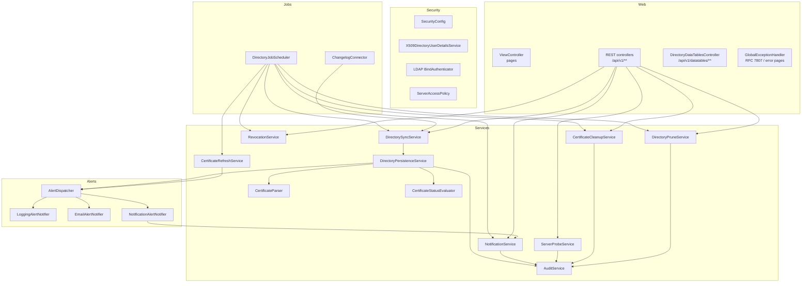
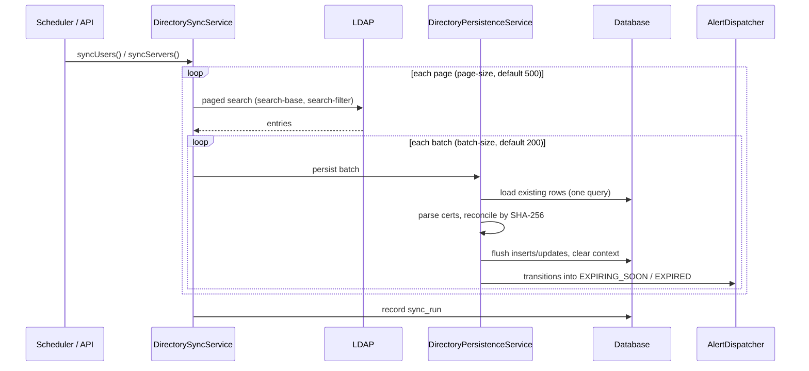
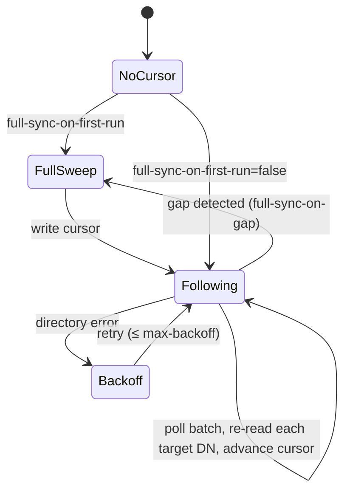
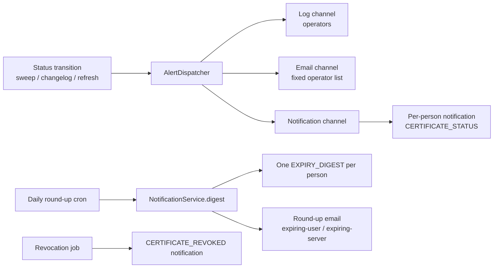
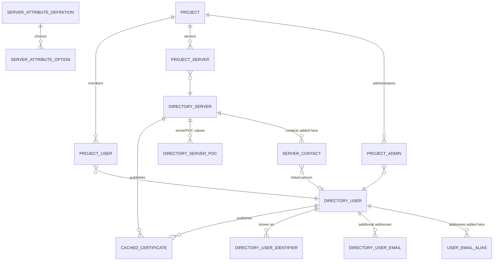

# Architecture

CertAlert is a single Spring Boot application (Java 21) that indexes an LDAP directory's
certificates into a relational database and serves a server-rendered UI and a JSON API over it.

## Source layout

```text
src/main/java/com/winllc/certalert/
├── alert/          AlertNotifier SPI, AlertDispatcher, log / email / notification channels
├── audit/          the ens-audit/1 trail: store, outputs (stdout, file, Splunk, syslog), pull API, audit page
├── cluster/        job locks in the database (ShedLock) and jobs started by hand (job_run)
├── config/         properties classes, clock, DataTables repository factory, email templates
├── demo/           the read-only demo mode
├── domain/         JPA entities and enums
├── ldap/           attribute mapping, paged streaming directory client, changelog client
├── license/        the ENS license check and the license screen's wiring
├── net/            address ranges matched within their own family
├── observability/  ens_* Prometheus metrics, management-port endpoints
├── repository/     Spring Data / DataTables repositories and filter specifications
├── revocation/     CRL store, OCSP/CRL checker, issuer certificates, fetch policy, revocation at sign-in
├── scheduling/     DirectoryJobScheduler (all cron jobs)
├── security/       X.509 (servlet and header mode) and LDAP-bind authentication, consent banner,
│                   session limits, security headers, roles, ServerAccessPolicy
├── service/        parsing, status evaluation, sync, notifications, mail outbox, probe, projects…
├── session/        sessions in the database (Spring Session JDBC), attribute allow-list, expiry sweep
└── web/            page controllers, REST API, DataTables endpoints, error handling
src/main/resources/
├── db/migration/   Flyway migrations V1–V28
├── static/         css, js (table wiring), img (logo, favicons)
├── templates/      Thymeleaf pages, email templates, layout fragments, icon sprite
└── dev-directory.ldif   sample directory used by the developers' tests (not shipped)
```

## Component view



## The sync pipeline

```text
DirectoryJobScheduler  (crons, each guarded against overlap by a database lock)
        |
DirectorySyncService        streams LDAP pages, outside any transaction
        |
DirectoryPersistenceService one transaction per batch of entries
        |-- CertificateParser           DER -> cached detail + SHA-256 identity
        |-- CertificateStatusEvaluator  expiry -> status + severity
        `-- AlertDispatcher --> AlertNotifier beans (log, email, notifications)
```



Design points, all for directories of 100,000+ entries:

| Concern | Handling |
|---|---|
| Directory size limits | Paged searches; an unpaged search silently truncates at the server's limit |
| Memory | Entries are streamed a page at a time and never collected |
| Round trips | Batches: one query to load what is held, one flush |
| Insert batching | Sequence-generated ids (identity columns would defeat JDBC batching) |
| Session growth | Persistence context cleared after every batch |
| Failure isolation | A failed batch is logged and skipped; the run records the error count |

**Reconciliation** matches certificates by the SHA-256 fingerprint of their DER: already-cached
certificates are left alone, ones no longer published are dropped, new ones are parsed and stored.
Re-syncing an unchanged directory writes nothing.

**Alerting fires on transitions, not on discovery.** A certificate seen for the first time is not
an alert, so the first sync of a large directory does not flood anyone. A cached certificate
moving into `EXPIRING_SOON` or `EXPIRED` (noticed by a sweep, the changelog or the hourly refresh)
is.

## Status roll-up

Each entry carries `certificate_count`, `certificate_status`, `earliest_expiry` and
`latest_expiry`, refreshed on every sync, so the tables filter on indexed columns.

- Expired certificates are passed over while the entry still holds one that has not expired.
- **People**: the *worst* of the remaining certificates (both halves of the signing/encryption pair
  must work).
- **Servers**: the *best* remaining certificate (healthiest state, then longest-lived), and both
  expiry dates come from it.
- When all have expired, all count again, so the entry reads `EXPIRED`.

## Credentials

Key usage determines a certificate's **use**: Signing (`digitalSignature`, `nonRepudiation`),
Encryption (`keyEncipherment`, `dataEncipherment`, `keyAgreement`), Signing and encryption (both),
Other (`keyCertSign`, `cRLSign`) or Unspecified (no extension). An entry's *current credentials*
are the newest unexpired certificate of each use. Two certificates form one credential when they
share a subject, one signs and one encrypts, and they were issued within
`cert-alert.credentials.pair-window` (7 days) of each other.

## The changelog connector



| Change type | Action |
|---|---|
| `add`, `modify` | Re-read the entry and upsert it |
| `delete` | Remove from the cache |
| `modrdn` | Remove the old name, read the new one |
| other | Counted and skipped |

A changed DN is applied only if it matches the sweep's **search filter** and lies under the
sweep's **search base** (resolved under `spring.ldap.base`); otherwise it is ignored (and removed
if previously cached). The position lives in `changelog_cursor` and advances one change at a time.

## Notifications vs alert channels



Recipients are resolved from ownership: a person's own certificates go to them; a server's go to
its `serverPOC` values resolved to people (including group addresses), contacts added here, and
administrators of projects containing it. Unclaimed addresses still receive email.

### Adding an alert channel

Implement `AlertNotifier` as a Spring bean; `AlertDispatcher` picks up every implementation and
isolates failures so one broken channel cannot stop the others. Each delivery (or failure) is
audited with the channel name.

```java
@Component
class SlackAlertNotifier implements AlertNotifier {
    @Override
    public void send(CertificateAlert alert) {
        // POST alert.summary() to a webhook
    }
}
```

## Data model



| Table | Purpose |
|---|---|
| `directory_user` | Cached IC Person: names, five addresses, organization, IC attributes, roll-up columns |
| `directory_user_identifier` | Every lower-cased value a `serverPOC` could name a person by (the join key) |
| `directory_user_email` | Addresses from `additional-email-attributes` |
| `directory_server` | Cached IC Non-Person Entity and its roll-up |
| `directory_server_poc` | The directory's `serverPOC` values (replaced by every sweep) |
| `cached_certificate` | Parsed certificate detail: subject, issuer, serial, validity, key and signature algorithms, hash, SANs, SHA-256 fingerprint, key usage, risk flags, revocation status and endpoints. Exactly one owner (check constraint) |
| `server_contact` | Contacts added in CertAlert (person or address); survive sweeps |
| `user_email_alias` | Addresses added to a person (`PERSONAL` or `GROUP`) |
| `project`, `project_user`, `project_server`, `project_admin` | Projects |
| `notification`, `notification_setting` | Notifications (recipient held as a user id and/or address, not a foreign key) and the round-up lead-days override |
| `audit_event` | Audit trail, in the `ens-audit/1` format since `V18`; subject is deliberately **not** a foreign key so records outlive entries |
| `audit_chain_head`, `audit_delivery`, `audit_api_token` | The chain's newest sequence number and hash (locked while an event is added), each audit output's delivery position, and the pull API's tokens |
| `outbound_email` | The email outbox: messages waiting to be sent, and what became of recent ones |
| `server_attribute_definition`, `server_attribute_option` | Editable-attribute definitions (values live only in the directory; the old `server_attribute_value` table was dropped in `V11`) |
| `changelog_cursor` | Changelog position and counters |
| `sync_run` | Job run log |

The schema is created and evolved by Flyway (`V1__create_directory_tables` …
`V20__check_attribute_type_without_an_in_list`); Hibernate only validates it. `V18` moved the
audit trail to the `ens-audit/1` format and added `audit_chain_head`, `audit_delivery` and
`audit_api_token`; `V19` added the email outbox, `outbound_email`; `V20` rewrote the check on
`server_attribute_definition.type` so the embedded H2 database keeps enforcing it.

## Front end

Server-rendered Thymeleaf pages on the Tabler 1.6.1 admin template. Tables are DataTables 3
driven by `POST /api/v1/datatables/*`, mapped to JPA queries by spring-data-jpa-datatables; the
app's own filters ride along as query parameters and become an additional JPA `Specification`.
DataTables 3 makes its requests without jQuery, so the tables send the CSRF header with their own
requests (`static/js/directory-table.js`). All assets (Tabler, Bootstrap, DataTables, jQuery 4, a
sprite of the icons used) are served from the jar via webjars, so the UI works on networks with no
CDN access. No page has an inline script, which the Content-Security-Policy requires. The Metrics
chart is inline SVG.

## Error handling

`GlobalExceptionHandler` turns exceptions into RFC 7807 problem details under `/api` and
`/actuator`, and into `error.html` / `not-found.html` pages elsewhere. Messages are chosen by
status (`server.error.include-message: never`), so stack traces and exception text are never
shown.
