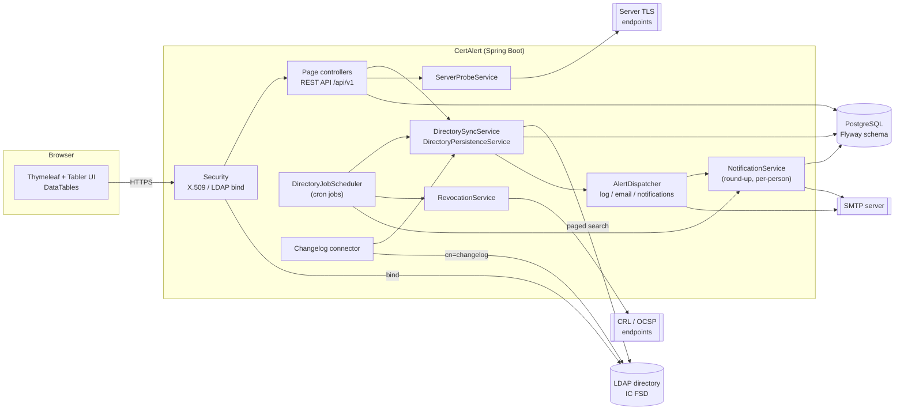

# CertAlert

{ width="220" }

**CertAlert** (artifact and configuration prefix `cert-alert`) scrapes an LDAP directory for the
certificates its entries publish, caches the details that matter in a relational database, and
puts them behind searchable tables. It tells the people responsible for a certificate when it is
about to expire, checks whether issuing authorities have revoked it, and can compare what a
server is actually serving with what the directory says it should be serving.

The directory is the source of truth; CertAlert is the index over it. It reads people and
servers out of the tree, parses every certificate they publish, stores the parsed detail so
nothing has to re-read DER or go back to LDAP to answer a question, and alerts when a cached
certificate crosses into expiry.

!!! info "Directory schema"
    CertAlert is built against the **IC IdAM Full Service Directory, FSD v2021-NOV**. It reads
    two object classes, and every attribute name is configurable:

    | Object class  | OID                     | What it is                                |
    |---------------|-------------------------|-------------------------------------------|
    | `icOrgPerson` | 2.16.840.1.101.2.2.3.73 | An IC Person (derives from inetOrgPerson) |
    | `icOrgServer` | 2.16.840.1.101.2.2.3.74 | An IC Non-Person Entity (a server)        |

## Key features

| Area | What CertAlert does |
|---|---|
| **Directory scrape** | Paged, streamed LDAP sweeps of people and servers, built for 100,000+ entries. Certificates are reconciled by SHA-256 fingerprint, so re-syncing an unchanged directory writes nothing. |
| **Changelog connector** | Optionally follows the directory's `cn=changelog` so a change reaches the cache within seconds rather than at the next nightly sweep. |
| **Search tables** | *People* and *Servers* tables with status roll-ups, expiry filters, point-of-contact search, risky-name and project filters, and expandable rows. |
| **Expiry status** | Every certificate is `VALID`, `EXPIRING_SOON` (within 30 days by default) or `EXPIRED`; an hourly job re-evaluates status as time passes. |
| **Notifications** | Per-person in-app notifications when a certificate crosses into a bad state, plus a daily *expiry round-up* by email to every point of contact. |
| **Alert channels** | Operator-facing channels (application log, email to a fixed list) receive every alert as it happens. |
| **Revocation** | A nightly job checks CRLs (and OCSP where no CRL exists) for the certificates each entry currently holds. |
| **Endpoint probe** | From a server's page, opens a TLS connection and compares the presented certificate with the one the directory publishes. |
| **Credentials** | Understands that a person holds a *pair* (signing + encryption) and flags half-renewed pairs. |
| **Risky names** | Flags wildcards, broad wildcards, certificates with many names or domains, and bare hostnames. |
| **Points of contact** | Contacts from the directory's `serverPOC` plus contacts and addresses added in CertAlert, which a sweep never overwrites. |
| **Projects** | Group people and servers into projects; project administrators manage contacts for the project's servers. |
| **Editable attributes** | Administrators can make selected server-entry attributes editable; edits are written back to the directory. |
| **Certificate clean-up** | An optional, off-by-default job that deletes expired and revoked certificates from the directory. |
| **Audit trail** | Every sign-in, refusal, setting, job run and change to an entry is recorded in the hash-chained `ens-audit/1` trail, searchable and verifiable at `/admin/audit` and sent on to a SIEM. See [Audit logging](../audit-logging.md). |
| **Metrics** | Directory-wide reporting: states, falling-due counts, algorithms, issuance, revocation, organization breakdowns. |
| **Classification banner** | Optional fixed top/bottom banners for accredited networks. |
| **Sign-in** | X.509 client certificate (matched by fingerprint against the directory, optionally checked for revocation at sign-in, or forwarded by a TLS-terminating proxy) or directory password (LDAP bind). |
| **Platform baseline** | The ENS security headers, notice-and-consent banner and session limits; Prometheus metrics on a separate management port, liveness and readiness, JSON logs; a hash-chained `ens-audit/1` audit trail for a SIEM. |

## Architecture at a glance

See [Architecture](architecture.md) for components, data model and the sync pipeline in detail.

## Components

| Component | Role |
|---|---|
| **CertAlert application** | A single Spring Boot application, shipped as the container image `ghcr.io/winllc/cert-alert`, that serves the UI and API and runs every scheduled job. |
| **Database** | PostgreSQL (included in the release package; your own with Helm). Flyway owns the schema. |
| **LDAP directory** | The source of truth. Read with a service account; written to only by the optional certificate clean-up job and by editable server attributes. |
| **SMTP server** *(optional)* | For the daily round-up email and the operator email alert channel. Mail goes through an outbox in the database and is retried while the server is down. |
| **CRL / OCSP endpoints** *(optional)* | Queried by the revocation job. |

## Tech stack

| Concern | Choice |
|---|---|
| Language | Java 21 |
| Framework | Spring Boot 4.1 (web, data-jpa, security, data-ldap, mail, actuator, thymeleaf, validation) |
| Build | Gradle 9.8.1 (Kotlin DSL) with wrapper, checked against its published checksum. Running Gradle needs JDK 17 or later; the project builds for Java 21 |
| Directory | Spring LDAP, paged searches; Spring Security LDAP for password sign-in |
| Persistence | Spring Data JPA + Flyway migrations |
| Database | PostgreSQL |
| Tables | spring-data-jpa-datatables |
| UI | Tabler 1.6.1 + Thymeleaf + DataTables 3 + jQuery 4, all served from webjars (no CDN) |
| Observability | Spring Boot Actuator, Micrometer with Prometheus (management port only), ECS JSON logs |
| Container | Red Hat UBI 9 OpenJDK 21 (build) / OpenJDK 21 runtime |
| Tests | JUnit 5, in-memory UnboundID directory, MockMvc |

## Documentation map

| Page | For | Contents |
|---|---|---|
| [Installation](install.md) | Operators | Prerequisites, the release package, the Helm chart, first start |
| [Configuration](configuration.md) | Operators | Every property and environment variable, profiles, example files |
| [Operator guide](operator-guide.md) | Operators | Day-to-day running, jobs, health, backups, upgrades, scaling |
| [Sizing, availability and recovery](availability-and-sizing.md) | Operators | Sizing, high availability, disaster recovery, rolling back |
| [Admin guide](admin-guide.md) | Application administrators | In-app administration: sync, revocation, attributes, audit log, projects, notifications |
| [User guide](user-guide.md) | Everyone | Walkthrough of every screen |
| [Architecture](architecture.md) | Engineers | Components, data model, sync pipeline, changelog connector |
| [Security](security.md) | Security / operators | Authentication, roles, permissions matrix, hardening |
| [FIPS 140-3 and DISA STIG](fips-and-stig.md) | Security / operators | What CertAlert relies on for FIPS 140-3, the license check in FIPS mode, STIG settings |
| [API reference](api-reference.md) | Integrators | Every REST endpoint |
| [Troubleshooting](troubleshooting.md) | Operators | Symptoms, causes and fixes |
