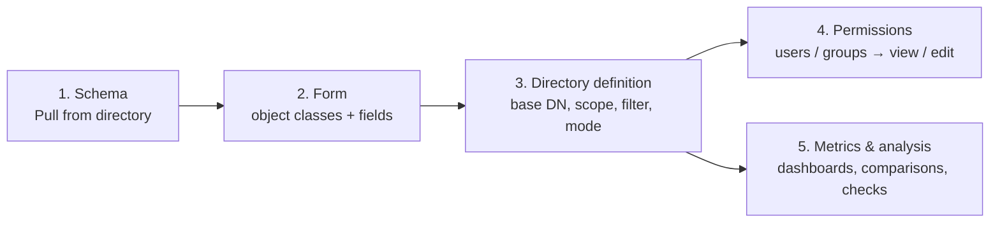
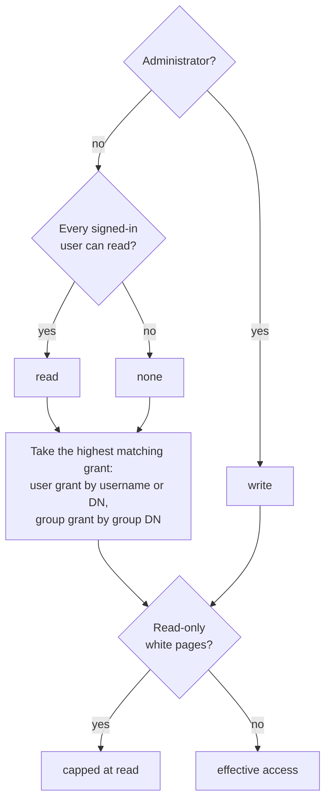

# Administrator guide

Portal administrators set up what end users see. They manage the schema, forms, directory
definitions, permissions, metric dashboards and data analyses, and they review the audit log. Everything in this
guide is stored in the portal's configuration store (`portal-config.json`), not in LDAP. The only
exception is the entry data itself.

## Who is an administrator

A signed-in user is an administrator when:

- their username (the value of `LDAP_USERNAME_ATTRIBUTE`) is listed in `ADMIN_USERS`, or
- they are a member of a group listed in `ADMIN_GROUPS`. Membership comes from `memberOf` on the user entry plus the
  `LDAP_GROUP_FILTER` search.

See [Configuration → Users, groups and administrators](configuration.md#users-groups-and-administrators).
Administrators see an **Admin** section in the sidebar with **Directory definitions**, **Forms**,
**Schema**, **Permissions**, **Data analysis** and **Audit log**. Every `/api/admin/**` call
requires the administrator role.

!!! info "Administrators and data access"
    Administrators have full read/write access to every **read/write** definition. They still
    cannot write through a **read-only (white pages)** definition. Every directory operation runs
    as the portal's LDAP service account, so the service account's own ACLs still apply.

## Getting started

1. **Schema**: pull the server schema so that forms can suggest attributes and catch mistakes.
2. **Forms**: describe how one object type is displayed and edited.
3. **Directory definitions**: publish a form over a namespace of the directory.
4. **Permissions**: decide who can view or edit each definition.
5. Optionally, build **dashboards** and **analyses**.

!!! tip "Seeded example"
    With `SEED_DEMO_CONFIG=true` (the default in memory mode), an empty store is seeded with four
    forms (*Employee*, *Managed device*, *Group*, *Partner contact*), five definitions (*Staff
    Directory*, *White Pages*, *Devices*, *Groups*, *Partners*), example grants, two dashboards
    and two analyses. They are a good template for your own setup.

## Schema

*Admin → Schema*

| Action | What it does |
|---|---|
| **Pull from directory** | Reads the schema from the root DSE's `subschemaSubentry` (RFC 4512), including non-standard object classes and attribute types. The result is cached in the config store |
| **Import** | Paste OpenLDAP `.schema` files, `cn=config` LDIF (`olcAttributeTypes` / `olcObjectClasses`) or raw schema descriptions. Definitions that can't be parsed are reported. Imports are limited to about 2 MB of text, and the bundled nginx accepts 5 MB request bodies |
| **Customize / create** | Edit any attribute type or object class, or create a new one. Custom definitions override server elements with the same OID or name. For example, add a **Display name (portal only)**, or describe a schema the server doesn't publish |
| **Export custom** | Download the custom definitions as a `.schema` file to load into the server |
| **Create form** | One-click form for the selected object class |

The browser filters by name, OID and description and by source (**All sources**, **Server**,
**Custom**). It shows the kind (structural / auxiliary / abstract), inheritance (SUP), MUST/MAY
attributes, syntax, equality rule, single/multi-value, and which classes use an attribute.

Attribute type fields: **OID** (use your private enterprise arc, for example
`1.3.6.1.4.1.99999.1.10`), **Names** (the first is primary, the others are aliases), **Description**,
**Display name (portal only)**, **Superior attribute (SUP)**, **Syntax**, **Equality matching rule**,
**Single value**, **No user modification**.

Object class fields: **OID**, **Names**, **Kind**, **Superior classes (SUP)**, **Required attributes
(MUST)**, **Optional attributes (MAY)**.

!!! note
    The portal never writes schema to the LDAP server. **Export custom** gives you the file; load it
    into the server with your directory's own tools.

## Forms

*Admin → Forms*

A form describes how entries of one object type are displayed and edited. A form can't be deleted
while a directory definition uses it ("Form is used by: ...").

### Object type

| Setting | Description |
|---|---|
| **Form name**, **Description** | Shown to administrators and in "New ..." buttons |
| **Object classes** | Written to new entries. Include the structural class and any auxiliary classes; custom schemas are welcome |
| **Naming attribute (RDN)** | Names new entries (for example `uid=jdoe,ou=people,...`). Must be one of the form's fields |

**Add attributes from the schema** suggests the classes' MUST/MAY attributes.

### Fields

| Setting | Description |
|---|---|
| **LDAP attribute** | Attribute name (each attribute can appear in only one field) |
| **Label**, **Help text**, **Placeholder** | Display text |
| **Section** | Fields with the same section are grouped |
| **Input type** | Free text, text area or drop down |
| **Multiple values** | Single- or multi-valued |
| **Required** | Must have a value |
| **Read only** | Shown, never written |
| **Self-service** | Users may edit this field on their own entry through **My profile** |
| **Format** | Any text, e-mail address, phone number, URL, number or distinguished name |
| **Pattern (regular expression)** | The whole value must match |
| **Max length** | 1–65536 characters |

Use the arrows to reorder fields, and the buttons to duplicate or remove them. A live **Preview**
shows the create form. Directory-backed drop-downs load their options only when the form is used in a
directory.

### Drop-down options

=== "Fixed list"

    One option per line, each with a stored value and an optional label. **Allow values not in the
    list** accepts free entries as well.

=== "Directory search"

    | Setting | Description | Default |
    |---|---|---|
    | Base DN, scope (`one` / `sub`), filter | Where options come from | — |
    | Value attribute | What is stored. `dn` stores the entry DN (for example a manager) | — |
    | Label attribute | What is shown | — |
    | Mode | **Load all options** (small sets) or **Search as you type** (people, devices, other large sets) | Load all |
    | Match typed text against | Up to 10 attributes. Each typed word must match one of them, as *contains*, *starts with* or *exact* | label (and value) attribute; contains |
    | Minimum characters | Before searching (search mode) | 2 in search mode, 0 otherwise |
    | Most options shown | 1–2000 | 25 in search mode, 500 otherwise |
    | Sort by, second line | Sort attribute, and a description line under each option (for example `title` or `mail`) | — |
    | Label template | For example `{cn} ({uid})`; overrides the label attribute | — |
    | Cache | How long loaded lists are reused, 0–3600 seconds | 30 |

    **Test search** runs the settings while you edit and shows the matches, the timing and the
    exact LDAP filter. Submitted values are always checked against the directory, including values
    beyond the display limit.

### Schema checks

The editor checks the form against the schema. **Errors** block saving; **warnings** are shown and
returned with the save.

| Errors (block saving) | Warnings |
|---|---|
| Missing form name, object classes, fields or naming attribute | Attribute not defined in the schema |
| Naming attribute not one of the fields | Unknown object class(es) |
| Same attribute used by more than one field | No STRUCTURAL object class (the directory will reject new entries) |
| Drop down without an option source or options | Attribute required by the object classes but not in the form |
| Invalid regular expression | Attribute not allowed by the selected object classes |
| Multi-valued field on a `SINGLE-VALUE` attribute | `NO-USER-MODIFICATION` attribute not marked read-only |
| Directory search without a search base, or invalid label template | Exact matching, or a large "load all" list (consider *Search as you type*) |

## Directory definitions

*Admin → Directory definitions*

A definition exposes one form within a namespace of the directory. All reads and writes through
the definition are confined to entries **below the base DN that match the filter**. The server
compares parsed DNs (RFC 4514), so string tricks cannot escape the namespace.

| Section | Setting | Description |
|---|---|---|
| General | **Name**, **URL slug**, **Description**, **Icon** | The slug is used in `/d/<slug>`: lower-case letters, digits and dashes, and unique across definitions |
| | **Form (object type)** | The form to use |
| Namespace | **Base DN** | With a DN browser. Example: `ou=people,dc=example,dc=com` |
| | **Scope** | *One level (direct children)* or *Subtree (all descendants)* |
| | **Filter** | Optional LDAP filter, for example `(objectClass=inetOrgPerson)` |
| | **Test namespace** | Previews the entries that match |
| Access mode | **Read / write directory** | Users with write permission can create, edit and delete entries |
| | **Read-only white pages** | Nobody can write through this definition, not even administrators |
| | **Every signed-in user can read** | Grants view access to all signed-in users |
| Display | **List columns** | In display order (1–20). The first column links to the entry |
| | **Quick search attributes** | Substring-matched by the search box (up to 20) |
| | **Title attribute** | Entry title, and the default sort |
| | **Containers for new entries** | Parent DNs where users can create entries (must be within the base DN) |
| Find the signed-in user | **Self match** | How **My profile** finds the user's own entries: *none*, *entry DN equals the user's DN*, or *entry attribute equals the user's attribute* (for example `member` = user `dn`, `acmeAssignedTo` = user `dn`, `uid` = user `uid`) |

Deleting a definition also removes all its permission grants. The audit log records how many grants
were removed.

!!! example "Demo definitions"
    | Name | Base DN | Scope | Mode | Everyone reads | Self match |
    |---|---|---|---|---|---|
    | Staff Directory | `ou=people,dc=example,dc=com` | one | read/write | no | entry DN |
    | White Pages | `dc=example,dc=com` | sub | read-only | yes | entry DN |
    | Devices | `ou=devices,dc=example,dc=com` | one | read/write | no | `acmeAssignedTo` = user DN |
    | Groups | `ou=groups,dc=example,dc=com` | one | read/write | yes | `member` = user DN |
    | Partners | `ou=partners,dc=example,dc=com` | sub | read/write | no | entry DN |

## Permissions

*Admin → Permissions*

Grant **Can view** (`read`) or **Can view and edit** (`write`) on a definition to a **user** or a
**group**. Find subjects by searching the directory. The users and groups found come from
`LDAP_USER_SEARCH_BASE` / `LDAP_GROUP_SEARCH_BASE`. An overview matrix shows all grants.

A user's effective access to a definition is calculated like this:

- Users are matched by username (case-insensitive) or DN. Groups are matched by DN, using the
  groups resolved at sign-in and read again every `GROUP_REFRESH_INTERVAL` (5 minutes by default).
  Group membership changes therefore take effect within that interval, while grant changes take
  effect immediately.
- A grant for the same definition and subject replaces the previous access level.
- Read-only definitions accept only view grants.
- **Self-service**: users can always see definitions that can locate them (self match) on
  **My profile**, and edit their own entry's **Self-service** fields there, even without a grant.

### What the license changes

Two license features decide whether these grants can be used at all:

| Feature | Without it |
|---|---|
| `directory-editor` | Nobody, administrators included, can browse, search or edit directories: `/api/definitions` and `/api/directories/**` answer 403 `feature_not_licensed`, and the **Directories** menu is hidden. **My profile** still works with `self-service-profile` |
| `white-pages` | Read access for users who are not administrators is removed: "Every signed-in user can read" definitions, **Can view** grants and read-only white pages definitions. Such users keep only the definitions they hold **Can view and edit** on. Administrators keep everything |

`white-pages` only widens access inside the directory editor, so it needs `directory-editor` as
well: a license with `white-pages` but without `directory-editor` gives nobody a directory to
browse.

## Metrics dashboards

*Metrics → Dashboards* (creating and editing requires an administrator)

Out of the box, every directory has an **overview** generated from its form: entry count, new
entries per month (`createTimestamp`), a breakdown for every drop-down field and e-mail domain,
containers (for subtree directories), values per entry for multi-valued links, and field
completeness. Administrators can combine charts from any directories into **dashboards**:

- **Name**, **Description** and **Share with all signed-in users** (otherwise the dashboard is listed only for
  administrators, as *Admins only*).
- Up to 48 charts per dashboard. Each chart has a width (a third, half, two-thirds or full) and can
  be edited, duplicated, moved earlier or later, and removed.
- Charts are also added from the **Explorer** (**Add to dashboard**, to an existing or new dashboard).
- A viewer sees charts from directories they can't read as locked.

Chart settings:

| Setting | Values |
|---|---|
| Measure | **Count**, **Breakdown** (distribution), **Completeness**, **Over time** (timeline), **Numbers** (numeric) |
| Chart | number (stat), bars, columns, stacked bars, donut, line, area, table, depending on the measure |
| Attribute(s), split by | Attributes to measure; breakdowns can be split by a second attribute |
| Grouping (transform) | none, lower/upper case, e-mail domain, name in a DN (RDN value), parent container, first N characters, regex first group, date year/quarter/month/week/day |
| Top N, include "(none)", sort by count or label | Breakdown options (top 1–100, the rest as "Other") |
| Bucket, running total | Timeline: day/week/month/quarter/year, optionally cumulative |
| Measure values / values per entry, bins | Numbers: statistics plus a histogram with 2–50 bins |
| Extra filter | LDAP filter that narrows the chart |

!!! note "What can be charted"
    Administrators may chart any attribute of a directory's object classes. Other users are limited
    to the attributes the directory shows them (form fields, list columns and the title attribute) and
    to entry timestamps. The same rule applies to extra filters. Password attributes can never be
    charted or filtered on. User-supplied regular expressions run with a time budget.

Creating, changing and deleting dashboards is recorded in the audit log.

## Data analysis

*Admin → Data analysis*

Saved analyses run on demand against live data, always as [background tasks](user-guide.md#background-tasks).
The list shows each analysis's sources and last run.

=== "Comparison"

    Compares **2–6 sources**. A source is a directory definition, optionally narrowed by a filter
    and given a label. Entries are matched by a **key attribute** per source (for example `uid`,
    `mail` or `employeeNumber`). A run reports:

    - keys missing from some sources
    - keys used by more than one entry in a source
    - compared attributes whose values differ, for keys present everywhere

    **Compared attributes** (up to 50) can use one attribute name for all sources or a different
    name per source. Options, all on by default: **Ignore case**, **Ignore extra spaces**,
    **Ignore the order of multiple values**, **Match keys regardless of case**. DN values always
    compare in normalized form. With no attributes, the run checks only whether each key exists in
    every source.

=== "Quality check"

    Checks **1–6 sources** against up to 100 rules. Each rule applies to one attribute and has a
    severity of **Error** or **Warning**:

    | Rule | Finds |
    |---|---|
    | Is present (`required`) / has a single value (`singleValue`) | Missing or multiple values |
    | Is unique (`unique`) | Values used by another entry, **within each source** or **across all sources**, optionally ignoring case |
    | Matches a pattern (`pattern`) | Values that don't match a regular expression (whole value), for example `B-\d{4}` |
    | Has a valid format (`format`) | Not a valid e-mail, phone, URL, number, integer, date or DN |
    | Is one of a list (`allowedValues`) | Values outside a comma-separated list |
    | Has a length between (`length`) | Values that are too short or too long |
    | Refers to existing entries (`dnExists`) | DN values (`manager`, `member`, ...) that point at entries that don't exist |

    **Check every form field's rules** adds the rules already configured on each directory's form
    (required, single value, format, pattern, maximum length and drop-down options). This checks the
    data against what the portal would accept today.

Running and results:

- **Run** returns at once. The page shows progress ("Reading Devices", entries read, and
  how far along the run is when the source has been read before). You can leave the page or cancel the run.
- The latest result of each saved analysis is kept on disk (`DATA_DIR/analysis-results/`) and
  reopens later. It is marked out of date when the analysis settings change afterwards.
- Running with unsaved changes keeps the saved result and shows the draft's result separately
  (*Results of an unsaved analysis*).
- Counts cover every entry read. The list of individual findings is capped at
  `ANALYSIS_MAX_ISSUES` (default 50,000). The server pages, filters (by rule, severity, source and
  status) and searches the findings.
- **CSV download** includes every finding that matches the current filters, not just the page shown.
  Each export is recorded in the audit log (`analysis.export`).
- Each finding links to the entry.

Each source reads at most `METRICS_MAX_ENTRIES` entries.

## Audit log

*Admin → Audit log*

Every write goes to the directory as the service account, so the directory's own logs can't say
who made a change. The portal records it instead, in the `ens-audit/1` format shared by every ENS
application. The format, the outputs to Splunk and syslog, and integrity checking are described in
[Audit logging](../audit-logging.md).

| Recorded | Activity names | Includes |
|---|---|---|
| Entries created, updated, renamed, deleted (through a directory or **My profile**) | `entry.create`, `entry.update`, `entry.self_update`, `entry.delete` | Each changed attribute's values before and after. A delete keeps everything the entry held; a rename records `previousDn` |
| Sign-ins and sign-outs (password or certificate) | `auth.login`, `auth.logout`, `auth.lockout` | For failures: the name tried, or the certificate subject, serial and issuer, and the reason. A certificate header that did not come from the portal's proxy is recorded with `reasonCode` `untrusted_certificate_header` and the connecting `peerAddress`. A revoked certificate, or one whose status is unknown, is recorded with `certificate_revoked` or `revocation_unknown`. A sign-in before the consent banner was acknowledged is recorded with `consent_required` |
| Sessions ending | `auth.session-expired` | The reason: `idle`, `absolute`, `concurrent` or `account-removed` |
| The consent banner | `auth.consent-acknowledged` | The client address |
| Password changes | `auth.password-changed`, `auth.password-reset` | A password attribute changed by the user themselves (`changed`), or by someone else through a directory (`reset`). The value is never recorded |
| Refused requests | `access.denied` | Method, path and reason (role, license, feature, CSRF header, the portal's own permission checks). Identical denials within 60 seconds are folded into one event with a count |
| Configuration changes | `grant.save`, `grant.revoke`, `definition.*`, `form.*`, `schema.import`, `schema.attribute_type.save/delete`, `schema.object_class.save/delete`, `dashboard.*`, `analysis.*` | The settings that changed, before and after |
| The license | `license.installed`, `license.rejected`, `license.mode-changed` | The reason for a rejection; the old and new mode |
| Exports | `analysis.export`, `data.exported`, `audit.exported` | Which analysis, run or filter |
| The audit trail itself and the system | `audit.*`, `system.started`, `system.stopped`, `job.*` | See [Audit logging](../audit-logging.md#what-is-recorded) |

Every event records who did it (with their DN and sign-in method), the client address, an outcome
(**Success**, **Denied** or **Failed**) and a severity. Requests that fail validation and saves that
change nothing are not recorded. Password attributes, tokens, keys and license text are recorded
as `[redacted]`.

The page searches all retained history, newest first, by time range, category, activity, outcome,
severity, person, target, source address and free text. It shows 50 events per page. An entry's
**History** button opens the log filtered to that entry, including events from before a rename. A
search reads at most `ENS_AUDIT_QUERY_MAX_SCAN` events (2,000,000 by default) and says when it
stopped there. From the page you can also:

- **Export** the current filter (up to 100,000 events) as CSV or NDJSON;
- **Verify integrity** of the hash chain;
- see each output's **Delivery** status;
- create and revoke **API tokens** for a SIEM to pull events.

The page works whatever the license says. How long events are kept is an operator setting,
`ENS_AUDIT_RETENTION_DAYS` (default: keep everything); see the
[Operator guide](operator-guide.md#data-and-backups).

## Site-wide settings

Some settings are environment variables rather than admin-UI settings, so an operator changes them:

- login page text: `LOGIN_HINT`
- classification banner: `BANNER_TEXT`, `BANNER_FOREGROUND`, `BANNER_BACKGROUND`
- the DoD notice-and-consent banner: `ENS_CONSENT_BANNER_ENABLED` and its text
- session timeouts and limits: `ENS_SESSION_*`
- certificate-only sign-in: `PASSWORD_LOGIN_ENABLED=false`
- administrators: `ADMIN_USERS`, `ADMIN_GROUPS`

See [Configuration](configuration.md).
