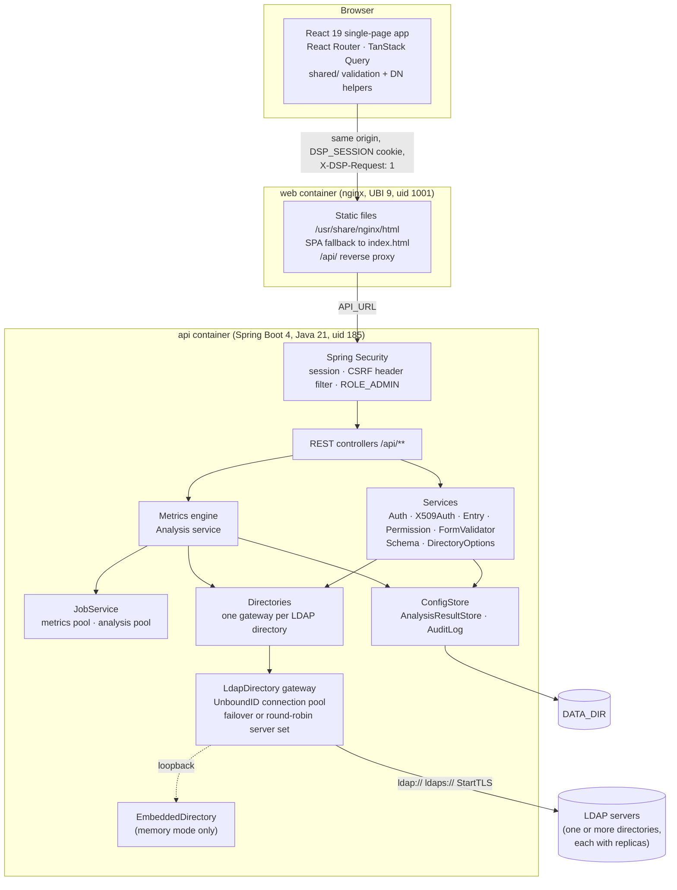
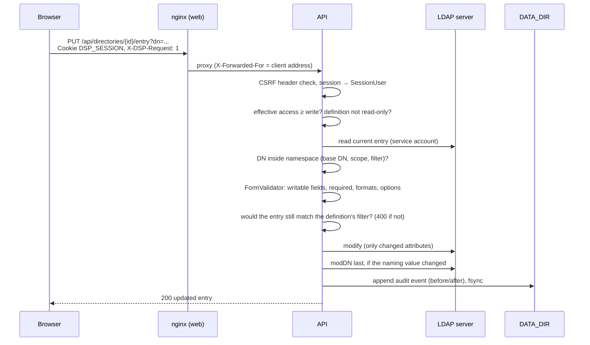
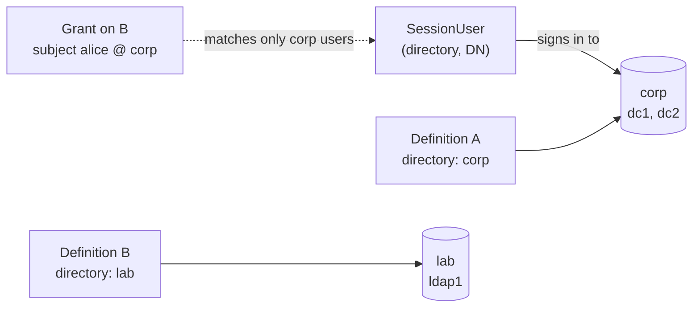
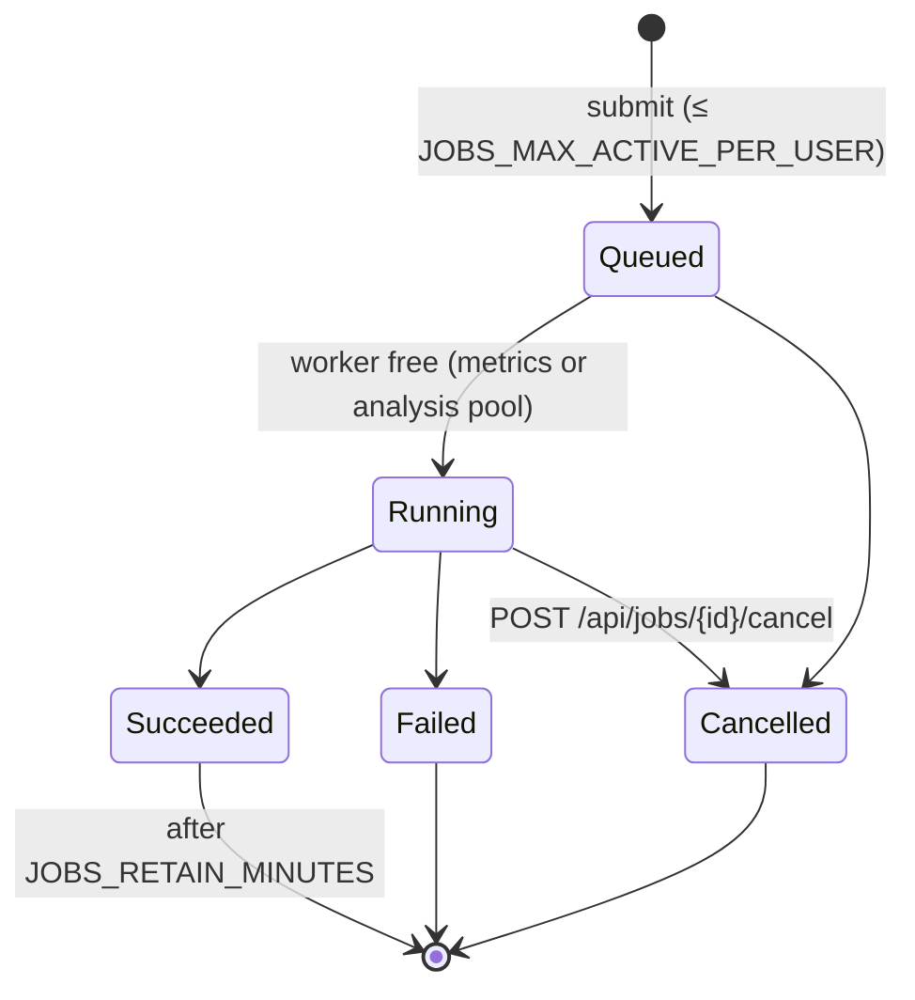

# Architecture

## Components

| Component | Responsibility | Source |
|---|---|---|
| Web client | Pages for directories, entries, profile, metrics and admin. Client-side validation mirrors the server | `web/src`, `shared/src` |
| nginx | Serves the build, falls back to `index.html` for client routes, proxies `/api/`, and sets `X-Forwarded-*`, `X-DSP-Proxy-Secret` and (mTLS) `X-SSL-Client-Cert` | `web/nginx` |
| Security | Session-based authentication, custom CSRF header filter, admin role on `/api/admin/**`, JSON 401/403 errors | `config/SecurityConfig`, `config/RequestHeaderCsrfFilter` |
| Auth | Finds the user with the service account, verifies the password with an LDAP bind, resolves groups and admin status, throttles failures | `service/AuthService` |
| X.509 auth | Extracts the certificate (servlet, or a header from the authenticated proxy), validates it, and maps it to one user | `x509/*` |
| Entries | List, search, sort, page, CRUD, rename (made last, after an update's other changes), namespace enforcement for reads and, from v0.0.9, for what a write would leave behind, self-service | `service/EntryService`, `service/FormValidator` |
| Group access | Looking groups up, requests and decisions, owners managing members and owners, open groups, membership end dates, and the two scheduled jobs that close expired requests and remove members after their end date (v0.0.11) | `groups/GroupService`, `groups/AccessRequests`, `groups/MembershipExpiries`, `groups/GroupAccessJobs` |
| Permissions | Effective access per definition | `service/PermissionService` |
| Schema | Pull `subschemaSubentry`, parse imports, merge custom definitions, lint forms | `schema/*`, `ldap/SchemaMapper` |
| Metrics | Widget evaluation, paged scans shared between charts that read the same directory, transforms, caching, overviews | `metrics/*`, `service/DataSources` |
| Analysis | Comparisons and quality checks, findings paging, stored latest results | `analysis/*` |
| Jobs | Background execution, progress, cancellation, deduplication, retention; with the shared database a heartbeat per unfinished job, so that the jobs of an instance that stopped are failed (v0.0.9) | `jobs/*` |
| Config store | Single JSON document with atomic writes; with a shared database, a versioned document in `dsp_document` | `store/ConfigStore`, `store/DemoConfigSeeder` |
| Audit | The `ens-audit/1` store (hash-chained monthly JSON Lines files with a single synchronized writer, or `dsp_audit_event` with a shared database), the `ens.audit` logger, delivery to Splunk HEC and syslog, retention, and searches over the files | `audit/*` |
| LDAP gateway | Pooled service-account connections (UnboundID SDK), TLS options, timeouts. Server certificates are checked with the JVM's default trust manager, which honours `javax.net.ssl.trustStore` (v0.0.10). A failed attempt to connect is remembered for 5 seconds, during which calls fail at once (v0.0.9). Ranged attribute values (Active Directory's `member;range=`) are read to the end (v0.0.9). v0.0.6: several servers per directory (`FailoverServerSet` in order, or `RoundRobinServerSet`), and the server in use | `ldap/LdapDirectory` |
| Directories (v0.0.6) | The configured LDAP directories (`PORTAL_DIRECTORIES_*`, or one, `default`, from `LDAP_*`), each with its settings and gateway; which the license enables (`multi-directory`; the first always); the directory of a definition or a user. Startup validation | `ldap/Directories`, `config/DirectoryConfig`, `config/DirectoryProperties` |
| Shared database | Only with `DSP_DATABASE_URL`: the connection pool (Flyway migrations), Spring Session JDBC with an allow-list for session attributes, cluster locks (ShedLock on `dsp_shedlock`), the versioned shared documents, and the election of the one instance that runs the audit forwarders | `cluster/*`, `audit/JdbcAuditStore` |
| Embedded directory | UnboundID in-memory server on a loopback port with demo schema and data | `ldap/EmbeddedDirectory`, `resources/demo/*` |

## Request flow: editing an entry

If the directory refuses the rename after the other changes were made (v0.0.9), the audit event
records what was done (success, with `details.partial`), the `entry.changed` webhook is sent for
it, and the answer carries `"code": "partially_saved"` and the entry's current DN.

## Several directories (v0.0.6)

- Every **definition** names one directory; every operation through it (entries, search,
  drop-downs, import and export, metrics, analyses, webhooks, the integration API) uses that
  directory's gateway, and its server schema (cached per directory, merged with the shared custom
  schema).
- A **user** is (directory, DN). Grants name their subject's directory, so a grant matches only
  users and groups of that directory. Administrators come from each directory's own lists. Jobs,
  the session limit and throttles key on the qualified user.
- **Configuration** version 2 stores `directory` on definitions and grants; version 1 is upgraded
  at the first start (everything to `default`, which also stands for the first directory).
- **Licensing**: without `multi-directory` only the first directory is enabled. Its users sign in,
  and the others' definitions answer `feature_not_licensed`.

## Sign-in

1. `POST /api/auth/login` with username and password (v0.0.6: and, with several directories,
   the `directory` chosen on the login page; none means the first).
2. The API checks that the consent banner, if enabled, has been acknowledged, then the throttle
   (`LOGIN_MAX_FAILURES` per client address and username in `LOGIN_LOCKOUT_WINDOW`) and the
   username's characters.
3. The API searches `LDAP_USER_SEARCH_BASE` with `LDAP_USER_FILTER` as the service account. Exactly
   one entry must match.
4. The API binds as that DN with the password (empty passwords are rejected beforehand).
5. The API reads `cn`, `displayName`, `mail`, the username attribute and `memberOf`, and runs
   `LDAP_GROUP_FILTER` under `LDAP_GROUP_SEARCH_BASE`.
6. The API sets the admin flag from `ADMIN_USERS` / `ADMIN_GROUPS` (with several directories, the
   chosen directory's lists).
7. The API rotates the session ID and stores the `SessionUser` in the HTTP session.

Certificate sign-in (`POST /api/auth/x509`, or automatically through `GET /api/auth/me`) replaces
steps 1–4 with certificate validation and mapping. See [Security](security.md#x509-client-certificates).
Single sign-on replaces them with the identity provider's answer, mapped to exactly one entry by
`SSO_*_USER_FILTER`; see [Single sign-on](single-sign-on.md). With several directories, certificate
sign-in and single sign-on search every enabled directory that takes them (`X509`, `SSO`) in
configured order: the first directory with a match wins (and must hold exactly one), and later
directories that also match are logged and recorded in `details.alsoMatched`.

A call to the integration API (`/api/v1`) does not sign in: the API token is checked on every call,
and the call runs as the token's creator, with their rights read again from the directory. See
[API reference → API tokens](api-reference.md#api-tokens).

## Persistence

| Data | Store | With a shared database (`DSP_DATABASE_URL`) | Lifetime |
|---|---|---|---|
| Directory entries | LDAP server | LDAP server | Permanent (the embedded demo server is in memory only) |
| Forms, definitions, grants, custom schema, schema cache (per directory), dashboards, analyses | `DATA_DIR/portal-config.json` | `dsp_document`, a versioned document | Permanent |
| Latest analysis results | `DATA_DIR/analysis-results/<id>.json` | `dsp_document` | Until the next run |
| Audit events | `AUDIT_DIR` or `DATA_DIR/audit/audit-YYYY-MM.jsonl` | `dsp_audit_event`, the same hash chain | Append-only; kept until `ENS_AUDIT_RETENTION_DAYS` removes them (default: never) |
| How far audit retention has deleted (v0.0.9) | `audit-pruned`, next to the monthly files | The `dsp_document` row `audit/pruned`, written in the transaction that deletes | Permanent; verification anchors on it |
| License and installation id, and from v0.0.9 the latest time seen | `ENS_LICENSE_STATE_DIR` (the license volume; the time in `latest-time-seen`) | `ens_license_*` (the time in a column Flyway V12 adds) | Permanent |
| Sessions | API memory | `spring_session` (Spring Session JDBC) | `ENS_SESSION_IDLE_TIMEOUT` idle, `ENS_SESSION_ABSOLUTE_TIMEOUT` at most, or (without a shared database) until restart |
| Login throttle | API memory | `dsp_login_failure` | `LOGIN_LOCKOUT_WINDOW` (15 minutes) |
| Background tasks and results | API memory | Progress and results in `dsp_job`; the task runs on the instance that started it, and is marked failed about 30 seconds after that instance stops (v0.0.9) | `JOBS_RETAIN_MINUTES`, or until restart |
| Metric cache | API memory | Each instance's memory | `METRICS_CACHE_SECONDS` |
| Results of the metrics home page, overviews and dashboards (v0.0.11) | The browser's memory | The browser's memory | Until the user clicks **Refresh** or reloads the page |
| Group access requests | `DATA_DIR/group-access-requests.json` | A shared document in `dsp_document` | Open requests until decided, withdrawn or expired; closed ones a year (at most 5,000) |
| Group membership end dates (v0.0.11) | `DATA_DIR/group-membership-expiries.json` | `dsp_group_membership_expiry` (Flyway V13; the file is imported once) | Until the member is removed, or the date is |
| Directory-search drop-down cache | API memory | Each instance's memory | per field, 30 s by default |
| API tokens (SHA-256 hashes) | `DATA_DIR/api-tokens.json` | The shared database | Until revoked or expired |
| Webhooks (with signing secrets, encrypted with `DSP_SECRETS_KEY` from v0.0.4) and the delivery outbox and log | `DATA_DIR/webhooks.json`, `webhook-deliveries.json` | `dsp_document` and `dsp_webhook_delivery` | `WEBHOOK_LOG_RETENTION` for finished deliveries |
| Single sign-on requests in flight | API memory | `dsp_sso_request` | Ten minutes |
| Per-address limits: failed API tokens, single sign-on starts (v0.0.4) | API memory | `dsp_rate_limit` (Flyway V4); a replica counts in its own memory while the database fails | A minute |

Without a shared database, sessions, tasks and caches live in memory, and the configuration and
audit stores have a single writer, so run **one** API instance. With one, the API creates its
tables itself (Flyway) and several instances can run. See
[High availability](availability-and-sizing.md#high-availability).

## Background jobs

- Metric requests wait up to `METRICS_WAIT_MILLIS`. A quick result returns `200`; otherwise the
  API returns `202 {"pending": true, "job": {...}}` and the client follows the job.
- Analyses always return `202` with a job.
- Identical requests (same dashboard version, overview or analysis) join the running job instead of
  starting a new one. A recent result is reused for 15 minutes, or for `METRICS_CACHE_SECONDS` if
  that is longer.
- Jobs belong to the user who started them. Other users get `404` for them.
- With the shared database, an instance touches the rows of its unfinished jobs every 2 seconds.
  Unfinished jobs not touched for 30 seconds belong to an instance that stopped: any instance marks
  them failed, and they no longer count as active (v0.0.9). An instance shutting down fails its own
  unfinished jobs first.

## Code layout

This section and the next describe the source code, for engineers reviewing the product. You do
not need the source to install or run the portal: install it from a release, as described in
[Installation](install.md).

| Path | Contents |
|---|---|
| `backend/` | Spring Boot service, package `com.winllc.dsp`: `ldap/`, `schema/`, `service/`, `web/` (controllers, DTOs, validation), `store/`, `x509/`, `sso/` (single sign-on), `groups/` (group access), `integration/` (the `/api/v1` API and its tokens), `webhooks/`, `transfer/` (import and export), `metrics/`, `analysis/`, `jobs/`, `audit/`, `cluster/`, `license/`, `config/` |
| `backend/src/main/resources` | `application.yml`, `application-mtls.yml`, `demo/` (ACME schema LDIF, demo data, demo `portal-config.json`) |
| `shared/` | TypeScript types, DN utilities, validation and schema helpers used by the client |
| `web/` | React client: `src/pages` (user, metrics, admin), `src/components` (including SVG charts), `nginx/` |
| `deploy/openldap/` | Demo OpenLDAP image (`slapd.conf` template, ACME schema, LDIF) |
| `deploy/package/` | Templates for the docker and native deployment packages |
| `scripts/` | Release packaging, and `generate-dev-certs.sh` (also shipped in the Docker package) |

## Testing

Each release is tested before it is published. In the source tree, `npm test` runs the backend JUnit + MockMvc tests against the embedded LDAP server, then the web
Vitest tests. The backend tests cover sign-in and throttling, CSRF, permission enforcement
(including white pages and namespace confinement), CRUD and renames, form validation,
directory-search drop-downs, schema pull/import/export, the audit log, metrics, jobs, analyses,
banners, X.509 parsing, validation and mapping, group access (requests, expiry, end dates, owners)
and, from v0.0.10, LDAPS directories trusted through a trust store given to the JVM.
