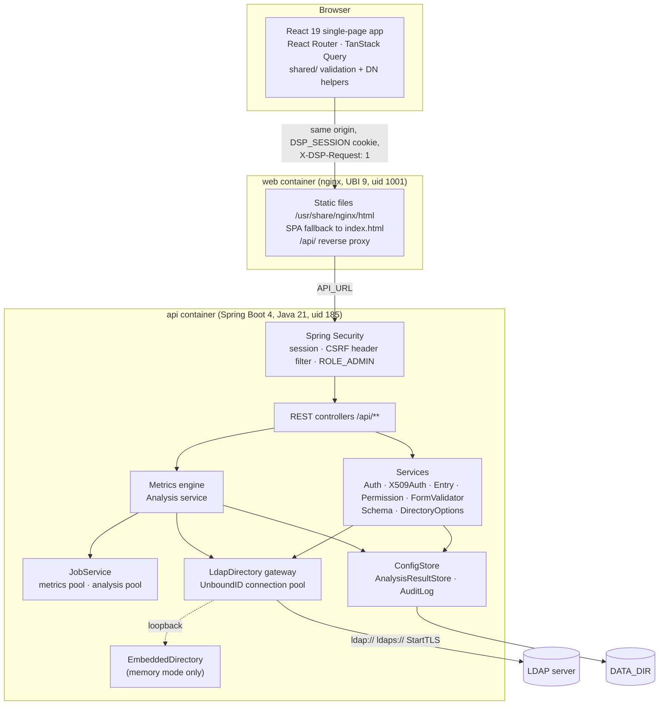
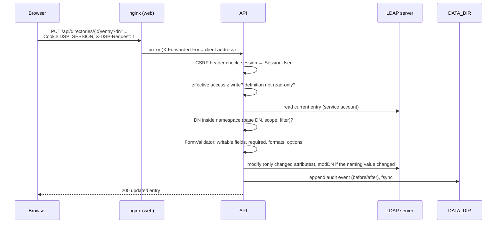
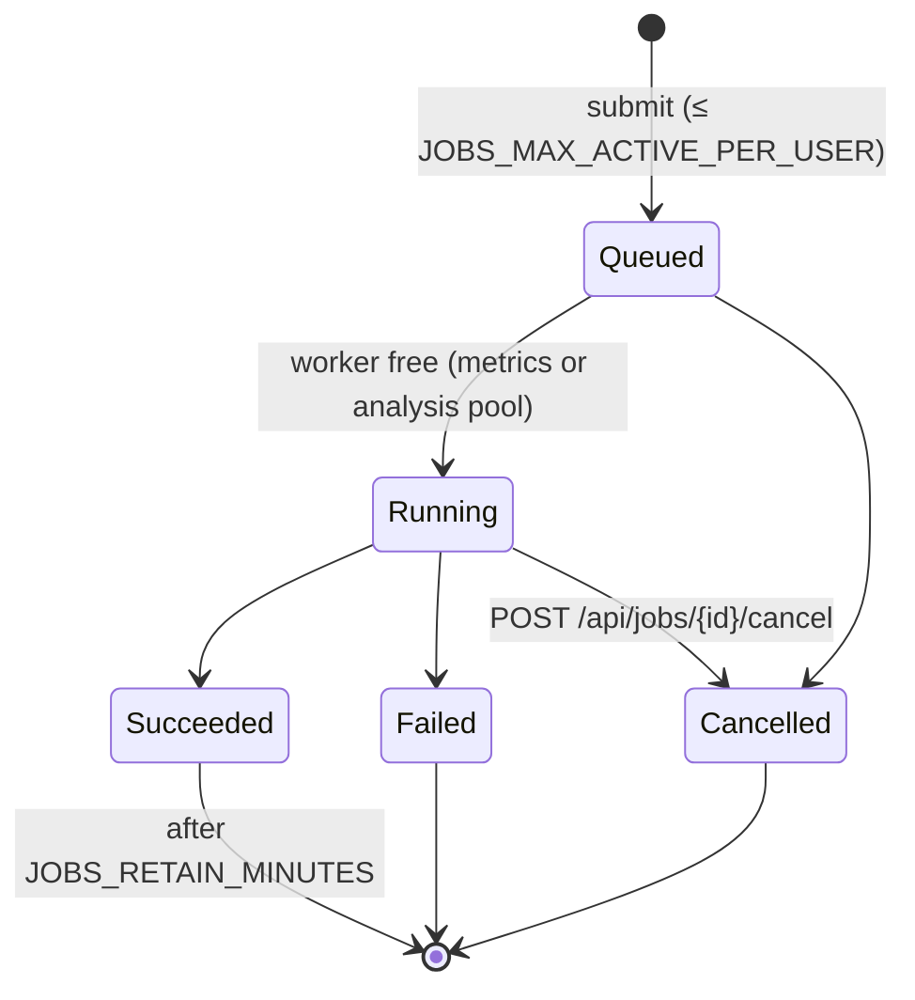

# Architecture

## Components

| Component | Responsibility | Source |
|---|---|---|
| Web client | Pages for directories, entries, profile, metrics and admin. Client-side validation mirrors the server | `web/src`, `shared/src` |
| nginx | Serves the build, falls back to `index.html` for client routes, proxies `/api/`, and sets `X-Forwarded-*`, `X-DSP-Proxy-Secret` and (mTLS) `X-SSL-Client-Cert` | `web/nginx` |
| Security | Session-based authentication, custom CSRF header filter, admin role on `/api/admin/**`, JSON 401/403 errors | `config/SecurityConfig`, `config/RequestHeaderCsrfFilter` |
| Auth | Finds the user with the service account, verifies the password with an LDAP bind, resolves groups and admin status, throttles failures | `service/AuthService` |
| X.509 auth | Extracts the certificate (servlet, or a header from the authenticated proxy), validates it, and maps it to one user | `x509/*` |
| Entries | List, search, sort, page, CRUD, rename, namespace enforcement, self-service | `service/EntryService`, `service/FormValidator` |
| Permissions | Effective access per definition | `service/PermissionService` |
| Schema | Pull `subschemaSubentry`, parse imports, merge custom definitions, lint forms | `schema/*`, `ldap/SchemaMapper` |
| Metrics | Widget evaluation, paged scans shared between charts that read the same directory, transforms, caching, overviews | `metrics/*`, `service/DataSources` |
| Analysis | Comparisons and quality checks, findings paging, stored latest results | `analysis/*` |
| Jobs | Background execution, progress, cancellation, deduplication, retention | `jobs/*` |
| Config store | Single JSON document with atomic writes | `store/ConfigStore`, `store/DemoConfigSeeder` |
| Audit | The `ens-audit/1` store (hash-chained monthly JSON Lines files with a single synchronized writer), the `ens.audit` logger, delivery to Splunk HEC and syslog, retention, and searches over the files | `audit/*` |
| LDAP gateway | Pooled service-account connections (UnboundID SDK), TLS options, timeouts | `ldap/LdapDirectory` |
| Embedded directory | UnboundID in-memory server on a loopback port with demo schema and data | `ldap/EmbeddedDirectory`, `resources/demo/*` |

## Request flow: editing an entry

## Sign-in

1. `POST /api/auth/login` with username and password.
2. The API checks that the consent banner, if enabled, has been acknowledged, then the throttle
   (`LOGIN_MAX_FAILURES` per client address and username in `LOGIN_LOCKOUT_WINDOW`) and the
   username's characters.
3. The API searches `LDAP_USER_SEARCH_BASE` with `LDAP_USER_FILTER` as the service account. Exactly
   one entry must match.
4. The API binds as that DN with the password (empty passwords are rejected beforehand).
5. The API reads `cn`, `displayName`, `mail`, the username attribute and `memberOf`, and runs
   `LDAP_GROUP_FILTER` under `LDAP_GROUP_SEARCH_BASE`.
6. The API sets the admin flag from `ADMIN_USERS` / `ADMIN_GROUPS`.
7. The API rotates the session ID and stores the `SessionUser` in the HTTP session.

Certificate sign-in (`POST /api/auth/x509`, or automatically through `GET /api/auth/me`) replaces
steps 1–4 with certificate validation and mapping. See [Security](security.md#x509-client-certificates).

## Persistence

| Data | Store | Lifetime |
|---|---|---|
| Directory entries | LDAP server | Permanent (the embedded demo server is in memory only) |
| Forms, definitions, grants, custom schema, schema cache, dashboards, analyses | `DATA_DIR/portal-config.json` | Permanent |
| Latest analysis results | `DATA_DIR/analysis-results/<id>.json` | Until the next run |
| Audit events | `AUDIT_DIR` or `DATA_DIR/audit/audit-YYYY-MM.jsonl` | Append-only; kept until `ENS_AUDIT_RETENTION_DAYS` removes them (default: never) |
| Sessions | API memory | `ENS_SESSION_IDLE_TIMEOUT` idle, `ENS_SESSION_ABSOLUTE_TIMEOUT` at most, or until restart |
| Login throttle | API memory | `LOGIN_LOCKOUT_WINDOW` (15 minutes) |
| Background tasks and results | API memory | `JOBS_RETAIN_MINUTES`, or until restart |
| Metric cache | API memory | `METRICS_CACHE_SECONDS` |
| Directory-search drop-down cache | API memory | per field, 30 s by default |

Because sessions, tasks and caches live in memory, and the configuration and audit stores have a
single writer, run **one** API instance. See
[High availability](availability-and-sizing.md#high-availability).

## Background jobs

- Metric requests wait up to `METRICS_WAIT_MILLIS`. A quick result returns `200`; otherwise the
  API returns `202 {"pending": true, "job": {...}}` and the client follows the job.
- Analyses always return `202` with a job.
- Identical requests (same dashboard version, overview or analysis) join the running job instead of
  starting a new one. A recent result is reused for 15 minutes, or for `METRICS_CACHE_SECONDS` if
  that is longer.
- Jobs belong to the user who started them. Other users get `404` for them.

## Code layout

This section and the next describe the source code, for engineers reviewing the product. You do
not need the source to install or run the portal: install it from a release, as described in
[Installation](install.md).

| Path | Contents |
|---|---|
| `backend/` | Spring Boot service, package `com.winllc.dsp`: `ldap/`, `schema/`, `service/`, `web/` (controllers, DTOs, validation), `store/`, `x509/`, `metrics/`, `analysis/`, `jobs/`, `audit/`, `config/` |
| `backend/src/main/resources` | `application.yml`, `application-mtls.yml`, `demo/` (ACME schema LDIF, demo data, demo `portal-config.json`) |
| `shared/` | TypeScript types, DN utilities, validation and schema helpers used by the client |
| `web/` | React client: `src/pages` (user, metrics, admin), `src/components` (including SVG charts), `nginx/` |
| `deploy/openldap/` | Demo OpenLDAP image (`slapd.conf` template, ACME schema, LDIF) |
| `deploy/package/` | Templates for the docker and native deployment packages |
| `scripts/` | Release packaging, and `generate-dev-certs.sh` (also shipped in the Docker package) |

## Testing

Each release is tested before it is published. In the source tree, `npm test` runs the backend JUnit + MockMvc tests against the embedded LDAP server, then the web
Vitest tests. The backend tests cover sign-in and throttling, CSRF, permission enforcement
(including white pages and namespace confinement), CRUD and renames, form validation,
directory-search drop-downs, schema pull/import/export, the audit log, metrics, jobs, analyses,
banners and X.509 parsing, validation and mapping.
