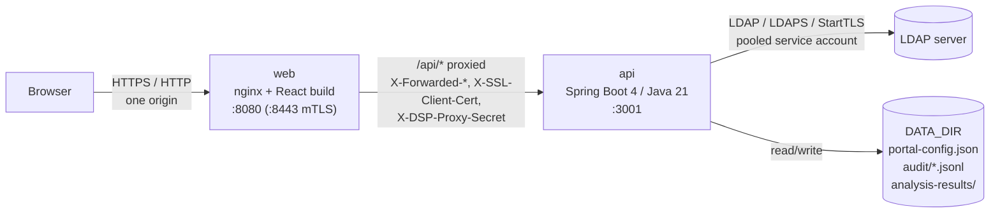

# Directory Services Portal

The **Directory Services Portal** (DSP) is a web front end for LDAP directories, including
directories that use custom (non-standard) schemas. Browsers cannot speak LDAP, so a Spring Boot
API sits between the React web client and the directory server. The API connects with a pooled
service account and enforces the portal's own permissions.

Administrators design **forms** for any object class and publish them as **directory definitions**.
Each definition is scoped to a namespace (base DN, scope and filter) and is either read/write or a
read-only "white pages" listing. Administrators then grant **view** or **view and edit** access
to users and directory groups. Every user gets a **My profile** page that shows where they
appear across the directories and lets them edit fields marked as self-service. **Metrics** turn any directory
into statistics and charts. **Data analysis** compares directories with each other and checks
their data for correct and unique values.

## Key features

| Area | What it does |
|---|---|
| Schema | Pull the schema from the server's `subschemaSubentry`, import OpenLDAP `.schema` / `cn=config` LDIF / raw descriptions, customise or add elements, and export the custom schema |
| Forms | Custom create/read/update/delete (CRUD) screens for any object class: text, text area or drop-down fields, single- or multi-valued, with validation (required, format, regex pattern, max length) and self-service flags |
| Directory definitions | A form bound to a base DN, scope (one level / subtree) and optional filter. Read/write or read-only white pages |
| Permissions | View or view-and-edit grants per definition, for users or LDAP groups. A definition can also be readable by every signed-in user |
| End users | Search, sort, page, view, create, edit (including rename) and delete entries. **My profile** lists the user's own entries |
| Metrics | Out-of-the-box overviews for every directory, shared dashboards, and an explorer for building ad-hoc charts. Every chart has a table view and CSV download |
| Data analysis | Saved comparisons (2–6 sources) and quality checks (1–6 sources), run as background tasks, with paged findings and CSV export |
| Background tasks | Long metrics and all analyses run on the server, with progress, cancellation and notifications |
| Audit log | Every change and sign-in, with before/after values, in the hash-chained `ens-audit/1` format, with delivery to Splunk or syslog (see [Audit logging](../audit-logging.md)) |
| Sign-in | LDAP bind with username and password, and/or X.509 client certificates (smart cards such as CAC/PIV) with OCSP/CRL revocation checking. Optional DoD notice-and-consent banner, session timeouts and limits |
| Page banners | Optional fixed top/bottom banner, for example a classification marking |

## Architecture at a glance

- The **web** tier serves the static React build and forwards `/api` to the API. The browser
  therefore sees a single origin, so the `SameSite=Strict` session cookie and the CSRF header
  work without any CORS configuration.
- The **API** serves only `/api/**`. It authenticates users by LDAP bind (or certificate), keeps
  sessions in memory, and stores the portal's own configuration in a JSON file.
- The **LDAP server** holds all directory data. The portal stores only its configuration,
  audit log and saved analysis results.

See [Architecture](architecture.md) for components, request flow and data storage in detail.

## Tech stack

| Layer | Technology |
|---|---|
| API | Java 21, Spring Boot 4.1 (Web MVC, Security, Validation, Actuator), Micrometer with Prometheus, UnboundID LDAP SDK 7.0. Cryptography comes from the JDK's own providers |
| Web client | React 19, React Router 7, TanStack Query 5, Vite 8, TypeScript 7, lucide-react icons, hand-written SVG charts |
| Shared code | `shared/` TypeScript workspace: types, DN utilities, validation and schema helpers used by the client |
| Container images | Red Hat UBI 9: `openjdk-21-runtime` (API, uid 185) and `nginx-126` (web, uid 1001) |
| Demo directory | Embedded UnboundID in-memory LDAP server, or a demo OpenLDAP (`slapd`) container |
| Tests | JUnit + MockMvc against the embedded LDAP server (Bouncy Castle for test certificates and a test OCSP/CRL server), and Vitest + Testing Library for the client. See [what is tested](install.md#directory-servers-what-is-tested) |

## Documentation map

| Page | For | Contents |
|---|---|---|
| [Installation](install.md) | Operators | Prerequisites, the Docker and native packages (including HTTPS and the demo directory), the Helm chart, verification |
| [Configuration](configuration.md) | Operators | Every environment variable and property, grouped by area, with examples |
| [Operator guide](operator-guide.md) | Operators | Start/stop, health, logs, backups, monitoring, upgrades, troubleshooting runbook |
| [Sizing, availability and recovery](availability-and-sizing.md) | Operators | Sizing, what high availability is possible, disaster recovery, rolling back an upgrade |
| [Administrator guide](admin-guide.md) | Portal administrators | Schema, forms, directory definitions, permissions, dashboards, data analysis, audit log |
| [User guide](user-guide.md) | Everyone | Signing in, browsing directories, entry CRUD, My profile, metrics, background tasks |
| [Architecture](architecture.md) | Engineers | Components, request flow, persistence, background jobs, code layout |
| [Security](security.md) | Security reviewers | Authentication, sessions, CSRF, X.509, LDAP injection defences, supply chain, audit |
| [FIPS 140-3 and DISA STIG](fips-and-stig.md) | Security reviewers | What the portal relies on for FIPS, and the settings a STIG deployment needs |
| [API reference](api-reference.md) | Integrators | Every REST endpoint under `/api` |

!!! tip "Try it with the demo directory"
    Unpack the Docker package and run `./install.sh --demo --bind 127.0.0.1 --start`. Then open
    <http://localhost:8080>, sign in as `admin` / `password` and install your evaluation license.
    See [Installation → Trying it out: the demo](install.md#trying-it-out-the-demo).
