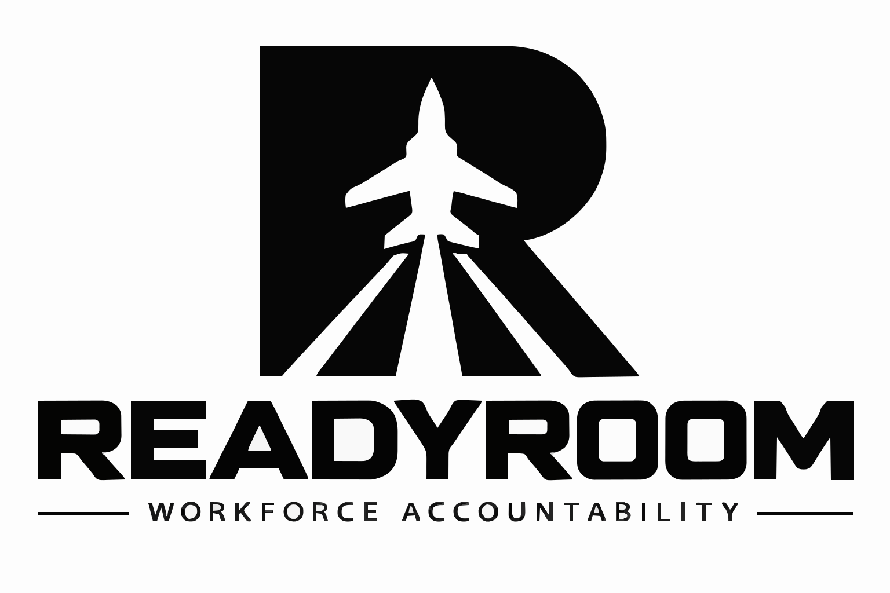
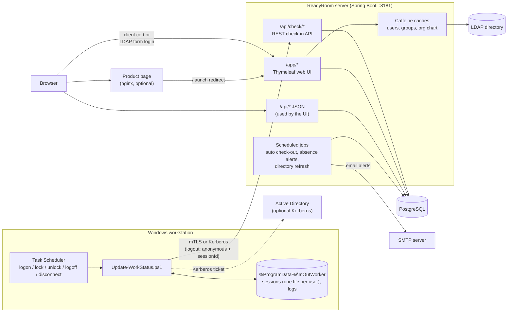
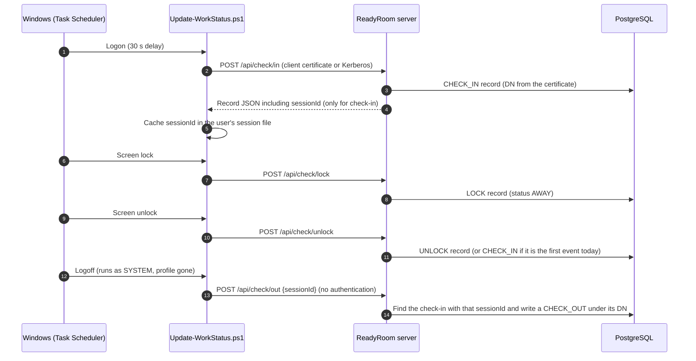

# ReadyRoom

{ width="240" }

**ReadyRoom** (image and project name `in-n-out-work`, Java package `com.winllc.innoutwork`)
tracks attendance and presence for an organization whose people and structure live in an LDAP
directory. Windows workstations report **logon, logoff, screen lock and screen unlock** events to a
Spring Boot server. The server turns those events into each person's working day, rolls them up by
directory group and organization, builds an org chart, and emails managers when someone has not
arrived by their expected time.

Nobody has to check in by hand. The first sign-in or unlock of the day counts as arriving, a locked
screen counts as away, and signing out counts as checking out. People can also set a status for a
day on a calendar (work from home, TDY, scheduled leave, a late arrival and so on), so their managers
know where they are when they are not at a workstation.

!!! info "Naming"
    The product is called **ReadyRoom** in the UI and on the product page. Older names still show up
    in the code and scripts: the container image is `in-n-out-work`, the Windows client is installed as
    `InOutWorker`, and the scheduled tasks are registered under `\InOutWork\`. All of these names
    refer to the same application.

## Key features

| Area | What ReadyRoom does |
|---|---|
| **Automatic check-in** | A PowerShell agent run by Windows Task Scheduler posts `login`, `lock`, `unlock` and `logout` events. The day's first unlock is stored as a check-in. |
| **Status per person** | Each person's status for the day is `IN`, `AWAY` (screen locked), `OUT` (checked out) or `NONE`. A calendar status such as *Work From Home* or *TDY* takes its place when one is set. |
| **Auto check-out** | A background job checks out anyone who has been locked for longer than `check-out-after-minutes`. The record is flagged as forced. |
| **Absence alerts** | If someone is not checked in by their expected time plus a grace period on a working day, their directory manager and any additional managers they chose get an in-app notification and an email. Managers record what happened. |
| **Home dashboard** | Each user sees their own status, the last 30 days, whether their workstation agent is reporting, and anything scheduled in the next two weeks. Users with direct reports also see their team. |
| **Groups** | Browse the directory group trees (`groupOfUniqueNames`), see each member's status, favorite groups, assign extra group managers, and generate a group report as a PDF. |
| **Org chart** | Builds a hierarchy from one flat directory attribute (for example `RYS34B` becomes `RYS` → `34` → `B`) and shows how many people are present in each organization. Parse rules can override how values are split. |
| **My Reports** | One table of everyone who reports to you in the directory, with 30-day attendance, average arrival and absence-alert history. |
| **Metrics** | Organization-wide accounted-for rate, status mix, workstation agent coverage, activity through the day, and status breakdowns by organization, employee type, location and branch. |
| **Organization calendar** | Admins and managers add organization-wide events and holidays. Absence alerts are not sent on holidays. |
| **Flexible sign-in** | Mutual TLS with X.509 client certificates is the main method, with LDAP username and password as a fallback. Windows (Kerberos) sign-in can optionally be turned on for the agent's check-in calls. |

## Architecture

The **directory is the source of truth** for people, groups, reporting lines and organization
attributes. PostgreSQL holds only what the directory cannot: check-in and check-out records, roles,
notes, favorite groups, additional managers, per-day statuses, notifications, the organization
calendar and org-chart parse rules.

### How a working day is recorded

Logoff cannot authenticate: by the time it runs, the user's profile and certificate store have been
unloaded. So `/api/check/out` is the one unauthenticated check-in endpoint. The agent caches the
`sessionId` returned at login, and the server uses it to find who is logging off. It accepts a
`sessionId` once, and only within 7 days of the check-in. Refused logouts are rate-limited per client
address; a logout with a usable `sessionId` never is.

## Components

| Component | Where it ships | Description |
|---|---|---|
| Server | Container image `ghcr.io/winllc/in-n-out-work` (in the release package's `images/`, and run by the Helm chart) | Spring Boot 4 application: web UI, REST API, scheduled jobs, LDAP and database access. |
| Web UI | Inside the server | Thymeleaf pages using the Tabler UI kit, Tabulator tables, FullCalendar, ApexCharts and flatpickr. |
| Windows client | The release package's `windows-client/` folder | `Update-WorkStatus.ps1`, the `Install-InOutWorker.ps1` installer, a sample configuration file and five Task Scheduler XML definitions. See [Windows client](windows-client.md). |
| Database scripts | The release package's `migrations/` folder; the Helm chart runs them in a Job | SQL run with `psql`. Hibernate creates the tables; these scripts add the indexes and constraints. |

## Technology stack

| Layer | Technology |
|---|---|
| Language and runtime | Java 21 |
| Framework | Spring Boot 4.1.1 (Web MVC, Security, Data JPA, Data LDAP, Mail, Actuator, Cache) |
| Security | Spring Security 7.1.1: X.509, `spring-security-ldap`, `spring-security-kerberos-core` |
| Views | Thymeleaf with the layout dialect and Spring Security extras |
| Database | PostgreSQL (Hibernate with `ddl-auto: update`) |
| Directory | Any LDAP v3 server. People are `inetOrgPerson` by default; groups are `groupOfUniqueNames`. |
| Caching | Caffeine |
| Delivery | Signed release package (Docker Compose) and Helm chart |
| Container | Red Hat UBI 9 `openjdk-21-runtime` with `krb5-workstation` |
| Client | Windows PowerShell 5.1 and Windows Task Scheduler |

## Where to go next

| If you want to... | Read |
|---|---|
| Install ReadyRoom and connect it to PostgreSQL, LDAP and certificates | [Installation](install.md) |
| Look up a property, environment variable or client parameter | [Configuration](configuration.md) |
| Roll out and troubleshoot the workstation agent | [Windows client](windows-client.md) |
| Use the web application day to day | [User guide](user-guide.md) |
| Manage roles, group managers, the calendar and org-chart rules | [Administration](admin-guide.md) |
| Run, monitor, back up and upgrade the server | [Operations](operator-guide.md) |
| Understand authentication, authorization and hardening | [Security](security.md) |
| Call or integrate with the HTTP endpoints | [API reference](api-reference.md) |
| Fix a problem | [Troubleshooting](troubleshooting.md) |
