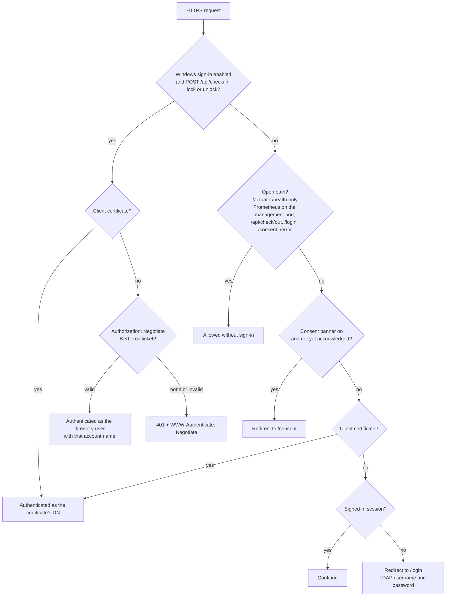

# Security

This page describes how ReadyRoom authenticates people and workstations, how it authorizes
access, which endpoints are open without sign-in, and what to harden before going live.

## Authentication

`SecurityConfig` builds one filter chain for the whole application. When Windows sign-in is
enabled, `WindowsAuthSecurityConfig` adds a second chain in front of it for the three check-in
calls only.



### Client certificates (mutual TLS)

- HTTPS is terminated by the application (`server.ssl.*`). `client-auth: want` means the server
  asks every client for a certificate but allows connections without one.
- The certificate must chain to a CA in the configured truststore. ReadyRoom ships no keystore or
  truststore, and does not fall back to Java's default CAs: with TLS on, it refuses to start until a
  keystore is set and, while `client-auth` is `want` or `need`, a truststore. Put only the CAs that
  issue your users' certificates in the truststore: any certificate one of them issues with a
  user's DN signs in as that user.
- By default the **full subject DN** is the username. `AppUserDetailsService` looks that DN up in
  LDAP, through the user cache. With `application.lookup-on-dn-attribute: true`, it instead
  searches `user-base-dn` for `<user-dn-attribute>=<subject DN>`. With `ENS_X509_USER_FILTER`, it
  searches with that filter instead, filled from the certificate (`{upn}`, `{edipi}`, `{email}`,
  `{uuid}`, `{subject}`, `{cn}`, all LDAP-escaped), and exactly one entry must match.
- When `ENS_X509_ALLOWED_ISSUERS` is set, only certificates from those issuers sign in.
- **Revocation** (`ENS_X509_REVOCATION`: `ocsp`, `crl` or `ocsp-then-crl`; `off` by default) is
  checked per sign-in by the JDK's PKIX validator, with fetches bounded (5 s connect, 10 s read, no
  redirects, 1 MB OCSP and 20 MB CRL, never link-local or cloud-metadata addresses). With
  `ENS_X509_REVOCATION_FAIL=closed` (the default), a certificate whose status can't be determined is
  refused. A CRL directory (`ENS_X509_CRL_DIR`) or a local OCSP responder serves air-gapped sites.
  **From the next release** revocation is on by default: with `ENS_X509_REVOCATION` unset,
  `ocsp-then-crl`, soft-fail (a revoked certificate is refused; one no responder answers for signs
  in with a WARN). A mode set explicitly fails closed unless `ENS_X509_REVOCATION_FAIL=open`. See
  [Install → Revocation from the next release](install.md#revocation-from-the-next-release).
  From 0.0.11 an OCSP responder or CRL distribution point that could not be reached is not asked
  again for 60 seconds; meanwhile its answer is unknown at once, and `ENS_X509_REVOCATION_FAIL`
  decides as before. Revocation is checked on every certificate sign-in, each check-in, lock and
  unlock included, so sign-ins no longer each wait out the connect timeout where the PKI cannot be
  reached. A CRL that cannot be fetched again is still used until its own next update.
- **Header mode** (`ENS_X509_SOURCE=header`): a TLS-terminating proxy forwards the certificate. It
  is accepted only from an address in `ENS_X509_TRUSTED_PROXIES` that sends the proxy secret in
  `X-ENS-Proxy-Secret` (compared in constant time), and only if it chains to
  `ENS_X509_TRUSTED_CA_FILE` or the TLS trust store. ReadyRoom does not start in header mode without
  a secret of 32 characters or more and a CA.
- **The account must still be usable.** The user's account is checked live in the directory, as
  API token owners' are: an account that is disabled, locked out, expired or no longer in the
  directory does not sign in with a certificate, as its password would fail at the bind. This also
  refuses the Windows client's check-ins made with such a certificate. When the directory cannot be
  read, the certificate signs in as before, from the user cache: an outage is no evidence that the
  account was disabled.
- Every refusal is audited as a failed `auth.login` with its reason (`certificate revoked`,
  `revocation unknown`, `issuer not allowed`, `no single directory user matches`,
  `proxy secret missing or wrong`, `account disabled in the directory`,
  `account locked out in the directory`, `account expired in the directory`,
  `account not in the directory, or no longer matching its filters`, ...). The settings are in
  [Installation → Client certificates](install.md#client-certificates-cacpiv).
- If the DN is not found in the directory, the certificate does not sign in, and a browser falls
  back to the login form. The refusal is audited as a failed `auth.login` with the reason
  *unknown user*.
- Certificate sessions have no *Log out* entry, because the browser would present the certificate
  again and sign straight back in.

### LDAP username and password

When no certificate is presented, protected pages redirect to the branded `/login` page. API
calls (`/api/**`) that are not signed in get `401 Unauthorized` instead, so a script never takes
the login page for an answer. The
LDAP authentication provider searches `user-base-dn` (subtree) with
`(|(uid={0})(cn={0})(mail={0}))` and then binds as the entry it found, with the password the user
typed. Password binds never use the LDAP connection pool, so a changed password takes effect at
once. Failed sign-ins go back to `/login?error`. Logging out goes to `/login?logout`.

**Throttling (from 0.0.11).** Each password sign-in is a directory search and a bind, and the form
is there in every deployment, those that use certificates or single sign-on too. Failed password
sign-ins are therefore counted:

| Counted per | Limit a minute | Setting |
|---|---|---|
| Client address | 30 | `application.login.address-failures-per-minute` (`APPLICATION_LOGIN_ADDRESSFAILURESPERMINUTE`; Helm `login.addressFailuresPerMinute`) |
| Username as entered (trimmed, any case), from anywhere | 5 | `application.login.username-failures-per-minute` (`APPLICATION_LOGIN_USERNAMEFAILURESPERMINUTE`; Helm `login.usernameFailuresPerMinute`) |

- Past either limit, further password sign-ins from that address, or for that username, are sent
  to `/login?throttled` (*Too many failed sign-ins. Wait a minute, then try again.*) before the
  directory is asked, so they do not count towards the directory's own lockout either.
- The refusal lasts until the minute that the first failure started is over. Someone guessing can
  hold a person's password sign-in off for a minute at a time, never longer. Certificate, single
  sign-on and Windows sign-in are not affected.
- A sign-in that failed because the directory did not answer is not counted.
- The counts are kept in the database with the other rate limits, once for all replicas. If the
  database cannot count for a moment, each replica counts in its own memory meanwhile.
- The first refusal over a limit is logged at `WARN` and audited as a failed `auth.login` with the
  reason `too many failed sign-ins` (`details.method` `ldap`, `details.limitedBy` `address` or
  `username`, `details.perMinute`).
- The client address is the one ReadyRoom sees. Behind a reverse proxy, set
  `SERVER_FORWARD_HEADERS_STRATEGY=framework`, or every browser shares the proxy's address and one
  person's mistakes lock everyone's password sign-in for the minute.
- `0` turns a limit off.

Both methods load roles through the same `AppUserDetailsService`, so a person gets identical access
whichever way they sign in.

### Notice and consent banner and sessions

- **Consent banner** (`ENS_CONSENT_BANNER_ENABLED=true`): the DoD notice-and-consent banner comes
  before any sign-in, enforced by the server, not just shown. `/consent` is reachable without
  signing in. Acknowledging it is audited as `auth.consent-acknowledged`. The Windows client's
  check-in calls (`POST` to `/api/check/in`, `/lock`, `/unlock` and `/out`) are machine endpoints
  and are not held by it. The rest of `/api/check/`, such as the administrators' day records, is
  called from the browser and needs the banner like any page.
- **Session lifetime:** an idle timeout (`ENS_SESSION_IDLE_TIMEOUT`, `30m`), an optional shorter
  one for administrators (`ENS_SESSION_ADMIN_IDLE_TIMEOUT`), an absolute lifetime
  (`ENS_SESSION_ABSOLUTE_TIMEOUT`, `12h`) and an optional limit per user
  (`ENS_SESSION_MAX_PER_USER`; over it the oldest session ends). Each end is audited as
  `auth.session-expired`; erasing a person ends theirs, with reason `erased`. See [Configuration](configuration.md#security-headers-banner-and-sessions).
- **Account checked again:** a sign-in's roles hold for its session, and nothing signs a session in
  again. So every `ENS_SESSION_ACCOUNT_CHECK_INTERVAL` (`5m`) a browser session's account is checked
  live in the directory, and the person's role in ReadyRoom (their stored role, or
  `application.super-user-dns`) is compared with the one at sign-in; the identity provider's group
  grants do not count. An account that is disabled, locked out, expired or gone, or a changed role,
  ends the session, audited as `auth.session-expired` with reason `account` (`details.account` says
  why); the new role applies from the next sign-in. A directory that cannot be read leaves the
  session as it is, as at sign-in. The Windows client's calls (`POST` to `/api/check/in`, `/lock`,
  `/unlock` and `/out`) are exempt from the session lifetimes and this check. From 0.0.11 the rest
  of `/api/check/`, such as the administrators' day records (`GET /api/check/records`), is a
  browser's call and is not: up to 0.0.10 polling it kept a session alive past its limits.

### Windows (Kerberos) sign-in

Windows sign-in is optional and **off by default**. It applies only to `POST /api/check/in`,
`/api/check/lock` and `/api/check/unlock`. Logout and every web page are unaffected. With it on:

- A client certificate on those calls is still checked **first**. A request signed in with a
  certificate never reaches the Kerberos code.
- A request with neither a certificate nor a ticket gets `401` with `WWW-Authenticate: Negotiate`
  (which prompts Windows to send a ticket) instead of a redirect to the login page.
- These calls make no session (from 0.0.11): the client keeps no cookies and signs in on every
  call. Up to 0.0.10 each logon, lock and unlock left a stored session behind for 30 minutes.
- The ticket is validated with the service principal's key from the keytab. No domain controller is
  contacted, so `krb5.conf` is optional.
- The account name from the ticket (for example `jdoe@EXAMPLE.COM`) must come from an **allowed
  realm**: `allowed-realms`, or by default the service principal's realm. Service and host
  principals (anything containing `/`) are rejected, and so are computer accounts (names ending in
  `$`, such as `PC01$`, which is what a task running as SYSTEM presents).
- The name, with the realm removed by default (`strip-realm`), must match **exactly one** directory
  user under `user-base-dn` that also matches `user-ldap-filter`, using `account-attribute`
  (default `sAMAccountName`). The check-in is then recorded under that user's DN, the same DN a
  certificate for that person would give.
- The `windowsUserId` stored with the record comes from the verified ticket, not from the request
  body.
- The account is not checked again in the directory, as it is for certificates and single sign-on:
  the ticket comes from the domain's own KDC, which refuses tickets to a disabled, locked out or
  expired account, and such an account cannot log on or unlock. A service ticket the workstation
  already holds (10 hours by default) can still report a lock until it expires.
- **NTLM is not supported.** Windows falls back to NTLM when it cannot get a Kerberos ticket for
  the URL, and the server logs this.

**Setup**

1. **Active Directory (domain admin).** Create a service account (for example `svc-readyroom`)
   with a strong, non-expiring password, and tick *This account supports Kerberos AES 256 bit
   encryption*. Register the host name that clients put in `BaseUrl` (not an IP address):

    ```bat
    setspn -S HTTP/readyroom.example.com EXAMPLE\svc-readyroom
    ```

    Export an AES keytab (Java rejects RC4). `ktpass` sets a new password on the account as it
    exports the key:

    ```bat
    ktpass -out http.keytab -princ HTTP/readyroom.example.com@EXAMPLE.COM -mapUser EXAMPLE\svc-readyroom -pass * -crypto AES256-SHA1 -ptype KRB5_NT_PRINCIPAL
    ```

    Treat `http.keytab` like a password: anyone who has it can pose as the application.

2. **Server.** Turn Windows sign-in on with the service principal and the keytab:

    === "Release package"

        Put `krb5.conf` and `http.keytab` in `kerberos/` (keytab: `chgrp 0`, `chmod 0640`), and set
        in `.env`:

        ```bash
        COMPOSE_FILE=docker-compose.yml:docker-compose.tls.yml:docker-compose.windows-auth.yml
        APPLICATION_WINDOWSAUTH_ENABLED=true
        APPLICATION_WINDOWSAUTH_SERVICEPRINCIPAL=HTTP/readyroom.example.com@EXAMPLE.COM
        ```

        `docker-compose.windows-auth.yml` mounts the keytab read-only at
        `/etc/in-n-out/http.keytab`. Check it with
        `docker compose exec app klist -kte /etc/in-n-out/http.keytab`.

    === "Helm"

        Put the keytab in a Secret and set `windowsAuth.enabled`, `windowsAuth.servicePrincipal`
        and `windowsAuth.keytab.secretName`. See
        [Installation → Windows sign-in](install.md#windows-kerberos-sign-in). Check it with
        `kubectl -n readyroom exec deploy/readyroom -- klist -kte /etc/in-n-out/http.keytab`.

    To match accounts by `userPrincipalName` instead of `sAMAccountName`, set
    `application.windows-auth.account-attribute` (with `strip-realm: false`); see
    [Configuration](configuration.md#windows-kerberos-sign-in).

    The server's clock must be within 5 minutes of the domain controllers' clocks.

3. **Clients.** Set `"Authentication": "Auto"` (or `"Windows"`) in `inoutworker.config.json`, with
   `BaseUrl` using the registered host name. PCs must be domain-joined, with users signed in to
   domain accounts. See [Windows client](windows-client.md).

All settings are listed in [Configuration](configuration.md#windows-kerberos-sign-in).

## Authorization

- **Roles:** `USER`, `MANAGER` and `ADMIN`, granted as described in
  [Administration](admin-guide.md#roles). Method security (`@EnableMethodSecurity`) enforces
  `@PreAuthorize` rules on controllers and REST services. Roles open pages: Metrics and group
  reports need `MANAGER` or `ADMIN`; **Settings** (the organization calendar, the org chart's
  parse rules, the group cache), which applies to the whole organization, needs `ADMIN`. Whose
  data a page shows is decided by `AccessPolicy`.
- **Administrators:** `ADMIN` comes from `application.super-user-dns`, or from a stored role
  (`user_records.user_role`) set in the database. An entry of `super-user-dns` is compared with the
  person's DN as a DN, whatever its case or the spaces after its commas (from 0.0.11; before, an
  entry written `CN=Jane Doe, OU=Users, ...` signed in as `USER` while the **Administrators** card
  listed her). It is never given from the UI: a person's page
  offers `ADMIN` only to keep it for someone who holds it, and refuses it otherwise (`400`). The
  last administrator cannot be demoted there: the page says why.
  **Administration → Privacy** lists every administrator and where the role comes from.
- **A person's details:** their arrival, departure and status-change times, notes, average login
  time, check-in history (**Audit Log**), calendar, and their delegates. These are visible to:
    - the person themselves;
    - `ADMIN`;
    - the managers of a group the person is a member of: the group's directory `owner`, or an
      additional manager set for the group in ReadyRoom;
    - their manager in the directory (one level up only, not that manager's manager);
    - their delegates (alternate managers), whom only administrators set.

    These relationships apply whatever the viewer's role. The `MANAGER` role on its own does not
    show anyone's details.

    From 0.0.11, what the directory says about them (the groups a viewer owns, a group's members,
    a viewer's direct reports) is kept for a minute per viewer and per group, on each replica, so
    a change there applies within a minute. Delegates and a group's additional managers, which
    ReadyRoom stores, apply at once.

- **Everyone else** sees a coworker, found by search, on a group page, an organization's members
  or in the org chart, with their directory details (organization, employee type, location,
  branch, email, phone, manager, groups), never their times, notes or history. How much of their
  day shows is `application.privacy.coworker-visibility`:

    | Value | A coworker's status shows |
    |---|---|
    | `full` (default) | In, away or out, or the day's calendar status. A status a manager recorded (*Unscheduled Leave*, *Absent*, *Absent Excused*, *Absent Unexcused*) shows as *Out of Office* |
    | `status` | `IN` (checked in or unlocked today, screen locked included) or `OUT`; no calendar status |
    | `none` | No status. The org chart shows headcounts but not how many are present, except to the `ADMIN` and `MANAGER` roles |

    It applies to user search, a group's and an organization's members, a person's page and the
    org chart, in the pages and the API alike. The org chart's counts follow it too: each person
    is counted by their real status only where the viewer may see their details, and otherwise as
    above: under `full` a status a manager recorded counts as *Out of Office*; under `status`, and
    under `none` for the `ADMIN` and `MANAGER` roles (the only ones who see the counts then),
    as *Checked in* or *Not in*. So the counts of a small organization do not show whom a manager
    marked absent.

- **Statuses and requests:** each status is set by the person (normal, Early Leave, Late
  Arrival), requested (by default every status that excuses an absence:
  `application.events.request-statuses`) or recorded by managers only (Absent, Absent Unexcused,
  Unscheduled Leave). The server enforces this on every API that sets a status. A request is
  decided by the person's directory manager, their delegates or an administrator; **nobody decides
  their own request, administrators included**. The same people may record any status for the
  person directly. A request's note is seen only by the requester, the people who may decide it
  and administrators, and is never in emails or the audit trail. One call can cover at most
  `application.events.max-range-days` (366) days.
- **Working days:** a person's working days and start date are seen by whoever sees their details,
  the person included, and set by the people who decide their requests (their directory manager,
  their delegates, `ADMIN`), never by the person themselves (`POST /app/user/details/schedule`).
  Audited as `person.schedule-changed`.
- **Corrections to check-in records:** only `ADMIN` voids, annotates or adds a person's check-in
  records (`/api/records`), never their own, always with a reason (or the note). Whoever sees the
  person's details sees the corrections. Each is audited (`record.voided`, `record.annotated`,
  `record.added`), and the person is e-mailed when a record is voided or added.
- **A person's data:** anyone downloads their own (**My data**); only `ADMIN` downloads someone
  else's or erases it, never their own. Both are audited. Erasure also revokes the person's API
  tokens, disables their webhooks and ends their browser sessions (see
  [Privacy → Erasure](privacy.md#erasure)).
- **Groups:** a group's page and its members are open to the group's members, its managers and
  `ADMIN`. Access follows directory membership only. Its report needs `ADMIN`, or the `MANAGER`
  role together with being a current manager of that group. Its additional managers are set by
  `ADMIN` only, as delegates are, and each must be someone in the directory: a group's manager
  cannot widen who sees the team. `POST /api/permissions/update`, whose grants nothing read, has
  been removed. A sub-group is a separate group with its own managers.
- **Direct reports:** `/api/users/reports` and **My Reports** always use the signed-in user as the
  manager, so they cannot be used to read someone else's team.
- **Notifications:** an absence alert goes to the person's directory manager, their delegates and
  the managers of their groups. It opens only for the one it was sent to, and for `ADMIN`. Only the
  directory manager, a delegate or `ADMIN` can record a response; a group manager sees the alert
  and the response. Anyone else gets an access-denied error.
- **Metrics** show aggregates only, never names.

A refused page is logged at `info` as `Access denied for <METHOD> <URI>`, and the user sees the
*Unauthorized* page.

## Unauthenticated endpoints

| Path | Why it is open |
|---|---|
| `POST /api/check/out` | Runs at logoff, after the user's profile and certificate store are gone. It accepts only the `sessionId` of a check-in that no logout has used yet and that is younger than 7 days (`application.logoff.session-max-age-hours`), and records the check-out under that check-in's DN. |
| `/actuator/health` (and its groups, such as `/actuator/health/liveness`) | Health checks and probes. Status only; details for `ADMIN`. It is the only Actuator endpoint exposed on the application's port, and any other endpoint you expose there needs an `ADMIN` sign-in. |
| `/actuator/prometheus` | Only on the management port (`MANAGEMENT_SERVER_PORT`), plain HTTP. Never publish that port |
| `/login`, `/consent`, `/error` | The sign-in, consent banner and error pages. Failed password sign-ins are [throttled](#ldap-username-and-password). |
| `GET /api/audit/events` | The audit pull API, with a bearer token instead of a session. See [Audit logging](../audit-logging.md#the-pull-api) |
| `/api/v1/**` | The [public API](api-reference.md#public-api-apiv1): a bearer API token instead of a session, read-only. Its OpenAPI document (`/api/v1/openapi`, `/api/v1/openapi.yaml`) needs no token |
| `/oauth2/authorization/oidc`, `/login/oauth2/code/oidc`, `/saml2/authenticate/saml`, `/login/saml2/sso/saml`, `/saml2/service-provider-metadata/saml` | [Single sign-on](single-sign-on.md), when enabled: starting a sign-in, the provider's answer, and this service provider's metadata |
| `/libs/**`, `/css/**`, `/js/**`, `/images/**` | Static assets, which bypass the security filters. |

A `sessionId` stands in for a sign-in on the logout, so ReadyRoom treats it as a credential. It
appears only in the answer to the check-in that created it: no other API response, page or log shows
it. On the workstation it is kept in a file that only that user, SYSTEM and Administrators can read
(see [Windows client](windows-client.md#why-logout-is-different)).

Only refused logouts are rate-limited, per client address. They are audited as a failed
`auth.login` with the reason *unknown session*; repeats from one address within 60 seconds become one
event with `details.count`. After `application.logoff.refused-per-minute` (30)
in a minute, the next ones get `429` and are audited once for that address and minute, with the
reason *too many unknown sessions* (method `session-id`). A logout with a usable `sessionId` is
never limited.

## Single sign-on, API tokens and webhooks

- **Single sign-on** (OIDC with PKCE, state and nonce; SAML with signed responses, `InResponseTo`,
  one use per assertion across replicas, no IdP-initiated sign-in) maps the provider's identity to
  exactly one directory user by an LDAP filter (refused, and audited as a failed sign-in, when that
  user's account is disabled, locked out or expired; a directory that cannot be read lets the
  sign-in go on), and grants `MANAGER` or `ADMIN` from the provider's
  groups only through `ENS_SSO_ROLE_MAPPING`. Every address given to the provider is built from
  `APPLICATION_BASE_URL`, never from request headers. No access or refresh token is kept; the OIDC
  ID token stays in the server-side session until sign-out. From the next release signing out can
  also end the provider's session (`ENS_SSO_OIDC_END_SESSION`, `ENS_SSO_SAML_SINGLE_LOGOUT`), and
  the ID token is then sent to the provider's end-session endpoint as `id_token_hint`.
  From the next release the OIDC issuer (with the endpoints and keys it names) and the SAML metadata
  are read over `https://` only (or, for SAML, from a file), and SAML refuses to start without an
  `https://` `APPLICATION_BASE_URL`. See [Single sign-on](single-sign-on.md).
- **API tokens** are SHA-256 hashed, shown once, scoped per endpoint, expiring, rate-limited (for
  all replicas together), and act for their creating administrator with that person's roles and account status
  re-checked live in the directory on every call, failing closed. The `/api/v1` chain accepts nothing
  but a bearer token and serves `GET`s only. See [API reference → Tokens](api-reference.md#tokens).
- **Webhooks** go to `https://` receivers on public addresses only (internal ranges only through
  `APPLICATION_WEBHOOKS_ALLOWEDCIDRS`, cloud metadata never), connect to the address just checked,
  follow no redirects, and are HMAC-SHA256 signed. Signing secrets are encrypted in the database with
  `APPLICATION_WEBHOOKS_SECRETKEY` (AES-256-GCM); a leaked one is replaced with **Rotate secret**,
  audited as `webhook.secret-rotated`. From 0.0.11 a webhook whose receiver gives no answer for
  about a day is disabled, audited as `webhook.disabled` by `system`. See [Webhooks](webhooks.md).
- **Exports** are form posts with the CSRF token, audited before they start, and hold only what the
  viewer may see; CSV cells that could run as formulas are neutralised. See
  [Reports, exports and time zones](exports.md).

## Other protections and notes

- **CSRF protection is on** for every `POST`, `PUT` and `DELETE` except the Windows client's
  `/api/check/**`, which signs in with a certificate or a ticket, or not at all, and accepts only
  JSON. Forms carry the token, and the pages add it to their `fetch` calls from the `_csrf` meta
  tags. A missing or wrong token gets `403`, audited as `access.denied`.
- **Session cookie:** `SameSite=Lax` and `HttpOnly`, and `Secure` when `SSL_ENABLED=true` or
  `ENS_COOKIE_SECURE=true` (the older `SESSION_COOKIE_SECURE` still works).
- **Security headers** on every response, static files and error pages included: a
  `Content-Security-Policy` that allows scripts from ReadyRoom itself and inline scripts carrying
  the request's nonce only (inline event handlers are not allowed), `frame-ancestors 'none'`,
  `X-Frame-Options: DENY`, `X-Content-Type-Options: nosniff`,
  `Referrer-Policy: strict-origin-when-cross-origin`, `Permissions-Policy`, and
  `Strict-Transport-Security` on secure requests. `ENS_CSP_REPORT_ONLY=true` only reports the
  policy; startup warns while it is on. The PDF export has not been checked against the policy in
  older browsers.
- **Windows client files:** the installer makes the install folder and
  `%ProgramData%\InOutWorker` writable by SYSTEM and Administrators only, and the SYSTEM logout task
  reads a user's session file only after checking for links and for its owner. From 0.0.11 a
  check-in restricts the session file to its user before the `sessionId` goes in, and writes
  nothing into a file another account created first. See
  [Windows client](windows-client.md#installation).
- **Errors are never a success** (from 0.0.11): a request that fails unexpectedly answers `500`,
  and one the framework refuses keeps its own status (`400`, `404`, `405`). Under `/api`, or for a
  client that asks for JSON, the body is `{"error": "...", "message": "..."}`, without the cause; the
  server log has it. Up to 0.0.10 these answered `200` with the error page.
- **Bounded reads** (from 0.0.11): a calendar read covers at most
  `application.events.max-view-days` (400) days, and the name search behind the delegate and
  group-manager pickers needs three characters, stays within `application.user-ldap-filter`,
  returns at most `application.ldap.search-max-results` people and only their DN and name.
- **A person's DN in a link** is a query parameter (`/app/user/details?dn=...`), encoded, from
  0.0.11, so a DN holding `\`, `/`, `#` or `?` reaches the page it names.
- **LDAP injection:** user-supplied search terms are escaped before they are put into LDAP filters.
- **LDAP timeouts:** connect (5 s) and read (30 s) timeouts and a paged-search page limit stop a
  slow or misbehaving directory from holding requests open indefinitely.
- **Notes field:** the profile form warns *Do not enter any classified or PII data!*. Notes are
  shown only to the people who can see the person's details (see [Authorization](#authorization)).
- **Server TLS validation on the client** is on by default. `SkipCertificateCheck` is for labs only.
- **SMTP:** the mail server's certificate is checked against the JVM's trust store, and STARTTLS
  is required by default. Earlier releases trusted any certificate.
  `SPRING_MAIL_PROPERTIES_MAIL_SMTP_SSL_TRUST` is an explicit opt-in to trust a host without checking.

## FIPS 140-3 and DISA STIG

See [FIPS 140-3 and DISA STIG](fips-and-stig.md).

## Hardening checklist

- [ ] Use your own keystore, truststore and CA. Put only the CAs that issue your users'
      certificates in the truststore. Never trust a development CA: the source repository's
      `test/dev-ca/make-dev-certs.sh` makes a throw-away one for local testing, and the earlier
      "WINLLC DEV CA" must not be trusted anywhere, because its private keys were published.
- [ ] With certificates in use: `ENS_X509_REVOCATION` other than `off`, and
      `ENS_X509_ALLOWED_ISSUERS` if only some trusted CAs issue user certificates. For DISA STIG,
      set the mode explicitly with `ENS_X509_REVOCATION_FAIL=closed`: the next release's default
      (mode unset) is soft-fail.
- [ ] Never run demo mode (`demo.enabled`) against production data; from the next release it cannot
      be combined with Windows sign-in.
- [ ] For DoD systems: `ENS_CONSENT_BANNER_ENABLED=true`, and session limits as your policy requires
      (DISA STIG suggests `ENS_SESSION_ADMIN_IDLE_TIMEOUT=15m` and `ENS_SESSION_MAX_PER_USER=3`).
- [ ] Keep the management port (`MANAGEMENT_SERVER_PORT`) off any ingress, route or published port.
- [ ] Supply all passwords (keystore, truststore, database, LDAP bind, SMTP) in `.env` (mode 600)
      or in Kubernetes Secrets, never in a ConfigMap or the values file you commit.
- [ ] Use `ldaps://` (or StartTLS) for the directory, with a least-privilege bind account that can
      only read.
- [ ] Keep Actuator exposure at `health` (the packaged setting).
- [ ] Behind a proxy that terminates TLS for browsers, set `ENS_COOKIE_SECURE=true` and
      `SERVER_FORWARD_HEADERS_STRATEGY=framework`. Without the second, ReadyRoom sees every browser
      at the proxy's address, and the password sign-in limit per address is shared by everyone.
- [ ] Decide the password sign-in limits (`APPLICATION_LOGIN_*`), and keep the directory's own
      lockout policy: ReadyRoom's throttle slows guessing, it locks no account.
- [ ] Set `super-user-dns` to the real administrators only, and review the **Administrators** card
      on **Administration → Privacy**, which also lists roles stored in the database.
- [ ] Keep the Kerberos keytab in `kerberos/` (mounted read-only) or a Secret, and out of images
      and source control.
- [ ] Install the Windows client under Program Files (as the installer does), so non-admins cannot
      change a script that runs as SYSTEM.
- [ ] After upgrading the client, re-run `Install-InOutWorker.ps1` on every workstation, so it
      corrects the folder permissions older clients left.
- [ ] Leave `SkipCertificateCheck` off on workstations.
- [ ] Leave `spring.mail.properties.mail.smtp.ssl.trust` unset, and give the JVM your mail server's CA
      if it is private.
