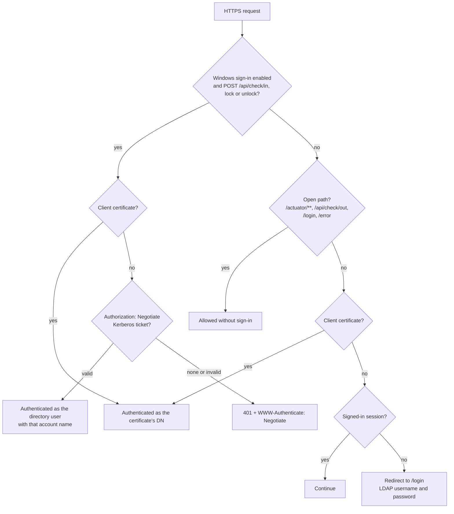

# Security

This page describes how ReadyRoom authenticates people and workstations, how it authorizes
access, which endpoints are open without sign-in, and what to harden before going live.

## Authentication

`SecurityConfig` builds one filter chain for the whole application. When Windows sign-in is
enabled, `WindowsAuthSecurityConfig` adds a second chain in front of it for the three check-in
calls only.



### Client certificates (mutual TLS)

- HTTPS is terminated by the application (`server.ssl.*`). `client-auth: want` means the server
  asks every client for a certificate but allows connections without one.
- The certificate must chain to a CA in the configured truststore.
- The **full subject DN** is the username (`subjectPrincipalRegex("(.*)")`). `AppUserDetailsService`
  looks that DN up in LDAP, through the user cache. With `application.lookup-on-dn-attribute: true`,
  it instead searches `user-base-dn` for `<user-dn-attribute>=<subject DN>`.
- If the DN is not found in the directory, the session gets **no roles**, so every page shows
  *Unauthorized*.
- Certificate sessions have no *Log out* entry, because the browser would present the certificate
  again and sign straight back in.

### LDAP username and password

When no certificate is presented, protected pages redirect to the branded `/login` page. The
LDAP authentication provider searches `user-base-dn` (subtree) with
`(|(uid={0})(cn={0})(mail={0}))` and then binds as the entry it found, with the password the user
typed. Password binds never use the LDAP connection pool, so a changed password takes effect at
once. Failed sign-ins go back to `/login?error`. Logging out goes to `/login?logout`.

Both methods load roles through the same `AppUserDetailsService`, so a person gets identical access
whichever way they sign in.

### Windows (Kerberos) sign-in

Windows sign-in is optional and **off by default**. It applies only to `POST /api/check/in`,
`/api/check/lock` and `/api/check/unlock`. Logout and every web page are unaffected. With it on:

- A client certificate on those calls is still checked **first**. A request signed in with a
  certificate never reaches the Kerberos code.
- A request with neither a certificate nor a ticket gets `401` with `WWW-Authenticate: Negotiate`
  (which prompts Windows to send a ticket) instead of a redirect to the login page.
- The ticket is validated with the service principal's key from the keytab. No domain controller is
  contacted, so `krb5.conf` is optional.
- The account name from the ticket (for example `jdoe@EXAMPLE.COM`) must come from an **allowed
  realm**: `allowed-realms`, or by default the service principal's realm. Service and host
  principals (anything containing `/`) are rejected.
- The name, with the realm removed by default (`strip-realm`), must match **exactly one** directory
  user under `user-base-dn` that also matches `user-ldap-filter`, using `account-attribute`
  (default `sAMAccountName`). The check-in is then recorded under that user's DN, the same DN a
  certificate for that person would give.
- The `windowsUserId` stored with the record comes from the verified ticket, not from the request
  body.
- **NTLM is not supported.** Windows falls back to NTLM when it cannot get a Kerberos ticket for
  the URL, and the server logs this.

**Setup**

1. **Active Directory (domain admin).** Create a service account (for example `svc-readyroom`)
   with a strong, non-expiring password, and tick *This account supports Kerberos AES 256 bit
   encryption*. Register the host name that clients put in `BaseUrl` (not an IP address):

    ```bat
    setspn -S HTTP/readyroom.example.com EXAMPLE\svc-readyroom
    ```

    Export an AES keytab (Java rejects RC4). `ktpass` sets a new password on the account as it
    exports the key:

    ```bat
    ktpass -out http.keytab -princ HTTP/readyroom.example.com@EXAMPLE.COM -mapUser EXAMPLE\svc-readyroom -pass * -crypto AES256-SHA1 -ptype KRB5_NT_PRINCIPAL
    ```

    Treat `http.keytab` like a password: anyone who has it can pose as the application.

2. **Server.**

    ```yaml
    application:
      windows-auth:
        enabled: true
        service-principal: HTTP/readyroom.example.com@EXAMPLE.COM
        keytab-location: /etc/in-n-out/http.keytab
        account-attribute: sAMAccountName   # or userPrincipalName with strip-realm: false
    ```

    In a container, mount the keytab read-only (the image creates `/etc/in-n-out` for it) and make
    sure the container user can read it:

    ```bash
    docker run ... \
      -v /secure/http.keytab:/etc/in-n-out/http.keytab:ro \
      -e APPLICATION_WINDOWSAUTH_ENABLED=true \
      -e APPLICATION_WINDOWSAUTH_SERVICEPRINCIPAL=HTTP/readyroom.example.com@EXAMPLE.COM \
      -e APPLICATION_WINDOWSAUTH_KEYTABLOCATION=/etc/in-n-out/http.keytab \
      in-n-out-work
    docker exec <container> klist -kte /etc/in-n-out/http.keytab
    ```

    The server's clock must be within 5 minutes of the domain controllers' clocks.

3. **Clients.** Set `"Authentication": "Auto"` (or `"Windows"`) in `inoutworker.config.json`, with
   `BaseUrl` using the registered host name. PCs must be domain-joined, with users signed in to
   domain accounts. See [Windows client](windows-client.md).

All settings are listed in [Configuration](configuration.md#windows-kerberos-sign-in).

## Authorization

- **Roles:** `USER`, `MANAGER` and `ADMIN`, granted as described in
  [Administration](admin-guide.md#roles). Method security (`@EnableMethodSecurity`) enforces
  `@PreAuthorize` rules on controllers and REST services.
- **Group access:** `PermissionEvaluator.groupCheck()` allows a group if the user is a member of it
  in the directory. The `ADMIN` and `MANAGER` roles bypass the check.
- **Per-person data:** `forCurrentUser()` (it is you) and `userManagerCheck()` (you are the
  directory `owner` or an additional manager of one of the person's groups) guard the audit log.
- **Direct reports:** `/api/users/reports` and **My Reports** always use the signed-in user as the
  manager, so they cannot be used to read someone else's team.
- **Notification responses:** only a recipient of the alert can record a response. Anyone else gets
  an access-denied error.
- **Metrics** show aggregates only, never names.

A refused page is logged at `info` as `Access denied for <METHOD> <URI>`, and the user sees the
*Unauthorized* page.

## Unauthenticated endpoints

| Path | Why it is open |
|---|---|
| `POST /api/check/out` | Runs at logoff, after the user's profile and certificate store are gone. The DN is taken from the `sessionId` that the login call returned. |
| `/actuator/**` | Health and metrics. The packaged configuration exposes `health`, `info`, `metrics` and `env`. |
| `/login`, `/error` | The sign-in and error pages. |
| `/libs/**`, `/css/**`, `/js/**`, `/images/**` | Static assets, which bypass the security filters. |

!!! warning "Consider these before going live"
    - **Actuator.** `/actuator/env` and `/actuator/metrics` are reachable without sign-in. Limit
      `management.endpoints.web.exposure.include` to `health`, or block `/actuator` at the network
      edge.
    - **Check-out by session id.** Anyone who knows a `sessionId` can post a check-out for that
      user. Session ids are random UUIDs, cached on the workstation in
      `%ProgramData%\InOutWorker\session.json` (readable by *Authenticated Users*) and returned in
      the API's record JSON.

## Other protections and notes

- **CSRF protection is disabled** in both filter chains. The UI's forms and `fetch` calls post
  without tokens. Rely on TLS, client certificates and same-site browser defaults, and do not embed
  ReadyRoom pages in other sites.
- **LDAP injection:** user-supplied search terms are escaped before they are put into LDAP filters.
- **LDAP timeouts:** connect (5 s) and read (30 s) timeouts and a paged-search page limit stop a
  slow or misbehaving directory from holding requests open indefinitely.
- **Notes field:** the profile form warns *Do not enter any classified or PII data!*. Notes are
  shown to anyone who can see the person.
- **Server TLS validation on the client** is on by default. `SkipCertificateCheck` is for labs only.
  The superseded scripts trusted every server certificate.
- **SMTP:** the packaged configuration trusts any SMTP certificate (`mail.smtp.ssl.trust: "*"`).
  Name your mail host instead.

## Hardening checklist

- [ ] Replace every committed keystore, truststore and CA key. Treat the repository's copies as
      compromised.
- [ ] Supply all passwords (keystore, truststore, database, LDAP bind, SMTP) through environment
      variables or an external file, not the packaged `application.yml`.
- [ ] Use `ldaps://` (or StartTLS) for the directory, with a least-privilege bind account that can
      only read.
- [ ] Restrict Actuator exposure.
- [ ] Set `super-user-dns` to the real administrators only.
- [ ] Mount the Kerberos keytab read-only and keep it out of images and source control.
- [ ] Install the Windows client under Program Files (as the installer does), so non-admins cannot
      change a script that runs elevated or as SYSTEM.
- [ ] Leave `SkipCertificateCheck` off on workstations.
- [ ] Set `spring.mail.properties.mail.smtp.ssl.trust` to your mail host.
