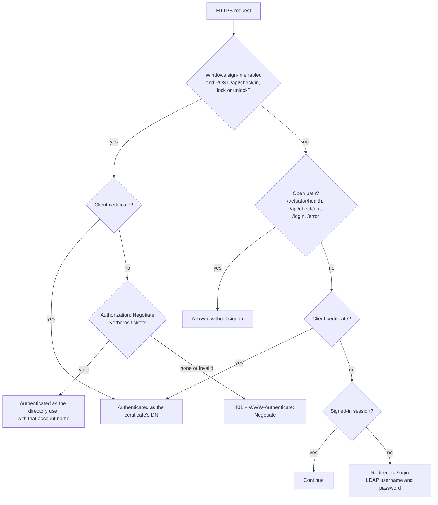

# Security

This page describes how ReadyRoom authenticates people and workstations, how it authorizes
access, which endpoints are open without sign-in, and what to harden before going live.

## Authentication

`SecurityConfig` builds one filter chain for the whole application. When Windows sign-in is
enabled, `WindowsAuthSecurityConfig` adds a second chain in front of it for the three check-in
calls only.



### Client certificates (mutual TLS)

- HTTPS is terminated by the application (`server.ssl.*`). `client-auth: want` means the server
  asks every client for a certificate but allows connections without one.
- The certificate must chain to a CA in the configured truststore. ReadyRoom ships no keystore or
  truststore, and does not fall back to Java's default CAs: with TLS on, it refuses to start until a
  keystore is set and, while `client-auth` is `want` or `need`, a truststore. Put only the CAs that
  issue your users' certificates in the truststore: any certificate one of them issues with a
  user's DN signs in as that user.
- The **full subject DN** is the username (`subjectPrincipalRegex("(.*)")`). `AppUserDetailsService`
  looks that DN up in LDAP, through the user cache. With `application.lookup-on-dn-attribute: true`,
  it instead searches `user-base-dn` for `<user-dn-attribute>=<subject DN>`.
- If the DN is not found in the directory, the certificate does not sign in, and a browser falls
  back to the login form. The refusal is audited as a failed `auth.login` with the reason
  *unknown user*.
- Certificate sessions have no *Log out* entry, because the browser would present the certificate
  again and sign straight back in.

### LDAP username and password

When no certificate is presented, protected pages redirect to the branded `/login` page. API
calls (`/api/**`) that are not signed in get `401 Unauthorized` instead, so a script never takes
the login page for an answer. The
LDAP authentication provider searches `user-base-dn` (subtree) with
`(|(uid={0})(cn={0})(mail={0}))` and then binds as the entry it found, with the password the user
typed. Password binds never use the LDAP connection pool, so a changed password takes effect at
once. Failed sign-ins go back to `/login?error`. Logging out goes to `/login?logout`.

Both methods load roles through the same `AppUserDetailsService`, so a person gets identical access
whichever way they sign in.

### Windows (Kerberos) sign-in

Windows sign-in is optional and **off by default**. It applies only to `POST /api/check/in`,
`/api/check/lock` and `/api/check/unlock`. Logout and every web page are unaffected. With it on:

- A client certificate on those calls is still checked **first**. A request signed in with a
  certificate never reaches the Kerberos code.
- A request with neither a certificate nor a ticket gets `401` with `WWW-Authenticate: Negotiate`
  (which prompts Windows to send a ticket) instead of a redirect to the login page.
- The ticket is validated with the service principal's key from the keytab. No domain controller is
  contacted, so `krb5.conf` is optional.
- The account name from the ticket (for example `jdoe@EXAMPLE.COM`) must come from an **allowed
  realm**: `allowed-realms`, or by default the service principal's realm. Service and host
  principals (anything containing `/`) are rejected, and so are computer accounts (names ending in
  `$`, such as `PC01$`, which is what a task running as SYSTEM presents).
- The name, with the realm removed by default (`strip-realm`), must match **exactly one** directory
  user under `user-base-dn` that also matches `user-ldap-filter`, using `account-attribute`
  (default `sAMAccountName`). The check-in is then recorded under that user's DN, the same DN a
  certificate for that person would give.
- The `windowsUserId` stored with the record comes from the verified ticket, not from the request
  body.
- **NTLM is not supported.** Windows falls back to NTLM when it cannot get a Kerberos ticket for
  the URL, and the server logs this.

**Setup**

1. **Active Directory (domain admin).** Create a service account (for example `svc-readyroom`)
   with a strong, non-expiring password, and tick *This account supports Kerberos AES 256 bit
   encryption*. Register the host name that clients put in `BaseUrl` (not an IP address):

    ```bat
    setspn -S HTTP/readyroom.example.com EXAMPLE\svc-readyroom
    ```

    Export an AES keytab (Java rejects RC4). `ktpass` sets a new password on the account as it
    exports the key:

    ```bat
    ktpass -out http.keytab -princ HTTP/readyroom.example.com@EXAMPLE.COM -mapUser EXAMPLE\svc-readyroom -pass * -crypto AES256-SHA1 -ptype KRB5_NT_PRINCIPAL
    ```

    Treat `http.keytab` like a password: anyone who has it can pose as the application.

2. **Server.** Turn Windows sign-in on with the service principal and the keytab:

    === "Release package"

        Put `krb5.conf` and `http.keytab` in `kerberos/` (keytab: `chgrp 0`, `chmod 0640`), and set
        in `.env`:

        ```bash
        COMPOSE_FILE=docker-compose.yml:docker-compose.tls.yml:docker-compose.windows-auth.yml
        APPLICATION_WINDOWSAUTH_ENABLED=true
        APPLICATION_WINDOWSAUTH_SERVICEPRINCIPAL=HTTP/readyroom.example.com@EXAMPLE.COM
        ```

        `docker-compose.windows-auth.yml` mounts the keytab read-only at
        `/etc/in-n-out/http.keytab`. Check it with
        `docker compose exec app klist -kte /etc/in-n-out/http.keytab`.

    === "Helm"

        Put the keytab in a Secret and set `windowsAuth.enabled`, `windowsAuth.servicePrincipal`
        and `windowsAuth.keytab.secretName`. See
        [Installation → Windows sign-in](install.md#windows-kerberos-sign-in). Check it with
        `kubectl -n readyroom exec deploy/readyroom -- klist -kte /etc/in-n-out/http.keytab`.

    To match accounts by `userPrincipalName` instead of `sAMAccountName`, set
    `application.windows-auth.account-attribute` (with `strip-realm: false`); see
    [Configuration](configuration.md#windows-kerberos-sign-in).

    The server's clock must be within 5 minutes of the domain controllers' clocks.

3. **Clients.** Set `"Authentication": "Auto"` (or `"Windows"`) in `inoutworker.config.json`, with
   `BaseUrl` using the registered host name. PCs must be domain-joined, with users signed in to
   domain accounts. See [Windows client](windows-client.md).

All settings are listed in [Configuration](configuration.md#windows-kerberos-sign-in).

## Authorization

- **Roles:** `USER`, `MANAGER` and `ADMIN`, granted as described in
  [Administration](admin-guide.md#roles). Method security (`@EnableMethodSecurity`) enforces
  `@PreAuthorize` rules on controllers and REST services. Roles open pages: Metrics, Settings and
  group reports need `MANAGER` or `ADMIN`. Whose data a page shows is decided by `AccessPolicy`.
- **A person's details:** their arrival, departure and status-change times, notes, average login
  time, check-in history (**Audit Log**), calendar, and the additional managers they named. These
  are visible to:
    - the person themselves;
    - `ADMIN`;
    - the managers of a group the person is a member of: the group's directory `owner`, or an
      additional manager set for the group in ReadyRoom;
    - their manager in the directory (one level up only, not that manager's manager);
    - people the person named as an additional manager on their profile.

    These relationships apply whatever the viewer's role. The `MANAGER` role on its own does not
    show anyone's details.

- **Everyone else** sees a coworker, found by search, on a group page or in the org chart, with
  their directory details (organization, employee type, location, branch, email, phone, manager,
  groups) and whether they are in, never their times, notes or history. A status a manager recorded
  in answer to an absence alert (*Unscheduled Leave*, *Absent*, *Absent Excused*,
  *Absent Unexcused*) shows to them as *Out of Office*.
- **Groups:** a group's page and its members are open to the group's members, its managers and
  `ADMIN`. Changing its managers, its report and `POST /api/permissions/update` need `ADMIN`, or
  the `MANAGER` role together with being a current manager of that group. A sub-group is a separate
  group with its own managers.
- **Direct reports:** `/api/users/reports` and **My Reports** always use the signed-in user as the
  manager, so they cannot be used to read someone else's team.
- **Notifications:** an absence alert opens only for the manager it was sent to, and for `ADMIN`.
  Only a recipient can record a response. Anyone else gets an access-denied error.
- **Metrics** show aggregates only, never names.

A refused page is logged at `info` as `Access denied for <METHOD> <URI>`, and the user sees the
*Unauthorized* page.

## Unauthenticated endpoints

| Path | Why it is open |
|---|---|
| `POST /api/check/out` | Runs at logoff, after the user's profile and certificate store are gone. It accepts only the `sessionId` of a check-in that no logout has used yet and that is younger than 7 days (`application.logoff.session-max-age-hours`), and records the check-out under that check-in's DN. |
| `/actuator/health` (and its groups, such as `/actuator/health/liveness`) | Health checks and probes. Status only, no details. It is the only Actuator endpoint exposed, and any other endpoint you expose needs an `ADMIN` sign-in. |
| `/login`, `/error` | The sign-in and error pages. |
| `/libs/**`, `/css/**`, `/js/**`, `/images/**` | Static assets, which bypass the security filters. |

A `sessionId` stands in for a sign-in on the logout, so ReadyRoom treats it as a credential. It
appears only in the answer to the check-in that created it: no other API response, page or log shows
it. On the workstation it is kept in a file that only that user, SYSTEM and Administrators can read
(see [Windows client](windows-client.md#why-logout-is-different)).

Only refused logouts are rate-limited, per client address. They are audited as a failed
`auth.login` with the reason *unknown session*; repeats from one address within 60 seconds become one
event with `details.count`. After `application.logoff.refused-per-minute` (30)
in a minute, the next ones get `429` and are audited once for that address and minute, with the
reason *too many unknown sessions* (method `session-id`). A logout with a usable `sessionId` is
never limited.

## Other protections and notes

- **CSRF protection is on** for every `POST`, `PUT` and `DELETE` except the Windows client's
  `/api/check/**`, which signs in with a certificate or a ticket, or not at all, and accepts only
  JSON. Forms carry the token, and the pages add it to their `fetch` calls from the `_csrf` meta
  tags. A missing or wrong token gets `403`, audited as `access.denied`.
- **Session cookie:** `SameSite=Lax` and `HttpOnly`, and `Secure` when `SSL_ENABLED=true` or
  `SESSION_COOKIE_SECURE=true`.
- **Windows client files:** the installer makes the install folder and
  `%ProgramData%\InOutWorker` writable by SYSTEM and Administrators only, and the SYSTEM logout task
  reads a user's session file only after checking for links and for its owner. See
  [Windows client](windows-client.md#installation).
- **LDAP injection:** user-supplied search terms are escaped before they are put into LDAP filters.
- **LDAP timeouts:** connect (5 s) and read (30 s) timeouts and a paged-search page limit stop a
  slow or misbehaving directory from holding requests open indefinitely.
- **Notes field:** the profile form warns *Do not enter any classified or PII data!*. Notes are
  shown only to the people who can see the person's details (see [Authorization](#authorization)).
- **Server TLS validation on the client** is on by default. `SkipCertificateCheck` is for labs only.
- **SMTP:** the packaged configuration trusts any SMTP certificate (`mail.smtp.ssl.trust: "*"`).
  Name your mail host instead.

## Hardening checklist

- [ ] Use your own keystore, truststore and CA. Put only the CAs that issue your users'
      certificates in the truststore. Never trust the development CA in the source repository's
      `test/step-ca-data/` ("WINLLC DEV CA"): its private keys are public.
- [ ] Supply all passwords (keystore, truststore, database, LDAP bind, SMTP) in `.env` (mode 600)
      or in Kubernetes Secrets, never in a ConfigMap or the values file you commit.
- [ ] Use `ldaps://` (or StartTLS) for the directory, with a least-privilege bind account that can
      only read.
- [ ] Keep Actuator exposure at `health` (the packaged setting).
- [ ] Behind a proxy that terminates TLS for browsers, set `SESSION_COOKIE_SECURE=true`.
- [ ] Set `super-user-dns` to the real administrators only.
- [ ] Keep the Kerberos keytab in `kerberos/` (mounted read-only) or a Secret, and out of images
      and source control.
- [ ] Install the Windows client under Program Files (as the installer does), so non-admins cannot
      change a script that runs as SYSTEM.
- [ ] After upgrading the client, re-run `Install-InOutWorker.ps1` on every workstation, so it
      corrects the folder permissions older clients left.
- [ ] Leave `SkipCertificateCheck` off on workstations.
- [ ] Set `spring.mail.properties.mail.smtp.ssl.trust` to your mail host.
