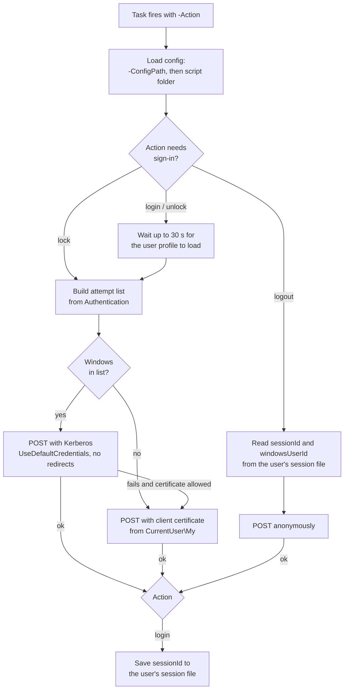

# Windows client

The ReadyRoom workstation agent is a single PowerShell script, `Update-WorkStatus.ps1`, run by five
Windows Task Scheduler tasks. Each task reports one session event to the server. There is no
service, tray application or user interface, so people have nothing to open or click.

All client files are in the release package's `windows-client/` folder:

| File | Purpose |
|---|---|
| `Update-WorkStatus.ps1` | The agent. A single entry point selected with `-Action login|lock|unlock|logout`. |
| `Install-InOutWorker.ps1` | Installer and uninstaller. Copies the script, prepares the data folders and registers the tasks. |
| `inoutworker.config.sample.json` | Sample configuration file. |
| `tasks/InOutWork-Login.xml`, `-Lock.xml`, `-Unlock.xml`, `-Logout.xml`, `-Disconnect.xml` | Task Scheduler definitions (UTF-16 XML). |


## How it works

| Task | Action | Windows trigger | Endpoint | Sign-in | Runs as |
|---|---|---|---|---|---|
| Login | `login` | User logon (30 s delay) | `POST /api/check/in` | certificate or Windows | the user, in their session |
| Lock | `lock` | Session lock | `POST /api/check/lock` | certificate or Windows | the user |
| Unlock | `unlock` | Session unlock | `POST /api/check/unlock` | certificate or Windows | the user |
| Logout | `logout` | Security event **4647** (user-initiated logoff) | `POST /api/check/out` | none (session id) | `LocalSystem` (S-1-5-18) |
| Disconnect | `logout` | **Remote disconnect** of a remote desktop session | `POST /api/check/out` | none (session id) | the user |

The four user tasks run as `BUILTIN\Users` (S-1-5-32-545) at *LeastPrivilege*, so they fire for
whichever user triggered them, in that user's own session, without elevation. All five tasks are
hidden, keep running when a laptop switches to battery, and are stopped after 5 minutes. The user
tasks ignore a new start while one is already running. The Logout task queues them instead, because
several users can log off a shared PC at once and each needs a run.



### Why logout is different

At logoff the user's profile, and with it the `CurrentUser\My` certificate store, has already been
unloaded, so the logoff task cannot authenticate. ReadyRoom handles this as follows:

1. At **login**, the server's response includes a server-generated `sessionId`. The agent saves it,
   with the Windows user name and the user's SID, to
   `%ProgramData%\InOutWorker\sessions\<SID>.json`. Only that user, SYSTEM and Administrators can
   read the file. The `sessionId` is never written to a log.
2. At **logoff**, the Logout task runs as SYSTEM and gets the user's SID from event 4647. It reads
   that user's file only if `sessions\` is owned by SYSTEM or Administrators, no part of the path is
   a junction or symbolic link, the file is owned by the user (or SYSTEM or Administrators), and the
   file was written for that SID. It then posts `{sessionId, windowsUserId}` to the unauthenticated
   `/api/check/out`.
3. On a **remote disconnect**, the user is still logged on, so the Disconnect task does the same as
   the user, with their own file.

The file is never deleted: the next login overwrites it.

The server accepts a `sessionId` once, for the logon that received it, and only within 7 days of
that check-in (`application.logoff.session-max-age-hours`). It records the check-out under that
check-in's DN. If there is no session file (for example, the login post failed), or its id is
unknown, already used (for example by a remote disconnect earlier in the same logon) or older than
that, the server refuses the logout with `401` and stores nothing. The user is checked out
automatically later (see [Operations](operator-guide.md#scheduled-jobs)), but only if their last
event was a screen lock.

### Server-side handling

- The **first unlock of the day** is stored as a `CHECK_IN`. This covers people who leave the
  workstation locked overnight instead of logging off.
- The request body binds exactly two fields: `sessionId` and `windowsUserId`. With certificate
  sign-in, the user's identity comes from the certificate. With Windows sign-in, it comes from the
  verified Kerberos ticket. A signed-in call is recorded under the signed-in user, whatever the body
  says: `sessionId` identifies the user only on a logout that does not sign in. The `windowsUserId`
  in the body is stored for information only and is never used for identity.

## Installation

Run from an **elevated** PowerShell prompt, inside the `windows-client\` folder:

```powershell
.\Install-InOutWorker.ps1 -BaseUrl "https://readyroom.example.com:8181/api/check"
```

What the installer does:

1. Copies `Update-WorkStatus.ps1` to the install folder (default `C:\Program Files\InOutWorker`),
   replacing any earlier copy so that an administrator owns it. It makes the folder writable by
   SYSTEM and Administrators only (Users may read and run), with nothing inherited from its parent.
   The Logout task runs the script as SYSTEM, so non-admins must not be able to change it or its
   configuration.
2. Writes `inoutworker.config.json` to the install folder **only if you passed at least one
   setting**, so re-running the installer without arguments does not blank an existing
   configuration. It warns if an existing configuration file is not owned by an administrator.
3. Prepares `%ProgramData%\InOutWorker`, where the SYSTEM task writes its log and reads each
   user's session file. Administrators own all three folders, and none inherits from
   `%ProgramData%`:

    | Folder | Access |
    |---|---|
    | `InOutWorker\` | SYSTEM and Administrators: full control. Users: list this folder only. |
    | `InOutWorker\logs\` | SYSTEM and Administrators only. |
    | `InOutWorker\sessions\` | SYSTEM and Administrators: full control. Users: create a file. CREATOR OWNER: read and rewrite the file they created. A user cannot list, change or delete anyone else's file. |

    On a workstation with an older client, it also removes the *Modify* grant that older versions
    gave `BUILTIN\Users` on `%ProgramData%\InOutWorker`, deletes any junction or symbolic link in
    that folder and the old shared `session.json`, and renames a `logs\` or `sessions\` folder it
    did not create to `logs.old-<timestamp>` or `sessions.old-<timestamp>`. It warns if an old
    `%ProgramData%\InOutWorker\inoutworker.config.json` is there: it is no longer read, so pass its
    settings to the installer instead.

4. Registers every `tasks\*.xml` under the `\InOutWork\` task folder: **Login**, **Lock**,
   **Unlock**, **Logout** and **Disconnect**. The task name comes from the `<URI>` in each XML, and
   the script path in each task is rewritten to the actual install folder. Existing tasks with the
   same name are replaced.

Re-run the installer on every workstation when you upgrade the client. Without arguments it keeps
the existing configuration, installs the new script and tasks, and corrects the folder permissions
an older client left behind.

### Installer parameters

| Parameter | Default | Description |
|---|---|---|
| `-InstallDir` | `$env:ProgramFiles\InOutWorker` | Where the script and its config file go. |
| `-BaseUrl` | – | Written to the config file. |
| `-Authentication` | – | `Certificate`, `Windows` or `Auto`. Written to the config file. |
| `-CertificateThumbprint` | – | Written to the config file. |
| `-SkipCertificateCheck` | off | Written to the config file. Only for lab servers with self-signed certificates. |
| `-Uninstall` | – | Unregisters the five tasks, deletes the install folder, and deletes the session files and `sessions\`. The logs are left in place, in `%ProgramData%\InOutWorker\logs` and in `%LOCALAPPDATA%\InOutWorker\logs` in each user's profile. |
| `-WhatIf` | – | Shows what would happen without changing anything. |

!!! note "Mass deployment"
    The installer needs the `tasks\` folder next to it and must run elevated. To deploy with a
    software distribution tool, copy the whole `windows-client\` folder to the target and run
    `powershell.exe -ExecutionPolicy Bypass -File Install-InOutWorker.ps1 -BaseUrl ...` as an
    administrator or SYSTEM. `CertificateSubjectContains` cannot be set through the installer, so
    to use it, ship your own `inoutworker.config.json` in the install folder instead.

### Prerequisites per workstation

=== "Certificate sign-in (default)"

    - A valid client certificate **with its private key** in the user's `CurrentUser\My` store,
      whose subject DN is the user's directory DN.
    - The server's CA trusted by Windows, unless you use `SkipCertificateCheck`.

=== "Windows sign-in"

    - The PC is domain-joined and the user signs in with a domain account.
    - `BaseUrl` uses the **host name registered as the service principal**, not an IP address.
      With an IP address, Windows falls back to NTLM, which the server rejects. The agent logs a
      warning when `BaseUrl` is an IP address and sign-in is not `Certificate`.
    - Windows sign-in is enabled on the server (`application.windows-auth.enabled: true`).

=== "Auto"

    Tries Windows sign-in first, then the certificate. Use it for laptops that cannot always reach a
    domain controller.

The **Logout** task's event trigger relies on Security event 4647, which needs the *Logoff* audit
subcategory to be enabled. It is enabled by default.

## Configuration

The script reads the **first** config file it finds, in this order:

1. the path given with `-ConfigPath`
2. `inoutworker.config.json` in the script's folder (where the installer writes it)

Explicit parameters override the file. The script itself never needs to be edited per machine.

```json title="inoutworker.config.json"
{
  "BaseUrl": "https://readyroom.example.com:8181/api/check",
  "Authentication": "Certificate",
  "CertificateThumbprint": "",
  "CertificateSubjectContains": "",
  "SkipCertificateCheck": false
}
```

| Key / parameter | Default | Description |
|---|---|---|
| `BaseUrl` / `-BaseUrl` | `https://192.168.1.29:8444/api/check` | Base URL of the check-in API, without a trailing slash (one is trimmed). It must start with `http://` or `https://`. The built-in value is a lab address, so always set it, for example to `https://readyroom.example.com:8181/api/check`. |
| `Authentication` / `-Authentication` | `Certificate` | How `login`, `lock` and `unlock` sign in. `Certificate`: client certificate only. `Windows`: Kerberos only. `Auto`: Kerberos, then the certificate. |
| `CertificateThumbprint` / `-CertificateThumbprint` | blank | Use the certificate with this thumbprint (non-hex characters are ignored). |
| `CertificateSubjectContains` / `-CertificateSubjectContains` | blank | If no thumbprint matches, use the first certificate whose subject contains this text. |
| `SkipCertificateCheck` / `-SkipCertificateCheck` | `false` | Turns off server certificate validation. **Lab use only.** |
| `-Action` | **required** | `login`, `logout`, `lock` or `unlock`. |
| `-UserSid` | – | For `logout` run as SYSTEM: the SID of the user whose session ended, which selects their session file. The Logout task passes it from event 4647. Run as a user, the user's own SID is used. |
| `-ConfigPath` | – | Read the configuration from this file. |
| `-TimeoutSec` | `30` | HTTP request timeout, in seconds. |
| `-ProfileWaitTimeoutSec` | `30` | For `login` and `unlock`: how long to wait for the user profile (and its certificate store) to load before continuing anyway. |
| `-WhatIf` | – | Load the configuration and choose a certificate, then log what would be posted without contacting the server. |

**Certificate selection.** The agent considers only certificates in `CurrentUser\My` that have a
private key and are currently within their validity period. It then picks one in this order: by
thumbprint, then by subject text, then the certificate with the most recent *NotBefore* date.

**TLS.** The agent enables TLS 1.2 and TLS 1.1 and leaves server certificate validation on unless
`SkipCertificateCheck` is set.

### Files on the workstation

| Path | Content |
|---|---|
| `C:\Program Files\InOutWorker\Update-WorkStatus.ps1` | The agent. |
| `C:\Program Files\InOutWorker\inoutworker.config.json` | Configuration, if the installer wrote one. |
| `%ProgramData%\InOutWorker\sessions\<SID>.json` | `sessionId`, `windowsUserId`, `userSid` and `savedAtUtc` from the user's last login. Readable only by that user, SYSTEM and Administrators. Overwritten by the next login, never deleted by a logout. |
| `%ProgramData%\InOutWorker\logs\inoutworker-yyyyMMdd.log` | The SYSTEM runs' log (the Logout task): one file per day. |
| `%LOCALAPPDATA%\InOutWorker\logs\inoutworker-yyyyMMdd.log` | The user's own runs' log (Login, Lock, Unlock and Disconnect), in their profile: one file per day. |

Lines in both logs look like `[yyyy-MM-dd HH:mm:ss][LEVEL][action] message`. Task Scheduler cannot
show console output, so everything is also written there. The logs never contain the `sessionId`
or a request body.

## Exit codes

| Code | Meaning |
|---|---|
| `0` | Success, or a `-WhatIf` run. |
| `1` | Configuration error (missing or invalid `BaseUrl`, unknown `Authentication`). |
| `2` | `Authentication` is `Certificate` and no usable client certificate was found. |
| `3` | Every sign-in attempt for the HTTP request failed. |
| `4` | `logout` ran as SYSTEM without a valid `-UserSid`, for example because the Logout task was started by hand rather than by event 4647. |

The exit code of each run appears in Task Scheduler as the task's *Last Run Result*.

## Testing on a workstation

```powershell
# Show what would happen, without contacting the server
& 'C:\Program Files\InOutWorker\Update-WorkStatus.ps1' -Action login -WhatIf

# Post a real lock event as the current user
& 'C:\Program Files\InOutWorker\Update-WorkStatus.ps1' -Action lock

# List the tasks and when each last ran
Get-ScheduledTask -TaskPath "\InOutWork\" | Get-ScheduledTaskInfo

# Run a task on demand
Start-ScheduledTask -TaskPath "\InOutWork\" -TaskName "InOutWork - Login"

# Today's log of the user's own runs (login, lock, unlock, disconnect)
Get-Content "$env:LOCALAPPDATA\InOutWorker\logs\inoutworker-$(Get-Date -Format yyyyMMdd).log" -Tail 50

# Today's log of the SYSTEM logoff runs (from an elevated prompt)
Get-Content "$env:ProgramData\InOutWorker\logs\inoutworker-$(Get-Date -Format yyyyMMdd).log" -Tail 50
```

Starting the **Logout** task by hand ends with exit code 4: only event 4647 tells it whose session
ended. To test a logout, log off, or run the script as the user with `-Action logout`.

## Troubleshooting the client

| Log message | Cause and fix |
|---|---|
| `No valid certificate with a private key in CurrentUser\My.` | The user has no usable certificate, or it has expired. Issue or renew one. With `Certificate`, the run ends with exit code 2. |
| `No certificate matched thumbprint ...; falling back.` | The configured thumbprint is stale, for example after a renewal. Update or clear `CertificateThumbprint`. |
| `Profile for <user> not ready after 30s; continuing anyway.` | The profile loaded slowly. The post may fail if the certificate store is not yet available. Increase `-ProfileWaitTimeoutSec` in the task's arguments if this keeps happening. |
| `POST to ... with Certificate sign-in failed (HTTP 401)` | The certificate was not accepted: it is not issued by a CA in the server's truststore, or its subject DN is not a directory user. |
| `The server redirected instead of accepting Windows sign-in (is application.windows-auth enabled on the server?)` | Windows sign-in is off on the server. Enable it, or set `Authentication` to `Certificate`. |
| `BaseUrl uses an IP address; Windows sign-in needs the server's host name.` | Use the host name registered as the SPN in `BaseUrl`. |
| `Logout has no sessionId; the server cannot resolve the DN from it.` | The login post did not complete, so there is no session file. Investigate why the login failed. The server refuses the logout with `401`. |
| `POST to .../out with Anonymous sign-in failed (HTTP 401) [unknown_session] ...` | The session id is unknown, already used (for example by a remote disconnect earlier in the same logon) or older than 7 days. Nothing is recorded; the user is checked out automatically if their last event was a lock. |
| `POST to .../out with Anonymous sign-in failed (HTTP 429) [rate_limited] ...` | The server has refused more than `application.logoff.refused-per-minute` logouts with an unusable session id from this address in the last minute. See [Troubleshooting](troubleshooting.md#check-ins-not-arriving). |
| `... does not exist; re-run Install-InOutWorker.ps1. ...` or `... is missing, a link, or not owned by SYSTEM or Administrators; not reading it. Re-run Install-InOutWorker.ps1.` | `sessions\` is missing or not as the installer left it. Re-run the installer. |
| `Session file ... is a link or not owned by <SID>; ignoring it.` | The file was replaced by a link, or another account created it. Delete it as an administrator; the user's next login writes a new one. |
| `Failed to write session file ...` | Usually another account created the user's session file first. An administrator deletes it. |
| `Logout needs -UserSid when run as SYSTEM ...` (exit 4) | The Logout task was started by hand, or its trigger does not pass the SID. Re-run the installer to restore the task. |
| `Server certificate validation DISABLED by configuration.` | `SkipCertificateCheck` is on. Turn it off outside a lab. |
| A TLS or trust error for the server certificate | Windows does not trust the server's CA. Install the CA or fix the server certificate's host name. |

For server-side causes, see [Troubleshooting](troubleshooting.md).
