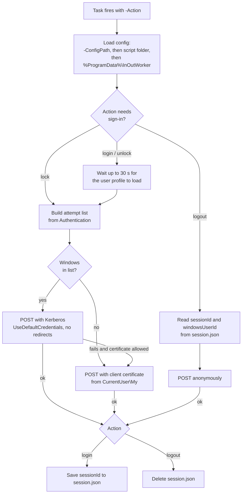

# Windows client

The ReadyRoom workstation agent is a single PowerShell script, `Update-WorkStatus.ps1`, run by four
Windows Task Scheduler tasks. Each task reports one session event to the server. There is no
service, tray application or user interface, so people have nothing to open or click.

All client files live in the repository's `powershell/` folder:

| File | Purpose |
|---|---|
| `Update-WorkStatus.ps1` | The agent. A single entry point selected with `-Action login|lock|unlock|logout`. |
| `Install-InOutWorker.ps1` | Installer and uninstaller. Copies the script, prepares the data folder and registers the tasks. |
| `inoutworker.config.sample.json` | Sample configuration file. |
| `tasks/InOutWork-Login.xml`, `-Lock.xml`, `-Unlock.xml`, `-Logout.xml` | Task Scheduler definitions (UTF-16 XML). |
| `login.ps1`, `logout.ps1`, `updatestatus.ps1`, `Loginout LogOFF.xml`, `logout post.xml` | **Superseded.** Kept for reference only. Do not deploy them: `updatestatus.ps1` never worked, and the old scripts trusted every server certificate. |

## How it works

| Action | Windows trigger | Endpoint | Sign-in | Runs as |
|---|---|---|---|---|
| `login` | User logon (30 s delay) | `POST /api/check/in` | certificate or Windows | the user, in their session |
| `lock` | Session lock | `POST /api/check/lock` | certificate or Windows | the user |
| `unlock` | Session unlock | `POST /api/check/unlock` | certificate or Windows | the user |
| `logout` | Security event **4647** (user-initiated logoff) or a **remote disconnect** | `POST /api/check/out` | none | `LocalSystem` (S-1-5-18) |

The user tasks run as `BUILTIN\Users` (S-1-5-32-545) at *HighestAvailable*, so they fire for
whichever user triggered them, in that user's own session. All four tasks are hidden, ignore a new
start while one is already running, keep running when a laptop switches to battery, and are stopped
after 5 minutes.



### Why logout is different

At logoff the user's profile, and with it the `CurrentUser\My` certificate store, has already been
unloaded, so the logoff task cannot authenticate. ReadyRoom handles this as follows:

1. At **login**, the server's response includes a server-generated `sessionId`. The agent saves it,
   with the Windows user name, to `%ProgramData%\InOutWorker\session.json` and grants
   *Authenticated Users* read access to the file.
2. At **logout**, the SYSTEM task reads `session.json` and posts `{sessionId, windowsUserId}` to the
   unauthenticated `/api/check/out`. The server finds the DN of the record with that session id,
   writes the check-out under it, and the agent deletes the file.

If `session.json` is missing (for example, the login post failed), the logout is still posted
without a session id. The server then stores a `CHECK_OUT` with no DN, which belongs to nobody. The
user is checked out automatically later (see [Operations](operator-guide.md#scheduled-jobs)), but
only if their last event was a screen lock.

### Server-side handling

- The **first unlock of the day** is stored as a `CHECK_IN`. This covers people who leave the
  workstation locked overnight instead of logging off.
- The request body binds exactly two fields: `sessionId` and `windowsUserId`. With certificate
  sign-in, the user's identity comes from the certificate. With Windows sign-in, it comes from the
  verified Kerberos ticket. The `windowsUserId` in the body is stored for information only and is
  never used for identity.

## Installation

Run from an **elevated** PowerShell prompt, inside the `powershell\` folder:

```powershell
.\Install-InOutWorker.ps1 -BaseUrl "https://readyroom.example.com:8444/api/check"
```

What the installer does:

1. Copies `Update-WorkStatus.ps1` to the install folder (default `C:\Program Files\InOutWorker`).
   It lives under Program Files because the tasks run elevated or as SYSTEM, and a script that runs
   elevated must not be writable by non-admins.
2. Writes `inoutworker.config.json` to the install folder **only if you passed at least one
   setting**, so re-running the installer without arguments does not blank an existing
   configuration.
3. Creates `%ProgramData%\InOutWorker` and grants `BUILTIN\Users` *Modify* on it, so a second user
   on the same PC can overwrite `session.json`.
4. Registers every `tasks\*.xml` under the `\InOutWork\` task folder. The task name comes from the
   `<URI>` in each XML, and the script path in each task is rewritten to the actual install folder.
   Existing tasks with the same name are replaced.

### Installer parameters

| Parameter | Default | Description |
|---|---|---|
| `-InstallDir` | `$env:ProgramFiles\InOutWorker` | Where the script and its config file go. |
| `-BaseUrl` | – | Written to the config file. |
| `-Authentication` | – | `Certificate`, `Windows` or `Auto`. Written to the config file. |
| `-CertificateThumbprint` | – | Written to the config file. |
| `-SkipCertificateCheck` | off | Written to the config file. Only for lab servers with self-signed certificates. |
| `-Uninstall` | – | Unregisters the four tasks and deletes the install folder. `%ProgramData%\InOutWorker` and its logs are left in place. |
| `-WhatIf` | – | Shows what would happen without changing anything. |

!!! note "Mass deployment"
    The installer needs the `tasks\` folder next to it and must run elevated. To deploy with a
    software distribution tool, copy the whole `powershell\` folder to the target and run
    `powershell.exe -ExecutionPolicy Bypass -File Install-InOutWorker.ps1 -BaseUrl ...` as an
    administrator or SYSTEM. `CertificateSubjectContains` cannot be set through the installer, so
    to use it, ship your own `inoutworker.config.json` in the install folder instead.

### Prerequisites per workstation

=== "Certificate sign-in (default)"

    - A valid client certificate **with its private key** in the user's `CurrentUser\My` store,
      whose subject DN is the user's directory DN.
    - The server's CA trusted by Windows, unless you use `SkipCertificateCheck`.

=== "Windows sign-in"

    - The PC is domain-joined and the user signs in with a domain account.
    - `BaseUrl` uses the **host name registered as the service principal**, not an IP address.
      With an IP address, Windows falls back to NTLM, which the server rejects. The agent logs a
      warning when `BaseUrl` is an IP address and sign-in is not `Certificate`.
    - Windows sign-in is enabled on the server (`application.windows-auth.enabled: true`).

=== "Auto"

    Tries Windows sign-in first, then the certificate. Use it for laptops that cannot always reach a
    domain controller.

The **Logout** task's event trigger relies on Security event 4647, which needs the *Logoff* audit
subcategory to be enabled. It is enabled by default.

## Configuration

The script reads the **first** config file it finds, in this order:

1. the path given with `-ConfigPath`
2. `inoutworker.config.json` in the script's folder (where the installer writes it)
3. `%ProgramData%\InOutWorker\inoutworker.config.json`

Explicit parameters override the file. The script itself never needs to be edited per machine.

```json title="inoutworker.config.json"
{
  "BaseUrl": "https://readyroom.example.com:8444/api/check",
  "Authentication": "Certificate",
  "CertificateThumbprint": "",
  "CertificateSubjectContains": "",
  "SkipCertificateCheck": false
}
```

| Key / parameter | Default | Description |
|---|---|---|
| `BaseUrl` / `-BaseUrl` | `https://192.168.1.29:8444/api/check` | Base URL of the check-in API, without a trailing slash (one is trimmed). It must start with `http://` or `https://`. The built-in value is a lab address, so always set it. |
| `Authentication` / `-Authentication` | `Certificate` | How `login`, `lock` and `unlock` sign in. `Certificate`: client certificate only. `Windows`: Kerberos only. `Auto`: Kerberos, then the certificate. |
| `CertificateThumbprint` / `-CertificateThumbprint` | blank | Use the certificate with this thumbprint (non-hex characters are ignored). |
| `CertificateSubjectContains` / `-CertificateSubjectContains` | blank | If no thumbprint matches, use the first certificate whose subject contains this text. |
| `SkipCertificateCheck` / `-SkipCertificateCheck` | `false` | Turns off server certificate validation. **Lab use only.** The old scripts did this unconditionally. |
| `-Action` | **required** | `login`, `logout`, `lock` or `unlock`. |
| `-ConfigPath` | – | Read the configuration from this file. |
| `-TimeoutSec` | `30` | HTTP request timeout, in seconds. |
| `-ProfileWaitTimeoutSec` | `30` | For `login` and `unlock`: how long to wait for the user profile (and its certificate store) to load before continuing anyway. |
| `-WhatIf` | – | Load the configuration and choose a certificate, then log what would be posted without contacting the server. |

**Certificate selection.** The agent considers only certificates in `CurrentUser\My` that have a
private key and are currently within their validity period. It then picks one in this order: by
thumbprint, then by subject text, then the certificate with the most recent *NotBefore* date.

**TLS.** The agent enables TLS 1.2 and TLS 1.1 and leaves server certificate validation on unless
`SkipCertificateCheck` is set.

### Files on the workstation

| Path | Content |
|---|---|
| `C:\Program Files\InOutWorker\Update-WorkStatus.ps1` | The agent. |
| `C:\Program Files\InOutWorker\inoutworker.config.json` | Configuration, if the installer wrote one. |
| `%ProgramData%\InOutWorker\session.json` | `sessionId`, `windowsUserId`, `savedAtUtc` and the server's record from the last login. Deleted after a successful logout. |
| `%ProgramData%\InOutWorker\logs\inoutworker-yyyyMMdd.log` | One log file per day. Lines look like `[yyyy-MM-dd HH:mm:ss][LEVEL][action] message`. Task Scheduler cannot show console output, so everything is also written here. |

## Exit codes

| Code | Meaning |
|---|---|
| `0` | Success, or a `-WhatIf` run. |
| `1` | Configuration error (missing or invalid `BaseUrl`, unknown `Authentication`). |
| `2` | `Authentication` is `Certificate` and no usable client certificate was found. |
| `3` | Every sign-in attempt for the HTTP request failed. |

The script's help text also lists `4` (session file unusable), but the current script never
returns it. A session file it cannot read is logged as a warning and the logout is posted without a
session id.

The exit code of each run appears in Task Scheduler as the task's *Last Run Result*.

## Testing on a workstation

```powershell
# Show what would happen, without contacting the server
& 'C:\Program Files\InOutWorker\Update-WorkStatus.ps1' -Action login -WhatIf

# Post a real lock event as the current user
& 'C:\Program Files\InOutWorker\Update-WorkStatus.ps1' -Action lock

# List the tasks and when each last ran
Get-ScheduledTask -TaskPath "\InOutWork\" | Get-ScheduledTaskInfo

# Run a task on demand
Start-ScheduledTask -TaskPath "\InOutWork\" -TaskName "InOutWork - Login"

# Today's log
Get-Content "$env:ProgramData\InOutWorker\logs\inoutworker-$(Get-Date -Format yyyyMMdd).log" -Tail 50
```

## Troubleshooting the client

| Log message | Cause and fix |
|---|---|
| `No valid certificate with a private key in CurrentUser\My.` | The user has no usable certificate, or it has expired. Issue or renew one. With `Certificate`, the run ends with exit code 2. |
| `No certificate matched thumbprint ...; falling back.` | The configured thumbprint is stale, for example after a renewal. Update or clear `CertificateThumbprint`. |
| `Profile for <user> not ready after 30s; continuing anyway.` | The profile loaded slowly. The post may fail if the certificate store is not yet available. Increase `-ProfileWaitTimeoutSec` in the task's arguments if this keeps happening. |
| `POST to ... with Certificate sign-in failed (HTTP 401)` or a redirect | The certificate was not accepted: it is not issued by a CA in the server's truststore, or its subject DN is not a directory user. |
| `The server redirected instead of accepting Windows sign-in (is application.windows-auth enabled on the server?)` | Windows sign-in is off on the server. Enable it, or set `Authentication` to `Certificate`. |
| `BaseUrl uses an IP address; Windows sign-in needs the server's host name.` | Use the host name registered as the SPN in `BaseUrl`. |
| `Logout has no sessionId; the server cannot resolve the DN from it.` | The login post did not complete, so there was no `session.json`. Investigate why the login failed. |
| `Server certificate validation DISABLED by configuration.` | `SkipCertificateCheck` is on. Turn it off outside a lab. |
| A TLS or trust error for the server certificate | Windows does not trust the server's CA. Install the CA or fix the server certificate's host name. |

For server-side causes, see [Troubleshooting](troubleshooting.md).
