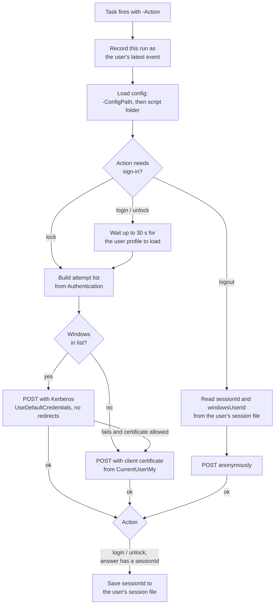

# Windows client

The ReadyRoom workstation agent is a single PowerShell script, `Update-WorkStatus.ps1`, run by six
Windows Task Scheduler tasks. Each task reports one session event to the server. There is no
service, tray application or user interface, so people have nothing to open or click.

All client files are in the release package's `windows-client/` folder:

| File | Purpose |
|---|---|
| `Update-WorkStatus.ps1` | The agent. A single entry point selected with `-Action login|lock|unlock|logout`. |
| `Install-InOutWorker.ps1` | Installer and uninstaller. Copies the script, prepares the data folders and registers the tasks. |
| `inoutworker.config.sample.json` | Sample configuration file. |
| `tasks/InOutWork-Login.xml`, `-Lock.xml`, `-Unlock.xml`, `-Logout.xml`, `-Disconnect.xml`, `-Reconnect.xml` | Task Scheduler definitions (UTF-16 XML). |


## How it works

| Task | Action | Windows trigger | Endpoint | Sign-in | Runs as |
|---|---|---|---|---|---|
| Login | `login` | User logon (30 s delay) | `POST /api/check/in` | certificate or Windows | the user, in their session |
| Lock | `lock` | Session lock | `POST /api/check/lock` | certificate or Windows | the user |
| Unlock | `unlock` | Session unlock | `POST /api/check/unlock` | certificate or Windows | the user |
| Logout | `logout` | Security event **4647** (user-initiated logoff) | `POST /api/check/out` | none (session id) | `LocalSystem` (S-1-5-18) |
| Disconnect | `lock` | **Remote disconnect** of a Remote Desktop or VDI session | `POST /api/check/lock` | certificate or Windows | the user |
| Reconnect | `unlock` | **Remote connect** to a disconnected Remote Desktop or VDI session | `POST /api/check/unlock` | certificate or Windows | the user |

A disconnected remote session is treated like a locked screen: the user is still logged on and may
reconnect, so the Disconnect task reports a lock and the Reconnect task an unlock. Only the real
logoff (the Logout task) reports a check-out. A session left disconnected is checked out by the
automatic check-out, as a locked screen is. A logoff reported while the screen is locked or the
session disconnected (a restart, shutdown or update, or the session signed out by someone else)
counts the person as gone from the lock, not the logoff.

The five user tasks run as `BUILTIN\Users` (S-1-5-32-545) at *LeastPrivilege*, so they fire for
whichever user triggered them, in that user's own session, without elevation. All six tasks are
hidden, keep running when a laptop switches to battery, and are stopped after 5 minutes. From
0.0.11 the user tasks start a run for every event, alongside one still running (*Parallel*): a lock
that comes while an earlier lock is still retrying, or another user's event on a shared PC, gets
its own run. Up to 0.0.10 they ignored a new start while one was running, and that event was never
sent. The script keeps the order: an older run does not post once a newer one has started (see
[Order of events](#order-of-events)). The Logout task queues its runs, because several users can
log off a shared PC at once and each needs a run.



### Why logout is different

At logoff the user's profile, and with it the `CurrentUser\My` certificate store, has already been
unloaded, so the logoff task cannot authenticate. ReadyRoom handles this as follows:

1. Whenever the server records an event as the day's **check-in**, its response includes a
   server-generated `sessionId`: at **login**, and at an **unlock** (or a remote reconnect) that the
   server records as the check-in because the person has none yet that day. The agent saves it,
   with the Windows user name and the user's SID, to
   `%ProgramData%\InOutWorker\sessions\<SID>.json`. Only that user, SYSTEM and Administrators can
   read the file. From 0.0.11 the agent restricts the file before the `sessionId` goes into it, and
   writes nothing if it cannot; and it writes nothing into a file named after the user that another
   account created first (it logs an error, and an administrator deletes that file). The
   `sessionId` is never written to a log. A login whose response carries no
   `sessionId`, and any other unlock, leave the cached file as it is, and the SYSTEM run never
   writes it. So a workstation kept logged on for days or weeks and only locked overnight gets a
   fresh `sessionId` with each day's first unlock, and its eventual logoff still has a usable one.
2. At **logoff**, the Logout task runs as SYSTEM and gets the user's SID from event 4647. It reads
   that user's file only if `sessions\` is owned by SYSTEM or Administrators, no part of the path is
   a junction or symbolic link, the file is owned by the user (or SYSTEM or Administrators), and the
   file was written for that SID. It then posts `{sessionId, windowsUserId}` to the unauthenticated
   `/api/check/out`.

A remote disconnect is not a logoff: it is reported as a lock, so it does not use up the
`sessionId`. The file is never deleted: the next check-in overwrites it.

The server accepts a `sessionId` once, for the check-in that received it, and only within 7 days of
that check-in (`application.logoff.session-max-age-hours`). It records the check-out under that
check-in's DN. If there is no session file (for example, the login post failed), or its id is
unknown, already used or older than that, the server refuses the logout with `401` and stores
nothing. The user is checked out automatically later (see
[Operations](operator-guide.md#scheduled-jobs)), but only if their last event was a screen lock
or a remote disconnect.

### Server-side handling

- An **unlock** is stored as a `CHECK_IN` when the person has no check-in yet that day, whatever
  else came before it (a lock just after midnight, or the automatic check-out of last night's
  lock). This covers people who leave the workstation locked overnight instead of logging off.
  The answer to such an unlock carries a new `sessionId`, as a login's does.
- The request body binds three fields: `sessionId`, `windowsUserId` and, from 0.0.11, `machine`.
  With certificate sign-in, the user's identity comes from the certificate. With Windows sign-in,
  it comes from the verified Kerberos ticket. A signed-in call is recorded under the signed-in
  user, whatever the body says: `sessionId` identifies the user only on a logout that does not sign
  in. The `windowsUserId` in the body is stored for information only and is never used for
  identity.
- `machine` is the workstation's computer name (`%COMPUTERNAME%`), which the agent sends with
  every event. The server keeps it with the record (at most 255 characters), and tells one
  workstation's events from another's for someone signed in on two PCs: a lock on one is not
  hidden by a later lock or logoff on the other, and is still checked out automatically. A server
  older than 0.0.11 ignores the field, and a client older than 0.0.11 sends none; its events are
  read as before. The name is in the person's data export (see [Privacy](privacy.md#export)).
- An event the server cannot store answers `500` (from 0.0.11), and the agent logs the failure
  and ends with exit code 3. Up to 0.0.10 such a failure answered `200`, and the agent logged
  `Server accepted` for an event that was lost.

### Order of events

Each run first records itself as the user's latest event, in `%LOCALAPPDATA%\InOutWorker\latest-event`,
before anything that can make it wait (the profile, the certificate store). It checks that record
before it posts, and again before each retry after a `503`: once a later logon, lock or unlock of
the same user has started, the older run posts nothing and logs
`Not sending '<action>': a later logon, lock or unlock of this user has started.` Sent after the
newer event, it would undo it: an unlock posted after the lock that followed it would show the
person at work while the screen is locked. A `-WhatIf` run records nothing. From 0.0.11 the wait
for the profile matches it by the user's SID, not by the account name, so a renamed account or a
temporary profile no longer waits the full 30 seconds.

## Installation

Run from an **elevated** PowerShell prompt, inside the `windows-client\` folder:

```powershell
.\Install-InOutWorker.ps1 -BaseUrl "https://readyroom.example.com:8181/api/check"
```

What the installer does:

1. Copies `Update-WorkStatus.ps1` to the install folder (default `C:\Program Files\InOutWorker`),
   replacing any earlier copy so that an administrator owns it. It makes the folder writable by
   SYSTEM and Administrators only (Users may read and run), with nothing inherited from its parent.
   The Logout task runs the script as SYSTEM, so non-admins must not be able to change it or its
   configuration.
2. Writes `inoutworker.config.json` to the install folder **only if you passed at least one
   setting**, so re-running the installer without arguments does not blank an existing
   configuration. From 0.0.11 it writes the settings you pass over what the file already holds
   and keeps the rest: `.\Install-InOutWorker.ps1 -Authentication Auto` alone switches an installed
   workstation over and keeps its `BaseUrl`, certificate settings and `Retries`. Up to 0.0.10 such
   a re-run wrote a file with only that setting. It warns if an existing configuration file is not
   owned by an administrator, and keeps none of that file's settings.

    Before it changes anything, the installer works out the resulting configuration and stops
    (exit code 1, *No BaseUrl is configured. Pass -BaseUrl ...*) when it would have no `BaseUrl`:
    a first install without `-BaseUrl`, or a re-run over a file without one. It also stops when the
    existing file cannot be read as JSON: correct or delete it, then run the installer again.

3. Prepares `%ProgramData%\InOutWorker`, where the SYSTEM task writes its log and reads each
   user's session file. Administrators own all three folders, and none inherits from
   `%ProgramData%`:

    | Folder | Access |
    |---|---|
    | `InOutWorker\` | SYSTEM and Administrators: full control. Users: list this folder only. |
    | `InOutWorker\logs\` | SYSTEM and Administrators only. |
    | `InOutWorker\sessions\` | SYSTEM and Administrators: full control. Users: create a file. CREATOR OWNER: read and rewrite the file they created. A user cannot list, change or delete anyone else's file. |

    On a workstation with an older client, it also removes the *Modify* grant that older versions
    gave `BUILTIN\Users` on `%ProgramData%\InOutWorker`, deletes any junction or symbolic link in
    that folder and the old shared `session.json`, and renames a `logs\` or `sessions\` folder it
    did not create to `logs.old-<timestamp>` or `sessions.old-<timestamp>`. It warns if an old
    `%ProgramData%\InOutWorker\inoutworker.config.json` is there: it is no longer read, so pass its
    settings to the installer instead.

4. Registers every `tasks\*.xml` under the `\InOutWork\` task folder: **Login**, **Lock**,
   **Unlock**, **Logout**, **Disconnect** and **Reconnect**. The task name comes from the `<URI>` in each XML, and
   the script path in each task is rewritten to the actual install folder. Existing tasks with the
   same name are replaced.

Re-run the installer on every workstation when you upgrade the client. Without arguments it keeps
the existing configuration, installs the new script and tasks, and corrects the folder permissions
an older client left behind. The 0.0.11 client also works with an older server, but only a 0.0.11
server keeps the workstation's name and answers a failed event with an error.

### Installer parameters

| Parameter | Default | Description |
|---|---|---|
| `-InstallDir` | `$env:ProgramFiles\InOutWorker` | Where the script and its config file go. |
| `-BaseUrl` | – | Written to the config file. Required unless the installed config file already has one. |
| `-Authentication` | – | `Certificate`, `Windows` or `Auto`. Written to the config file. |
| `-CertificateThumbprint` | – | Written to the config file. |
| `-SkipCertificateCheck` | off | Written to the config file, only when passed (from 0.0.11 a re-run without it keeps the file's value). Only for lab servers with self-signed certificates. |
| `-Uninstall` | – | Unregisters the six tasks, deletes the install folder, and deletes the session files and `sessions\`. The logs are left in place, in `%ProgramData%\InOutWorker\logs` and in `%LOCALAPPDATA%\InOutWorker\logs` in each user's profile. |
| `-WhatIf` | – | Shows what would happen without changing anything. |

!!! note "Mass deployment"
    The installer needs the `tasks\` folder next to it and must run elevated. To deploy with a
    software distribution tool, copy the whole `windows-client\` folder to the target and run
    `powershell.exe -ExecutionPolicy Bypass -File Install-InOutWorker.ps1 -BaseUrl ...` as an
    administrator or SYSTEM. `CertificateSubjectContains`, `Retries` and `MaxRetryWaitSeconds`
    cannot be set through the installer, so to use them, ship your own `inoutworker.config.json` in
    the install folder instead; the installer keeps them when it is run again.

### Prerequisites per workstation

=== "Certificate sign-in (default)"

    - A valid client certificate **with its private key** in the user's `CurrentUser\My` store,
      whose subject DN is the user's directory DN.
    - The server's CA trusted by Windows, unless you use `SkipCertificateCheck`.

=== "Windows sign-in"

    - The PC is domain-joined and the user signs in with a domain account.
    - `BaseUrl` uses the **host name registered as the service principal**, not an IP address.
      With an IP address, Windows falls back to NTLM, which the server rejects. The agent logs a
      warning when `BaseUrl` is an IP address and sign-in is not `Certificate`.
    - Windows sign-in is enabled on the server (`application.windows-auth.enabled: true`).

=== "Auto"

    Tries Windows sign-in first, then the certificate. Use it for laptops that cannot always reach a
    domain controller.

The **Logout** task's event trigger relies on Security event 4647, which needs the *Logoff* audit
subcategory to be enabled. It is enabled by default.

## Configuration

The script reads the **first** config file it finds, in this order:

1. the path given with `-ConfigPath`
2. `inoutworker.config.json` in the script's folder (where the installer writes it)

Explicit parameters override the file. The script itself never needs to be edited per machine.

```json title="inoutworker.config.json"
{
  "BaseUrl": "https://readyroom.example.com:8181/api/check",
  "Authentication": "Certificate",
  "CertificateThumbprint": "",
  "CertificateSubjectContains": "",
  "SkipCertificateCheck": false,
  "Retries": 3,
  "MaxRetryWaitSeconds": 30
}
```

| Key / parameter | Default | Description |
|---|---|---|
| `BaseUrl` / `-BaseUrl` | none | Base URL of the check-in API, without a trailing slash (one is trimmed), for example `https://readyroom.example.com:8181/api/check`. It must start with `http://` or `https://`. Required: from 0.0.11 there is no built-in address, and a run without one ends with exit code 1 (`Configuration error: BaseUrl is not configured.`). Up to 0.0.10 the client fell back to a lab address. |
| `Authentication` / `-Authentication` | `Certificate` | How `login`, `lock` and `unlock` sign in. `Certificate`: client certificate only. `Windows`: Kerberos only. `Auto`: Kerberos, then the certificate. |
| `CertificateThumbprint` / `-CertificateThumbprint` | blank | Use the certificate with this thumbprint (non-hex characters are ignored). |
| `CertificateSubjectContains` / `-CertificateSubjectContains` | blank | If no thumbprint matches, use the first certificate whose subject contains this text. |
| `SkipCertificateCheck` / `-SkipCertificateCheck` | `false` | Turns off server certificate validation. **Lab use only.** |
| `Retries` | `3` | After a `503` (the server could not reach its directory for a moment): how many more times to send the event. `0` sends it once. |
| `MaxRetryWaitSeconds` | `30` | The longest wait before each of those tries. The agent waits as long as the server's `Retry-After` says (5 seconds), up to this. |
| `-Action` | **required** | `login`, `logout`, `lock` or `unlock`. |
| `-UserSid` | – | For `logout` run as SYSTEM: the SID of the user whose session ended, which selects their session file. The Logout task passes it from event 4647. Run as a user, the user's own SID is used. |
| `-ConfigPath` | – | Read the configuration from this file. |
| `-TimeoutSec` | `30` | HTTP request timeout, in seconds. |
| `-ProfileWaitTimeoutSec` | `30` | For `login` and `unlock`: how long to wait for the user profile (and its certificate store) to load before continuing anyway. |
| `-WhatIf` | – | Load the configuration and choose a certificate, then log what would be posted without contacting the server. |

**Certificate selection.** The agent considers only certificates in `CurrentUser\My` that have a
private key and are currently within their validity period. It then picks one in this order: by
thumbprint, then by subject text, then the certificate with the most recent *NotBefore* date.

**TLS.** The agent enables TLS 1.2 and TLS 1.1 and leaves server certificate validation on unless
`SkipCertificateCheck` is set.

### Files on the workstation

| Path | Content |
|---|---|
| `C:\Program Files\InOutWorker\Update-WorkStatus.ps1` | The agent. |
| `C:\Program Files\InOutWorker\inoutworker.config.json` | Configuration, if the installer wrote one. |
| `%ProgramData%\InOutWorker\sessions\<SID>.json` | `sessionId`, `windowsUserId`, `userSid` and `savedAtUtc` from the user's last check-in (a login, or an unlock the server recorded as the day's check-in). Readable only by that user, SYSTEM and Administrators. Overwritten by the next check-in, never deleted by a logout. |
| `%ProgramData%\InOutWorker\logs\inoutworker-yyyyMMdd.log` | The SYSTEM runs' log (the Logout task): one file per day. |
| `%LOCALAPPDATA%\InOutWorker\latest-event` | A token naming the user's latest logon, lock or unlock run, written at the start of each run, so that an older run posts nothing once a later one has started. See [Order of events](#order-of-events). |
| `%LOCALAPPDATA%\InOutWorker\logs\inoutworker-yyyyMMdd.log` | The user's own runs' log (Login, Lock, Unlock, Disconnect and Reconnect), in their profile: one file per day. |

Lines in both logs look like `[yyyy-MM-dd HH:mm:ss][LEVEL][action] message`. Task Scheduler cannot
show console output, so everything is also written there. The logs never contain the `sessionId`
or a request body.

## Exit codes

| Code | Meaning |
|---|---|
| `0` | Success, or a `-WhatIf` run. |
| `1` | Configuration error (missing or invalid `BaseUrl`, unknown `Authentication`). The installer also ends with `1` when no `BaseUrl` would be configured. |
| `2` | `Authentication` is `Certificate` and no usable client certificate was found. |
| `3` | Every sign-in attempt for the HTTP request failed, or the server answered an error (`500` included). |
| `4` | `logout` ran as SYSTEM without a valid `-UserSid`, for example because the Logout task was started by hand rather than by event 4647. |

The exit code of each run appears in Task Scheduler as the task's *Last Run Result*.

## Testing on a workstation

```powershell
# Show what would happen, without contacting the server
& 'C:\Program Files\InOutWorker\Update-WorkStatus.ps1' -Action login -WhatIf

# Post a real lock event as the current user
& 'C:\Program Files\InOutWorker\Update-WorkStatus.ps1' -Action lock

# List the tasks and when each last ran
Get-ScheduledTask -TaskPath "\InOutWork\" | Get-ScheduledTaskInfo

# Run a task on demand
Start-ScheduledTask -TaskPath "\InOutWork\" -TaskName "InOutWork - Login"

# Today's log of the user's own runs (login, lock, unlock, disconnect, reconnect)
Get-Content "$env:LOCALAPPDATA\InOutWorker\logs\inoutworker-$(Get-Date -Format yyyyMMdd).log" -Tail 50

# Today's log of the SYSTEM logoff runs (from an elevated prompt)
Get-Content "$env:ProgramData\InOutWorker\logs\inoutworker-$(Get-Date -Format yyyyMMdd).log" -Tail 50
```

Starting the **Logout** task by hand ends with exit code 4: only event 4647 tells it whose session
ended. To test a logout, log off, or run the script as the user with `-Action logout`.

## Troubleshooting the client

| Log message | Cause and fix |
|---|---|
| `No valid certificate with a private key in CurrentUser\My.` | The user has no usable certificate, or it has expired. Issue or renew one. With `Certificate`, the run ends with exit code 2. |
| `No certificate matched thumbprint ...; falling back.` | The configured thumbprint is stale, for example after a renewal. Update or clear `CertificateThumbprint`. |
| `Profile for <user> not ready after 30s; continuing anyway.` | The profile loaded slowly. The post may fail if the certificate store is not yet available. Increase `-ProfileWaitTimeoutSec` in the task's arguments if this keeps happening. |
| `POST to ... with Certificate sign-in failed (HTTP 401)` | The certificate was not accepted: it is not issued by a CA in the server's truststore, or its subject DN is not a directory user. |
| `POST to ... failed (HTTP 503) [directory_unavailable] ...; trying again in 5s (1 of 3).` | The server could not reach its directory to check who signed in (it tries three times itself). The user was not refused. The agent sends the event again after the server's `Retry-After`, up to `Retries` times. If the directory still does not answer, the run ends with exit code 3, and the next logon, lock or unlock goes through once the directory answers. |
| `Not sending 'lock': a later logon, lock or unlock of this user has started.` | The same user locked, unlocked or logged on again before this run posted, or while it was retrying a `503`. The older event is dropped, because sent after the newer one it would undo it (a lock after the unlock that followed it would show the person as locked while they work). |
| `Configuration error: BaseUrl is not configured.` (exit 1) | The config file has no `BaseUrl`, or there is no config file. Re-run the installer with `-BaseUrl`. |
| `POST to ... failed (HTTP 500) [internal_error] ...` (exit 3) | The server could not store the event (a database error or a lock timeout). The event is not recorded and is not sent again; the server log has the cause. |
| `The server redirected instead of accepting Windows sign-in (is application.windows-auth enabled on the server?)` | Windows sign-in is off on the server. Enable it, or set `Authentication` to `Certificate`. |
| `BaseUrl uses an IP address; Windows sign-in needs the server's host name.` | Use the host name registered as the SPN in `BaseUrl`. |
| `Logout has no sessionId; the server cannot resolve the DN from it.` | The login post did not complete, so there is no session file. Investigate why the login failed. The server refuses the logout with `401`. |
| `POST to .../out with Anonymous sign-in failed (HTTP 401) [unknown_session] ...` | The session id is unknown, already used or older than 7 days. Nothing is recorded; the user is checked out automatically if their last event was a lock. |
| `POST to .../out with Anonymous sign-in failed (HTTP 429) [rate_limited] ...` | The server has refused more than `application.logoff.refused-per-minute` logouts with an unusable session id from this address in the last minute. See [Troubleshooting](troubleshooting.md#check-ins-not-arriving). |
| `... does not exist; re-run Install-InOutWorker.ps1. ...` or `... is missing, a link, or not owned by SYSTEM or Administrators; not reading it. Re-run Install-InOutWorker.ps1.` | `sessions\` is missing or not as the installer left it. Re-run the installer. |
| `Session file ... is a link or not owned by <SID>; ignoring it.` | At logoff: the file was replaced by a link, or another account created it. Delete it as an administrator; the user's next login writes a new one. |
| `Session file ... is a link or not owned by <SID>; not writing the sessionId into it. An administrator should delete it; until then this user's logoff cannot be attributed.` (`ERROR`) | At check-in: another account created a file named after this user, or it is a link. The agent writes nothing into it. Delete it as an administrator; the user's next login writes a new one. |
| `Did not write the session file ...: .... The next logoff cannot be attributed.` (`ERROR`) | The file could not be created, restricted to its user or written. The agent never leaves a `sessionId` in a file it could not restrict. Check the `sessions\` folder's permissions by re-running the installer. |
| `Logout needs -UserSid when run as SYSTEM ...` (exit 4) | The Logout task was started by hand, or its trigger does not pass the SID. Re-run the installer to restore the task. |
| `Server certificate validation DISABLED by configuration.` | `SkipCertificateCheck` is on. Turn it off outside a lab. |
| A TLS or trust error for the server certificate | Windows does not trust the server's CA. Install the CA or fix the server certificate's host name. |

For server-side causes, see [Troubleshooting](troubleshooting.md).
