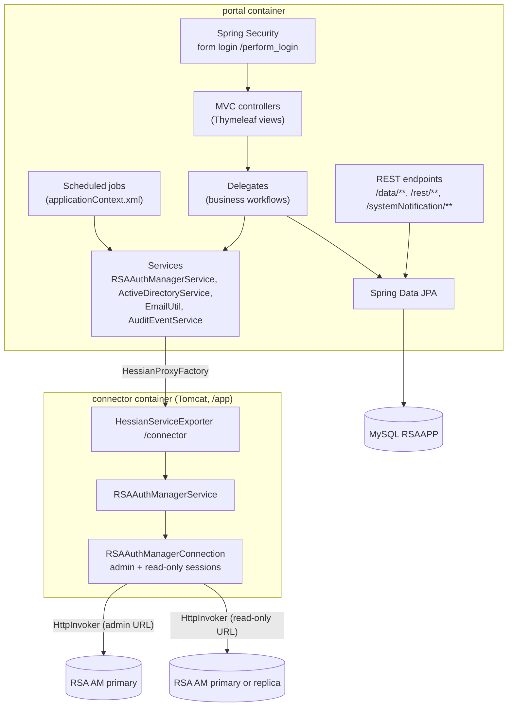
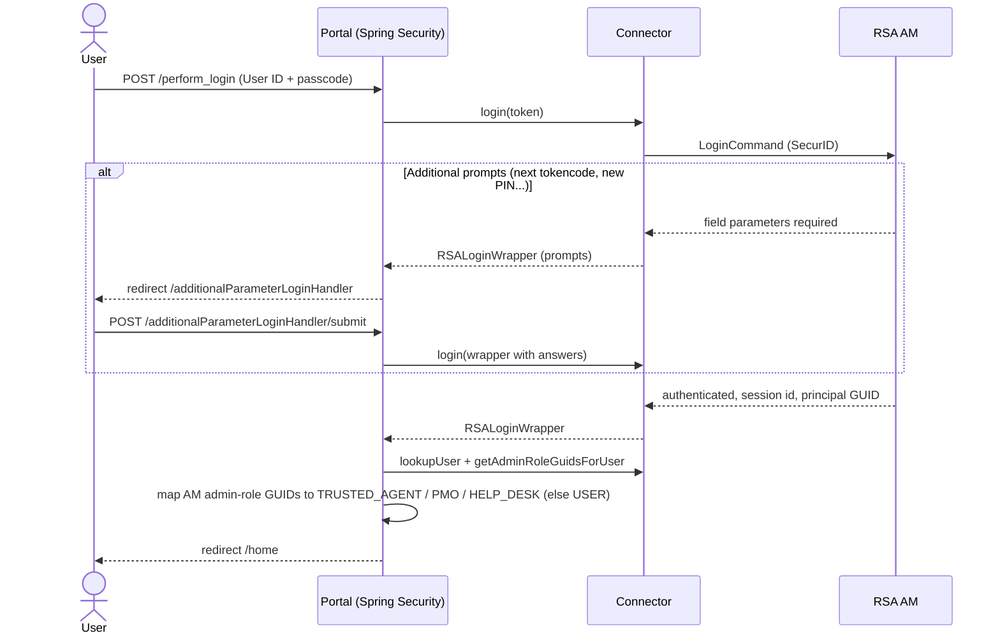

# Architecture

## Maven modules

The root `pom.xml` (`com.winllc.rsaapp:rsaapp:1.0-SNAPSHOT`, packaging `pom`) builds three modules:

| Module | Artifact | Packaging | Purpose |
|---|---|---|---|
| `rsaapp-api` | `com.winllc.rsaapp.api:rsaapp-api` | jar | The shared contract. It holds `RSAAuthManagerServiceInterface`, DTO wrappers (`PrincipalDTOWrapper`, `RSALoginWrapper`, `UpdatePrincipalCommandWrapper`, `AppAuthenticationToken`) and about 45 `Rsa*`/`Token*` exception types. It depends on the RSA `am-client.jar`. |
| `rsaapp-connector` | `com.winllc.rsaapp.connector:rsaapp-connector` | war (deployed in Tomcat in the Connector image) | Implements `RSAAuthManagerServiceInterface` with the RSA AM SDK and exports it with Spring's `HessianServiceExporter` at `/connector`. |
| `rsaapp-portal` | `rsaapp-portal` | Spring Boot jar | The web application. Its main class is `com.winllc.rsaapp.portal.configuration.AppConfig`. |

The release package's `util/` folder holds operational scripts (`check-env.sh`, `backupdb.sh`); it is not a Maven module.

## Runtime components

### Portal

* **Bootstrap.** `AppConfig` is a `@SpringBootApplication` that scans `com.winllc.rsaapp.portal`, enables JPA repositories in `repository.standard` (plus DataTables repositories in `repository.datatables`), and imports the XML contexts `applicationContext.xml` (placeholder configuration and scheduled jobs) and `email-templates.xml` (one `SimpleMailMessage` bean per email template).
* **Connection to the connector.** The `RSAAuthManagerServiceInterface` bean is a Hessian proxy created against the fixed URL `http://connector:8080/app/connector`. This URL is **not configurable**: the connector must be reachable under the Docker service name `connector`.
* **Health.** The portal's `RSAAuthManagerService` implements Spring Boot's `HealthIndicator`. On each health check it calls `testConnection()` on the connector, which establishes or validates the admin session to RSA AM.
* **Thread pools.** `appTaskExecutor` (10–50 threads), `emailTaskExecutor` (50–500), `cronTaskExecutor` (50–500), plus `appExecutor` (50) and `appScheduler` (25) from `applicationContext.xml`. The sizes are hard-coded (the code marks them "todo make configurable").
* **Email** is sent asynchronously on `emailTaskExecutor` through Spring's `JavaMailSender`.

### Connector

* Deployed into Tomcat 8.5.88 as `webapps/app.war`, so the context path is **`/app`**. `web.xml` maps a `DispatcherServlet` to `/` and loads `springapp.xml`.
* `springapp.xml` imports the RSA SDK's `CommandClientAppContext.xml` and the local `CommandClientAppContextOverrides.xml`, then defines:
    * `authManagerConnection` (`RSAAuthManagerConnection`), built with two HttpInvoker command targets: `AdminHttpInvokerCommandTargetBasicAuth` (`ims.httpinvoker.client.provider.url`) and `ReadOnlyHttpInvokerCommandTargetBasicAuth` (`ims.httpinvoker.client.provider.readonly.url`).
    * `authManagerService` (`RSAAuthManagerService`), which implements the API.
    * the `/connector` Hessian exporter. The older RMI exporter on port 1199 is commented out.
* Configuration is read through a `PropertyPlaceholderConfigurer` in `SYSTEM_PROPERTIES_MODE_OVERRIDE`, from the file named by the `config.properties.location` system property. JVM `-D` system properties take precedence. See [Configuration](configuration.md#connector-rsa-authentication-manager-settings).

[RSA AM Integration](rsa-integration.md) covers sessions, run-as semantics and the AM operations the connector uses.

## Authentication flow

Users always authenticate with RSA SecurID. The portal keeps no passwords. Application roles come from the user's **RSA AM administrative roles**, mapped by the `role.mapped.N.*` properties (see [Security](security.md#roles)).

## Data model (MySQL `RSAAPP`)

Hibernate manages the tables (`ddl-auto=update`, physical naming strategy `PhysicalNamingStrategyStandardImpl`, so each table is named after its entity):

| Table | Holds |
|---|---|
| `TrustedAgent` | Trusted Agent profile (RSA ID, name, email, phone, desk, working hours, site, active flag, PMO flag, appointments) |
| `Site` | Sites (shipping ID, name, address, city, state, zip, country, building, time zone, active flag, token serial ranges) |
| `Shipment` | Token shipment requests and their lifecycle (requester, fulfilled by, received by, serial ranges, status, timestamps) |
| `Appointment` | User appointments with a Trusted Agent (type, date, time, requester, certificate DN, confirmed/cancelled, notes) |
| `UserTokenEnrollment` | Token distribution and enrollment records (status `DISTRIBUTED` or `COMPLETED`, allowed-to-enroll date, certificate DN, last reminder sent) |
| `PinSetTracker` | Tokens being watched by the PIN-check job, with a unique reset code used in emailed links |
| `CertTokenMapping` | Associations between a client certificate DN and a user ID and token serial, used for self-service PIN reset |
| `UserExemptionRequest` | MFA exemption requests and their review outcome |
| `SystemNotification` | Home-page banners (level `INFO`/`ALERT`/`CRITICAL`, expiry) |
| `AuditEvent` | Audit trail (see the event types below) |

Audit event types (`AuditEventType`): `TRUSTED_AGENT_REGISTERED`, `TRUSTED_AGENT_MARKED_ACTIVE`, `TRUSTED_AGENT_MARKED_INACTIVE`, `TRUSTED_AGENT_DELETED`, `USER_TOKEN_LOST`, `USER_TOKEN_PIN_RESET`, `USER_TOKEN_REGISTERED_NEW`, `USER_TOKEN_EMERGENCY_ACCESS_CODE_ISSUED`, `USER_TOKEN_DISTRIBUTED_TO_USER`, `USER_TOKEN_PIN_RESET_BY_USER`, `USER_TOO_MANY_LOST_TOKENS_NOTIFICATION_SENT`, `TOKEN_DEPROVISIONED`, `TOKEN_MARKED_LOST`, `SITE_DELETED`, `SHIPMENT_REQUESTED`, `SHIPMENT_SENT`, `SHIPMENT_CANCELLED`, `SHIPMENT_RECEIVED`, `HELP_DESK_USER_REGISTERED`, `HELP_DESK_USER_MARKED_INACTIVE`, `HELP_DESK_USER_MARKED_ACTIVE`, `HELP_DESK_USER_DELETED`.

User and token data itself (principals, tokens, PINs, admin roles) lives in RSA AM, and the portal reads it live through the connector.

## Scheduled jobs

The jobs are registered in `applicationContext.xml` and run on the `cronTaskExecutor`. Each one reads `cron.<name>.enabled`, `cron.<name>.debug` and `cron.<name>.description` at run time. When **debug** is `true`, the job runs but sends no email, and its last-run message is prefixed `(DEBUG MODE - NO EMAILS SENT)`.

| Job name (`cron.<name>`) | Class | Default schedule (Spring cron) | What it does |
|---|---|---|---|
| `expiring` | `TokenExpiringNotificationCron` | `0 30 0 ? * *` (00:30 daily) | Finds tokens expiring within `cron.expiring.notification.expireInDays` days and emails each assigned user (`user-token-expiring-soon` template). |
| `appointmentupcoming` | `UpcomingAppointmentsEmailCron` | `0 30 0 ? * *` | Emails a reminder to each requester with a confirmed appointment in the next week, and a digest of their upcoming appointments to each Trusted Agent. |
| `resyncta` | `ReSyncTrustedAgentsCron` | `0 30 0 ? * *` | Reconciles the local `TrustedAgent` table with the users who hold the mapped `TRUSTED_AGENT` admin role in RSA AM: adds missing agents, marks agents who lost the role inactive, refreshes name and email, and pushes the PMO role to AM for agents flagged as PMO locally. |
| `lostTokenThresholdMonitor` | `LostTokenThresholdMonitorCron` | `0 35 0 ? * *` | Finds users who lost at least `tokens.lost` tokens within `window.inDays` days, records an audit event, and emails the list to `mfa.group.email`. **Debug is `true` by default**, so no email is sent until it is set to `false`. |
| `sendDelayedTokenRegistrationEmails` | `SendDelayedTokenRegistrationEmailsCron` | `0 32 0 ? * *` | For distributed tokens whose allowed enrollment date has arrived, sends the registration email, and repeats every `daysBetweenReminderEmails` days. |
| `tokenPinCheck` | `ResetTokenPinCheckCron` | `0 30 0 ? * *` | For assigned tokens that have not authenticated within `minutesSinceLastLoginThreshold` minutes, emails the user either a "set your initial PIN" link (token in new-PIN mode) or a "check your PIN" link with a one-time reset code (`/user/pinReset/start/{code}`). Throttled by `minutesSinceLastEmailSentThreshold`. |

The last-run details are held **in memory only**. The PMO can see them, and trigger any job, at **Admin → Manual Run Cron Jobs** (`/manualCron`). A job whose `enabled` flag is `false` does nothing, even when triggered by hand.

## Customization assets

| Asset | Default (inside the image) | Purpose |
|---|---|---|
| `messages.properties` | `classpath:properties/messages.properties` | UI text, branding (`branding.*`), footer links (`link.*`), `build.version`, validation messages, and the `login.additional.param.*` hints |
| `page-descriptions.properties` | `classpath:properties/page-descriptions` | The description shown at the top of each page |
| Email templates (`*.properties`) | `classpath:email-templates/*.properties` | Subject and body for the 22 notification emails |
| `banner.png`, `header-logo.png` | `classpath:/static/custom/` | Home-page banner and site logo |
| `countries.csv` | `/resources/countries.csv` (absolute path in the container) | Country list on the site forms |

The release package's `default_build/` directory holds editable copies of these assets, which its `docker-compose.yml` mounts into the containers (with Helm, ConfigMaps in `branding.*`). [Configuration](configuration.md#branding-text-and-email-templates) explains how to point the portal at them.
