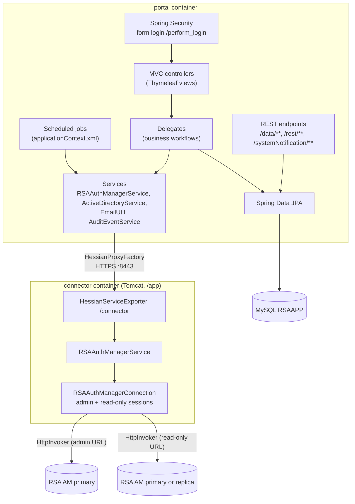
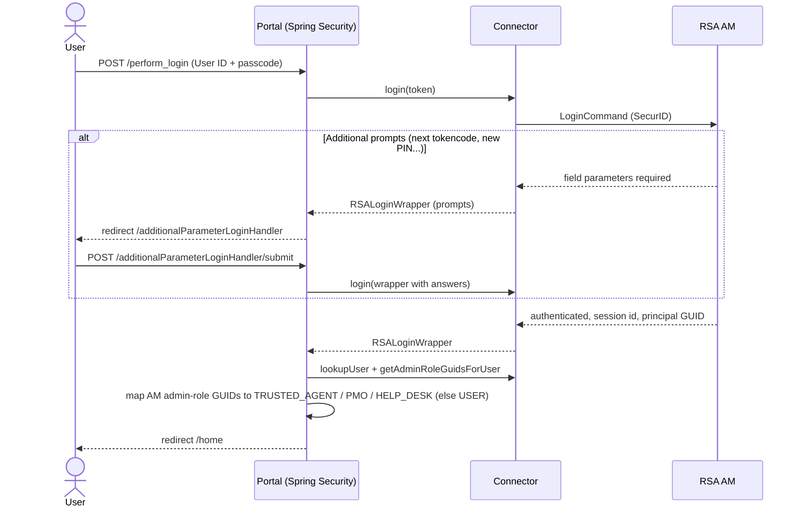

# Architecture

## Maven modules

The root `pom.xml` (`com.winllc.rsaapp:rsaapp:1.0-SNAPSHOT`, packaging `pom`) builds three modules:

| Module | Artifact | Packaging | Purpose |
|---|---|---|---|
| `rsaapp-api` | `com.winllc.rsaapp.api:rsaapp-api` | jar | The shared contract. It holds `RSAAuthManagerServiceInterface`, DTO wrappers (`PrincipalDTOWrapper`, `RSALoginWrapper`, `UpdatePrincipalCommandWrapper`, `AppAuthenticationToken`) and about 45 `Rsa*`/`Token*` exception types. It depends on the RSA `am-client.jar`. |
| `rsaapp-connector` | `com.winllc.rsaapp.connector:rsaapp-connector` | war (deployed in Tomcat in the Connector image) | Implements `RSAAuthManagerServiceInterface` with the RSA AM SDK and exports it at `/connector` with `AllowListHessianServiceExporter`, a Hessian exporter that rebuilds only the classes the Portal sends, each named on a list. It reads AM's replies through a deserialization filter and checks AM's host name (`security/AuthManagerTransport`). |
| `rsaapp-mock-authmanager` | `rsaapp-mock-authmanager` | jar | An in-memory stand-in for RSA AM that serves the same HttpInvoker command endpoint. Used by the tests and the development stack; never deployed. |
| `rsaapp-portal` | `rsaapp-portal` | Spring Boot jar | The web application. Its main class is `com.winllc.rsaapp.portal.configuration.AppConfig`. |

The release package's `util/` folder holds operational scripts (`check-env.sh`, `split-env.sh`, `move-connector-secrets.sh`, `connector-tls.sh`, `backupdb.sh`); it is not a Maven module.

## Runtime components

### Portal

* **Bootstrap.** `AppConfig` is a `@SpringBootApplication` that scans `com.winllc.rsaapp.portal`, enables JPA repositories in `repository.standard` (plus DataTables repositories in `repository.datatables`), and imports the XML contexts `applicationContext.xml` (placeholder configuration and scheduled jobs) and `email-templates.xml` (one `SimpleMailMessage` bean per email template).
* **Connection to the connector.** The `RSAAuthManagerServiceInterface` bean is a Hessian proxy against `connector.url` (default `https://connector:8443/app/connector`). `ConnectorTls` checks the Connector's certificate and host name against `connector.tls.truststore` and, for mutual TLS, presents the Portal's own certificate. Every call carries the shared secret as HTTP Basic credentials, and is bounded by `connector.connect-timeout-millis` (5 s) and `connector.read-timeout-millis` (120 s). See [RSA AM integration](rsa-integration.md#portal-to-connector).
* **Health.** Liveness (`/actuator/health/liveness`) is the Portal itself; readiness (`/actuator/health/readiness`) adds the database (`db`) and the Connector (`connector`: `ConnectorHealthIndicator` calls the Connector's `/app/health`).
* **Thread pools.** `appTaskExecutor` (10–50 threads), `emailTaskExecutor` (50–500) and `cronTaskExecutor` (6). The sizes are fixed in the code.
* **Email** is sent asynchronously on `emailTaskExecutor` through Spring's `JavaMailSender`.

### Connector

* Deployed into Tomcat 9 as `webapps/app.war`, so the context path is **`/app`**. `web.xml` maps a `DispatcherServlet` to `/` and loads `springapp.xml`.
* Tomcat serves HTTPS on 8443 (TLS 1.2 and 1.3) for the Portal, and plain HTTP on 8080 on the loopback address only, for the container's health check. `bin/setenv.sh` builds the PKCS12 key store Tomcat reads from the PEM certificate and key at each start, so no password reaches the command line.
* Tomcat's HTTPS asks for a client certificate from `CONNECTOR_TLS_CLIENT_CA` when `CONNECTOR_TLS_CLIENT_AUTH=required` (mutual TLS, on in new installations); `MutualTlsCheck` warns at every start while it is off. `CONNECTOR_HTTPS_ADDRESS` names the address 8443 listens on (default: every interface).
* `ConnectorAuthFilter` requires the shared secret on every request except `GET`/`HEAD` `/health`. `ConnectorSecrets` reads the AM credentials from files or `RSA_*` variables before the application context starts.
* `AuthManagerTransport` replaces the request executor of the SDK's HTTP invoker clients with `FilteringHttpInvokerRequestExecutor`, which reads every AM reply through `AuthManagerReplyFilter` (a JEP 290 allow-list and limits) and, for `https`, opens sockets with `HostnameCheckingSocketFactory`, which checks that AM's certificate names the host. The SDK offers no setting for either, so they are reached by reflection; if the SDK is not what the Connector expects, it does not start rather than read unfiltered. See [What the Connector accepts](rsa-integration.md#what-the-connector-accepts).
* Its Log4j 1 configuration uses `CrlfSafePatternLayout`, which writes CR and LF in a message as `\r` and `\n`.
* `springapp.xml` imports the RSA SDK's `CommandClientAppContext.xml` and the local `CommandClientAppContextOverrides.xml`, then defines:
    * `authManagerConnection` (`RSAAuthManagerConnection`), built with two HttpInvoker command targets: `AdminHttpInvokerCommandTargetBasicAuth` (`ims.httpinvoker.client.provider.url`) and `ReadOnlyHttpInvokerCommandTargetBasicAuth` (`ims.httpinvoker.client.provider.readonly.url`).
    * `authManagerService` (`RSAAuthManagerService`), which implements the API.
    * the `/connector` Hessian exporter. The older RMI exporter on port 1199 is commented out.
* Configuration is read through a `PropertyPlaceholderConfigurer` in `SYSTEM_PROPERTIES_MODE_OVERRIDE`, from the file named by the `config.properties.location` system property. JVM `-D` system properties take precedence. See [Configuration](configuration.md#connector-rsa-authentication-manager-settings).

[RSA AM Integration](rsa-integration.md) covers sessions, run-as semantics and the AM operations the connector uses.

## Authentication flow

Users always authenticate with RSA SecurID. The portal keeps no passwords. Application roles come from the user's **RSA AM administrative roles**, mapped by the `role.mapped.N.*` properties (see [Security](security.md#roles)).

## Data model (MySQL `RSAAPP`)

Flyway owns the schema: at every start the Portal applies the migrations in `db/migration` that the database does not have yet (recorded in `flyway_schema_history`), then Hibernate only validates the tables against the entities (`ddl-auto=validate`) and refuses to start if they differ. A database from release 1.5 or earlier, whose tables Hibernate created, is given a Flyway history at version 0 on its first start, and the first migration adds what is missing; its tables, data and ids are kept. The physical naming strategy is `PhysicalNamingStrategyStandardImpl`, so each table is named after its entity:

| Table | Holds |
|---|---|
| `TrustedAgent` | Trusted Agent profile (RSA ID, name, email, phone, desk, working hours, site, active flag, PMO flag, appointments) |
| `Site` | Sites (shipping ID, name, address, city, state, zip, country, building, time zone, active flag, token serial ranges) |
| `Shipment` | Token shipment requests and their lifecycle (requester, fulfilled by, received by, serial ranges, status, timestamps) |
| `Appointment` | User appointments with a Trusted Agent (type, date, time, requester, certificate DN, confirmed/cancelled, notes) |
| `UserTokenEnrollment` | Token distribution and enrollment records (status `DISTRIBUTED` or `COMPLETED`, allowed-to-enroll date, certificate DN, last reminder sent) |
| `PinSetTracker` | Tokens being watched by the PIN-check job, with a unique reset code used in emailed links |
| `CertTokenMapping` | Associations between a client certificate DN and a user ID and token serial. Read only by the certificate-based PIN reset; nothing creates new ones, and the PIN-check reset link records none |
| `UserExemptionRequest` | MFA exemption requests and their review outcome |
| `SystemNotification` | Home-page banners (level `INFO`/`ALERT`/`CRITICAL`, expiry) |
| `AuditEvent` | The audit trail: `ens-audit/1` events with their sequence number and hash (see [Audit logging](../audit-logging.md)) |
| `AuditChainHead` | The chain's newest sequence number and hash, locked while an event is added so the chain stays consistent |
| `AuditOutputState` | How far each audit output (Splunk HEC, syslog) has delivered |
| `AuditApiToken` | Tokens for the audit pull API, stored as hashes |
| `CronLock` | Which node has claimed each scheduled job's current occurrence |
| `HelpDeskRequest` | [Help-desk requests](help-desk.md): the change, the user and token, ticket, reason, verification, approval, state, when it was opened, decided and run (`runStartedAt`). An e-mailed code is kept only as an HMAC-SHA256 under the server's key (`rsa.helpdesk.code-key`, `EmailCodeKey`); an emergency access code never |
| `RateLimitWindow`, `RateLimitBackoff` | Rate-limit counts per fixed window, and backoff per user ID or serial, keyed by SHA-256 hashes of the address, user ID or serial (see [Security](security.md#rate-limits-and-uniform-answers)) |

Flyway also creates tables that are not entities: `SPRING_SESSION` and `SPRING_SESSION_ATTRIBUTES` (signed-in sessions, Spring Session JDBC, shared by every Portal replica), `ens_license_*` (the license, the installation id and the license history) and `SsoSamlRequest` (SAML sign-ins in progress). See [High availability](availability-and-sizing.md#high-availability).

The Portal's earlier audit event types (`TRUSTED_AGENT_REGISTERED`, `USER_TOKEN_LOST` and so on) were moved into the chain on the first start of the release that introduced `ens-audit/1`; each keeps its original type in `details.legacyType`.

User and token data itself (principals, tokens, PINs, admin roles) lives in RSA AM, and the portal reads it live through the connector.

## Scheduled jobs

`CronScheduleConfig` schedules each job on `cron.<name>.cron`, in the time zone `cron.timezone` (default: the server's, UTC in the containers), and the jobs run on the `cronTaskExecutor`. Each one reads `cron.<name>.enabled`, `cron.<name>.debug` and `cron.<name>.description` at run time. When **debug** is `true`, the job runs but sends no email and changes nothing, and its last-run message is prefixed `(DEBUG MODE - NO EMAILS SENT)`.

- **One node per occurrence.** Each node that runs the scheduler claims the occurrence in the `CronLock` table first; the first claim wins. A claim is released after `cron.lock.maximumHoldMinutes` (360) if its node died, and held at least `cron.lock.minimumHoldSeconds` (120), so a node with a slightly late clock does not run the same occurrence again.
- **No overlap.** A job still running when its next time comes is skipped. A failed run is logged, shown as `Failed: ...`, and audited as `job.failed`.
- **License.** The jobs need the `scheduled-jobs` license feature; without it, or while the license is read-only, they are skipped (audited once per license mode change as `job.skipped`).

| Job name (`cron.<name>`) | Class | Default schedule (Spring cron) | What it does |
|---|---|---|---|
| `expiring` | `TokenExpiringNotificationCron` | `0 30 0 ? * *` (00:30 daily) | Sends one notice per token `cron.expiring.notification.daysBefore` days before it expires (default `30,14,7,1`), to its assigned user (`user-token-expiring-soon` template). |
| `appointmentupcoming` | `UpcomingAppointmentsEmailCron` | `0 30 0 ? * *` | A reminder `cron.appointmentupcoming.remindDaysBefore` (1) day before each confirmed appointment, and for each Trusted Agent a daily overview of the next `cron.appointmentupcoming.taDigestDays` (7) days. |
| `resyncta` | `ReSyncTrustedAgentsCron` | `0 30 0 ? * *` | Reconciles the local `TrustedAgent` table with the users who hold the mapped `TRUSTED_AGENT` admin role in RSA AM: adds missing agents, refreshes name and email, deactivates agents who lost the role and reactivates those who got it back. If AM returns no Trusted Agents at all while the Portal has active ones, it deactivates nobody and reports `Stopped`. |
| `lostTokenThresholdMonitor` | `LostTokenThresholdMonitorCron` | `0 35 0 ? * *` | Finds users who lost at least `tokens.lost` tokens within `window.inDays` days, records an audit event, and emails the list to `mfa.group.email`. **Debug is `true` by default**, so no email is sent until it is set to `false`. |
| `sendDelayedTokenRegistrationEmails` | `SendDelayedTokenRegistrationEmailsCron` | `0 32 0 ? * *` | For distributed tokens whose allowed enrollment date has arrived, sends the registration email, and repeats every `daysBetweenReminderEmails` days. |
| `tokenPinCheck` | `ResetTokenPinCheckCron` | `0 30 0 ? * *` | For assigned tokens unused for `daysSinceLastLogin` (60) days, emails the user either a "set your initial PIN" reminder (token still waiting for its first PIN) or a "check your PIN" link with a reset code (`/user/pinReset/start/{code}`) that works for `resetLinkValidDays` (14) days. At most one email per token every `daysBetweenReminderEmails` (14) days; disabled and locked accounts are skipped. |

Two housekeeping tasks run on every node, outside the job table: overdue help-desk requests are expired every 5 minutes, and expired rate-limit rows are deleted every 10 minutes, in batches.

The last-run details are held **in memory only**, separately on each Portal replica. The PMO can see them, and trigger any job, at **Admin → Manual Run Cron Jobs** (`/manualCron`). A job whose `enabled` flag is `false` does nothing, even when triggered by hand.

## Customization assets

| Asset | Default (inside the image) | Purpose |
|---|---|---|
| `messages.properties` | `classpath:properties/messages.properties` | UI text, branding (`branding.*`), footer links (`link.*`), `build.version`, validation messages, and the `login.additional.param.*` hints |
| `page-descriptions.properties` | `classpath:properties/page-descriptions` | The description shown at the top of each page |
| Email templates (`*.properties`) | `classpath:email-templates/*.properties` | Subject and body for the 22 notification emails |
| `banner.png`, `header-logo.png` | `classpath:/static/custom/` | Home-page banner and site logo |
| `countries.csv` | `/resources/countries.csv` (absolute path in the container) | Country list on the site forms |

The release package's `default_build/` directory holds editable copies of these assets, which its `docker-compose.yml` mounts into the containers (with Helm, ConfigMaps in `branding.*`). [Configuration](configuration.md#branding-text-and-email-templates) explains how to point the portal at them.
