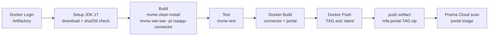

# Build & Release

## Source layout

| Path | Contents |
|---|---|
| `pom.xml` | Parent POM (modules `rsaapp-api`, `rsaapp-connector`, `rsaapp-portal`; Lombok 1.18.26 and Hessian 4.0.66 for all modules) |
| `rsaapp-api/` | Shared interface and DTOs. `rsa-lib/am-client.jar` |
| `rsaapp-connector/` | Connector WAR, `Dockerfile`, `rsa-lib/` (RSA SDK and its dependency jars) |
| `rsaapp-portal/` | Spring Boot portal, `Dockerfile`, `rsa-lib/am-client.jar` |
| `default_build/` | Deployment-time customization (email templates, log configuration, properties, images) |
| `mysql/01-databases.sql` | Database and user bootstrap |
| `scripts/` | `install.sh`, `prepare_deployment_package.sh`, `init_deployment.sh`, `download_images.sh`, `restore.sh`, `start-portal.sh`, `stop-portal.sh`, `add_node.sh` |
| `util/` | `backupdb.sh`, `propdiff.sh`, `PropDiff.class` |
| `docker-compose.yaml` | Production compose file (registry images) |
| `docker-compose.local.yaml` | The same services, built from local sources (`rsaapp-portal:latest`, `rsaapp-connector:latest`) |
| `docker-compose.build.yaml` | Legacy build compose file used by `prepare_deployment_package.sh` |
| `Jenkinsfile`, `.gitlab-ci.yml` | CI pipelines |

## Prerequisites

* **Git LFS.** `.gitattributes` stores every `*.jar` in LFS, including the RSA SDK jars. Run `git lfs install && git lfs pull` after cloning, or the build will find LFS pointer files instead of jars.
* **JDK 17.** The portal uses `org.mvnsearch:toolchains-maven-plugin` 4.5.0 with a JDK 17 toolchain. The connector compiles with `source/target 1.8`.
* The **Maven wrapper** (`./mvnw`, Maven 3.8.7).
* **Docker**, with pull access to the base image `docker.artifactory.code.dicelab.net/cio2d/dodiispki/pkiapps:1.0`. Override it with `--build-arg BASE_REGISTRY=… BASE_IMAGE=… BASE_TAG=…`; both Dockerfiles declare these `ARG`s and use `yum`, so the base must be RHEL-like.
* Internet access while building the connector image. Its Dockerfile downloads Tomcat 8.5.88 from `downloads.apache.org`.

## Build

```bash
git lfs pull
./mvnw clean install                    # builds api, connector (jar), portal (Spring Boot jar); runs tests
./mvnw war:war -pl rsaapp-connector     # produces rsaapp-connector/target/rsaapp-connector-*.war
./mvnw test                             # tests only
```

Portal tests use `src/test/resources/application-test.yml` (an H2 in-memory URL, and a local SMTP on port 3025).

### Docker images

```bash
docker build -t rsa-operations-connector:dev ./rsaapp-connector
docker build -t rsa-operations-portal:dev    ./rsaapp-portal
```

| Image | Dockerfile summary |
|---|---|
| Connector | Base image, then `yum update`. Installs Tomcat 8.5.88 into `/opt/tomcat`, empties `webapps/`, adds `target/rsaapp-connector-*.war` as `webapps/app.war`, sets `JAVA_OPTS`, `EXPOSE 8080`, `CMD catalina.sh run`. |
| Portal | Base image, then `yum update`. `EXPOSE 8080 8443`. Adds `rsa-lib/` and `src/main/resources` (as `/resources`) and `log4j2.xml` (as `/log4j2.xml`). Copies `target/*.jar` as `app.jar`. Sets `JAVA_OPTS`. Entry point: `java $JAVA_OPTS -cp app.jar:rsa-lib/* org.springframework.boot.loader.JarLauncher`. |

For a local stack built from source, provide a `dev.env` and run:

```bash
docker-compose -f docker-compose.local.yaml up -d --build
```

## Jenkins pipeline (`Jenkinsfile`)

Polls SCM every minute (`pollSCM '* * * * *'`).



| Setting | Value |
|---|---|
| Credentials | `CODE_ARTIFACTORY_API_KEY` (username and password) |
| Registry | `docker.artifactory.code.dicelab.net` |
| Image parent | `cio2d/dodiispki/mfa` |
| Images | `rsa-operations-portal`, `rsa-operations-connector` |
| Tag | `${TAG_NAME}` when building a Git tag, otherwise `latest`. Each image is also tagged `latest`. |
| JDK | `https://download.oracle.com/java/17/latest/jdk-17_linux-x64_bin.tar.gz`, extracted to `./java/jdk-17` |
| Archived artifact | `mfa-portal-$IMAGE_VERSION.zip` containing `docker-compose.yaml` and `default_build/` |
| Security scan | `prismaCloudScanImage` on the portal image. Results are published from `prisma-cloud-scan-results.json`. |

To release, push a Git tag. The pipeline publishes `rsa-operations-portal:<tag>` and `rsa-operations-connector:<tag>`. The shipped `docker-compose.yaml` references `:latest`; pin it to a tag for repeatable deployments.

## GitLab CI (`.gitlab-ci.yml`)

| Job | Stage | Image | Action |
|---|---|---|---|
| `build` | build | `maven:latest` | `mvn $MAVEN_CLI_OPTS compile` |
| `install` | build | `maven:latest` | `mvn $MAVEN_CLI_OPTS install`, keeping `*/target/*.jar` |
| `test` | test | `maven:latest` | `mvn $MAVEN_CLI_OPTS test` |
| `job` | deploy | `tmaier/docker-compose:latest` + `docker:dind` | `docker pull mysql:8.0.25`, `docker save -o services.img mysql:8.0.25`, `sh prepare_deployment_package.sh`, keeping `rsaapp-deployment_*.tar.gz` for 30 days |

## Offline deployment package

`prepare_deployment_package.sh` builds the air-gap tarball that `install.sh` consumes:

1. If `java` is available, runs `./mvnw clean test install`.
2. Runs `docker system prune` (answering yes).
3. Runs `docker-compose -f docker-compose.build.yaml build` and `… pull`.
4. Collects every `image:` from `docker-compose config` and runs `docker save -o services.img <images>`.
5. Runs `tar -czvf rsaapp-deployment_$(date +%m-%d-%Y).tar.gz services.img COPYRIGHT default_build dev.env docker-compose.yaml mysql init_deployment.sh install.sh restore.sh util README start-portal.sh stop-portal.sh add-node.sh`.
6. Deletes `services.img`.

!!! warning "Stage the inputs first"
    The script runs from the repository root and expects the scripts **next to it**, but they live in `scripts/`. It also expects `dev.env` (not committed) and a file named `add-node.sh` (the repository has `add_node.sh`). Before you run it, copy `scripts/*.sh` to the root (renaming `add_node.sh` to `add-node.sh`) and create `dev.env`. `docker-compose config` reads the default `docker-compose.yaml`, so the image names saved must match the images that `docker-compose.yaml` references. Check this when you mix the build and production compose files.

`scripts/download_images.sh` does the same `docker save` step on its own, and `init_deployment.sh` loads the images on the target host (`docker load < services.img`).

## Versioning

* Maven versions are fixed at `1.0-SNAPSHOT`.
* The UI footer shows `build.version` from `messages.properties` (default `1.0.0`). Update it per release if you rely on it.
* Image tags come from Git tags (Jenkins), and offline packages are named by date (`rsaapp-deployment_MM-DD-YYYY.tar.gz`).
