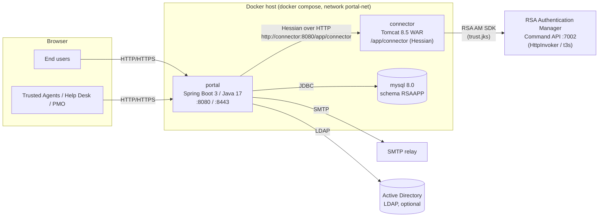

# RSA Operations Portal

The **RSA Operations Portal** is a web application that simplifies the day-to-day operational work of an organization that uses **RSA SecurID tokens** for multi-factor authentication (MFA). It sits in front of **RSA Authentication Manager (AM)** and gives end users, Trusted Agents, Help Desk staff and the Project Management Office (PMO) a single place to issue, enroll, test, reset, recover and track hardware tokens.

!!! info "Source of truth"
    Everything in this section comes from the `rsa-operations-portal` source (Maven project `com.winllc.rsaapp:rsaapp`) and its release package and Helm chart. Where the product leaves something undefined, the docs say so.

## Key features

| Area | What the portal does |
|---|---|
| **Token self-service** | Users test their token, complete token enrollment by setting a PIN, and reset a PIN themselves (with a PKI client certificate, a Windows username and password, or an emailed reset link). |
| **Token administration** | Trusted Agents assign (distribute) tokens to users. Trusted Agents and Help Desk staff mark tokens lost, reset PINs, deprovision tokens, issue emergency access codes, unlock accounts and clear cached Windows passwords. |
| **Trusted Agent directory and appointments** | A public directory of Trusted Agents. Users can book an appointment with a Trusted Agent to pick up, replace or return a token. |
| **Logistics** | Trusted Agents request token shipments for their **sites**. PMO staff work the shipments and send token serial ranges, and the receiving site confirms receipt. |
| **Exemptions** | Users request an exemption from the MFA requirement, and the PMO approves or denies it. |
| **Administration (PMO)** | Register Trusted Agents (one at a time or in bulk from a CSV file), map application roles to RSA AM administrative roles, post home-page system notifications, email groups of users, and run scheduled jobs on demand. |
| **Automation** | Six scheduled jobs send token-expiry, appointment and PIN-set reminders, re-sync Trusted Agents from RSA AM, and flag users who lose too many tokens. |
| **Active Directory (optional)** | Adds or removes users in an "RSA enabled" AD group when they enroll a token, lose one, or have one deprovisioned. |

## Architecture at a glance

The release package runs three Docker containers on one bridge network (`portal-net`), started with `docker compose`. The Helm chart runs the Portal and the Connector as two Deployments and uses your MySQL server.

* **Portal** (`rsaapp-portal`): serves the Thymeleaf UI, holds the business logic, stores its own data (Trusted Agents, sites, shipments, appointments, audit events, enrollments and similar records) in MySQL, sends email, runs scheduled jobs and, optionally, updates Active Directory group membership.
* **Connector** (`rsaapp-connector`): the only component that talks to RSA Authentication Manager. It wraps the RSA AM SDK (`am-client.jar`) and exposes it to the portal as a Hessian remote service.
* **API** (`rsaapp-api`): a shared Java library with the `RSAAuthManagerServiceInterface` contract, DTO wrappers and exceptions used by both the portal and the connector.
* **MySQL**: the portal database (`RSAAPP`). Hibernate creates and updates the schema (`spring.jpa.hibernate.ddl-auto=update`).

[Architecture](architecture.md) describes the components in detail.

## Tech stack

| Layer | Technology |
|---|---|
| Portal | Java 17, Spring Boot 3.0.6 (web, security, data JPA, mail, validation, actuator, Thymeleaf), Thymeleaf Layout Dialect, Spring LDAP 2.4.1, spring-data-jpa-datatables 6.0.1, Log4j2, MySQL Connector/J 8.0.33 |
| Connector | Java 1.8 source/target, Spring 3.2.18 (webmvc), Hessian 4.0.38, Guava 30, RSA AM SDK jars in `rsaapp-connector/rsa-lib/`, Log4j 1.x, Apache Tomcat 8.5.88 |
| Front end | Bootstrap 4, jQuery and jQuery UI, DataTables, Font Awesome, appointment-picker |
| Database | MySQL 8.0 (in the release package; your own server with Helm) |
| Delivery | Container images `ghcr.io/winllc/rsa-operations-portal` and `ghcr.io/winllc/rsa-operations-portal-connector`, in a signed release package (Docker Compose) and a Helm chart |

## Documentation map

| Page | Audience | Contents |
|---|---|---|
| [Architecture](architecture.md) | Engineers, operators | Components, request flows, data model, scheduled jobs |
| [Installation](install.md) | Operators | Prerequisites, the release package (`install.sh`, `upgrade.sh`), the Helm chart, RSA AM preparation, first start |
| [Configuration](configuration.md) | Operators | Every property and environment variable, with defaults |
| [RSA AM Integration](rsa-integration.md) | Engineers, RSA admins | How the connector talks to RSA AM; trust store, command client, admin roles |
| [Operator Guide](operator-guide.md) | Operators | Start/stop, health, logs, backup/restore, upgrades, certificates, runbook |
| [Admin Guide](admin-guide.md) | PMO administrators | Roles, Trusted Agent management, notifications, group email, scheduled jobs, exemptions |
| [User Guide](user-guide.md) | End users, Trusted Agents, Help Desk | Every screen and workflow |
| [Security](security.md) | Security reviewers | Authentication, authorization, TLS and client certificates, known issues |
| [HTTP Route Reference](api-reference.md) | Engineers | Every controller route, its HTTP method and the role it requires |
| [Troubleshooting](troubleshooting.md) | Operators | Symptom → cause → fix |
