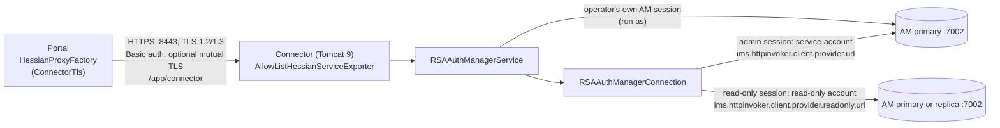
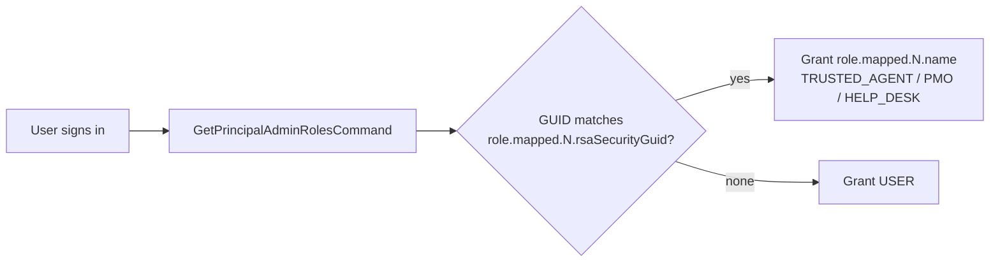

# RSA Authentication Manager Integration

The **Connector** (`rsaapp-connector`) is the only component that talks to RSA Authentication Manager (AM). It uses the RSA AM SDK command API (`am-client.jar` 8.8 and its dependencies, in `rsaapp-connector/rsa-lib/`). The Portal calls the Connector through the Java interface `com.winllc.rsaapp.api.RSAAuthManagerServiceInterface`, sent over **Hessian** (binary HTTP remoting) on HTTPS.

## Transport

| Hop | Protocol | Address | Configurable? |
|---|---|---|---|
| Portal → Connector | Hessian over HTTPS (TLS 1.2 or 1.3), with the Connector's certificate and host name checked, HTTP Basic credentials, and optional mutual TLS | `https://connector:8443/app/connector` | Yes: `connector.url` (`CONNECTOR_URL`), or `connector.host` for the host name only |
| Connector → AM (write) | RSA `HttpInvokerCommandTarget`, basic auth with the Command Client credentials, TLS 1.3 or 1.2 | `ims.httpinvoker.client.provider.url` | Yes |
| Connector → AM (read) | Same, on a separate target | `ims.httpinvoker.client.provider.readonly.url` | Yes (can point at a replica) |

The Connector offers AM TLS 1.3 and 1.2 (`-Dhttps.protocols=TLSv1.3,TLSv1.2` in its `JAVA_OPTS`), and the handshake picks the newest version both support. A `connector.env` from an older release holds `-Dhttps.protocols=TLSv1.2 -Djdk.tls.client.protocols=TLSv1.2`, which keeps the Connector at TLS 1.2; replace them to allow TLS 1.3.

The Connector's `springapp.xml` aliases `CommandAPIConnection` to the SDK's `CacheableCommandTargetBasicAuth`. The old RMI exporter on port 1199 is a commented-out block; neither the release package nor the Helm chart publishes that port.

## Portal to Connector

| Side | Setting | Default | Meaning |
|---|---|---|---|
| Portal | `connector.url` (`CONNECTOR_URL`) | `https://connector:8443/app/connector` | The Connector's address. A plain `http` URL logs a warning |
| Portal | `connector.tls.truststore` (`CONNECTOR_TLS_TRUSTSTORE`) | Java's default trust store | The CA certificates the Connector's certificate must chain to: PEM, or a PKCS12/JKS trust store. The release package's template sets `/ssl/connector-ca.crt` |
| Portal | `connector.tls.truststore-password` | — | Password of a PKCS12/JKS trust store |
| Portal | `connector.tls.client-certificate`, `connector.tls.client-key` (`CONNECTOR_TLS_CLIENTCERTIFICATE`, `CONNECTOR_TLS_CLIENTKEY`), `connector.tls.client-key-password` | unset | The Portal's certificate and key (PEM), for mutual TLS. Set both or neither |
| Portal | `connector.auth.user`, `CONNECTOR_AUTH_PASSWORD` (`connector.auth.password`) | `portal`, — | The HTTP Basic credentials the Portal sends. The same password goes in `connector.env` |
| Portal | `connector.connect-timeout-millis`, `connector.read-timeout-millis` | `5000`, `120000` | How long the Portal waits for the Connector |
| Portal | `connector.health-url`, `connector.health-timeout-millis` | the Connector's `/app/health`, `5000` | What the Portal's `connector` health indicator calls, with the same TLS settings |
| Connector | `CONNECTOR_TLS_CERTIFICATE`, `CONNECTOR_TLS_PRIVATE_KEY` | `/custom/connector-tls/tls.crt`, `/custom/connector-tls/tls.key` | The Connector's certificate (PEM, intermediate CAs after it) and key. Without them HTTPS starts with a throwaway self-signed certificate, which the Portal refuses |
| Connector | `CONNECTOR_TLS_PRIVATE_KEY_PASSWORD` | set by `util/connector-tls.sh` | Password of an encrypted key |
| Connector | `CONNECTOR_TLS_CLIENT_AUTH` | `none` | `required` turns on mutual TLS |
| Connector | `CONNECTOR_TLS_CLIENT_CA` | `/custom/connector-tls/ca.crt` | The CA of the clients' certificates |
| Connector | `CONNECTOR_HTTP_ADDRESS` | `127.0.0.1` | Plain HTTP on 8080, for the container's own health check. `0.0.0.0` opens it to the network unencrypted: the demo only |

**Release package.** `util/connector-tls.sh`, which `install.sh` and `upgrade.sh` run, makes what is missing and renews its own certificates when 60 days are left (`--renew` renews them now). It never touches certificates it did not make.

| File | What |
|---|---|
| `connector-tls-ca/ca.crt`, `ca.key` | A CA for this installation only (10 years). No container mounts it; keep the key private |
| `default_build/connector-tls/tls.crt`, `tls.key` | The Connector's certificate (5 years; names `connector`, `localhost` and `CONNECTOR_TLS_NAMES`) and its key, encrypted with `CONNECTOR_TLS_PRIVATE_KEY_PASSWORD` in `connector.env`. Only the Connector mounts this folder |
| `default_build/ssl/connector-ca.crt` | The CA certificate the Portal checks the Connector's against (`CONNECTOR_TLS_TRUSTSTORE=/ssl/connector-ca.crt` in `.env`) |
| `default_build/ssl/portal-client.crt`, `.key` | The Portal's certificate, for mutual TLS |

To use certificates from your own PKI, set `CONNECTOR_TLS_CERTIFICATE` and `CONNECTOR_TLS_PRIVATE_KEY` in `connector.env` and `CONNECTOR_TLS_TRUSTSTORE` in `.env`.

**Helm.** The chart makes a CA and the certificates with Helm's `genCA` and `genSignedCert` in the Secret `<release>-rsa-operations-portal-connector-tls`, and keeps them across upgrades by reading the Secret back from the cluster. Or give your own in `connector.tls.existingSecret` (`tls.crt`, `tls.key`, `ca.crt`; a cert-manager Certificate's Secret, for example). Each pod mounts only its own key.

| Value | Default | Meaning |
|---|---|---|
| `connector.tls.existingSecret` | `""` (the chart makes the CA) | Your own `tls.crt`, `tls.key` and `ca.crt` |
| `connector.tls.mutual` | `false` | Mutual TLS |
| `connector.tls.clientSecret` | `""` | The Portal's certificate (`tls.crt`, `tls.key`) when you use `existingSecret` with mutual TLS |
| `connector.tls.validityDays` | `3650` | Validity of the CA and certificates the chart makes |
| `connector.service.port` | `8443` | The Connector Service's port (8080 before this release) |
| `networkPolicy.connector.enabled` | `true` | Only the Portal's pods may open a connection to the Connector, even when `networkPolicy.enabled` is `false`. Set `false` only on a cluster without NetworkPolicy support |

!!! note "Not verified on a real cluster"
    The chart's reuse of its generated certificates across upgrades relies on Helm's `lookup`, which works with `helm install` and `helm upgrade` against the cluster. `helm template`, or a GitOps tool that renders without cluster access, makes new certificates on every render: use `connector.tls.existingSecret` there.

## Sessions

`RSAAuthManagerConnection` keeps two AM `ClientSession`s:

| Session | Account | Used for |
|---|---|---|
| **Admin** | The service account, `rsa.admin.user.id` / `RSA_ADMIN_USER_ID` | Changes no signed-in operator makes |
| **Read-only** | `rsa.readonly.user.id` / `RSA_READONLY_USER_ID`. Unset: the service account, and the Connector logs a warning | Searches and lookups |

1. At startup the Connector connects both sessions. If AM can't be reached, it still starts, logs the error and connects on the next request.
2. On (re)connect it runs `SearchRealmsCommand` for `rsa.authmanager.realm.name` and `SearchSecurityDomainCommand` for `rsa.authmanager.securityDomain.name`, and caches the security domain and the realm's identity sources. A missing realm or domain fails the session check (`RsaSessionCheckFailedException`).
3. A session AM has confirmed is used for 60 seconds without asking again. If AM drops it sooner, the failing command is run once more on a new session.
4. On shutdown the Connector logs out both sessions.

## Who runs each command

| Runs as | Commands |
|---|---|
| **The signed-in operator** (Trusted Agent, Help Desk, PMO), in the operator's own AM session (`executeCommandAs`) | Assigning and unassigning tokens (assign, lost token, deprovision), taking back a user's expired tokens before assigning a new one, PIN resets by an agent, emergency access codes, enabling and unlocking accounts, granting and revoking administrative roles, clearing cached Windows passwords. AM applies the operator's own permissions and scope, and its audit log names the operator. PIN resets, emergency codes, lost and deprovisioned assigned tokens and cached-password clearing run only through a [help-desk request](help-desk.md) |
| **The service account** (admin session) | Users acting on their own token: setting the PIN of a new token, a PIN reset with a certificate, a Windows password or a reset code, swapping to a replacement token, checking a tokencode (including the help desk's tokencode verification). The scheduled jobs, such as re-syncing Trusted Agents' roles |
| **The read-only account** (read-only session) | Searches and lookups: principals, tokens, identity sources, administrative-role membership |
| No session | Sign-in (`LoginCommand`) and the tokencode checks of a sign-in |

Every command that changes AM, whoever runs it, is recorded as `am.change-attempt` before it is sent and `am.change-outcome` after, with `details.amAccount` saying which session made it (`operator` or `service-account`). If the attempt can't be recorded, the command is not sent. See [Security → Other controls](security.md#other-controls).

The Portal passes the operator's AM session ID and principal GUID (`AppAuthenticationToken`) with each operator command. If that AM session has ended, the Connector throws `RsaUserSessionEndedException`, and the Portal signs the user out and redirects to `/login`.

!!! warning "Upgrade the Portal and the Connector together"
    The role grant and revoke calls and `clearCachedWindowsPassword` take the operator's token since the release that moved them to the operator's session. A Portal and a Connector from different releases can't talk to each other. The release package and the Helm chart always run matching versions.

## Operations used by the Portal

| Portal feature | Interface method | AM SDK command(s) |
|---|---|---|
| Sign-in (SecurID) and multi-step prompts | `login`, `loginAttempt` | `LoginCommand` (in-progress logins are cached for 4 minutes) |
| Sign-out | `logout` | `LogoutCommand` |
| Test My Token | `testTokenLogin` | `LoginCommand` + `LogoutCommand` |
| Verify tokencode (PIN-check reset link) | `verifyTokencodeOfToken` | `ValidateFirstTokencodeForResyncTokenCommand` (service account; no PIN, and not a logon) |
| Windows-password PIN reset | `loginWithPassword` | `LoginCommand` (password) |
| Enrollment step 1 | `verifyTokenCodeDuringRegistration` | `LoginCommand` |
| Enrollment step 2 (set PIN) | `updateTokenPin` | `LookupTokenCommand`, `UpdateTokenCommand` |
| User search | `searchUnregisteredUsers`, `lookupUser`, `lookupUserByLastname`, `retrieveUsersByRsaId` | `SearchPrincipalsCommand` (limit 25 per identity source, sub-domains included) |
| Role mapping | `getAdminRoleGuidsForUser`, `assignAdminRole`, `removeAdminRole`, `getAllUsersWithRole` | `GetPrincipalAdminRolesCommand`, `LinkAdminRolesPrincipalsCommand`, `UnlinkAdminRolesPrincipalsCommand`, `GetAdminRolePrincipalsCommand` |
| Assign token | `distributeTokenToUser` | `LookupTokenCommand`, `LinkTokensWithPrincipalCommand` (refused if the token is already assigned) |
| Lost token / unassign | `unAssignUserToken` | `LookupTokenCommand`, `UnlinkTokensFromPrincipalsCommand` |
| Deprovision | `resetTokenToAssignableState` | `UnlinkTokensFromPrincipalsCommand` |
| Reset PIN (agent or user) | `resetTokenPin`, `resetTokenPinByUser` | `UpdateTokenCommand` (puts the token in new-PIN mode) |
| Emergency access code | `generateEmergencyTokenCode` | `GenerateEmergencyAccessCodeCommand`, then `UpdateTokenEmergencyAccessCommand` (temporary fixed tokencode, token flagged lost, expires after `token.emergencyCode.validityInDays`) |
| Unlock account | `setUserAccountLockoutStatus` | `UpdatePrincipalCommand` (lockout flag) |
| Clear cached Windows password | `clearCachedWindowsPassword` | `LookupAMPrincipalCommand`, `UpdateAMPrincipalCommand` |
| Shipments: validate serial range | `checkValidRange`, `findTokensInSerialRange` | `SearchTokensCommand` |
| Jobs: expiring tokens, inactive tokens | `findTokensExpiringWithinDays`, `findTokensThatHaveNotLoggedInWithinMinutes`, `findUsersWithTokens` | `SearchTokensCommand`, `SearchPrincipalsCommand` |
| Health | `testConnection` | Admin session check |

## Health

* **Connector:** `GET` or `HEAD /app/health` needs no credentials. It answers 200 `UP` when the Connector has an AM admin session or can open one, and 503 `DOWN` otherwise. The result is kept for 30 seconds, so probes don't reach AM on every call; the reason for `DOWN` goes to the Connector's log only. The compose files and the podman unit check `curl http://localhost:8080/app/health` inside the container; the Helm chart's readiness probe uses it too, and its liveness and startup probes check the HTTPS port.
* **Portal:** the health indicator named `connector` calls the Connector's health endpoint over the Portal's TLS settings, and is part of the Portal's readiness group with the database (`/actuator/health/readiness`).

## Token serial prefix

AM stores token serials as 12 digits, while labels are often read without the leading zeros. Both the Connector and the Portal prepend **`token.serial.prefix`** (default `000`) to any serial that does not already start with it (`normalizeTokenSerial`, `lookupTokenBySerial`). Set the same value on both sides.

When a Trusted Agent assigns several tokens in a row, the **Assign Token** page notices that recent serials share a prefix (all but the last 3 digits) and pre-fills it, so the agent types only the last 3 digits.

## Administrative role GUIDs

The Portal has no role store of its own. A signed-in user's roles are computed on each login:

Granting a role in the Portal (**Admin → Manage User Roles**, or Trusted Agent registration) **links the user to that AM administrative role** in the PMO user's own AM session. Revoking a role unlinks it. The re-sync job runs as the service account.

## Least-privilege AM roles

The Connector's accounts no longer need Super Admin. Create these custom administrative roles in the AM Security Console and assign them to internal AM users.

!!! warning "Check the permission names in your Security Console"
    These definitions come from the commands the code runs. The checkbox labels below have **not** been checked against an AM Security Console. Verify each one against the AM 8.8 Security Console (or your AM release) when you create the roles, and test every Portal function with the new accounts before you remove Super Admin from the old service account.

**Service account role** (for `RSA_ADMIN_USER_ID`). Scope: the security domain the Portal manages (`rsa.authmanager.securityDomain.name`) and its identity sources.

| Area | Permissions |
|---|---|
| Users | View |
| Realms, security domains, sessions | View |
| Administrative roles | View; assign and unassign **the Trusted Agent administrative role only** (for the re-sync job) |
| SecurID tokens | View; edit (set PIN, require new PIN); replace; resynchronize (for the tokencode check); unassign |
| Not needed | Adding or deleting users, assigning tokens, emergency access, enabling or unlocking accounts, Windows credentials, system settings |

**Read-only role** (for `RSA_READONLY_USER_ID`, recommended). Same scope. View only: users and AM principal attributes, SecurID tokens, administrative-role membership, realms, security domains and sessions.

**Operators' roles.** Trusted Agent, Help Desk and PMO users' changes run in their own AM sessions, so the AM administrative roles you map in `role.mapped.N.rsaSecurityGuid` need the AM permissions for what each does in the Portal ([feature matrix](security.md#feature-access-matrix)), within the managed security domain. Since operators' role changes, cached-Windows-password clearing and emergency codes moved to their own sessions, these roles also need:

| Portal role | Additional AM permission |
|---|---|
| PMO | Assign and unassign administrative roles (the Trusted Agent, PMO and Help Desk roles) |
| Trusted Agent, Help Desk | Clear cached Windows credentials |
| Trusted Agent, Help Desk | Emergency access (generate emergency access codes) |

## Compatibility

What is known about which Authentication Manager the Connector works with:

| | Status |
|---|---|
| RSA AM SDK in the Connector | `am-client` 8.8, the jars in `rsaapp-connector/rsa-lib`, on Java 8 bytecode and Spring 3.2 |
| AM API used | The AM 8.x command API: HttpInvoker `CommandServer` on port 7002 (`/ims-ws/httpinvoker/CommandServer`) |
| Automated tests | Run against the **mock AM** (`rsaapp-mock-authmanager`): an in-memory stand-in built on the RSA client API that serves the same HttpInvoker endpoint. The Connector's own tests, the image test and the Portal-to-Connector Hessian test use it. Commands the mock does not implement fail with `MOCK_UNSUPPORTED_COMMAND` |
| A real AM | **Not part of the automated tests.** ENS has no recorded test of this release against a particular AM version |
| TLS 1.3 to AM | Offered, **untested against a real AM**. TLS 1.2 is offered too, so an AM without 1.3 still connects |
| The least-privilege roles above | **Untested against a real AM**; see the warning |
| AM releases other than 8.x, and RSA's cloud services | **Not supported**: the Connector speaks only the on-premises AM command API |

## AM-side prerequisites checklist

- [ ] Root CA exported and imported into `trust.jks` with alias `rsa_am_ca` ([Installation](install.md#export-the-am-root-certificate-and-build-trustjks))
- [ ] Command Client user and password from `rsautil manage-secrets --action list`
- [ ] An internal AM user with the [service account role](#least-privilege-am-roles) for `RSA_ADMIN_USER_ID`
- [ ] Recommended: an internal AM user with the [read-only role](#least-privilege-am-roles) for `RSA_READONLY_USER_ID`
- [ ] Realm and security domain names (`rsa.authmanager.realm.name`, `rsa.authmanager.securityDomain.name`), both `SystemDomain` by default
- [ ] Three administrative roles (Trusted Agent, PMO, Help Desk) with the permissions their holders need, including the [additional ones](#least-privilege-am-roles), and their `ims.…` GUIDs
- [ ] TCP 7002 open from the Connector to the primary (and to the replica if it is used for reads)

## Trust store renewal

When the AM root CA changes, rebuild `default_build/ssl/trust.jks` and restart the Connector. See [Operator Guide → Certificate renewal](operator-guide.md#certificate-renewal).
