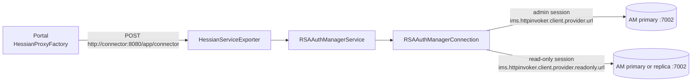
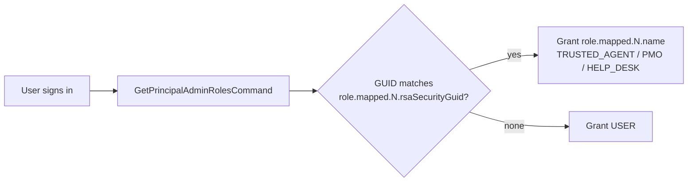

# RSA Authentication Manager Integration

The **connector** (`rsaapp-connector`) is the only component that talks to RSA Authentication Manager (AM). It uses the RSA AM SDK command API (`am-client.jar` and its dependencies in `rsaapp-connector/rsa-lib/`). The portal calls the connector through the Java interface `com.winllc.rsaapp.api.RSAAuthManagerServiceInterface`, sent over **Hessian** (binary HTTP remoting).

## Transport

| Hop | Protocol | Address | Configurable? |
|---|---|---|---|
| Portal → connector | Hessian over plain HTTP inside the Docker network | `http://connector:8080/app/connector` | No. It is hard-coded in `AppConfig`. |
| Connector → AM (write) | RSA `HttpInvokerCommandTarget`, basic auth with the command client credentials, TLS | `ims.httpinvoker.client.provider.url` | Yes |
| Connector → AM (read) | Same, on a separate target | `ims.httpinvoker.client.provider.readonly.url` | Yes (can point at a replica) |

The connector's `springapp.xml` aliases `CommandAPIConnection` to the SDK's `CacheableCommandTargetBasicAuth`. A commit in the repository history notes a switch from RMI to HttpInvoker ("use http invoker instead of deprecated rmi"). The old RMI exporter on port 1199 is still in `springapp.xml` as a commented-out block. Neither the release package nor the Helm chart publishes port 1199.

## Sessions

`RSAAuthManagerConnection` keeps two `ClientSession`s, **admin** and **read-only**, both opened as `rsa.admin.user.id` / `rsa.admin.user.password`:

1. On start-up (`afterPropertiesSet`), and whenever a command needs a session, it validates the current session with `GetSessionCommand` and reconnects if the session is missing or invalid.
2. On (re)connect it runs `SearchRealmsCommand` for `rsa.authmanager.realm.name` and `SearchSecurityDomainCommand` for `rsa.authmanager.securityDomain.name`, and caches the security domain and the realm's identity sources. A missing realm or domain fails the session check (`RsaSessionCheckFailedException`).
3. On shutdown, `cleanUp()` logs out both sessions.

Commands then run in one of four modes:

| Mode | Used for |
|---|---|
| Admin authenticated session | Writes that are not attributed to a person: emergency-code generation, clearing the cached Windows password, session checks |
| Read-only authenticated session | Searches and lookups (principals, tokens, identity sources) |
| **Run as the signed-in portal user** (`executeCommandAs`) | Operator actions: linking a token to a user, unassigning, PIN reset by an agent, enable/lock changes, emergency-access update. The portal passes the user's AM session ID and principal GUID (`AppAuthenticationToken`), and the connector executes the command under an `RSAPrincipal` subject. AM therefore enforces the operator's **own** administrative-role permissions and records the operator in its audit log. If that AM session has ended, the connector throws `RsaUserSessionEndedException`, and the portal logs the user out and redirects to `/login`. |
| Run as system (`executeCommandAsSystem`) | Available in the connector, for internal use |

## Operations used by the portal

| Portal feature | Interface method | AM SDK command(s) |
|---|---|---|
| Sign-in (SecurID) and multi-step prompts | `login`, `loginAttempt` | `LoginCommand` (in-progress logins are cached for 4 minutes) |
| Sign-out | `logout` | `LogoutCommand` |
| Test My Token | `testTokenLogin` | `LoginCommand` + `LogoutCommand` |
| Verify tokencode (PIN-check reset link) | `verifyTokencodeOfToken` | `ValidateFirstTokencodeForResyncTokenCommand` (in the Connector's admin session; no PIN, and not a logon) |
| Windows-password PIN reset | `loginWithPassword` | `LoginCommand` (password) |
| Enrollment step 1 | `verifyTokenCodeDuringRegistration` | `LoginCommand` |
| Enrollment step 2 (set PIN) | `updateTokenPin` | `LookupTokenCommand`, `UpdateTokenCommand` |
| User search | `searchUnregisteredUsers`, `lookupUser`, `lookupUserByLastname`, `retrieveUsersByRsaId` | `SearchPrincipalsCommand` (limit 25 per identity source, sub-domains included) |
| Role mapping | `getAdminRoleGuidsForUser`, `assignAdminRole`, `removeAdminRole`, `getAllUsersWithRole` | `GetPrincipalAdminRolesCommand`, `LinkAdminRolesPrincipalsCommand`, `UnlinkAdminRolesPrincipalsCommand`, `GetAdminRolePrincipalsCommand` |
| Assign token | `distributeTokenToUser` | `LookupTokenCommand`, `LinkTokensWithPrincipalCommand` (run as the Trusted Agent; refused if the token is already assigned) |
| Lost token / unassign | `unAssignUserToken` | `LookupTokenCommand`, `UnlinkTokensFromPrincipalsCommand` |
| Deprovision | `resetTokenToAssignableState` | `UnlinkTokensFromPrincipalsCommand` |
| Reset PIN (agent or user) | `resetTokenPin`, `resetTokenPinByUser` | `UpdateTokenCommand` (puts the token in new-PIN mode) |
| Emergency access code | `generateEmergencyTokenCode` | `GenerateEmergencyAccessCodeCommand`, then `UpdateTokenEmergencyAccessCommand` (temporary fixed tokencode, token flagged lost, expires after `token.emergencyCode.validityInDays`) |
| Unlock account | `setUserAccountLockoutStatus` | `UpdatePrincipalCommand` (lockout flag) |
| Clear cached Windows password | `clearCachedWindowsPassword` | `LookupAMPrincipalCommand`, `UpdateAMPrincipalCommand` |
| Shipments: validate serial range | `checkValidRange`, `findTokensInSerialRange` | `SearchTokensCommand` |
| Jobs: expiring tokens, inactive tokens | `findTokensExpiringWithinDays`, `findTokensThatHaveNotLoggedInWithinMinutes`, `findUsersWithTokens` | `SearchTokensCommand`, `SearchPrincipalsCommand` |
| Health | `testConnection` | Admin `sessionCheck` |

## Token serial prefix

AM stores token serials as 12 digits, while labels are often read without the leading zeros. Both the connector and the portal prepend **`token.serial.prefix`** (default `000`) to any serial that does not already start with it (`normalizeTokenSerial`, `lookupTokenBySerial`). Set the same value on both sides.

When a Trusted Agent assigns several tokens in a row, the **Assign Token** page notices that recent serials share a prefix (all but the last 3 digits) and pre-fills it, so the agent types only the last 3 digits.

## Administrative role GUIDs

The portal has no role store of its own. A signed-in user's roles are computed on each login:

Granting a role in the portal (**Admin → Manage User Roles**, Trusted Agent registration, or the `resyncta` job) **links the user to that AM administrative role**. Revoking a role unlinks it. The AM administrative roles you map must carry the AM permissions needed for the actions the portal performs as that user (for example, assigning tokens and resetting PINs within the managed security domain), because those commands run as the operator.

## AM-side prerequisites checklist

- [ ] Root CA exported and imported into `trust.jks` with alias `rsa_am_ca` ([Installation](install.md#export-the-am-root-certificate-and-build-trustjks))
- [ ] Command client user and password from `rsautil manage-secrets --action list`
- [ ] Internal Super Admin user for `rsa.admin.user.id`
- [ ] Realm and security domain names (`rsa.authmanager.realm.name`, `rsa.authmanager.securityDomain.name`), both `SystemDomain` by default
- [ ] Three administrative roles (Trusted Agent, PMO, Help Desk) with appropriate scope, and their `ims.…` GUIDs
- [ ] TCP 7002 open from the Docker host to the primary (and to the replica if it is used for reads)

## Trust store renewal

When the AM root CA changes, rebuild `default_build/ssl/trust.jks` and restart the connector. See [Operator Guide → Certificate renewal](operator-guide.md#certificate-renewal).
