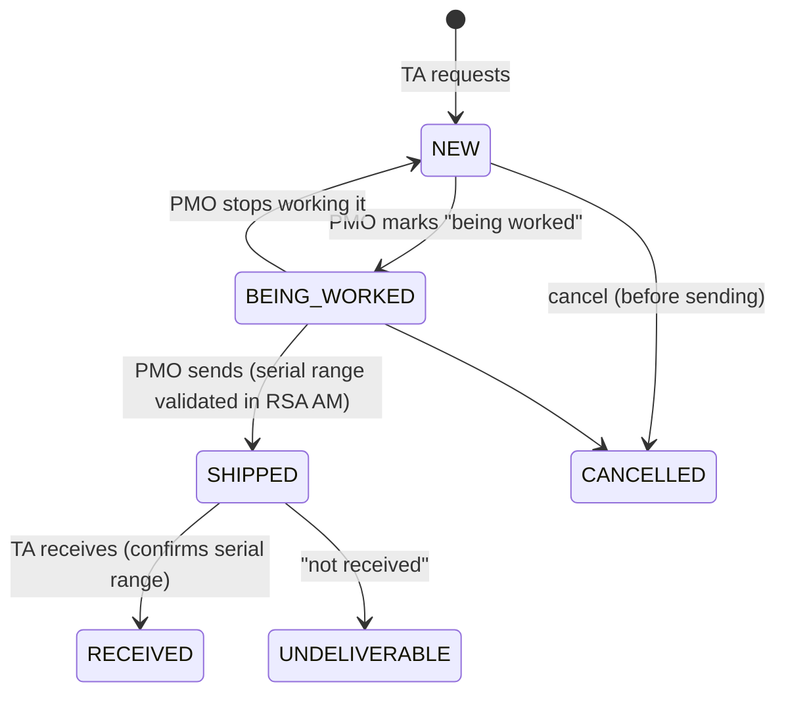

# User Guide

This guide walks through every screen in the portal by audience. The left-hand menu shows only the sections your roles allow (see [Security → Roles](security.md#roles)). PMO-only screens are covered in the [Admin Guide](admin-guide.md).

!!! tip "Signing in"
    Click **Login** (top right), then enter your **User ID** and your SecurID **passcode** (PIN followed by the tokencode shown on the token). If RSA asks for more input, such as the *next tokencode* or a *new PIN*, the portal shows a follow-up screen with one field per prompt and a hint for each. Wait for a **new** tokencode before you enter the next tokencode. Sign out with the **Logged in: \<user\>** link.

## Screens for everyone (no sign-in needed)

### Home (`/home`)

The home page shows a welcome banner, active **system notifications** (Info, Alert or Critical, posted by the PMO), and three panels: *What?*, *Why?* and *How?*. The *How?* panel links to the Trusted Agent directory. The footer has links to the MFA homepage, the organization homepage, the service desk, FAQs and Contact Us, plus the build version.

### Trusted Agent Directory (`/ta/list`)

A searchable table of Trusted Agents (first and last name, email, phone, site name, city, state, country). It shows active agents by default and can be switched to show all. For each agent you can:

* **Details** (`/ta/details/{id}`): the agent's contact details, desk, working hours and site address.
* **Schedule Appointment** (`/appointment/schedule/{id}`).

### Schedule an appointment

1. From the directory, choose **Schedule Appointment** for an agent.
2. Enter your **User ID**, pick an **appointment type** (*New Token*, *Replace Token* or *Return Token*), and pick a **date** and **time**. Times the agent has already booked are loaded from the portal and are not offered. Times are shown in the server's time zone.
3. Submit. The portal creates the appointment, emails the agent, and opens the appointment details page (`/appointment/details/{id}`). Bookmark it.

The portal refuses the booking if your User ID is not in RSA AM, or if the form is incomplete. The agent confirms the appointment. You receive a reminder email in the week before a confirmed appointment. You can **cancel** from the details page if your browser presents the same PKI certificate you used when you booked.

### Test My Token (`/user/token/test`)

Enter your User ID and passcode. The portal attempts an RSA authentication and reports:

* *"Success! You were able to use your token to authenticate…"*, or
* *"Failed. The system did not recognize the username and passcode combination."*

### Enroll your token (set your PIN)

After a Trusted Agent assigns you a token, you receive an email (*"RSA SecurID Token Pin Activation"*) with a link to `/user/registration/start?userId=<you>`. During a staged roll-out you may first get a notice that you will be able to set your PIN later. The link arrives on the allowed date and is re-sent every few days until you finish.

1. **Start**: confirm your User ID, enter the **tokencode currently on your token**, and tick to accept the user agreement.
2. **Complete**: if more than one of your tokens is waiting for a PIN, choose the token serial. Enter your new **PIN** twice (6 digits by default, numbers only) and the **Next Token Code**. Wait for the token display to change before you enter it.
3. On success: *"You have successfully enrolled your RSA token!"* If Active Directory integration is on, you are added to the RSA-enabled group, and from then on you sign in to your workstation with your token.

Common messages: *"You have not been assigned a token"*, *"You already have a token with a pin set"* (ask a Trusted Agent for a PIN reset), *"The token code does not match…"*, *"Your account is currently locked out"*, *"Pin not accepted…"* (PIN reuse or wrong length).

### Reset My PIN (`/user/pinReset/splash`)

The page offers two **Pin Reset Options**:

=== "With your PKI certificate"

    `/user/pinReset/certReset`. Your browser must present a client certificate.

    1. Enter your User ID.
    2. The portal checks that this certificate was used at your last token enrollment, or was recorded by a PIN-check email link. If it matches, it lists your tokens that have a PIN set.
    3. Choose the token. The PIN is cleared (new-PIN mode) and you go to **Enroll your token** to set a new one.

    If the certificate does not match: *"We were unable to match your previous RSA Enrollment with your PKI Credentials. Please contact the Help Desk…"*.

=== "With your Windows password"

    `/user/pinReset/passwordReset`

    1. Enter your Windows **username** and **password**, and the **token serial**. Omit the leading zeros; the portal adds the configured serial prefix.
    2. If RSA accepts the password and the serial belongs to you, the PIN is cleared and you go to **Enroll your token**.

### PIN-check email links (`/user/pinReset/start/{code}`)

If your assigned token has not been used recently, the nightly job may email you:

* an **initial PIN** reminder with your enrollment link (token never enrolled), or
* a **check your PIN** email with a personal link. On that page, enter your passcode to **verify** it. If verification works, nothing else is needed. If it fails, click **reset** to clear the PIN and go to enrollment. The link stops working once it has been used, or once you sign in successfully with the token.

### Request an exemption

The **Request Exemption** menu link (target set by the `exemptionrequest.url` property, normally `/user/exemption/request`) requires a PKI client certificate. Enter your User ID and a **reason** and submit. One request is kept per certificate. If you open the page again, it links to your existing request. The PMO reviews the request, and you receive an email with the decision. A Trusted Agent cannot assign a token to a user whose exemption has been approved.

## Trusted Agent screens

These need the `TRUSTED_AGENT` role. The **Trusted Agent Activities** menu holds **Shipments**, **Sites** and **My TA Profile**. The **Token Management** menu holds **Assign Token**, **User Lost Token**, **Deprovision Token** and **User Search**.

### My TA Profile (`/ta/profile`)

Update your **phone**, **desk**, **working hours** (from and to) and **site**. The page also lists your **upcoming appointments** (each with a **Details** link) and a personal activity report. The menu badge shows how many appointment requests you have not reviewed yet.

### Appointments

Open an appointment from your profile. You can:

* **Confirm** it. The requester is emailed and will get a reminder.
* **Cancel** it. The requester is emailed.
* **Update notes**.

Only the agent the appointment is booked with can change it.

### Assign Token (`/token/distribute/search`)

1. Search for the user. Free text matches User ID, first, middle and last name, with up to 25 results per identity source. If `search.useridonly` is on, enter an exact User ID or a last name instead. Verify the user's identity with photo ID.
2. Choose the user. If they already hold a valid (unexpired) token, the page shows *"User already is assigned a token"* with no assignment form. If they have an approved exemption, assignment is blocked.
3. Enter the **token serial** from the back of the token. After a few assignments with similar serials, the page pre-fills the common prefix so you type only the last 3 digits. During a staged roll-out, the **allowed to set PIN** date is pre-set.
4. Submit. The portal removes the user's **expired** tokens, links the new token to the user in RSA AM (as you), records an audit event, and emails the user the enrollment link (or the delayed-PIN notice).

### User Lost Token (`/token/lost/search`)

Search (only users with a valid token are listed), open the user, review their tokens, and click **Mark Lost** for the lost token. The token is unassigned in RSA AM, the user is removed from the AD RSA-enabled group (if AD integration is on), an audit event is recorded, and the user is emailed. Users who lose `cron.lostTokenThresholdMonitor.tokens.lost` tokens within the configured window are reported to the MFA mailbox.

### Deprovision Token (`/token/deprovision/search`)

Use this when a user leaves, or when a lost token is found. Enter the **serial** to see the token's expiry and current assignee, then **Deprovision**. The token is unlinked and returned to the **assignable** state. The previous holder is removed from the AD RSA-enabled group, and an audit event is recorded.

### User Search and User Details (`/user/search`)

Search for a user, then open **User Details** (`/user/search/details/{id}`):

| Section | Contents and actions |
|---|---|
| User Details | User ID, name, email, last login, enabled, **In MFA Enabled Active Directory Group** with **Add to Group** or **Remove From Group**, **Locked Out** with **Unlock**, and **Clear Cached Windows Password** under *Additional User Options* |
| Token Details | For each token: serial, expiration date, PIN set?, and the buttons **Reset Pin** (clears the PIN so the user re-enrolls, and emails the user), **Mark Lost**, and **Generate Emergency Token Code** (a temporary fixed tokencode valid for `token.emergencyCode.validityInDays` days, shown on screen; the token is flagged lost in RSA) |
| Enrollment History | Date, token serial, user certificate DN |
| Activity Log | Audit events for this user: type, timestamp, Trusted Agent, details |

### Sites (`/sites/list`)

A table of sites. **Add** a site (`/sites/add`) with shipping ID, name, address, building, city, state, ZIP, country and time zone; the shipping ID must be unique. Open a site to see its details, its Trusted Agents and its associated token serial ranges, and to open the **Site Report** (tokens at site, tokens issued, enrolled users).

### Shipments (`/shipment/list/all`)

Shipments move token stock to sites. Only one active shipment per site is allowed.

| Action | Where | Who |
|---|---|---|
| **Request** | `/shipment/request`: choose the site (defaults to yours), number of tokens, and optionally "on behalf of" another agent's User ID (that agent must have a site) | Trusted Agent |
| **View / Modify** | `/shipment/details/{guid}`, `/shipment/modify/{guid}`: edit details while the shipment is not being worked, cancel before it is sent, report **not received** after it is sent, open **receive** | Trusted Agent |
| **Print label** | `/shipment/print/{guid}` (only while being worked or shipped) | Trusted Agent |
| **Receive** | `/shipment/receive/{guid}`: confirm the start and end serials received | Trusted Agent |
| Work, send, delete | See [Admin Guide → Shipments](admin-guide.md#shipments) | PMO |

Email notifications go to the requesting agent when the shipment is requested, being worked, sent and cancelled, and to the sending PMO user when it is received. The menu shows a count of new shipment requests to PMO users.

## Help Desk screens

Users with `HELP_DESK` see the **Token Management** menu, without **Assign Token**:

* **User Lost Token**, **Deprovision Token**, and **User Search / User Details** (unlock, emergency token code, PIN reset, mark lost, clear cached Windows password, AD group toggle), all as described above.

!!! note
    The source contains Help Desk user-management templates (`help_desk_user_*.html`) and matching audit event types, but no controller serves them, so those screens are not reachable in this version.
