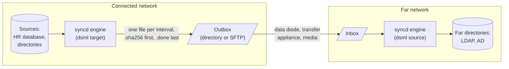

# Air-gapped synchronisation

From 0.6.0 syncd synchronises identities between networks that are not connected: a
classified enclave and the enterprise network, an operational technology network and
the office, a disconnected site. The engine on the connected side publishes people and
groups as **DSML v2 files** (OASIS, `urn:oasis:names:tc:DSML:2:0:core`) into an outbox;
whatever carries files across the gap (a data diode, a cross-domain transfer appliance,
an SFTP drop, removable media) takes them to an inbox on the far side; and the engine
there reads them in the order they were written and publishes them to its own
directories.

This page sets up both sides end to end, with the transfer between them, and covers
monitoring, recovery, security and the limits as of 0.7.0. The connector itself (every
file format detail and setting) is in [DSML files (air gap)](connectors.md#dsml-files-air-gap),
and every key with its default in [Configuration](configuration.md#connectors-connectors).
It describes syncd 0.7.0 (tag `v0.7.0`, commit `6de2fa1`), whose DSML connector is
0.6.0's unchanged: 0.7.0 only refuses governance's grants on a `dsml` target (see
[Governance across the gap](#governance-across-the-gap)). The source repository's own guide is `docs/connectors/dsml.md`, with
`examples/airgap-export.yaml` and `examples/airgap-import.yaml`.

!!! note "What has been tested, and what has not"
    CI runs both sides on every pull request (`tests/e2e/dsml-airgap.sh`): the connected
    side writing over SFTP to OpenSSH 9.6, the far side publishing to OpenLDAP 2.6, with
    lost, damaged and late files, the SFTP server down and the far side rebuilt from
    nothing. Every file that crosses is validated against the OASIS schema. **The transfer
    in the test is a script copying files.** syncd has not been tested with a commercial
    data diode, a cross-domain solution's transfer software or a DSML gateway, so test the
    whole path, with your own product, before relying on it ([Acceptance test](#acceptance-test)).

## How it works



- **Changes, in order.** The connected side keeps each export in its store and writes
  the interval's exports as one file every 15 minutes (`batch_secs`), on the quarter
  hour, as a DSML `batchRequest` of adds, modifications, renames and deletes. Nothing is
  lost across a stop or a crash: an export counts as exported once it is in the store,
  and leaves the store in the same commit that records the file written.
- **Numbered and checked.** Files are named `<prefix>-<sequence>-<UTC time>.dsml.xml`,
  the sequence counting the files written. Each has a `.sha256` written before it and,
  with `done_files`, a `.done` after it.
- **Read in order, held at a gap.** The far side reads files in name order, each as one
  transaction, and checks it against its `.sha256`. When a number is missing, it holds the
  files after it until the missing one arrives.
- **Snapshots put things right.** With `full_snapshots: true` the connected side also
  writes a snapshot (a `searchResponse` of every entry it has exported) at each full
  reconciliation. The far side reads it as a full read of everything: entries it does not
  hold are deleted (within the deletion thresholds), entries changed on the way are put
  right, and a missing file before it no longer holds the files after it.
- **One way.** Nothing comes back across the gap: the connected side never learns what
  the far side applied. Monitoring and recovery are done on each side, as below.

What crosses is what the connected side's publications export: the attributes you map,
and group membership as member DNs. **syncd's password delivery never crosses**:
validation refuses `passwords` on a publication to a `dsml` target. An attribute you map is
written whatever it holds, so never map `userPassword` or another secret.

## Before you start

Decide these first; most of them need someone other than the syncd administrator.

| Decision | Why it matters |
|---|---|
| **What crosses** | Which people and groups, and which attributes. Every attribute in a file crosses the gap in clear (see [Security](#security)). Approve the list as you would any information flow (it is the AC-4 information flow in an authorisation package), and select on the connected side: the far side should take everything it is given. |
| **The far directory's names** | Write the files in the far directory's namespace (its suffix, its containers), so the far side needs no rewriting. The far side can rewrite DNs (as the CI test does), but every group's member values then need the same rewriting. |
| **The anchor** | An attribute the files carry that never changes (`employeeNumber`, an HR id) identifies each entry on the far side. `dn` works but makes a rename a delete and an add there. |
| **How leavers leave** | Disable on the connected side (`deprovision: disable` with a `profile`) and let the far side decide (delete them, or disable them in its own directory), or delete them on the connected side. |
| **The transfer** | A data diode or cross-domain solution, an SFTP server a transfer agent reads, or removable media. Its file handling decides several settings below; find out how it names files while they are in transit, whether it delivers files in order, which file types it passes, and its size limit. |
| **How fresh** | A change reaches the far side after the rest of its interval (`batch_secs`), the transfer, and the far side's next look (`poll_secs`). 15 minutes plus transfer is the default; `batch_secs: 0` writes each batch at once. |
| **How often snapshots cross** | A snapshot holds every exported entry, so it is far larger than a file of changes. See [below](#how-often-snapshots-cross). |
| **FIPS mode** | An `sftp://` outbox or inbox is refused in FIPS mode. With FIPS, use a directory on the engine's host (a local disk, NFS, SMB, the appliance's share). |
| **Licences** | Each side is its own installation with its own licence, and each counts the identities it manages, so the far side needs a licence that covers the same people. The DSML connector is in the Core pack. The licence check is offline, but the far side's installation id has to reach the ENS licensing portal and the `.lic` file has to come back on media, since the transfer runs one way. See [Licensing](licensing.md#getting-a-license). |
| **Versions** | Run the same syncd release on both sides. Any DSML reader can read the files, but upgrading both sides together keeps behaviour the same at each end. |

## Step 1. Install syncd on both sides

Install a console and an engine on each network, as in the [install guide](install.md).
On the far network the release comes in on media: carry the bundle (or the `.deb` or
`.rpm`) with `SHA256SUMS`, and check it there with `sha256sum -c` before installing. The
release files are not GPG-signed yet (see [Verifying a release](install.md#verifying-a-release)),
so compare `SHA256SUMS` with a copy obtained separately (the ENS licensing portal's
**Downloads** page and the GitHub release both have it). With FIPS, carry the `-fips`
bundle and install with `--fips` on both sides.

Each side's configuration is designed and published in its own console. Nothing about
configuration crosses the gap, and should not: a configuration for the far side is
written on the far side (or carried in on reviewed media and imported there).

Install the licence on each side ([Licensing](licensing.md)).

## Step 2. Prepare the outbox (connected side)

The outbox is where the connected side's engine writes. It is either a directory the
engine's host can write (a local disk the transfer agent reads, a mounted share, the
diode's send folder) or a directory on an SFTP server.

=== "A directory"

    The directory must exist (an unmounted transfer volume is an error, not a new
    directory). The engine runs as `syncd` with a umask of `0027`, so the files it writes
    are `0640`, owned by `syncd`. Give the directory a group the transfer agent belongs to,
    with the set-group-ID bit, so the files inherit that group and the agent can read
    them:

    ```sh
    sudo groupadd --system airgap                  # the transfer agent's group
    sudo install -d -o syncd -g airgap -m 2750 /var/lib/syncd/airgap/out
    sudo usermod -aG airgap <transfer-agent-account>
    ```

    The agent needs write access too if it removes files once they are sent
    (`-m 2770`).

    **The engine's systemd unit only lets it write its store and `/etc/syncd/engine`**
    (`ProtectSystem=strict`, `ReadWritePaths=/var/lib/syncd/engine /etc/syncd/engine`), so
    the outbox needs a drop-in, or every write fails with a read-only file system and the
    target shows as down. `sudo systemctl edit syncd`, and put in it:

    ```ini
    [Service]
    ReadWritePaths=/var/lib/syncd/airgap/out
    # For a network file system (NFS, SMB) or a removable volume, also:
    [Unit]
    RequiresMountsFor=/var/lib/syncd/airgap/out
    ```

    then `sudo systemctl restart syncd`. The directory must exist, or the service does not
    start.

=== "An SFTP server"

    On the SFTP server, make an account that can do nothing but SFTP into its own
    directory. With OpenSSH, in `/etc/ssh/sshd_config`:

    ```
    Match User syncd-airgap
        ChrootDirectory /srv/airgap
        ForceCommand internal-sftp
        AllowTcpForwarding no
        X11Forwarding no
        PasswordAuthentication no
    ```

    ```sh
    sudo useradd --system --home-dir /srv/airgap --shell /usr/sbin/nologin syncd-airgap
    sudo install -d -o root -g root -m 0755 /srv/airgap               # the chroot: root's
    sudo install -d -o syncd-airgap -g airgap -m 2770 /srv/airgap/outbox
    sudo systemctl reload sshd
    ```

    On the engine's host, make the engine's key (Ed25519 or ECDSA; RSA keys are not
    taken), readable by the engine and nobody else:

    ```sh
    sudo ssh-keygen -t ed25519 -N '' -C syncd-airgap -f /etc/syncd/airgap_ed25519
    sudo chown root:syncd /etc/syncd/airgap_ed25519 && sudo chmod 0640 /etc/syncd/airgap_ed25519
    ```

    Put `/etc/syncd/airgap_ed25519.pub` in the account's `~/.ssh/authorized_keys` on the
    server (outside the chroot, or set `AuthorizedKeysFile` for the account). A key with a
    passphrase works too: give the passphrase as `private_key_passphrase`, a secret
    reference.

    Pin the server's host key. Read it on the server itself, or over a channel you trust,
    rather than from the network you are protecting against:

    ```sh
    ssh-keygen -lf /etc/ssh/ssh_host_ed25519_key.pub     # on the server: SHA256:...
    ssh-keyscan -t ed25519 transfer.example.com          # from the engine's host, to compare
    ```

    Use the `SHA256:` fingerprint or the `ssh-ed25519 AAAA...` line in `host_keys`. A server
    presenting another key is refused; the error names the key it presented.

    The SSH transport is not in FIPS mode: in FIPS mode an `sftp://` location is refused.

=== "Kubernetes"

    The engine's container has a read-only root file system. Mount the outbox with the
    chart's `engine.extraVolumes` and `engine.extraVolumeMounts`, from a volume the
    transfer agent can also reach:

    ```yaml
    engine:
      extraVolumes:
        - name: airgap-out
          persistentVolumeClaim: { claimName: airgap-out }
      extraVolumeMounts:
        - name: airgap-out
          mountPath: /var/lib/syncd/airgap/out
    ```

    or use an SFTP outbox, which needs no volume. The SFTP key comes from a Secret,
    mounted the same way, and is named in the configuration by its path.

## Step 3. Configure the connected side

A complete configuration: people from the HR database and teams from a CSV file,
published as DSML files in the far directory's namespace (`dc=far,dc=example`).

```yaml
version: 1

engine:
  data_dir: /var/lib/syncd/engine
  # Full reconciliations, and so snapshots, every 24 hours rather than every hour
  # (the default follows scrape_interval_secs, 3600). See "How often snapshots cross".
  reconcile_interval_secs: 86400

attributes:
  multi_valued: [members, member]

connectors:
  - name: hr_db
    type: postgres
    connection:
      host: hr-db.example.com
      user: syncd
      password: { env: HR_DB_PASSWORD }
      dbname: hr
      tls: verify_full
    objects:
      - type: person
        anchor: id
        table: people
        mode: stream
        cdc: { slot: syncd_hr, publication: syncd_hr_pub }

  - name: teams
    type: csv
    connection:
      path: /var/lib/syncd/in/teams.csv
      watch: true
      columns: [name, { name: members, type: "multi:;" }]
    objects: [{ type: group, anchor: name }]

  - name: outbox
    type: dsml
    connection:
      location: /var/lib/syncd/airgap/out
      # or, on an SFTP server:
      # location: sftp://syncd-airgap@transfer.example.com/outbox
      # sftp:
      #   host_keys: ["SHA256:Vh3...k2E"]
      #   private_key: { file: /etc/syncd/airgap_ed25519 }
      prefix: hq                    # unique per writer; see "Recovery"
      batch_secs: 900               # one file per 15 minutes, on the quarter hour
      done_files: true              # a .done after each file
      max_bytes: 104857600          # 100 MiB: a larger interval is split
      full_snapshots: true          # a snapshot at each full reconciliation
      profile: openldap             # disabling writes pwdAccountLockedTime

views:
  - name: people
    sources:
      - connector: hr_db
        object: person
        project: true
        flows:
          employeeNumber: source.id
          uid: source.login
          givenName: source.first_name
          sn: source.last_name
          mail: source.email
          clearance: source.clearance
    computed:
      - name: cn
        output: e.givenName + " " + e.sn

  - name: groups
    sources:
      - connector: teams
        object: group
        project: true
        flows: { cn: source.name, members: source.members }

publications:
  - name: people_out
    view: people
    target: outbox
    # Select here: only people cleared for the far network cross.
    filter: e.clearance == "far"
    dn: uid={uid},ou=People,dc=far,dc=example
    object_classes: [inetOrgPerson]
    attributes:
      uid: e.uid
      cn: e.cn
      sn: e.sn
      givenName: e.givenName
      mail: e.mail
      employeeNumber: e.employeeNumber
    # Leavers and those who lose clearance: a modification of pwdAccountLockedTime.
    deprovision: disable
    deletion_threshold: { percent: 5, count: 500 }

  - name: groups_out
    view: groups
    target: outbox
    dn: cn={cn},ou=Groups,dc=far,dc=example
    object_classes: [groupOfNames]
    attributes:
      cn: e.cn
      member: 'e.members.map(m, "uid=" + m + ",ou=People,dc=far,dc=example")'
```

Notes on the target's settings:

- **`prefix`** names this writer. Letters, digits, `-`, `_` and `.`, not starting with a
  dot. Each writer that sends to the far side needs its own prefix (and its own inbox
  there; see [Recovery](#recovery)).
- **`profile`** says how the far directory disables accounts: `openldap`
  (`pwdAccountLockedTime`), `389ds` (`nsAccountLock`) or `unboundid`
  (`ds-pwp-account-disabled`). Without one, validation refuses `deprovision: disable`.
- **What validation refuses on a publication to a `dsml` target**, since a file cannot be
  read back: `drift`, `unmanaged`, `writeback`, `adopt`, `create_containers`,
  `remove_empty_containers`, `strip_unmanaged_groups` and `passwords`. The far side
  creates containers and checks for drift with its own publications.
- **Deletion thresholds still apply.** A publication's `deletion_threshold` holds a mass
  delete on the connected side before it is ever written to a file (since 0.5.5 disables
  of leavers count under it too).

Check and publish:

```sh
sudo syncd validate engine.yaml           # or the console's check
sudo syncd test-connection outbox         # lists the outbox; for SFTP, signs in:
# signed in to transfer.example.com:22 as syncd-airgap, host key SHA256:Vh3...k2E
# 0 files in the directory
```

Publish the configuration from the console as usual. A connector of type `dsml` has its
own form in the console's configuration editor (location, SFTP settings, intervals,
snapshots, reading options) and **Browse the files**, which lists the outbox's files,
newest first, with the entries one carries.

## Step 4. Set up the transfer

Whatever carries the files, it must:

1. **Carry three kinds of file**: `*.dsml.xml`, `*.dsml.xml.sha256` and, with
   `done_files`, `*.dsml.xml.done` (they are empty). Allow these extensions through the
   diode's or appliance's file-type filter.
2. **Keep the names exactly**: the sequence number and the time in the name are how the
   far side orders the files and finds a missing one.
3. **Never show part of a file under its final name** in the inbox. Deliver it under a
   name the reader ignores and rename it into place, or deliver its `.done` last. The
   reader never reads names starting with `.`, nor `.part`, `.sha256` or `.done` files.
4. **Pass files up to `max_bytes`** (1 GiB by default; set it to the transfer's limit or
   below). A snapshot is one file and is not written when it would be larger.
5. **Take only from the outbox's top level.** The target writes a file under a temporary
   name (`.<name>.part`) and renames it into place when it is complete; take files
   only once renamed, which is when they match `*.dsml.xml`.

Match the far side's settings to how the transfer delivers:

| The transfer | Far side's `done_files` | Far side's `require_checksums` |
|---|---|---|
| Delivers each file atomically (renames into place) and in order: `.sha256`, file, `.done` | `true` | `true` |
| Delivers atomically but in any order, or drops `.done` files | `false`: a file is read once it has not changed for three seconds | `true`: the reader waits for the `.sha256` |
| Writes files in place, slowly, with no done marker | `false` | `true`: a file that does not yet match its checksum fails the source, which tries again on its restart schedule until it matches |

### A data diode or cross-domain solution

Point the diode's send side (its low-side folder or agent) at the outbox, or at the SFTP
server's directory, and its receive side at the far side's inbox (or at a folder a
local job moves complete files from into the inbox). Most diodes deliver a file only once
it is whole; check yours, and whether it keeps the order files were sent in.

A cross-domain solution that inspects content can check every file against the OASIS
schema (`DSMLv2.xsd`): every file syncd writes is valid against it. A file holds no
document type declaration, no `anyURI` values and no external references, and the far
side refuses a file that does.

### An SFTP server and a transfer agent

The connected side writes to the SFTP server ([Step 2](#step-2-prepare-the-outbox-connected-side));
the transfer agent (the diode's low-side agent, a scheduled job) collects from there. Its
account needs read access to the outbox, and write access if it removes what it sent.

### Removable media

For a site where media are carried by hand. On the connected side, copy what is new since
the last trip, with its checksums:

```sh
#!/bin/sh
# airgap-pack.sh MEDIA_DIR: copies DSML files not yet carried onto the media.
set -eu
OUT=/var/lib/syncd/airgap/out
MEDIA=$1
LOG=/var/lib/airgap/carried.log      # names already carried
touch "$LOG"
cd "$OUT"
for f in $(ls -1 -- *.dsml.xml 2>/dev/null | sort); do
  grep -qxF "$f" "$LOG" && continue
  sha256sum -c --quiet "$f.sha256"          # never carry a damaged file
  cp -- "$f.sha256" "$f" "$MEDIA/"
  [ -f "$f.done" ] && cp -- "$f.done" "$MEDIA/"
  echo "$f" >> "$LOG"
done
(cd "$MEDIA" && sha256sum -c --quiet ./*.dsml.xml.sha256)   # the copies are good
```

On the far side, check the media and move the files into the inbox under a name the
reader ignores, then rename them into place:

```sh
#!/bin/sh
# airgap-unpack.sh MEDIA_DIR: puts the carried files into the inbox.
set -eu
IN=/var/lib/syncd/airgap/in
MEDIA=$1
cd "$MEDIA"
sha256sum -c --quiet ./*.dsml.xml.sha256
for f in $(ls -1 -- *.dsml.xml | sort); do
  cp -- "$f.sha256" "$IN/"
  cp -- "$f" "$IN/.$f.tmp" && mv -- "$IN/.$f.tmp" "$IN/$f"
  [ -f "$f.done" ] && cp -- "$f.done" "$IN/"
done
```

Media carry personal data in clear: encrypt them, and handle them as your media
protection policy says.

### Cleaning the outbox

The connected side never removes what it wrote, so the outbox grows. Remove files once the
transfer has delivered them, but **keep them for a while** (two weeks, say) so a file lost
on the way can be sent again rather than waiting for a snapshot:

```sh
# Daily, as the transfer agent: files delivered and older than 14 days.
find /var/lib/syncd/airgap/out -maxdepth 1 -name '*.dsml.xml*' -mtime +14 -delete
```

## Step 5. Prepare the inbox (far side)

The inbox is a directory the far side's engine reads, on its host or on an SFTP server
(the same settings as the outbox's, under `sftp`).

The transfer writes the files and the engine reads them. With `after_read: move` or
`delete`, the engine also moves or removes them, so it needs write access, and its unit
needs a drop-in as on the connected side:

```sh
sudo install -d -o <transfer-account> -g syncd -m 2770 /var/lib/syncd/airgap/in
sudo systemctl edit syncd     # [Service] ReadWritePaths=/var/lib/syncd/airgap/in
sudo systemctl restart syncd
```

Files delivered into a set-group-ID directory owned by group `syncd` are readable by the
engine when the transfer writes them group-readable. Only the transfer should be able to
write the inbox: whatever is put there is applied to the far directories (see
[Security](#security)).

## Step 6. Configure the far side

```yaml
version: 1

engine:
  data_dir: /var/lib/syncd/engine

attributes:
  multi_valued: [member]

connectors:
  - name: inbox
    type: dsml
    connection:
      location: /var/lib/syncd/airgap/in
      pattern: "*.dsml.xml"
      done_files: true            # see the table in Step 4
      require_checksums: true
      on_gap: wait                # hold the files after a missing one
      after_read: move            # into processed/, with .sha256 and .done
      poll_secs: 30
    # Deletes found in one read (a snapshot) beyond this are held for approval.
    deletion_threshold: { percent: 5, count: 500 }
    objects:
      # Read everything the files hold under each base: the connected side selected.
      - type: person
        anchor: employeeNumber
        mode: stream
        base: ou=People,dc=far,dc=example
        scope: sub
        filter: (objectClass=inetOrgPerson)
      - type: group
        anchor: cn
        mode: stream
        base: ou=Groups,dc=far,dc=example
        scope: sub
        filter: (objectClass=groupOfNames)

  - name: far_ldap
    type: ldap
    connection:
      url: ldaps://ldap.far.example
      bind_dn: cn=syncd,ou=Services,dc=far,dc=example
      password: { env: FAR_LDAP_PASSWORD }

views:
  - name: people
    sources:
      - connector: inbox
        object: person
        project: true
        flows:
          uid: source.uid
          cn: source.cn
          sn: source.sn
          givenName: source.givenName
          mail: source.mail
          employeeNumber: source.employeeNumber
          locked: source.pwdAccountLockedTime
  - name: groups
    sources:
      - connector: inbox
        object: group
        project: true
        flows: { cn: source.cn, member: source.member }

publications:
  - name: people_far
    view: people
    target: far_ldap
    # Those the connected side disabled leave this directory.
    filter: '!has(e.locked)'
    dn: uid={uid},ou=People,dc=far,dc=example
    object_classes: [inetOrgPerson]
    create_containers: true
    attributes:
      uid: e.uid
      cn: e.cn
      sn: e.sn
      givenName: e.givenName
      mail: e.mail
      employeeNumber: e.employeeNumber
    deletion_threshold: { percent: 5, count: 500 }
    drift: { interval_secs: 86400, default: revert }   # put hand changes back daily

  - name: groups_far
    view: groups
    target: far_ldap
    dn: cn={cn},ou=Groups,dc=far,dc=example
    object_classes: [groupOfNames]
    create_containers: true
    attributes:
      cn: e.cn
      member: e.member
```

Notes on the source's settings:

- **Objects must be `mode: stream`**: files are read as they arrive.
- **An object reads what its search would have found** in the directory the files
  describe: entries under `base`, in `scope` (`base`, `one`, `sub`), matching `filter`,
  matched without a schema (values compare without case; `>=` and `<=` compare numbers as
  numbers; extensible matches are refused). Each object reads every file on its own.
- **Read everything, select on the connected side.** A file of changes can only change
  what the source holds: an entry that a modification brings into an object's filter,
  whose other attributes the source never held, is skipped with a warning until a
  snapshot carries it whole.
- **`anchor`** is an attribute the files carry that never changes. `dn` works, but a
  renamed entry is then a different record.
- **Two writers, two inboxes.** If two connected sides send to this far side, give each
  its own inbox and its own `dsml` connector (see [Recovery](#recovery) for why).
- **The far side's publications are ordinary LDAP publications**: thresholds, drift
  checks, change windows, `create_containers` and the rest all work here.

Drift checks are described in [Drift detection](configuration.md#drift-detection-drift).

## Step 7. First run and verification

1. **Start the far side** first (or at any time): with an empty inbox, its first start
   records that there is nothing to read, and waits.
2. **Publish the connected side's configuration.** Its initial load exports every entry
   as adds, written as files of changes at once (a full reconciliation writes out what is
   waiting), and then, with `full_snapshots`, a snapshot:

    ```
    hq-000000000001-20261121T091502Z.dsml.xml
    hq-000000000001-20261121T091502Z.dsml.xml.sha256
    hq-000000000001-20261121T091502Z.dsml.xml.done
    hq-000000000002-20261121T091503Z.full.dsml.xml
    ...
    ```

    The log says `DSML file written` and `DSML snapshot written`.
3. **Carry the files across.**
4. **Watch the far side read them**: the log says `DSML file read` for each, the files move
   to `processed/`, and the far directory fills.
5. **Check the counts.** The snapshot's entries against the far directory's:

    ```sh
    grep -c '<searchResultEntry' hq-000000000002-*.full.dsml.xml     # connected side
    ldapsearch -H ldaps://ldap.far.example -D ... -W -LLL \
      -b ou=People,dc=far,dc=example '(objectClass=inetOrgPerson)' dn | grep -c '^dn:'
    ```

    The far count is the snapshot's people less those disabled (the far publication
    filters them out).
6. **Check `syncd status` on both sides**: no target down on the connected side, no
   warning on the far side's source lines.

Optionally, validate a file against the schema, as CI does:

```sh
xmllint --noout --schema DSMLv2.xsd hq-000000000001-20261121T091502Z.dsml.xml
```

### Acceptance test

Before production, run each of these through your real transfer and record the result:

- [ ] A new person, a change of name, a rename (`uid`), a leaver and a group membership
      change each reach the far directory.
- [ ] A file deliberately held back: the far side reports the gap and holds the files
      after it; releasing the file lets them through in order.
- [ ] A file deliberately lost: `syncd reconcile` on the connected side, and the snapshot
      supersedes it.
- [ ] A file corrupted in transit (change a byte): the far side refuses it, naming it;
      a good copy is read.
- [ ] The outbox unavailable (unmount it, stop the SFTP server): the connected side shows
      the target down, keeps its exports, and writes them, with no gap in the numbering,
      once the outbox is back.
- [ ] The largest snapshot you expect passes the transfer's size limit.
- [ ] The far side's engine restored from its backup catches up (see [Recovery](#recovery)).

## Operating it

### How often snapshots cross

A snapshot is written once every publication to the target has been reconciled in full
since the last one. Full reconciliations happen:

- at the end of the first start's initial load;
- after a configuration change's full sync (any publish);
- at `syncd reconcile` (all publications; `--publication` reconciles one, and a snapshot
  follows once all have been);
- **every `engine.reconcile_interval_secs`**, which defaults to
  `engine.scrape_interval_secs`: **an hour**.

So with the defaults a snapshot crosses every hour, which with tens of thousands of
entries is most of what crosses. Set `engine.reconcile_interval_secs` on the connected side
to how often you want one: daily (`86400`) is a reasonable start. Regular snapshots are
worth having: they put right anything lost on the way, and they are the far side's sign
that the path works when nothing has changed (an interval with no changes writes no file).

A snapshot's size is roughly the number of entries times an entry's size in DSML (500 to
1,000 bytes for a person with a handful of attributes; a group with its members much
more). Keep `max_bytes` above it, or it is not written (the log warns).

### Sending now

`sudo syncd reconcile` (the operate tier) on the connected side writes out the exports
waiting for the end of the interval and, with `full_snapshots`, a snapshot. Use it before
a planned transfer, after a recovery, and before stopping the connected side for a long
time.

### Monitoring

There is no metric for the files themselves, so watch each side:

| Watch | On | How |
|---|---|---|
| The outbox cannot be written | Connected | `syncd status`: `target outbox UNREACHABLE (since ...)`; `syncd_target_up{target="outbox"} == 0`, the shipped `SyncdTargetDown` alert. Its description talks of the dead-letter queue, but a DSML target keeps its exports in the store instead, and nothing goes to the queue |
| Files not collected | Connected | The outbox's oldest file not yet carried, from the transfer's own logs or a file-age check (node exporter's textfile collector, a script) |
| A gap | Far | `syncd status`: `warning: file 42 of hq not arrived: ... wait for it (...)` on the source's line, and the log |
| A damaged or refused file | Far | The source fails with an error naming the file: `syncd_source_up{source="inbox/person"} == 0` (the shipped `SyncdSourceDown` alert, after 10 minutes) |
| Nothing arriving | Far | Each file read commits the source's checkpoint, so its age says when a file last arrived. With daily snapshots, alert when no file has been read for a day and a bit: `time() - syncd_source_last_checkpoint_timestamp_seconds{source="inbox/person"} > 90000` |
| Entries skipped | Far | `warning:` on the source's line in `syncd status` (an entry outside what the source held, an entry without its anchor) |
| Deletes held | Far | `SyncdDeletesHeld`: a snapshot (or the publication) found more deletes than the threshold allows |

The rest of the [shipped alert rules](operator-guide.md#alert-rules) apply on both sides as usual.

### Records of what crossed

With `after_read: move` the far side keeps every file it read in `processed/`, so the
files themselves are the record of what crossed, with their checksums. Keep them as long
as your records schedule says and remove them after (nothing in syncd does). On the
connected side the outbox (until cleaned) and the console's audit trail of configuration
changes are the record.

## Recovery

| What happened | What to do |
|---|---|
| **A file was lost on the way** | Send it again from the outbox (`syncd status` on the far side names it). If the outbox no longer has it, run `syncd reconcile` on the connected side and carry the snapshot: once it arrives, the far side passes over the missing file and goes on from the snapshot. |
| **A file arrived damaged** | The far side's source fails, naming it. Replace it with a good copy from the outbox (with its `.sha256`); the source reads it on its next try. |
| **A file is larger than `max_bytes`** | Raise `max_bytes` on the far side (and on the connected side, so files are split smaller), or remove the file and send a snapshot. |
| **Someone changed the far directory by hand** | A drift check on the far side's publication puts it back; so does the next snapshot, for what the source holds. |
| **The far side's engine was rebuilt, or restored from a backup** | It goes on from the backup's checkpoint. Files it read since were moved to `processed/`, so the next file in the inbox shows a gap and the source waits. Move the files after the checkpoint back from `processed/` into the inbox, or run `syncd reconcile` on the connected side and carry the snapshot. A far side rebuilt from nothing is put right by the next snapshot (the CI test does this). |
| **The connected side's engine was restored from a backup, or an HA pair took over** | See below. |
| **A snapshot came through empty or partial** | A snapshot with no entries for an object deletes nothing (a warning says so) unless the connector sets `allow_empty: true`. One that would delete more than the inbox connector's `deletion_threshold` is held: `syncd status` names the hold; find out why before `syncd approve "source inbox/person"`. |
| **Rolling the connected side back to 0.5.5** | 0.5.5 has no DSML connector. Run `syncd reconcile` first (which writes out the exports waiting), then publish a configuration without the `dsml` connector before rolling back with the store kept. |

### When the connected side's numbers go back

The far side remembers the name of the last file it read and, as of 0.7.0, reads only
files whose names sort after it. The sequence number in the name is kept in the connected
side's store. So whenever the connected side's store goes back in time, its next files
carry numbers the far side has already passed, and **the far side passes over them
without a warning** until a file with a later number arrives:

- the connected side's engine restored from a backup (`syncdctl restore`, `syncd restore`);
- an HA takeover on the connected side, since the passive engine's copy of the store is
  as old as its last snapshot.

After either, start a new generation of file names and send a snapshot:

1. Change the target's `prefix` to one that **sorts after the old one**: add a generation
   (`hq` becomes `hq-g2`; `hq-g2` sorts after `hq-000...` because `g` sorts after
   digits). A new prefix is a new writer to the far side, with no numbers to compare.
2. Publish. The configuration change's full sync writes a snapshot under the new prefix
   (or run `syncd reconcile`).
3. Carry it. The far side reads the snapshot as a full read of everything, which puts it
   right whatever it missed, and goes on with the new prefix's files.

The same rule is why **each writer needs its own inbox**: with two writers' files in one
inbox, a file of the writer whose names sort first, arriving after the other writer's
files have been read, sorts before the last file read and is passed over.

## High availability

**The connected side** can run as an active/passive pair ([Sizing, availability and
recovery](availability-and-sizing.md)), with the outbox somewhere both engines reach (a
shared file system, or an SFTP server). The DSML target has not been tested on an HA pair.
After a takeover, follow [When the connected side's numbers go back](#when-the-connected-sides-numbers-go-back).

**The far side** can run as a pair too, with the inbox both engines reach. The engine
taking over goes on from its copy's checkpoint, which may be older than what the active
engine read. With `after_read: keep` the files are still in the inbox and are read
again (each applies the same the second time); with `move` or `delete` they are not, the
source waits at a gap, and you move them back or send a snapshot, as after a restore. For a
far-side pair, prefer `after_read: keep` and clear old files away yourself.

## Governance across the gap

From 0.7.0 the console's governance layer grants access through the engines' publications
(see [Governance](governance.md)). A publication to a `dsml` target takes no grants: validation
refuses `grants` on it ("grants cannot be taken by a dsml target: access granted across an air
gap is the far side's to enforce"), and a grant sent for it is refused. Access to the far
side's directories is governed there, by a console of its own, with its own license
(see [syncd licensing](licensing.md#across-an-air-gap)): nothing about governance crosses the gap.

## Security

| Concern | How it is handled |
|---|---|
| **Confidentiality of what crosses** | Files hold the exported attributes in clear (XML, binary values in base64). Map only what the far side needs; keep the outbox, inbox, `processed/` and any media to the engine and the transfer; encrypt the volumes and media they are on. syncd's password delivery never crosses, but an attribute you map is written whatever it holds: never map `userPassword` or another secret. |
| **Integrity** | Each file's SHA-256 (in its `.sha256`) detects damage on the way, not tampering: anyone who can write the inbox can write a file and its checksum. There is no signature on DSML files. The integrity of what the far side applies rests on the transfer path (a one-way diode, a cross-domain solution's checks) and on who can write the inbox. |
| **Hostile content** | The far side refuses a file with a document type declaration (no entity expansion, no external references), an `anyURI` value, a request a file cannot carry (a search), or a file over `max_bytes`, and parses a file whole before applying any of it. Every file syncd writes validates against the OASIS schema, so a content-checking transfer can refuse anything that does not. |
| **Mass deletes** | Deletion thresholds on the connected side's publications, on the far side's inbox connector (for snapshots) and on its publications. |
| **SFTP** | The server is trusted by its pinned host key only (no trust on first use); keys are Ed25519 or ECDSA (no RSA); every secret is a secret reference. Use a chrooted SFTP-only account. Not available in FIPS mode. |
| **FIPS 140-3** | The file checksum uses the AWS-LC module like the rest of syncd. In FIPS mode an `sftp://` location is refused; use a directory. |
| **Least privilege** | The engine writes only the outbox (a drop-in names it); the transfer reads it. On the far side, only the transfer writes the inbox. |
| **Audit** | Configuration changes on each side are in that side's console audit trail; the files in `processed/` are the record of what crossed. |

For an authorisation package: the flow is an AC-4 information flow (enforced by the
publications' filters and attribute mappings on the connected side, and by the transfer
device), the gap is the SC-7 boundary, the far side's checks are SI-10 input validation,
and protection of the outbox, inbox and media is SC-28 and MP. The
[Security](security.md) page covers the rest of syncd.

## Limitations as of 0.7.0

- **Not tested** against a commercial DSML gateway, data diode transfer software or
  cross-domain solution: in the tests a script carries the files. Their file handling is
  configurable here for that reason.
- **Late files are passed over.** The far side reads only names after the last it read:
  a writer's numbers going back (a restore, an HA takeover) or two writers in one inbox
  can leave files unread until a snapshot. See [Recovery](#when-the-connected-sides-numbers-go-back).
- **A modification of an entry the far side never held** is skipped until a snapshot
  carries the entry whole. Select on the connected side; read everything on the far side.
- **A snapshot is one file**: one larger than `max_bytes` is not written.
- **At least once**: an export planned again after a stop may be in two files; it applies
  the same the second time.
- **Nothing comes back**: the connected side cannot see what the far side applied, failed
  or held. Watch each side.
- **SFTP is not available in FIPS mode**, and takes no RSA keys.
- **DSML only over files**: a DSML gateway's SOAP endpoint is not called.
