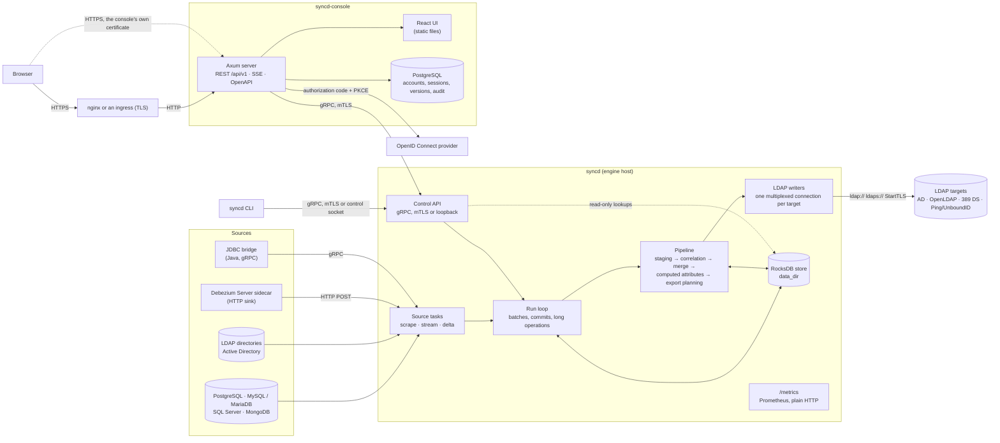
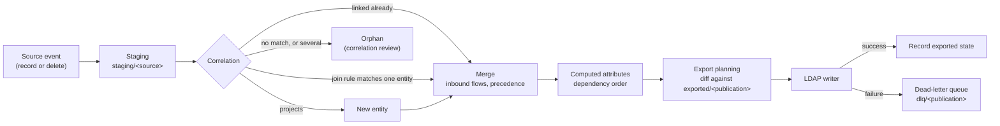
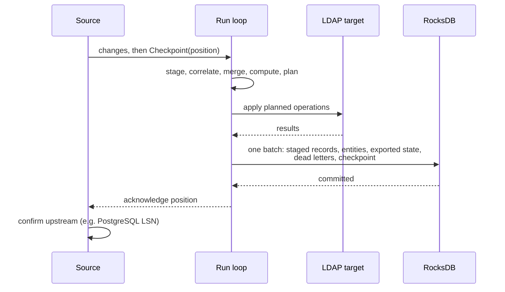
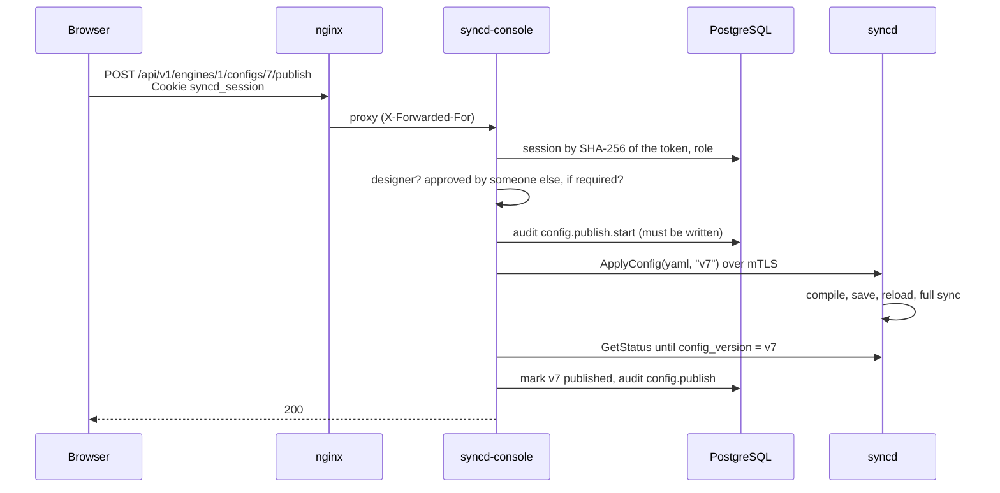
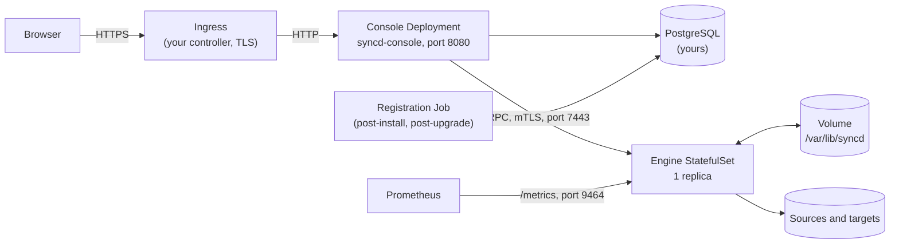

# Architecture

syncd has two programs. They are installed together on one Linux host as systemd services,
or run on Kubernetes from their container images with the Helm chart (see
[Running on Kubernetes](#running-on-kubernetes)):

- **`syncd`**, the engine: it reads sources, merges their records into views, and writes
  the results to LDAP directories. It keeps its state in an embedded RocksDB store.
- **`syncd-console`**, the web console: accounts, roles, the audit log, configuration
  versions, and the REST API and UI. It keeps its own data in PostgreSQL and drives the
  engine through the engine's gRPC control API.

The engine runs without the console. The `syncd` command line talks to the same control API.

## Components

| Component | Responsibility | Source |
|---|---|---|
| Source connectors | Read objects from a source in full (`scrape`), as a stream of changes (`stream`: PostgreSQL logical replication, MySQL binlog, SQL Server change data capture, MongoDB change streams, LDAP syncrepl, AD DirSync, LDAP changelogs), or by a watermark (`delta`). Full reads run on an interval or a cron `schedule`. Streaming sources send a checkpoint at each transaction boundary. A database connect (TCP, TLS and login) fails after 10 seconds without an answer, so a hung server restarts the source rather than stalling it | `engine/crates/connectors` |
| Wire decoders | Decoders of what sources send (`pgoutput`, DirSync, syncrepl), fuzzed in CI | `engine/crates/wire` |
| Run loop | One loop owns the engine. It batches changes from every source, plans and applies exports, and commits each batch with its source checkpoints. It also runs the long operations and the commands that come from the control API | `engine/bin/syncd/src/run.rs` |
| Pipeline | Staging, correlation, precedence merge, computed attributes, groups, export planning, drift decisions | `engine/crates/engine` |
| Rules | The CEL rule compiler, function library and computed-attribute transforms. The console's previews link the same crate | `engine/crates/rules` |
| Store | RocksDB column families for staging, entities, links, exported state, checkpoints, the dead-letter queue and history | `engine/crates/store` |
| LDAP writer | Applies planned operations to a target, parent entries first, with a bounded number of entities in flight per connection | `engine/crates/connectors/src/ldap.rs` |
| Control API | gRPC service `syncd.v1.EngineControl`: status, the status stream, runs, approvals, dead letters, quarantined entities, configuration, previews, the object explorer | `engine/crates/api`, `proto/syncd/v1/engine.proto` |
| Metrics | Prometheus text format at `GET /metrics` on `api.metrics_listen`, off unless set | `engine/crates/api/src/metrics.rs` |
| Process statistics | The engine's own CPU time, the CPUs it may use, resident and peak memory, its cgroup's memory limit, threads and open files, read from `/proc` and the cgroup with each status (Linux only). The console's dashboard and metrics page chart them live | `engine/crates/api/src/process.rs` |
| Crypto | Installs the process-wide TLS crypto provider: aws-lc-rs, or its FIPS module | `engine/crates/crypto` |
| Console server | Accounts, sessions, roles, single sign-on, the audit log, configuration versions, the proxy to each engine's control API, the REST API and its OpenAPI document | `console/server` |
| Console UI | The single-page application, served by the console server from `CONSOLE_UI_DIR` | `console/web` |
| `syncdctl` | Install, upgrade with rollback, backup, restore, status, renewing the control API certificates, uninstall | `deploy/packaging/syncdctl` |
| Container images and Helm chart | The engine and console images, and the chart that runs them on Kubernetes | `deploy/container`, `deploy/helm/syncd` |

## The pipeline

1. **Ingest.** Each source object runs in its own task and sends events to the run loop
   over a bounded channel (up to 10 000 changes). When the loop is busy, the channel fills
   and streaming sources stop reading rather than buffering without limit.
2. **Staging.** A record is stored by its anchor (the immutable key the object names) in
   the source's staging space. A full read is diffed against what is staged, so records
   that are gone become deletes.
3. **Correlation.** A staged record that already has a link keeps its entity. Otherwise the
   view's join rules are tried in order. A record that matches one entity joins it; a source
   that projects creates a new entity; a record that matches none (or several) waits as an
   orphan. Operators can join or unjoin records by hand, and those decisions are kept in the
   store (`pinned_joins`, `exclusions`).
4. **Merge.** Any change recomputes the entity from all its contributors: inbound attribute
   flows, then per-attribute precedence between sources.
5. **Computed attributes.** Rules compiled from CEL run in dependency order. Rules that read
   other entities (references, `referrers()`, groups) are re-evaluated across entities, up to
   16 rounds per change. When a rule with `on_error: quarantine` fails, the entity's exports
   are held back. The hold is recorded in the store (`quarantine/<view>`), so it lasts across
   restarts, and ends once the rule evaluates again for the entity.
6. **Export planning.** For each publication, the entity is projected into a target entry
   (DN template, object classes, attribute mapping) and diffed against the last exported
   entry. The result is the smallest set of LDAP operations: add, modify, rename or delete.
   Deletion thresholds can hold deletes back for approval.
7. **LDAP writer.** Each entity's operations are applied in order, parent entries first, and
   up to `max_inflight` entities (32 by default) are written at once over one multiplexed
   connection. A successful export updates the exported state; a failed one goes to the
   dead-letter queue.

The CPU-bound, read-only stages (recomputing entities, planning exports) run on
`engine.shards` worker threads (one per CPU by default). The run loop's own thread applies
their results, so writes to the store stay single-threaded and ordered.

## Renames and moves

Since 0.3.0, the engine follows entries that move, whoever moves them.

- **Target ids.** The writer reads each entry's id in the target after it adds the entry, or
  at its first write if it was exported before ids were kept: `objectGUID` on Active
  Directory, `nsUniqueId` on 389 Directory Server, `entryUUID` elsewhere. The id is kept in
  the exported state (as `syncd-target-id`) and never written to the target. Reading it is
  best effort: a target that does not give it works as before.
- **Entries moved or renamed in the target by someone else.** When an entry is not at the DN
  last written, the writer looks for it by its id. On Active Directory that is a base search
  for `<GUID=…>`; elsewhere a subtree search of the entry's naming context. A modify moves the
  entry back to the DN the publication places it at and changes it there; a rename or delete
  acts where the entry was found. Each is logged as a warning naming both DNs. Only an entry
  found nowhere is added again. Two entries with the same id fail the export (dead letter).
- **Renames into a DN that is taken.** When two entries of one batch swap DNs, or rename in a
  chain, the writer parks a blocked entry under an RDN of its own (its RDN with `~` and the
  entity's number, for example `CN=Jon Smith~1a`). Once the rest of the batch is written, it
  renames the parked entries to their DNs, in rounds. An entry moved aside (`move_to`,
  `disable_and_move_to`) into a container where its RDN is taken gets such an RDN for good,
  and the engine records it there. Any other rename into a taken DN fails, as a real
  conflict.
- **Containers renamed in an LDAP source.** A directory reports only the container, not the
  entries under it. So an LDAP object read with `mode: stream` or `mode: delta` and subtree
  scope has its containers checked every `container_check_secs` (60 by default; 0 turns it
  off). The entries under a container renamed since the last check are read again, as
  updates. The last check's DNs are kept as a checkpoint of their own
  (`<connector>/<object>#containers`), so a rename made while the engine was stopped is found
  at the next start.
- **Case-only renames** (`jdoe` to `JDoe`) are renames, tested on OpenLDAP and 389.
- **Containers left empty.** The writer records each container it creates
  (`containers/<target>` in the store). With a publication's `remove_empty_containers` (off
  by default, needs `create_containers`), a plan that moves or deletes an entry lists the
  containers it leaves, and the writer deletes those that are empty once the batch is
  written, deepest first. A container syncd did not create, or that holds anything, stays. A
  failure to delete one is logged and fails no export.

See [Configuration](configuration.md) for the settings, and
[Troubleshooting](troubleshooting.md) for the log messages.

## The store

The store is a RocksDB database in `engine.data_dir` (`/var/lib/syncd/engine` on a packaged
install), with LZ4 compression and a shared block cache of `engine.cache_mb`.

| Column family | Key | Value |
|---|---|---|
| `meta` | `attr/<id>`, `source/<id>`, settings | Attribute and source registries, the store format, the running configuration version, full-sync progress |
| `staging/<source id>` | anchor | Staged record |
| `entities/<view>` | entity id | Merged entity |
| `links` | source id and anchor | Entity id |
| `exported/<publication>` | entity id | Last exported entry, with the entry's target id (`syncd-target-id`) when known |
| `checkpoints` | source name | Opaque source position; for an LDAP object whose containers are checked, also the containers' DNs (`<connector>/<object>#containers`) |
| `unique/<scope>` | claimed value | Entity id |
| `permanent/<view>/<attribute>` | normalized key | The entity that has (or last had) the key of a `permanent` computed attribute, and its values. Kept when the entity is deleted, so an entity that comes back with the key gets them again |
| `quarantine/<view>` | entity id | The rule with `on_error: quarantine` that failed, its error, and since when |
| `containers/<target>` | normalized DN | A container the writer created, for `remove_empty_containers` |
| `dlq/<publication>` | entity id | Last failed export of that entity |
| `pinned_joins` | source and anchor | Entity an operator joined the record to |
| `exclusions` | link key and entity id | A record an operator kept from joining that entity |
| `history` | entity id, time, sequence | The entity's change history (`engine.history`: 30 days and 100 entries per entity by default) |

Every write goes through one batch that commits atomically, together with any attribute
names first seen in it. A crash cannot leave a record that refers to an unknown attribute,
or a checkpoint ahead of the data it covers.

The layout has a version, the **store format**. A newer release that changes it migrates the
store when it first starts; an older release refuses a store written by a newer one. See
[Installation](install.md) for upgrades and rollbacks.

## Checkpoints and the commit protocol

- A streaming source acknowledges a position upstream only after the batch holding it has
  committed. After a crash the engine resumes from the last committed checkpoint and
  replays what followed. Exports are applied before the commit that records them, so a
  replayed batch exports again rather than losing anything.
- Commits are grouped: a batch is flushed at 5 000 pending writes or 2 000 entity changes,
  and a checkpoint waits at most 50 ms for a group commit while events keep arriving.
- A restart does not re-read the sources. The engine rebuilds its in-memory indexes from the
  store (in parallel) and continues from its checkpoints.

## The run loop and long operations

The run loop handles source changes, timers and commands one at a time. These are **long
operations** that keep it busy:

| Operation | When |
|---|---|
| Full sync | `syncd full-sync`, the console's run of that kind, and every configuration reload. It recomputes every entity a page at a time (8 192 entities), then reconciles |
| Reconciliation | Every `engine.reconcile_interval_secs` (by default `engine.scrape_interval_secs`, one hour), and on demand. It plans every entity of every publication against what was exported |
| A full read's deletes | When a scrape or delta full read finds records gone, applied a page at a time |
| Configuration reload | `ApplyConfig` (publishing from the console, or `syncd apply-config`) |

While one runs, source changes wait (they are not lost), and a command waits up to 10
seconds and is then refused as busy, naming what the engine is doing. Status always
answers. A stop request is checked between pages, so the engine stops within a page of
work. A full sync that is interrupted records how far it got and resumes at the next start.

The metrics `syncd_engine_busy` and `syncd_engine_busy_seconds` show a long operation. See
[Operator guide](operator-guide.md) and [Troubleshooting](troubleshooting.md).

### Reloading a configuration

`ApplyConfig` compiles the new YAML, saves it over the configuration file (so the engine needs
write access to it), reloads the engine in-process, and runs a full sync. If the new
configuration does not start, the previous file is put back. `engine.data_dir` and the `api`
section can only be changed on the engine host; a published configuration that changes them
is refused.

## The dead-letter queue

- An export that fails is recorded in `dlq/<publication>` with the error, one entry per
  entity (the latest failure), and is not recorded as exported.
- The next change to the entity, or the next reconciliation, exports it again. Operators
  can retry dead letters now, or discard one (a later change or reconciliation still exports
  the entity).
- When a target is unreachable, every export to it fails at once into the queue rather than
  waiting on a dead connection. The engine tries a new connection on a backoff (one second,
  doubling to a minute). `syncd_target_up` and `syncd_publication_dead_letters` show this.
- The writer converges on the common drift cases instead of failing: an entry that already
  exists is updated in place, a delete of a missing entry succeeds, and a value-level modify
  that no longer fits the live entry is retried as a replace.

## Reconciliation and drift

- **Reconciliation** compares every entity with its exported state and fixes the target
  where they differ. It works from the store's record of what was exported, not from the
  target.
- **Drift detection** (a publication's `drift` section, every `interval_secs` or with
  `syncd check-drift`) reads each exported entry back from the target and compares the
  attributes the engine manages with what it last wrote. Per attribute, the policy is `flag`
  (report it), `revert` (write the engine's value back) or `accept` (keep the target's value
  until the engine computes a different one). Missing entries are flagged or reverted. An
  entry moved by hand is reported as missing; reverting it moves it back by its target id
  rather than adding a second one.
- **Adoption** (`adopt`) takes over entries the target already has instead of adding
  duplicates. It compares DNs as DNs, not as text.

## Writeback

A publication's `writeback` covers an outage of an LDAP target. While the engine cannot reach
the target, exports to it are held (they go to the dead-letter queue). When it answers again,
the engine reads the target's change log (OpenLDAP access log, or `cn=changelog`) for exactly
the outage, and writes modifications of the listed attributes back to the LDAP source the
entry came from. An attribute the source also changed meanwhile keeps the source's value and
is reported as a conflict. Then the hold is lifted and the dead letters are retried. The
outage's start is kept in the store, so a restart part way through still writes the changes
back. See [Connectors](connectors.md).

## Simulations and previews

- **Simulate** (`SimulateConfig`) dry-runs a candidate configuration on a hard-linked copy of
  the store, through a reload's own steps, with recorders in place of the targets. It reports
  what each target would receive. One runs at a time.
- **Preview** (`PreviewConfig`) runs a candidate over a sample of source records in a scratch
  store, and returns the entities it makes and what each publication would write.
- **Connector checks** (`TestConnector`, `DiscoverSchema`) connect with one connector of a
  candidate configuration and list what it holds. They write nothing.

None of these writes to a target or to the engine's state.

## The console

The console server is one process. It listens on `CONSOLE_LISTEN` (`127.0.0.1:8080`; `0.0.0.0:8080`
in the container image):

- **over plain HTTP** by default, with nginx (or a Kubernetes ingress) in front of it to
  terminate TLS, as in the diagram above;
- **over HTTPS itself** when `CONSOLE_TLS_CERT` and `CONSOLE_TLS_KEY` name a PEM certificate
  (with its chain) and key. TLS is rustls on the process crypto provider, TLS 1.2 and 1.3,
  HTTP/1.1. Each handshake runs in a task of its own with a 10-second limit, so a client
  that stalls holds up no other. The files are checked every minute and loaded again when
  they change, so a renewal (certbot, cert-manager) needs no restart; a renewal that does
  not load is logged and the previous certificate kept. A certificate that does not load at
  startup stops the console. See [Security](security.md#https-for-the-console).

It serves:

- the REST API at `/api/v1` and its OpenAPI document at `/api/openapi.json` (see
  [API reference](api-reference.md));
- `GET /healthz`, which answers `ok`;
- the UI's static files, with `index.html` for the UI's own routes.

### The console database

PostgreSQL 13 or newer. The console applies its migrations (`console/server/migrations`) every
time it starts.

| Table | Holds | Migration |
|---|---|---|
| `users` | Accounts: username, display name, role, password hash (PHC string, or none for single sign-on accounts), forced change, disabled, failed sign-ins, lock time, OIDC subject, break-glass flag | `0001_init`, `0004_oidc`, `0005_local_sign_in` |
| `sessions` | The SHA-256 of each session token, its account, last activity and end | `0001_init` |
| `audit_log` | The append-only, hash-chained audit log. Triggers refuse `UPDATE`, `DELETE` and `TRUNCATE` | `0001_init` |
| `engines` | Registered engines: name, `host:port` or `unix:<socket path>`, the server CA and client certificate, and the client key sealed with the master key | `0002_engines` |
| `engine_configs` | Configuration versions per engine: YAML, comment, author, publication, approval, pending publish. A trigger refuses changes to a saved version; a constraint refuses an approval by the author; another trigger makes an approval final | `0003_engine_configs`, `0006_config_approval`, `0007_publish_pending` |
| `oidc_logins` | Single sign-on requests in flight: state, nonce, PKCE verifier, where to go next | `0004_oidc` |
| `settings` | One row: who may sign in locally (`everyone` or `break_glass`), configuration approval (`off` or `required`), and the top and bottom banners | `0005_local_sign_in`, `0006_config_approval`, `0008_banners` |

Every ten minutes the console deletes ended or idle sessions and single sign-on requests older
than an hour.

At startup, and then every hour when it has changed, the console writes the head of the audit
chain (the newest entry's id, time and hash) to its own log, as `audit log head`. That copy
lives outside the database, so a verification against it finds entries removed from the end
of the log. See [Security](security.md#audit-log).

Also at startup, the console checks its master key against a secret the database holds (an
engine's sealed client key). A missing key file is not replaced by a new key while such
secrets exist, and a key that does not open them is refused: the console does not start
unless `CONSOLE_NEW_MASTER_KEY=true`. See
[Security](security.md#console-secrets-and-the-master-key).

### The engine control API

The console holds one gRPC client per registered engine. An engine off loopback must be
registered with mTLS (the engine's CA, and a client certificate and key); plain text is
allowed only to a loopback address, or to the engine's control socket (`unix:/run/syncd/control.sock`)
when the console runs on the engine's host as a user that may open it. The installer registers
the local engine at `127.0.0.1:7443` with mTLS, using certificates from a CA of the host's own;
`syncdctl renew-certs` issues new ones and updates the registration
(`syncd-console admin register-engine --update`). On Kubernetes the Helm chart issues the
certificates and a Job registers the engine. See
[Security](security.md#the-engine-control-api).

The console reads each mTLS client certificate's expiry and returns it with the engine
(`certificate_expires_at`); the engine's page warns from 60 days before it.

Each operation the console proxies (runs, approvals, drift checks, dead-letter actions, joins
and unjoins, publishes) is checked against the user's role and recorded in the console's audit
log with its outcome.

### The live status stream

`GET /api/v1/engines/{id}/status/stream` is a server-sent events stream. The console opens the
engine's `WatchStatus` gRPC stream at one-second intervals and passes each snapshot on as a
`status` event; an engine that goes away ends it with one `error` event. Every 30 seconds the
console checks that the session is still valid (not signed out, expired, idle, or disabled)
and ends the stream otherwise. The shipped nginx configuration turns off proxy buffering and
keeps the stream open for up to an hour.

Each status also carries the engine process's CPU and memory (`process`, on Linux). The console
computes CPU in use from the CPU time over the last five statuses, as a share of the CPUs the
engine may use, and shows it with memory (against the cgroup's limit, when there is one) on the
engines dashboard and each engine's metrics page.

## Running on Kubernetes

From 0.3.0, the release workflow publishes two container images and a Helm chart when a
release is tagged (`v*`). No release has been tagged yet, so none is published so far: build
the images yourself from the source (`docker build -f deploy/container/Dockerfile --target engine`,
or `--target console`) and install the chart from `deploy/helm/syncd`.

| Artifact | Where a tagged release publishes it |
|---|---|
| Engine image | `ghcr.io/winllc/syncd:<version>` |
| Console image | `ghcr.io/winllc/syncd-console:<version>` |
| Helm chart | `oci://ghcr.io/winllc/charts/syncd`, the same version as the images |

Both images are built from one Dockerfile (`deploy/container/Dockerfile`) on
`gcr.io/distroless/cc-debian12:nonroot`: no shell, no package manager, running as uid and gid
65532. They are built for amd64 only, and there is no FIPS image.

Resource names below are for a release named `syncd`. The chart names them `<release>-syncd-…`,
or `<release>-…` when the release name contains `syncd`.

| Part | What the chart makes |
|---|---|
| Engine | A StatefulSet with one replica: one engine per store. Its volume (`data-syncd-engine-0`) holds the store (`/var/lib/syncd/engine`) and the configuration file it runs (`/var/lib/syncd/engine.yaml`). The file starts as a copy of the image's (`SYNCD_INITIAL_CONFIG`), and the console replaces it when it publishes. The image fixes the `engine` and `api` sections: the control API on `0.0.0.0:7443` with mTLS, the control socket at `/run/syncd/control.sock` (an in-memory volume), metrics on `0.0.0.0:9464`. Secrets the configuration refers to come from a Secret you name (`engine.envFromSecret`) |
| Console | A Deployment (`console.replicas`, 1 by default) on port 8080, plain HTTP, with an optional Ingress. Its data directory is an `emptyDir`: the master key comes from a Secret |
| Certificates | The `syncd-pki` Secret: a CA of the chart's own, the engine's server certificate (named for its Service) and the console's client certificate, issued by Helm at install (`pki.days`, ten years by default) and kept across upgrades |
| Console secrets | The `syncd-console` Secret: the master key (32 random bytes) and the initial admin password, generated at install, kept across upgrades, and kept when the release is uninstalled |
| Registration | A Job after each install and upgrade runs `syncd-console admin register-engine --update` with the chart's certificates |
| Monitoring | An optional `ServiceMonitor` for the Prometheus operator |

Probes: the engine's startup and readiness probes connect to the control API port, and its
liveness probe fetches `/metrics`; the console's probes fetch `/healthz`. The PostgreSQL server
for the console is yours; the chart does not bundle one. Upgrades and rollbacks are `helm
upgrade` and `helm rollback`; a store or database that the newer release migrated must be
restored from backups before rolling back. See [Installation](install.md) and
[Security](security.md#container-images-and-the-helm-chart).

## Tech stack

| Layer | Technology |
|---|---|
| Engine | Rust 1.97 (edition 2024), Tokio, mimalloc |
| Engine store | RocksDB (`rocksdb` crate 0.25, LZ4), embedded; no external broker |
| Rules | CEL syntax (parsed by the `cel` crate), compiled into closures by syncd's own compiler |
| Database sources | `tokio-postgres` and `pgwire-replication` (PostgreSQL, with syncd's own `pgoutput` decoder), `mysql_async` (MySQL and MariaDB binlog), `tiberius` (SQL Server), the MongoDB Rust driver; Debezium Server over HTTP; a JDBC bridge in Java 17 over gRPC for other databases |
| Directory sources and targets | `ldap3` 0.12 with syncd's DirSync and syncrepl controls; target profiles for Active Directory, OpenLDAP, 389 Directory Server and Ping/UnboundID |
| Control API | gRPC (`tonic` 0.14, `prost`), mTLS through rustls |
| TLS and cryptography | rustls 0.23 with aws-lc-rs; optional FIPS build with the AWS-LC FIPS module |
| Metrics | Prometheus text format from the engine's own HTTP listener; alert rules shipped |
| Console server | Rust, Axum 0.8, `sqlx` 0.8 on PostgreSQL 13+, `tokio-rustls` (its own HTTPS), `utoipa` (OpenAPI), `jsonwebtoken` and `reqwest` (OpenID Connect), `argon2` |
| Console UI | React 19, TypeScript, Vite, TanStack Router and Query, Tailwind CSS 4, Monaco editor, React Flow (`@xyflow/react`), `openapi-fetch` with types generated from the OpenAPI document |
| Packaging | systemd units; `.tar.gz` bundle, `.deb` and `.rpm` (nfpm), RHEL 8 `.rpm`; `syncdctl` (bash) |
| Containers | Images on `gcr.io/distroless/cc-debian12:nonroot` (amd64), built from `rust:1.97.0-bookworm` and `node:22-bookworm-slim`; a Helm 3 chart (`deploy/helm/syncd`), published to GHCR as an OCI chart |
| Front proxy | Optional: the console serves HTTPS itself, or behind the shipped nginx configuration or a Kubernetes ingress |
| CI | GitHub Actions: fmt and clippy, tests, the console UI with a Playwright smoke test and a Keycloak sign-in, end-to-end suites per source and target, benchmarks, fuzzing, the FIPS build, `cargo-deny`, `cargo-audit`, a CycloneDX SBOM, package lifecycle tests, and the container images built and the chart installed, upgraded and uninstalled in a kind cluster |

## Code layout

This section describes the source code, for engineers reviewing the product. You do not need
the source to install or run syncd: install it from a release, as described in
[Installation](install.md).

| Path | Contents |
|---|---|
| `engine/bin/syncd` | The daemon and command line (`run`, `status`, `reconcile`, `full-sync`, `dlq`, `quarantine`, `approve`, `retry`, `discard`, `apply-config`, `check-drift`, `test-connection`, `discover`, `simulate`, ...) and the run loop |
| `engine/crates/api` | The control API server and client, the status board, the explorer, the metrics listener, process statistics |
| `engine/crates/config` | The YAML configuration model and its validation |
| `engine/crates/core` | Values, records, attribute maps, attribute-level diffs |
| `engine/crates/rules` | The CEL compiler, function library and computed-attribute transforms |
| `engine/crates/store` | The RocksDB store and its format migrations |
| `engine/crates/engine` | Correlation, merge, computed attributes, groups, export planning, drift, writeback |
| `engine/crates/connectors` | Source connectors, the LDAP target, connector probes |
| `engine/crates/wire` | Decoders of `pgoutput`, DirSync and syncrepl (with fuzz targets) |
| `engine/crates/crypto` | The crypto provider and FIPS mode |
| `console/server` | The console server and its migrations |
| `console/web` | The console UI, its OpenAPI types and its browser tests |
| `proto/syncd` | gRPC definitions: `v1/engine.proto` (the control API) and `bridge/v1/jdbc.proto` (the JDBC bridge) |
| `bridge/jdbc` | The JDBC bridge (Java, Gradle) |
| `deploy/packaging` | The release build, systemd units, `syncdctl`, nginx configuration, alert rules, package tests |
| `deploy/container` | The Dockerfile of both images, and the engine's initial configuration in its image |
| `deploy/helm/syncd` | The Helm chart |
| `tests/helm` | The chart's test in a kind cluster |
| `docs/adr` | Architecture decision records |
