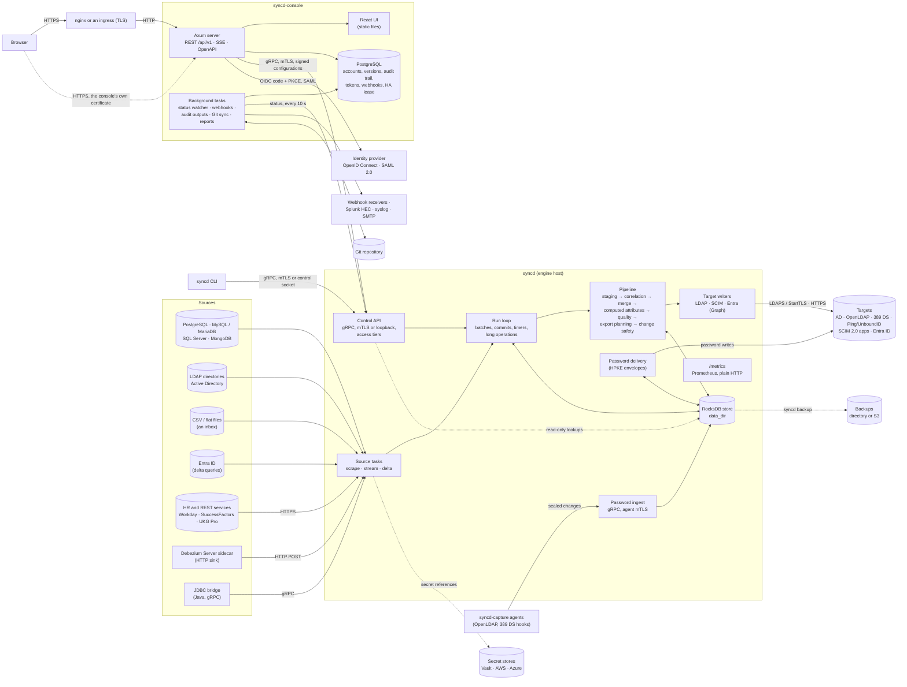
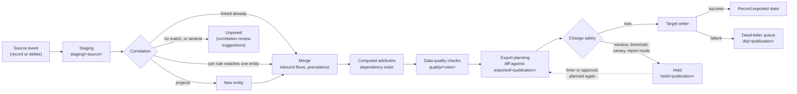
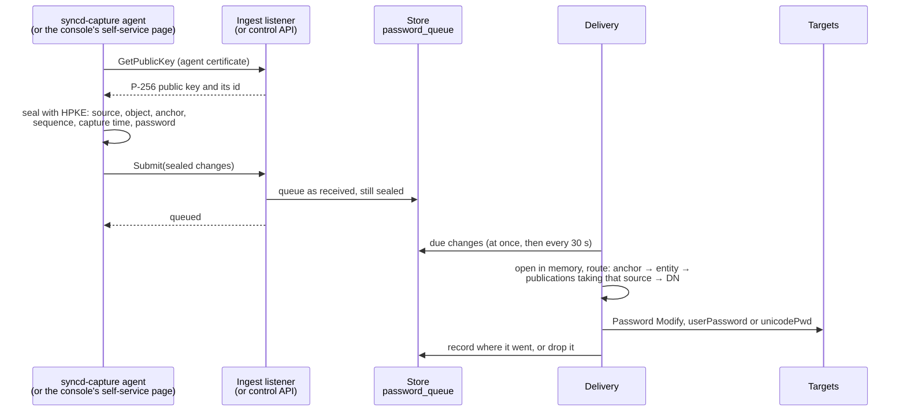
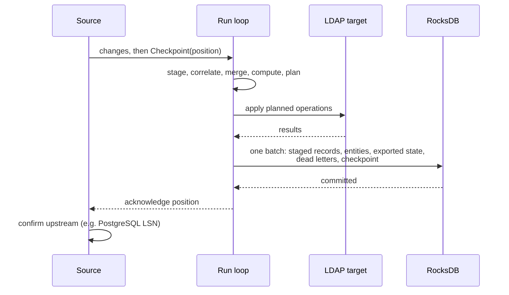
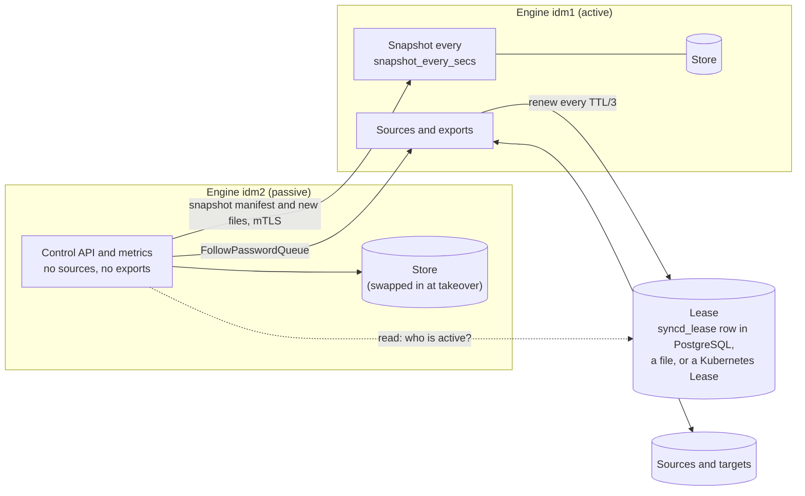
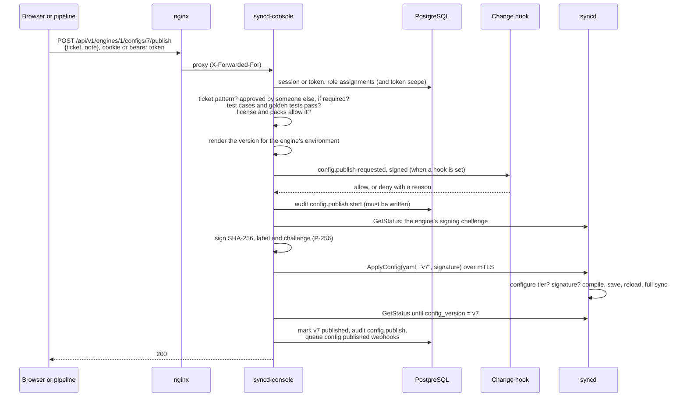
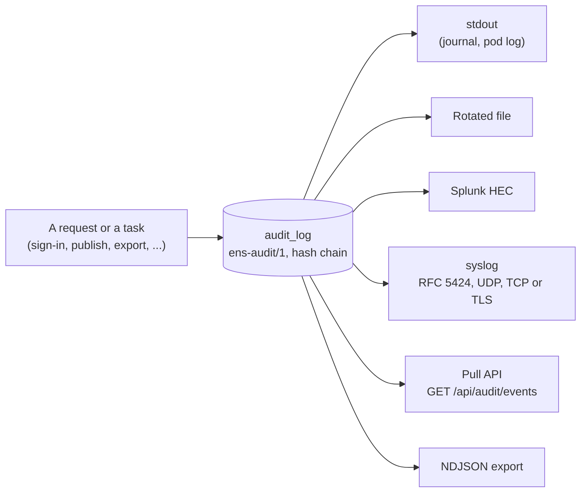
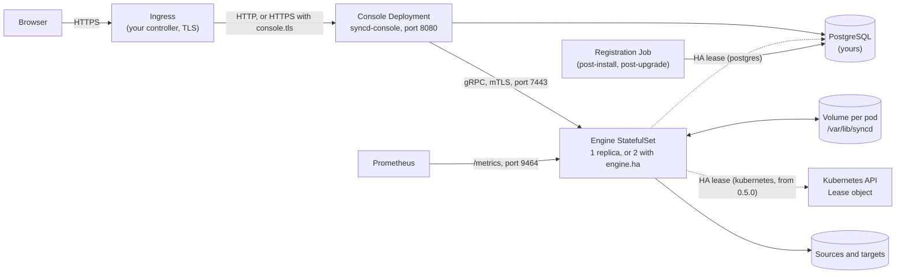

# Architecture

syncd has two programs. They are installed together on one Linux host as systemd services,
or run on Kubernetes from their container images with the Helm chart (see
[Running on Kubernetes](#running-on-kubernetes)):

- **`syncd`**, the engine: it reads sources, merges their records into views, and writes
  the results to LDAP directories, SCIM 2.0 applications and Entra ID. It keeps its state in
  an embedded RocksDB store. It also delivers password changes, backs itself up, and can run
  as one of an [active/passive pair](#high-availability).
- **`syncd-console`**, the web console: accounts and their scoped roles, sign-in (local,
  OpenID Connect, and from 0.5.0 SAML 2.0 and client certificates), the audit trail,
  configuration versions, API tokens, webhooks, reports, Git sync, the license, and the REST API
  and UI. It keeps its own data in PostgreSQL and drives the engine through the engine's gRPC
  control API.

The engine runs without the console. The `syncd` command line talks to the same control API.
From 0.5.0 a third program, **`syncd-capture`**, runs on the directory servers' hosts: the
password capture agent, packaged on its own (see [Password synchronisation](#password-synchronisation)).

## Components

| Component | Responsibility | Source |
|---|---|---|
| Source connectors | Read objects from a source in full (`scrape`), as a stream of changes (`stream`: PostgreSQL logical replication, MySQL binlog, SQL Server change data capture, MongoDB change streams, LDAP syncrepl, AD DirSync, LDAP changelogs), or by a watermark (`delta`). Full reads run on an interval or a cron `schedule`. A CSV file is read in full, on a schedule or when it changes; Entra ID users and groups are read through Graph delta queries. From 0.5.0 a `rest` source reads a JSON or OData API page by page, with presets for Workday, SAP SuccessFactors and UKG Pro (tested against fakes of those services only). Streaming sources send a checkpoint at each transaction boundary. A database connect (TCP, TLS and login) fails after 10 seconds without an answer, so a hung server restarts the source rather than stalling it | `engine/crates/connectors` |
| Wire decoders | Decoders of what sources send (`pgoutput`, DirSync, syncrepl), fuzzed in CI | `engine/crates/wire` |
| Run loop | One loop owns the engine. It batches changes from every source, plans and applies exports, fires the persisted timers, and commits each batch with its source checkpoints. It also runs the long operations and the commands that come from the control API | `engine/bin/syncd/src/run.rs` |
| Pipeline | Staging, correlation, precedence merge, computed attributes and rule packages, data-quality checks, groups and their lifecycle, export planning, change safety (windows, thresholds, canaries, report mode), leaver stages, drift decisions | `engine/crates/engine` |
| Rules | The CEL rule compiler, function library, rule packages and computed-attribute transforms. From 0.5.0, custom functions in WebAssembly carried in rule packages, run by the wasmi interpreter with fuel and memory limits and no host functions. The console's previews link the same crate | `engine/crates/rules` (`wasm.rs`); the value encoding in `engine/crates/wasm-abi` |
| Store | RocksDB column families for staging, entities, links, exported state, checkpoints, the dead-letter queue, history, held changes, timers, the password queue and the rest (see [The store](#the-store)) | `engine/crates/store` |
| Target writers | Apply planned operations to a target: LDAP (parent entries first, a bounded number of entities in flight per connection), SCIM 2.0 (`POST`, `PATCH` or `PUT` with ETags, paced and waiting out `429`) and Entra ID (Microsoft Graph, members in `$batch`, licences, app roles). Every batch checks the HA lease first | `engine/crates/connectors` (`ldap.rs`, `scim.rs`, `entra.rs`, `target.rs`) |
| Password synchronisation | The engine's password keys (from 0.5.0 a ring, rotated with an overlap), HPKE envelopes, the agent CA, enrollment and agents' bindings to sources, the self-service policy, and delivery of captured changes and initial passwords to targets | `engine/crates/password`, `engine/bin/syncd` |
| Capture agent | From 0.5.0, `syncd-capture`: takes changes from a directory server's hook, seals each at once, spools it, and submits it over mutual TLS; the OpenLDAP overlay, the 389 Directory Server plugin and the Windows password filter as source | `engine/bin/syncd-capture`, `capture/` |
| Control API | gRPC service `syncd.v1.EngineControl`: status, the status stream, runs, approvals, held changes, dead letters, quarantine, data quality, configuration, previews, the object explorer, lineage, reports, correlation, passwords, unmanaged entries, the license, backups and HA snapshots. From 0.5.0 every call has an access tier, checked in one place before its handler, and a configuration can be required to carry the console's signature | `engine/crates/api` (`access.rs`, `signing.rs`), `proto/syncd/v1/engine.proto` |
| Password ingest | gRPC service `syncd.v1.PasswordIngest` on a listener of its own, for capture agents; on the passive engine of a pair (from 0.5.0), forwarded to the active one | `engine/crates/api/src/ingest.rs`, `replication.rs` |
| High availability | The lease (PostgreSQL, a file, or from 0.5.0 a Kubernetes Lease), the fence, the lease controller, incremental store snapshots and the swap; the password queue's replication | `engine/crates/ha`, `engine/crates/api/src/replication.rs` |
| Secrets | From 0.5.0, secret references to HashiCorp Vault, AWS Secrets Manager and Azure Key Vault, read with a cache and read again after a failed connection; keys wrapped by a KMS (AWS KMS, Azure Key Vault keys, Vault transit). Small HTTPS clients of syncd's own, no vendor SDK; tested against doubles only | `engine/crates/secrets` |
| Licensing | From 0.5.0, the signed license file (ECDSA P-256, verified offline with keys compiled in), packs, the managed-identity count and the license states. Consulted only by what publishes a configuration, never by sources or exports. See [syncd licensing](licensing.md) | `engine/crates/licensing`, `engine/crates/api/src/license.rs` |
| Backups | Backup archives with a manifest, to a directory or S3 (SigV4), restore, and the support bundle | `engine/crates/backup` |
| Metrics | Prometheus text format at `GET /metrics` on `api.metrics_listen`, off unless set | `engine/crates/api/src/metrics.rs` |
| Process statistics | The engine's own CPU time, the CPUs it may use, resident and peak memory, its cgroup's memory limit, threads and open files, read from `/proc` and the cgroup with each status (Linux only). The console's dashboard and metrics page chart them live | `engine/crates/api/src/process.rs` |
| Crypto | Installs the process-wide TLS crypto provider: aws-lc-rs, or its FIPS module | `engine/crates/crypto` |
| Console server | Accounts, sessions, scoped role assignments, single sign-on (OpenID Connect, and from 0.5.0 SAML 2.0 with the console's own XML reader, and X.509 client certificates with OCSP and CRL checks), the sign-in policy and consent banner, API tokens, the audit trail and its outputs, configuration versions and their signing, environments, promotion, the pre-publish hook, the license, the WebAssembly module store, the proxy to each engine's control API, the REST API and its OpenAPI document | `console/server` (`saml`, `x509`, `rbac.rs`, `signing.rs`, `license.rs`) |
| Console background tasks | The status watcher and webhook sender, the audit outputs and retention, Git sync, scheduled reports and the mail outbox, the data-quality daily rollup | `console/server/src/webhooks`, `audit`, `gitsync.rs`, `reports`, `mail.rs` |
| Console UI | The single-page application, served by the console server from `CONSOLE_UI_DIR` | `console/web` |
| `syncdctl` | Install, upgrade with rollback, backup (local or off-host), restore, the support bundle, status, renewing the control API certificates, uninstall; from 0.5.0 setting up an HA pair (`ha`), opting in to strict control API access and signed configurations (`api-access`), and installing a license (`license`) | `deploy/packaging/syncdctl` |
| Container images and Helm chart | The engine and console images (multi-arch, and a FIPS variant), and the chart that runs them on Kubernetes | `deploy/container`, `deploy/helm/syncd` |

## The pipeline

1. **Ingest.** Each source object runs in its own task and sends events to the run loop
   over a bounded channel (up to 10 000 changes). When the loop is busy, the channel fills
   and streaming sources stop reading rather than buffering without limit.
2. **Staging.** A record is stored by its anchor (the immutable key the object names) in
   the source's staging space. A full read is diffed against what is staged, so records
   that are gone become deletes.
3. **Correlation.** A staged record that already has a link keeps its entity. Otherwise the
   view's join rules are tried in order. A record that matches one entity joins it; a source
   that projects creates a new entity; a record that matches none (or several) waits
   unjoined, and when it became unjoined is kept (`unjoined/<view>`) so the queue's age can be
   reported. Operators can join or unjoin records by hand, or accept scored suggestions, and
   those decisions are kept in the store (`pinned_joins`, `exclusions`).
4. **Merge.** Any change recomputes the entity from all its contributors: inbound attribute
   flows, then per-attribute precedence between sources.
5. **Computed attributes.** Rules compiled from CEL run in dependency order. Calls to rule
   package functions are expanded by the compiler. Rules that read other entities
   (references, `referrers()`, groups) are re-evaluated across entities, up to 16 rounds per
   change. When a rule with `on_error: quarantine` fails, the entity's exports are held back.
   The hold is recorded in the store (`quarantine/<view>`), so it lasts across restarts, and
   ends once the rule evaluates again for the entity. All rules of one pass share one `now()`.
6. **Data-quality checks.** A view's `quality` checks run as the entity is computed, so they
   run again exactly when its inputs change. Failures are kept per entity
   (`quality/<view>`). A check can only record the failure, hold the entity's exports back, or
   keep it out of some publications. See
   [Reports, lineage and data quality](reports-and-data-quality.md).
7. **Export planning.** For each publication, the entity is projected into a target entry
   (DN template, object classes, attribute mapping; for SCIM and Entra ID, a resource name)
   and diffed against the last exported entry. The result is the smallest set of operations:
   add, modify, rename or delete, and the leaver stages that are due.
8. **Change safety.** Report mode, the modification, add and deletion thresholds, a canary
   and the change window decide whether each plan is written now or **held**. See
   [Timers and held changes](#timers-and-held-changes).
9. **Target writer.** Each entity's operations are applied in order. An LDAP target takes
   parent entries first, and up to `max_inflight` entities (32 by default) at once over one
   multiplexed connection. A successful export updates the exported state; a failed one goes
   to the dead-letter queue.

The CPU-bound, read-only stages (recomputing entities, planning exports) run on
`engine.shards` worker threads (one per CPU by default). The run loop's own thread applies
their results, so writes to the store stay single-threaded and ordered.

## Timers and held changes

Since 0.4.0 the engine can act at a set time, not only when something changes.

- **Persisted timers.** Due times are kept in the store (`timers`, ordered by due time, and
  `timer_keys`, so arming the same entity again replaces its timer). The run loop looks every
  second for timers that are due and acts on them, whether the engine ran throughout or was
  restarted in between: a timer fires at its due time, not after an uptime. Each fires once,
  removed in the same commit as what it did. Timers are not fired before the initial export.
- **What arms them.** A rule's effective date (`effective()`, `effective_until()`), the next
  stage of a leaver (`deprovision: { disable_after, strip_groups_after, move_to,
  delete_after }`), a change window's next opening or a held change's `max_delay`, a canary's
  soak, a group's expiry and, from 0.5.0, a group's review falling due. A recompute timer
  recomputes the entity with the rules' `now()` at the firing time and plans it again for every
  publication of its view; a window or canary timer releases held changes; an expiry timer acts on
  the group; a review timer marks the group due, which the console reports to its `reviewers`
  by mail and as the `group.review-due` webhook event (and `SyncdGroupReviewsDue` after a day).
- **Leaver clocks** live with the exported entry in the store (`syncd-left-at`,
  `syncd-stripped`, beside `syncd-disabled`) and are never written to the target. A stage falls
  due at the time it left plus the stage's delay, by the engine's clock, so a timer and a full
  recompute at the same instant agree.
- **Held changes.** A planned export that is not applied now is written to `held/<publication>`:
  one entry per entity, keyed by entity id and replaced as the plan changes, with the reason
  (`window`, `overdue`, `modifications`, `additions`, `deletions`, `canary`, `canary_failed` or
  `report`), the kinds of change, the DN, a summary of the operations without values, and when
  it was first held. The engine also counts them in memory per publication; from 0.5.0 it keeps no
  other copy in memory.
- **A held change is never replayed.** When its hold ends (the window opens, the canary has
  soaked, an operator approves) the entity is planned again from its current state, and what
  that plan says is applied. An entity that no longer needs a change loses its hold.
- `overdue`, the thresholds and `canary_failed` need an approval (`syncd approve`, or the
  console's **Approve and apply**); the others clear by themselves. Report mode records every
  plan as a would-do and writes nothing.

`syncd status`, `syncd held`, the console's Held changes card, `ListHeld` and the
`syncd_held_changes`, `syncd_timers_*` and `syncd_deprovision_pending` metrics show them. See
[Change safety and lifecycle](change-safety.md) for the settings.

## Password synchronisation

From 0.4.0 the engine delivers password changes to the accounts it manages. A password is
never in the clear outside memory: it is sealed where it is captured and opened only by the
engine, just before it is written to a target.

- **The engine's password key** is a P-256 key pair, created on first start in the data
  directory (`password.key`, `passwords.key_file`), mode 0600. From 0.4.1, with
  `SYNCD_PASSWORD_KEY_PASSPHRASE_FILE`, it and the agent CA's key are sealed at rest
  (PBKDF2-HMAC-SHA256, 600,000 iterations, AES-256-GCM, on aws-lc-rs); without it they are in the
  clear, protected by the file mode only, and the engine warns at start. From 0.5.0 the passphrase
  file can hold the passphrase wrapped by a KMS key (`SYNCD_PASSWORD_KEY_PASSPHRASE_KMS`). Capture
  points fetch the public half (`GetPasswordKey`); they can seal, never open. See
  [Security](security.md#cryptography).
- **Key lifecycle** (from 0.5.0). `syncd password rekey` changes the passphrase (the previous one
  still opens files until they are sealed again). `syncd password rotate-key` makes a new key and
  keeps the old ones as `password.key.<id>` beside it until they are retired after
  `passwords.rotation_overlap_days` (7). `syncd password rotate-agent-ca` makes a new agent CA with
  the same overlap (`password-agent-ca.previous.*` meanwhile), and agents renew their certificates
  by themselves. Nothing rotates on a schedule; `SyncdPasswordKeyOld` and
  `SyncdPasswordAgentCertExpiring` say when to.
- **The envelope** is HPKE (RFC 9180, base mode): DHKEM(P-256, HKDF-SHA256), HKDF-SHA256,
  AES-256-GCM, on aws-lc-rs, with the key's id as additional data. A self-service request is
  sealed with a different HPKE `info`, so it can never be taken for a captured change.
- **Capture points:**
    - **Agents** enroll on the ingest listener (`passwords.ingest.listen`) with a one-time token
      and get a client certificate from the engine's **agent CA** (`password-agent-ca.key` and
      `.crt` beside the password key, created on first start, ten years). They submit with
      `Submit`. See [API reference](api-reference.md#password-ingest-api-grpc). From 0.5.0 the
      agent is `syncd-capture`, fed by a hook in the directory server: the OpenLDAP overlay
      `syncd_capture` and the 389 Directory Server plugin (both tested end to end, on Ubuntu 24.04
      only), and a Windows password filter that is **compile-checked only** (never loaded by LSASS
      or run on a domain controller). The agent seals each change at once and spools it until the
      engine has it. An agent is bound to the sources it speaks for (`--source`), and the engine
      refuses a change for any other; an agent enrolled before 0.5.0 is bound to none and still
      accepted, with a warning.
    - **The console's self-service page** seals the person's request to the password key and
      sends it with `ChangeOwnPassword` (from 0.4.1, to the member of an HA pair that holds the
      lease). The engine checks its policy, binds as the person to
      prove the current password, changes it in the source directory as the person, then queues
      it for the other targets.
    - **`syncd password set`** stands in for a capture point in scripts and tests.
    - **Initial passwords** (`passwords.initial`) are generated or read from the entity and set
      as an entry is created.
- **The queue** (`password_queue`) keeps changes sealed, as they came, until they are delivered
  or reach `passwords.ttl_secs` (a day by default): a change for an account not provisioned yet,
  or a target that is down, waits. From 0.5.0 each queued change records who submitted it (the
  agent, the person and caller of a self-service change, or the control API's caller), shown by
  `syncd password queue` and the lineage, and on an HA pair the passive engine follows the queue
  (see [High availability](#high-availability)). Per account only the newest change is delivered; one no newer
  than the last delivered (`password_sequences`) is dropped. syncd's own write coming back from
  a directory is recognised for 10 minutes by a keyed hash and dropped.
- **A refusal** by a target (its password policy, access rights) is reported and not retried.
  `syncd status` and the status API count deliveries, failures, dropped (report mode) and
  waiting changes, never with password material; from 0.4.1 also per publication, and as the
  metrics `syncd_password_deliveries_total` and `syncd_password_waiting`.
- **Agents** are kept in `password_agents`: the token's SHA-256, the certificate's fingerprint,
  revocation, when last seen and how many changes each submitted. Revocation checks the
  fingerprint, not a CRL.

From 0.5.0, a configuration that would send passwords in the clear to an LDAP directory on
another host (`ldap://` without `starttls`) does not validate unless `passwords.allow_cleartext`
says so, and setting passwords through the control API is a permission of its own
(`api.access.passwords`). The threat model of password synchronisation is a draft, not signed
off, and no penetration test has been done. See [Password synchronisation](password-sync.md) and
[Security](security.md#password-synchronisation).

## Renames and moves

Since 0.3.0, the engine follows entries that move, whoever moves them.

- **Target ids.** The writer reads each entry's id in the target after it adds the entry, or
  at its first write if it was exported before ids were kept: `objectGUID` on Active
  Directory, `nsUniqueId` on 389 Directory Server, `entryUUID` elsewhere. The id is kept in
  the exported state (as `syncd-target-id`) and never written to the target. Reading it is
  best effort: a target that does not give it works as before.
- **Entries moved or renamed in the target by someone else.** When an entry is not at the DN
  last written, the writer looks for it by its id. On Active Directory that is a base search
  for `<GUID=…>`; elsewhere a subtree search of the entry's naming context. A modify moves the
  entry back to the DN the publication places it at and changes it there; a rename or delete
  acts where the entry was found. Each is logged as a warning naming both DNs. Only an entry
  found nowhere is added again. Two entries with the same id fail the export (dead letter).
- **Renames into a DN that is taken.** When two entries of one batch swap DNs, or rename in a
  chain, the writer parks a blocked entry under an RDN of its own (its RDN with `~` and the
  entity's number, for example `CN=Jon Smith~1a`). Once the rest of the batch is written, it
  renames the parked entries to their DNs, in rounds. An entry moved aside (`move_to`,
  `disable_and_move_to`) into a container where its RDN is taken gets such an RDN for good,
  and the engine records it there. Any other rename into a taken DN fails, as a real
  conflict.
- **Containers renamed in an LDAP source.** A directory reports only the container, not the
  entries under it. So an LDAP object read with `mode: stream` or `mode: delta` and subtree
  scope has its containers checked every `container_check_secs` (60 by default; 0 turns it
  off). The entries under a container renamed since the last check are read again, as
  updates. The last check's DNs are kept as a checkpoint of their own
  (`<connector>/<object>#containers`), so a rename made while the engine was stopped is found
  at the next start.
- **Case-only renames** (`jdoe` to `JDoe`) are renames, tested on OpenLDAP and 389.
- **Containers left empty.** The writer records each container it creates
  (`containers/<target>` in the store). With a publication's `remove_empty_containers` (off
  by default, needs `create_containers`), a plan that moves or deletes an entry lists the
  containers it leaves, and the writer deletes those that are empty once the batch is
  written, deepest first. A container syncd did not create, or that holds anything, stays. A
  failure to delete one is logged and fails no export.

See [Configuration](configuration.md) for the settings, and
[Troubleshooting](troubleshooting.md) for the log messages.

## The store

The store is a RocksDB database in `engine.data_dir` (`/var/lib/syncd/engine` on a packaged
install), with LZ4 compression and a shared block cache of `engine.cache_mb`.

| Column family | Key | Value |
|---|---|---|
| `meta` | `attr/<id>`, `source/<id>`, settings | Attribute and source registries, the store format, the running configuration version, full-sync progress, when the last scheduled backup succeeded; from 0.5.0 also the installation id and the license ledger, each publication's unmanaged-entries result and adopted entries, the password queue's position (for an HA pair's follower), and the data-quality 24-hour trend |
| `staging/<source id>` | anchor | Staged record |
| `entities/<view>` | entity id | Merged entity |
| `links` | source id and anchor | Entity id |
| `exported/<publication>` | entity id | Last exported entry, with the entry's target id (`syncd-target-id`) when known, and the leaver clocks (`syncd-left-at`, `syncd-stripped`, `syncd-disabled`) |
| `checkpoints` | source name | Opaque source position; for an LDAP object whose containers are checked, also the containers' DNs (`<connector>/<object>#containers`) |
| `unique/<scope>` | claimed value | Entity id |
| `permanent/<view>/<attribute>` | normalized key | The entity that has (or last had) the key of a `permanent` computed attribute, and its values. Kept when the entity is deleted, so an entity that comes back with the key gets them again |
| `quarantine/<view>` | entity id | The rule with `on_error: quarantine` that failed, its error, and since when |
| `quality/<view>` | entity id | The data-quality checks the entity fails, their messages (never a value), and since when |
| `held/<publication>` | entity id | A planned change not applied: held by a window, a threshold or a canary, or what a report-mode publication would do |
| `timers` | due time, kind and key | Nothing: a persisted timer, in due order |
| `timer_keys` | kind and key | The timer's due time, so arming it again replaces it |
| `group_lifecycle/<publication>` | group id | When the engine created the computed group, last reviewed it, and when it expired |
| `group_manual/<publication>/<group>` | member DN | A member of a computed group kept although its filter does not produce it: when first and last seen |
| `unjoined/<view>` | source id and anchor | When the record became unjoined, for the age of the unmatched queue |
| `containers/<target>` | normalized DN | A container the writer created, for `remove_empty_containers` |
| `dlq/<publication>` | entity id | Last failed export of that entity |
| `pinned_joins` | source and anchor | Entity an operator joined the record to |
| `exclusions` | link key and entity id | A record an operator kept from joining that entity |
| `history` | entity id, time, sequence | The entity's change history (`engine.history`) |
| `password_queue` | received time and a random suffix | A sealed password change waiting for delivery, the publications it was delivered to, and (from 0.5.0) who submitted it |
| `password_sequences` | source, object type and anchor | The sequence of the last password change delivered for the account |
| `password_agents` | agent name | The agent's enrollment token (its SHA-256), certificate fingerprint, revocation and activity; from 0.5.0 the sources it is bound to, its renewed certificate's fingerprint, and the changes refused for other sources |

Every write goes through one batch that commits atomically, together with any attribute
names first seen in it. A crash cannot leave a record that refers to an unknown attribute,
or a checkpoint ahead of the data it covers.

The layout has a version, the **store format**. A newer release that changes it migrates the
store when it first starts; an older release refuses a store written by a newer one. Neither
0.4.0, 0.4.1 nor 0.5.0 changes the format (1). 0.4.0 adds the column families above that 0.3.0 did
not have, on first start. 0.3.0 opens a store that has them, but ignores what they hold (timers, held changes,
quality results, group lifecycles). 0.5.0 adds no column family, but keeps records 0.4.1 cannot
use: 0.4.1 cannot read 0.5.0's password agent and queued password records, ignores previous
password keys and a previous agent CA, drops group-review timers as unknown, and ignores the new
settings in `meta`. See [Installation](install.md#rolling-back-050-to-041) for upgrades and
rollbacks.

History keeps at most `engine.history.keep_per_entity` entries per entity (100 by default) for
`keep_days` (30 by default). Since 0.4.0 the newest `min_per_entity` entries of each entity (10 by
default) stay past `keep_days`. Every entry of an entity with an open held change or a dead letter
stays until it clears: past `keep_days`, and from 0.4.1 past `keep_per_entity` too (0.4.0 still
cut such an entity's entries to `keep_per_entity`). The prune runs every hour, or at once
with `syncd history prune --now`.

The data directory also holds the password key and the agent CA (`password.key`,
`password-agent-ca.key`, `password-agent-ca.crt`; the keys sealed when a passphrase is set), from
0.5.0 previous password keys (`password.key.<id>`) until they are retired and, during a rotation,
the previous agent CA (`password-agent-ca.previous.key`, `.crt`), and, while they are in use,
`backups/` (a store checkpoint while a backup is taken), `restore/` and `replaced-<time>/` (left
by `syncd restore`), and `ha/`: the swap's progress; on the active engine of a pair, from 0.5.0,
`ha/snapshots/` (the newest two snapshots, hard links to the store's files; `ha/snapshot.tar.zst`
only while a whole snapshot is pulled); on the passive one, the snapshot it received and, from
0.5.0, `ha/password-queue.replica`.

## Checkpoints and the commit protocol

- A streaming source acknowledges a position upstream only after the batch holding it has
  committed. After a crash the engine resumes from the last committed checkpoint and
  replays what followed. Exports are applied before the commit that records them, so a
  replayed batch exports again rather than losing anything.
- Commits are grouped: a batch is flushed at 5 000 pending writes or 2 000 entity changes,
  and a checkpoint waits at most 50 ms for a group commit while events keep arriving.
- Exports go out only while the engine may write: the engine of an HA pair checks its lease
  before every export batch (see [High availability](#high-availability)).
- A restart does not re-read the sources. The engine rebuilds its in-memory indexes from the
  store (in parallel) and continues from its checkpoints.

## The run loop and long operations

The run loop handles source changes, timers and commands one at a time. These are **long
operations** that keep it busy:

| Operation | When |
|---|---|
| Full sync | `syncd full-sync`, the console's run of that kind, and every configuration reload. It recomputes every entity a page at a time (8 192 entities), then reconciles |
| Reconciliation | Every `engine.reconcile_interval_secs` (by default `engine.scrape_interval_secs`, one hour), and on demand. It plans every entity of every publication against what was exported |
| A full read's deletes | When a scrape or delta full read finds records gone, applied a page at a time |
| Configuration reload | `ApplyConfig` (publishing from the console, or `syncd apply-config`) |

While one runs, a command waits up to 10 seconds and is then refused as busy, naming what the
engine is doing. Status always answers. A stop request is checked between pages, so the engine
stops within a page of work. A full sync that is interrupted records how far it got and resumes
at the next start.

From 0.5.0 the sources take turns with a reconciliation, a full sync's recompute and a reload,
between pages: their changes are applied, committed and acknowledged there, and delivered queued
password changes too. During a reconciliation they are exported at once; while a full sync
recomputes they are committed, and the reconciliation that follows exports them. A pass no longer
drops a hold written for an entity after the pass went by it. Still without turns, so source
changes wait for them (they are not lost): a full read's deletes, the first export after an
initial load, drift checks, the release of held changes, `syncd approve`'s reconciliation,
dead-letter retries, write-back, and the end-of-pass pages for thresholds and canaries. See
[Sizing](availability-and-sizing.md#sizing) for the measured lag.

From 0.4.1 the status also counts the runs that end (`runs`: full syncs, reconciliations,
reloads, drift checks, approvals and dead-letter retries), with the last one's activity, start,
end and the source reads that failed meanwhile; the console's `run.*` webhooks come from it.

The metrics `syncd_engine_busy` and `syncd_engine_busy_seconds` show a long operation. See
[Operator guide](operator-guide.md) and [Troubleshooting](troubleshooting.md).

### Reloading a configuration

`ApplyConfig` compiles the new YAML, saves it over the configuration file (so the engine needs
write access to it), reloads the engine in-process, and runs a full sync. If the new
configuration does not start, the previous file is put back. `engine.data_dir`, `engine.ha`, the
`api` section and, from 0.5.0, `engine.require_signed_config`, `engine.config_signing_keys` and
`engine.license_file` can only be changed on the engine host; a published configuration that
changes them is refused. After `ApplyConfig` the log shows `starting sources` before the full
sync's summary.

From 0.5.0:

- **Who may apply.** `ApplyConfig` needs the `configure` tier. In strict mode (new installs) only
  the console's certificate has it; the control socket and the loopback listener stop at
  `operate`. In compatible mode (installs upgraded from 0.4.1 until they opt in), every
  certificate of the client CA may.
- **Signed configurations.** With `engine.require_signed_config`, the engine applies a
  configuration only with the console's ECDSA P-256 signature over its SHA-256, its version label
  and a challenge the engine issues anew at every start and reload, checked against the keys in
  `engine.config_signing_keys` (read at each apply).
- **Who applied it.** The engine records who applied its configuration (the caller, when, the
  text's SHA-256, and whether it was signed), or that it runs the file on its host; the console
  compares that with what it last published.
- **The license.** An engine without a console checks its own license at `ApplyConfig` and
  refuses a changed configuration once publishing is blocked; for an engine a console manages,
  the console checks at validate, save and publish. The configuration an engine starts with is
  never refused.

## The dead-letter queue

- An export that fails is recorded in `dlq/<publication>` with the error, one entry per
  entity (the latest failure), and is not recorded as exported.
- The next change to the entity, or the next reconciliation, exports it again. Operators
  can retry dead letters now, or discard one (a later change or reconciliation still exports
  the entity).
- When a target is unreachable, every export to it fails at once into the queue rather than
  waiting on a dead connection. The engine tries a new connection on a backoff (one second,
  doubling to a minute). `syncd_target_up` and `syncd_publication_dead_letters` show this.
- The writer converges on the common drift cases instead of failing: an entry that already
  exists is updated in place, a delete of a missing entry succeeds, and a value-level modify
  that no longer fits the live entry is retried as a replace.

## Reconciliation and drift

- **Reconciliation** compares every entity with its exported state and fixes the target
  where they differ. It works from the store's record of what was exported, not from the
  target.
- **Drift detection** (a publication's `drift` section, every `interval_secs` or with
  `syncd check-drift`) reads each exported entry back from the target and compares the
  attributes the engine manages with what it last wrote. Per attribute, the policy is `flag`
  (report it), `revert` (write the engine's value back) or `accept` (keep the target's value
  until the engine computes a different one). Missing entries are flagged or reverted. An
  entry moved by hand is reported as missing; reverting it moves it back by its target id
  rather than adding a second one.
- **Adoption** (`adopt`) takes over entries the target already has instead of adding
  duplicates. It compares DNs as DNs, not as text.
- **Unmanaged entries** (from 0.5.0). After each scheduled drift check of a publication with
  `drift`, and with `syncd unmanaged`, the engine runs a read-only paged search of the target for
  entries of the kind the publication manages that no publication exported, with their creation
  time, last sign-in and state, and for members of the publication's privileged groups that no
  rule accounts for (nested groups resolved in Active Directory). The result is kept in the store,
  in the status, the report and the metrics. `syncd adopt` (the console's **Adopt**) takes one
  over for an entity. LDAP and Active Directory, SCIM and Entra ID users (no privileged groups
  there); 389 DS and Ping are unit-tested only. It never writes to the target.

## Writeback

A publication's `writeback` covers an outage of an LDAP target. While the engine cannot reach
the target, exports to it are held (they go to the dead-letter queue). When it answers again,
the engine reads the target's change log (OpenLDAP access log, or `cn=changelog`) for exactly
the outage, and writes modifications of the listed attributes back to the LDAP source the
entry came from. An attribute the source also changed meanwhile keeps the source's value and
is reported as a conflict. Then the hold is lifted and the dead letters are retried. The
outage's start is kept in the store, so a restart part way through still writes the changes
back. See [Connectors](connectors.md).

## Simulations and previews

- **Simulate** (`SimulateConfig`) dry-runs a candidate configuration on a hard-linked copy of
  the store, through a reload's own steps, with recorders in place of the targets. It reports
  what each target would receive. One runs at a time.
- **Preview** (`PreviewConfig`) runs a candidate over a sample of source records in a scratch
  store, and returns the entities it makes and what each publication would write.
- **Connector checks** (`TestConnector`, `DiscoverSchema`) connect with one connector of a
  candidate configuration and list what it holds. They write nothing.

None of these writes to a target or to the engine's state.

## High availability

From 0.4.0, two engines with the same configuration can run as an **active/passive pair**
(`engine.ha`, or the `SYNCD_HA_*` variables; from 0.4.1 `SYNCD_HA_MEMBER` and `SYNCD_HA_ADVERTISE`
override `engine.ha.member` and `advertise` when set, where 0.4.0 used the configuration first). Without it, an engine runs on its own as before:
one engine per store.

- **The lease.** The engine that holds it is active and runs the sources and exports. In
  PostgreSQL it is one row per pair in `syncd_lease`, taken or renewed by a single statement
  that succeeds only for its holder or over an expired row, with expiry judged by the database's
  clock (the console's database works; its migration creates the table). The `file` backend
  keeps it in a file on a shared file system, under a lock, judged by the hosts' clocks. From
  0.5.0 the `kubernetes` backend keeps it in a `coordination.k8s.io/v1` Lease object, which the
  engine reads and writes itself over HTTPS with its pod's service account token (no Kubernetes
  client library): every write names the `resourceVersion` it read, and an engine takes the lease
  only once the object has stood unchanged for its whole duration on its own clock, as client-go's
  leader election does. The holder renews every third of `ttl_secs` (15 by default) and gives the
  lease up on a clean stop.
- **The passive engine** serves its control API and metrics on its own store, runs no source,
  writes nothing, and refuses commands with the active engine's name. It keeps a warm copy: it
  pulls the active engine's newest **snapshot** every half interval (`snapshot_every_secs`, 60 by
  default from 0.5.0, 300 before). A snapshot is a checkpoint of the store with the key material
  and the configuration file. From 0.5.0 it has a manifest of every file's size and SHA-256
  (`SnapshotManifest`); since the store's table files never change once written, the passive
  engine asks only for the files it lacks (`PullSnapshotFiles`), checks each against the manifest,
  and switches to the new snapshot only once all of it is there. The first snapshot, one the
  incremental way fails for, and any from or to an engine before 0.5.0, come whole as one archive
  (`PullSnapshot`). Sealed password keys travel sealed, so both engines need the same passphrase.
- **Password changes between snapshots** (from 0.5.0). The passive engine follows the active
  one's password queue write by write (`FollowPasswordQueue`: a change queued, delivered,
  dropped, and the last sequence delivered per account) into `ha/password-queue.replica`. A
  submission is answered once the passive engine has it, or after
  `engine.ha.password_replication_wait_ms` (2000) without it. The passive engine also listens on
  the password ingest port, once it has its first snapshot (which carries the agent CA), and hands
  each call to the active engine (`ForwardPasswordIngest`), which checks the agent as its own
  listener would.
- **Fencing.** Every export batch of every target kind and every password delivery asks first
  whether this engine holds the lease with more than a second to go. The lease's time is counted
  from when the renewal was sent, so a slow answer cannot stretch it. An engine that cannot renew
  stops writing before the other may take over, and steps down to passive when it finds the
  lease gone. A refused batch is neither written nor recorded, so the engine that takes over
  plans it again.
- **Takeover.** When the lease expires, the passive engine takes it, swaps the newest snapshot
  in for its store (in recorded steps under `ha/`, so a crash part way is rolled back or
  finished at the next start), applies the password queue it followed since that snapshot,
  reconciles every publication, and starts the sources from the snapshot's checkpoints. They re-read what the old engine read after the snapshot; a
  PostgreSQL logical replication stream, which cannot go back past what its slot confirmed,
  reads its tables in full first. The reconciliation finds what the old engine already exported
  (an LDAP entry already there is updated in place, a SCIM or Entra ID resource adopted).
- **The console** shows the two engines of a pair as one card, with the active one's status,
  and sends the `ha.failover` webhook once, from the engine that took over.

There is no etcd backend. The Kubernetes Lease backend has met only a fake API server in the
project's tests, incremental snapshots were measured at 3,000 people only, and a pair of mixed
versions was not run. A capture agent enrolled, or a password key rotated, after the last
snapshot is lost with the active engine. See
[Availability and sizing](availability-and-sizing.md#high-availability) and
[Installation](install.md#an-activepassive-pair-on-hosts).

## Backups

`syncd backup --to <directory | s3://bucket/prefix>` asks the running engine for a backup
(`Backup`, which needs what a reveal needs): a RocksDB checkpoint of the store (hard-linked, so
consistent at one instant while the engine goes on writing), the configuration file, the
password key and the agent CA (as they are on disk: sealed when a passphrase is set), streamed as
one `tar.zst` with a manifest of every file's size and
SHA-256. Nothing is staged on the engine's disk but the checkpoint. `engine.backup` takes one on a
schedule (`every_secs`, `keep`). S3 is reached with syncd's own SigV4 client on the process's
crypto provider, with optional server-side encryption (`AES256`, `aws:kms`).

`syncd restore` (with the engine stopped) verifies every file against the manifest, refuses a
store format newer than it reads, and puts the backed-up configuration beside the live one as
`engine.restored.yaml`, never over it. A restored engine with sealed keys needs the passphrase
they were sealed with. From 0.5.0 backups carry previous password keys and a previous agent CA
too; a WebAssembly module next to a configuration written by hand on the host is in neither
backups nor HA snapshots. `syncdctl backup --to ...` adds the console's database, `/etc/syncd` and,
from 0.4.1, the console's master key, which `syncdctl restore --from` puts back. See [Installation](install.md) and [Security](security.md#backups).

## The console

The console server is one process. It listens on `CONSOLE_LISTEN` (`127.0.0.1:8080`; `0.0.0.0:8080`
in the container image):

- **over plain HTTP** by default, with nginx (or a Kubernetes ingress) in front of it to
  terminate TLS, as in the diagram above;
- **over HTTPS itself** when `CONSOLE_TLS_CERT` and `CONSOLE_TLS_KEY` name a PEM certificate
  (with its chain) and key. TLS is rustls on the process crypto provider, TLS 1.2 and 1.3,
  HTTP/1.1. Each handshake runs in a task of its own with a 10-second limit, so a client
  that stalls holds up no other. The files are checked every minute and loaded again when
  they change, so a renewal (certbot, cert-manager) needs no restart; a renewal that does
  not load is logged and the previous certificate kept. A certificate that does not load at
  startup stops the console. See [Security](security.md#https-for-the-console).

It serves:

- the REST API at `/api/v1`, the audit pull API at `/api/audit/events`, and the OpenAPI
  document at `/api/openapi.json` (see [API reference](api-reference.md));
- `GET /healthz`, which answers `ok`;
- the UI's static files, with `index.html` for the UI's own routes, including the public
  self-service password page (`/password`).

### Background tasks

The console process also runs these tasks. Each keeps its state in the database, so a restart
resumes where it was, and several consoles on one database share the work without doing it twice
(rows claimed with `FOR UPDATE SKIP LOCKED`, or an advisory lock):

| Task | Does | See |
|---|---|---|
| Status watcher | Reads every engine's status every 10 seconds; raises webhook events on each change (from 0.4.1 it tells runs by the engine's count of runs ended, so none is missed between two reads); keeps the data-quality daily rollup (`quality_daily`). From 0.5.0 it also compares the configuration an engine runs with the one last published (`config.unpublished-running`), gives engines the license and its assessment, adds up the managed identities, and raises `license.state-changed`, `group.review-due` (and the reviewers' mail) and `quality.errors` | [Webhooks](webhooks.md), [syncd licensing](licensing.md) |
| Webhook sender | Posts queued deliveries, signed, with retries for a day | [Webhooks](webhooks.md) |
| Audit outputs | One sender per output (stdout, file, Splunk HEC, syslog), each from its own cursor; the daily retention prune | [Audit trail](#the-audit-trail) |
| Git sync | Polls the repository, turns new commits into configuration versions, pushes console versions back | [Configuration as code](#configuration-as-code) |
| Scheduled reports and mail | Runs reports that are due, writes them to a share or queues them in the mail outbox, and sends the mail over SMTP with STARTTLS | [Reports, lineage and data quality](reports-and-data-quality.md) |
| Housekeeping | Deletes ended sessions and old single sign-on requests every ten minutes; logs the audit chain's head every hour | |

### The console database

PostgreSQL 13 or newer. The console applies its migrations (`console/server/migrations`) every
time it starts. 0.4.0 takes the schema from 8 to 17; 0.4.1 keeps it at 17, so a rollback to
0.4.0 keeps the database. 0.5.0 takes it from 17 to 28 (migrations 0018 to 0028), so a rollback
to 0.4.1 restores the database backed up before the upgrade.

| Table | Holds | Migration |
|---|---|---|
| `users` | Accounts: username, display name, password hash (PHC string, or none for single sign-on accounts), forced change, disabled, failed sign-ins, lock time, OIDC subject, break-glass flag. Its `role` column is dropped in 0.5.0 | `0001_init`, `0004_oidc`, `0005_local_sign_in`, `0019_sign_in_policy`, `0021_role_assignments` |
| `role_assignments` | From 0.5.0: each account's roles, each on everything, one environment or one engine (by name). The upgrade gives every account its former role on everything | `0021_role_assignments` |
| `sessions` | The SHA-256 of each session token, its account, last activity and end; from 0.5.0 its sign-in method and when the notice was accepted | `0001_init`, `0019_sign_in_policy` |
| `password_history`, `sign_in_consents` | From 0.5.0: earlier password hashes, for the sign-in policy's history rule; the notice-and-consent acceptances | `0019_sign_in_policy` |
| `saml_logins`, `saml_assertions` | From 0.5.0: SAML sign-ins in flight, and the assertions already used (replay) | `0020_saml` |
| `audit_log` | The append-only, hash-chained audit trail in `ens-audit/1`: `seq`, the event's fields, `prev_hash` and `hash`; from 0.5.0 the environment and engine an event concerns, and indexes for the audit page's filters. Triggers refuse `UPDATE`, `DELETE` and `TRUNCATE`, except the retention prune | `0001_init`, `0009_audit_ens`, `0022_audit_scope`, `0026_audit_filters` |
| `audit_output_cursor` | How far each audit output has delivered, and its last error | `0009_audit_ens` |
| `engines` | Registered engines: name, `host:port` or `unix:<socket path>`, the server CA and client certificate, the client key sealed with the master key, and the environment | `0002_engines`, `0013_environments` |
| `engine_configs` | Configuration versions per engine: YAML, comment, author, source (`console`, `git`, `promotion`), publication, approval, pending publish, ticket, note and the hook's decision; from 0.5.0 the SHA-256 of the text last sent, and the Git commit the version came from. A trigger refuses changes to a saved version; a constraint refuses an approval by the author; another trigger makes an approval final | `0003_engine_configs`, `0006_config_approval`, `0007_publish_pending`, `0012_publish_hook`, `0013_environments`, `0018_config_signing`, `0028_config_git_commit` |
| `config_signing_keys` | From 0.5.0: the console's configuration signing key (ECDSA P-256), the private half sealed with the master key, and a key staged for a rotation | `0018_config_signing` |
| `oidc_logins` | Single sign-on requests in flight: state, nonce, PKCE verifier, where to go next | `0004_oidc` |
| `settings` | One row: who may sign in locally, configuration approval, the banners, and the installation id of the audit trail | `0005_local_sign_in`, `0006_config_approval`, `0008_banners`, `0009_audit_ens` |
| `api_tokens` | API tokens: the SHA-256, a display prefix, scopes, creator, expiry, last use, revocation; from 0.5.0 a limit to an environment or to engines | `0010_api_tokens`, `0023_token_limits` |
| `webhook_endpoint`, `webhook_delivery`, `webhook_engine_state` | Webhooks (the URL and signing secret sealed with the master key), their deliveries, and what the status watcher last saw of each engine | `0011_webhooks` |
| `environments` | Each environment's values; secret ones sealed with the master key | `0013_environments` |
| `config_git_state` | Git sync's last commit, sync time and error | `0014_config_git` |
| `scheduled_reports`, `mail_outbox` | Scheduled reports (from 0.5.0 also as xlsx), and mail waiting to be sent | `0015_reports`, `0027_report_xlsx` |
| `syncd_lease` | The HA lease of each engine pair, when the console's database holds it | `0016_syncd_lease` |
| `quality_daily` | Per engine, view and check, the day's count of failing entities | `0017_quality_daily` |
| `wasm_modules` | From 0.5.0: WebAssembly modules uploaded for an engine, by SHA-256, with their manifest; approved by someone other than the uploader (the database refuses otherwise) | `0024_wasm_modules` |
| `license_install`, `licenses`, `license_usage_daily` | From 0.5.0: the installation id and what the license state machine remembers; the licenses installed, kept after removal; each day's highest managed-identity count | `0025_license` |

At startup, and then every hour when it has changed, the console writes the head of the audit
chain (the newest entry's id, time and hash) to its own log, as `audit log head`. That copy
lives outside the database, so a verification against it finds entries removed from the end
of the log. See [Security](security.md#audit-trail).

Also at startup, the console checks its master key against the secrets the database holds: from
0.5.0 one sealed secret of each kind (an engine's client key, a webhook's URL and signing secret,
a secret environment value, the configuration signing key); 0.4.1 tried the first one it found,
and 0.4.0 engines' client keys only. A database with secrets sealed under two keys, which 0.4.1
started, may now refuse to start, naming what the key does not open. From 0.5.0 the key file can
hold the master key wrapped by a KMS key (`CONSOLE_MASTER_KEY_KMS`), unwrapped at every start. A missing key file is not replaced by a new key while such
secrets exist, and a key that does not open them is refused: the console does not start
unless `CONSOLE_NEW_MASTER_KEY=true`. See
[Security](security.md#console-secrets-and-the-master-key).

### The engine control API

The console holds one gRPC client per registered engine. An engine off loopback must be
registered with mTLS (the engine's CA, and a client certificate and key); plain text is
allowed only to a loopback address, or to the engine's control socket (`unix:/run/syncd/control.sock`)
when the console runs on the engine's host as a user that may open it. The installer registers
the local engine at `127.0.0.1:7443` with mTLS, using certificates from a CA of the host's own;
`syncdctl renew-certs` issues new ones and updates the registration
(`syncd-console admin register-engine --update`). On Kubernetes the Helm chart issues the
certificates and a Job registers the engine (both engines of an HA pair). See
[Security](security.md#the-engine-control-api).

The console reads each mTLS client certificate's expiry and returns it with the engine
(`certificate_expires_at`); the engine's page warns from 60 days before it.

From 0.5.0 the engine checks every call's tier (`read`, `operate`, `configure`, and `passwords`
on top of `operate`) against `api.access`, by the client certificate's common name or URI SAN, in
one place before the handler; an RPC missing from the table is refused to everyone. New installs
are strict, and the console's certificate (`syncd console`) is the one that applies
configurations; installs upgraded from 0.4.1 stay compatible (every certificate may do
everything) until they opt in. See [Control API access](install.md#control-api-access).

Each operation the console proxies (runs, approvals, drift checks, dead-letter actions, joins
and unjoins, group reviews, publishes) is checked against the caller's role assignments (and an
API token's scope and limits) and recorded in the audit trail with its outcome, from 0.5.0 with
the assignment that allowed it. Every API operation is declared once with its rule, so none can
exist without one; an engine outside the caller's assignments answers 404.

### The live status stream

`GET /api/v1/engines/{id}/status/stream` is a server-sent events stream. The console opens the
engine's `WatchStatus` gRPC stream at one-second intervals and passes each snapshot on as a
`status` event; an engine that goes away ends it with one `error` event. Every 30 seconds the
console checks that the session is still valid (not signed out, expired, idle, or disabled)
and ends the stream otherwise. The shipped nginx configuration turns off proxy buffering and
keeps the stream open for up to an hour.

Each status also carries the engine process's CPU and memory (`process`, on Linux). The console
computes CPU in use from the CPU time over the last five statuses, as a share of the CPUs the
engine may use, and shows it with memory (against the cgroup's limit, when there is one) on the
engines dashboard and each engine's metrics page.

### Configuration as code

- **Rendering.** A configuration may hold `{{ env.<name> }}` placeholders (with an optional
  `| default`). A value that is one placeholder takes the environment value's type. The engine
  renders them from an environment file (`--env`, `SYNCD_ENVIRONMENT`); the console renders a
  version for each engine's environment (its **Environments**, with secret values sealed with
  the master key) when it publishes it, and with secret values masked everywhere it shows one.
  A value the environment lacks refuses the publish, naming it.
- **Semantic diff.** `syncd config diff` and the console's Compare tab tell what changed by
  meaning (per connector, view, rule and publication field), with secrets redacted.
- **Git sync.** The console clones the repository under its data directory (`git/`) with the
  `git` binary and polls it. Each new commit that touches the configuration file or the
  environment files becomes a version on each engine the repository is for, then is left as a
  draft, validated, or published through the usual gates (`CONSOLE_CONFIG_GIT_AUTO_PUBLISH`).
  Secret values in environment files are refused. With push-back on, versions saved in the
  console are committed back. Credentials (an SSH deploy key, or a token sent as an HTTP header)
  are given to git through its own configuration, never on the command line.
- **Promotion** publishes a version proven in one environment to every engine of another,
  rendered for each, through each engine's gates.

See [Configuration as code](config-as-code.md).

### The audit trail

Every event is one row of `audit_log` and one JSON object in the ENS family's format,
`ens-audit/1`, hash-chained with a gapless `seq`. It is stored first; then one sender per
output delivers it from its own cursor, at least once and in order, so an output that is down
holds up nothing and loses nothing.

Events from before 0.4.0 keep their earlier chain; the first new event continues its head.
`ENS_AUDIT_RETENTION_DAYS` prunes only what every enabled output has delivered. See
[Security](security.md#audit-trail) and [Audit logging](../audit-logging.md).

## Running on Kubernetes

The release workflow publishes two container images and a Helm chart when a release is tagged
(`v*`). No release has been tagged yet, so none is published so far: build the images yourself
from the source (`docker build -f deploy/container/Dockerfile --target engine`, or
`--target console`; `--build-arg FEATURES=syncd/fips,syncd-console/fips` for the FIPS variant)
and install the chart from `deploy/helm/syncd`.

| Artifact | Where a tagged release publishes it |
|---|---|
| Engine image | `ghcr.io/winllc/syncd:<version>`, and `ghcr.io/winllc/syncd:<version>-fips` |
| Console image | `ghcr.io/winllc/syncd-console:<version>`, and `ghcr.io/winllc/syncd-console:<version>-fips` |
| Helm chart | `oci://ghcr.io/winllc/charts/syncd`, the same version as the images |

Both images are built from one Dockerfile (`deploy/container/Dockerfile`) on
`gcr.io/distroless/cc-debian12:nonroot`, pinned by digest: no shell, no package manager, running
as uid and gid 65532. The console's image also carries `git` and `ssh` for Git sync. A tag's
images, and from 0.5.0 its `-fips` images too, are built for `linux/amd64` and `linux/arm64`
(unless the repository's `ARM64_RUNNERS` is set to `false`). All of them, and the chart, are
signed with cosign; see [Security](security.md#supply-chain).

Resource names below are for a release named `syncd`. The chart names them `<release>-syncd-…`,
or `<release>-…` when the release name contains `syncd`.

| Part | What the chart makes |
|---|---|
| Engine | A StatefulSet with one replica: one engine per store. Its volume (`data-syncd-engine-0`) holds the store (`/var/lib/syncd/engine`) and the configuration file it runs (`/var/lib/syncd/engine.yaml`). The file starts as a copy of the image's (`SYNCD_INITIAL_CONFIG`), and the console replaces it when it publishes. The image fixes the `engine` and `api` sections: the control API on `0.0.0.0:7443` with mTLS, the control socket at `/run/syncd/control.sock` (an in-memory volume), metrics on `0.0.0.0:9464`, and from 0.5.0 strict control API access (`syncd console` configures; `syncd engine` operates and may set passwords). A volume first written before 0.5.0 keeps its own file, without that access section. Secrets the configuration refers to come from a Secret you name (`engine.envFromSecret`), files, or from 0.5.0 a vault the engine asks itself |
| HA pair | With `engine.ha.enabled`: two replicas started in parallel, a headless Service naming each pod, engine certificates naming them, the lease in the console's database or (from 0.5.0, `engine.ha.lease.kind: kubernetes`) a Lease object with a Role limited to it, a soft or hard anti-affinity, a PodDisruptionBudget, and the registration of both pods |
| Service accounts | From 0.5.0, `engine.serviceAccount` and `console.serviceAccount` (the registration Job runs as the console's): none by default, the namespace's `default` account. No pod mounts an API token, except the engine's with a Kubernetes lease |
| Console | A Deployment (`console.replicas`, 1 by default) on port 8080, plain HTTP, or HTTPS with `console.tls.existingSecret`, with an optional Ingress. Its data directory is an `emptyDir`: the master key comes from a Secret |
| Certificates | The `syncd-pki` Secret: a CA of the chart's own, the engine's server certificate (named for its Service, and for each pod of an HA pair) and the console's client certificate, ECDSA P-256, issued by Helm at install (`pki.days`, ten years by default), kept across upgrades and when the release is uninstalled |
| Console secrets | The `syncd-console` Secret: the master key (32 random bytes) and the initial admin password, generated at install, kept across upgrades, and kept when the release is uninstalled |
| Registration | A Job after each install and upgrade runs `syncd-console admin register-engine --update` with the chart's certificates, and with `console.env`. From chart 0.4.1 a registered engine keeps its environment unless `engine.environment` names one, and with `engine.ha.enabled` an init container first renames an earlier `<name>` registration to `<name>-0` (`syncd-console admin rename-engine`), keeping its configuration versions, reports and history |
| Password ingest | From chart 0.4.1, `engine.passwordIngest.enabled`: the ingest port (7445 by default) on a Service of its own (`syncd-engine-ingest`), let in from `networkPolicy.passwordIngestFrom`; from 0.5.0 both pods of a pair answer on it. `engine.passwordKeyPassphrase.existingSecret` seals the password keys with a passphrase from a Secret of your own (`previousKey`, from 0.5.0, while it is changed) |
| Signing key, CA certificates, license | From 0.5.0: `engine.configSigning` mounts the console's public signing key at `/etc/syncd/config-signing`; `engine.extraCaCertificates` mounts CA certificates at `/etc/syncd/ca`; `console.license.existingSecret` mounts the license at `/etc/syncd/license` and sets `CONSOLE_LICENSE_FILE` |
| Single sign-on | `console.oidc.*` and `console.publicUrl`; see [Single sign-on](single-sign-on.md#on-kubernetes) |
| Monitoring | An optional `ServiceMonitor` (its targets' job label is `engine.metrics.job`, `syncd`) and an optional PrometheusRule with the shipped alert rules (`engine.metrics.prometheusRule.enabled`) |
| NetworkPolicies | Optional (`networkPolicy.enabled`): 7443 from the console and the registration Job only, 9464 from your monitoring namespace, 8080 from your ingress controller; egress open unless `networkPolicy.egress.enabled` |
| Extra volumes | `engine.extraVolumes` and `console.extraVolumes` with their mounts: a CSV inbox, a CA bundle |

Probes: the engine's startup and readiness probes connect to the control API port, and its
liveness probe fetches `/metrics`; the console's probes fetch `/healthz`. The PostgreSQL server
for the console is yours; the chart does not bundle one. Upgrades and rollbacks are `helm
upgrade` and `helm rollback`; a store or database that the newer release migrated must be
restored from backups before rolling back. From 0.5.0 a `kind-ha` CI job installs a pair and
fails it over with the PostgreSQL lease (it had not run in GitHub Actions before the pull request
that brought 0.5.0); its Kubernetes-lease variant has never run, and none of the 0.5.0 chart
changes had been rendered by `helm` or installed on a cluster during development. See
[Installation](install.md#install-with-helm) and
[Security](security.md#container-images-and-the-helm-chart).

## Tech stack

| Layer | Technology |
|---|---|
| Engine | Rust 1.97 (edition 2024), Tokio, mimalloc |
| Engine store | RocksDB (`rocksdb` crate 0.25, LZ4), embedded; no external broker |
| Rules | CEL syntax (parsed by the `cel` crate), compiled into closures by syncd's own compiler; from 0.5.0 custom functions in WebAssembly on `wasmi` 2, an interpreter (Wasmtime's JIT cannot run under the units' `MemoryDenyWriteExecute=yes`), with no host functions |
| Database sources | `tokio-postgres` and `pgwire-replication` (PostgreSQL, with syncd's own `pgoutput` decoder), `mysql_async` (MySQL and MariaDB binlog), `tiberius` (SQL Server), the MongoDB Rust driver; Debezium Server over HTTP; a JDBC bridge in Java 17 over gRPC for other databases |
| File sources | The `csv` crate, with syncd's own delimiter sniffing and encodings (UTF-8, Latin-1, UTF-16) |
| Directory sources and targets | `ldap3` 0.12 with syncd's DirSync and syncrepl controls; target profiles for Active Directory, OpenLDAP, 389 Directory Server and Ping/UnboundID |
| SaaS targets and sources | SCIM 2.0 and Microsoft Graph (Entra ID) clients of syncd's own on `reqwest`, with bearer, basic or OAuth 2.0 client-credentials authentication; from 0.5.0 also `private_key_jwt` for SCIM, a certificate, a federated token or a managed identity for Entra ID, and a REST/OData source reader (Workday, SuccessFactors, UKG Pro) |
| Secrets | From 0.5.0, HashiCorp Vault, AWS Secrets Manager and Azure Key Vault, and AWS KMS, Azure Key Vault keys and Vault transit, through small HTTPS clients of syncd's own (no vendor SDK) |
| Licensing | From 0.5.0, ECDSA P-256 signatures verified offline on aws-lc-rs, with the portal's public keys compiled into release builds |
| Password synchronisation | HPKE (RFC 9180) implemented by syncd on aws-lc-rs primitives; agent certificates with `rcgen` on aws-lc-rs |
| Backups | `tar` over zstd; S3 through syncd's own SigV4 client (no AWS SDK) |
| Control API | gRPC (`tonic` 0.14, `prost`), mTLS through rustls |
| TLS and cryptography | rustls 0.23 with aws-lc-rs; optional FIPS build with the AWS-LC FIPS module |
| Metrics | Prometheus text format from the engine's own HTTP listener; alert rules shipped |
| Console server | Rust, Axum 0.8, `sqlx` 0.8 on PostgreSQL 13+, `tokio-rustls` (its own HTTPS), `utoipa` (OpenAPI), `jsonwebtoken` and `reqwest` (OpenID Connect, webhooks, Splunk), `argon2`; its own SMTP client (from 0.5.0 also SMTPS and AUTH LOGIN); the `git` binary for Git sync. From 0.5.0, SAML 2.0 with its own XML reader and exclusive canonicalization (no XML library; aws-lc for the signatures), and X.509 path validation with OCSP and CRLs |
| Console UI | React 19, TypeScript, Vite, TanStack Router and Query, Tailwind CSS 4, Monaco editor, React Flow (`@xyflow/react`), `openapi-fetch` with types generated from the OpenAPI document |
| Packaging | systemd units; `.tar.gz` bundle (x86_64 and aarch64, and FIPS bundles for both from 0.5.0), `.deb` and `.rpm` (nfpm), RHEL 8 `.rpm`, and from 0.5.0 the `syncd-capture` packages and signed apt and dnf repositories on GitHub Pages; `syncdctl` (bash) |
| Containers | Images on `gcr.io/distroless/cc-debian12:nonroot` pinned by digest (`linux/amd64`, `linux/arm64`, and from 0.5.0 FIPS for both), built from `rust:1.97.0-bookworm` and `node:22-bookworm-slim`; a Helm 3 chart (`deploy/helm/syncd`), published to GHCR as an OCI chart |
| Front proxy | Optional: the console serves HTTPS itself, or behind the shipped nginx configuration or a Kubernetes ingress |
| CI | GitHub Actions: fmt and clippy, tests, the console UI with a Playwright smoke test and a Keycloak sign-in, end-to-end suites per source and target (with fake SCIM, Graph and S3 services), password synchronisation, HA and backup, golden-file tests, benchmarks, fuzzing, the FIPS build, `cargo-deny`, `cargo-audit`, CycloneDX SBOMs, package lifecycle tests, Trivy scans of the images, and the chart installed, upgraded and uninstalled in a kind cluster. A release signs `SHA256SUMS` with GPG and the images and chart with cosign. From 0.5.0: axe-core accessibility checks in the browser tests, an HA pair in kind (`kind-ha`), and nightly jobs against real systems (Entra ID, hosted SCIM applications, PingDirectory, Windows Server AD, the HR services), each skipped until its credentials are configured (none is yet: only the open-source SCIM server runs every night) |

## Code layout

This section describes the source code, for engineers reviewing the product. You do not need
the source to install or run syncd: install it from a release, as described in
[Installation](install.md).

| Path | Contents |
|---|---|
| `engine/bin/syncd` | The daemon and command line (`run`, `status`, `reconcile`, `full-sync`, `dlq`, `held`, `quarantine`, `quality`, `approve`, `retry`, `discard`, `apply-config`, `check-drift`, `test-connection`, `discover`, `simulate`, `config diff`, `config render`, `config promote`, `test`, `report`, `lineage`, `history`, `group`, `correlation`, `password`, `backup`, `restore`, `support-bundle`, and from 0.5.0 `unmanaged`, `adopt`, `license`, `secrets`, ...), the run loop, HA and scheduled backups |
| `engine/bin/syncd-capture` | The password capture agent (new in 0.5.0) |
| `engine/bin/syncd-fakes` | Fake SCIM, Graph and S3 services for the tests |
| `engine/crates/api` | The control API server and client, its access tiers and configuration signatures, the password ingest service and its replication between an HA pair's engines, the license on the engine, the status board, the explorer, reports, the metrics listener, process statistics |
| `engine/crates/backup` | Backup archives, destinations (directory, S3 with SigV4), restore |
| `engine/crates/config` | The YAML configuration model, its validation, rendering for an environment, the semantic diff and secret redaction |
| `engine/crates/core` | Values, records, attribute maps, attribute-level diffs |
| `engine/crates/rules` | The CEL compiler, function library, rule packages, computed-attribute transforms and, from 0.5.0, the WebAssembly runtime |
| `engine/crates/wasm-abi` | From 0.5.0, the value encoding between the engine and WebAssembly functions (ABI version 1) |
| `engine/crates/licensing` | From 0.5.0, the license file's format and keys, packs, the managed-identity count and the license states |
| `engine/crates/secrets` | From 0.5.0, the Vault, AWS and Azure secret references and KMS-wrapped keys, and doubles of those services for the tests |
| `engine/crates/store` | The RocksDB store and its format migrations |
| `engine/crates/engine` | Correlation and suggestions, merge, computed attributes, data quality, groups and their lifecycle, export planning, change safety, timers, leaver stages, drift, writeback |
| `engine/crates/connectors` | Source connectors (CSV, Entra ID and, from 0.5.0, REST and the HR presets included), the LDAP, SCIM and Entra ID targets, connector probes, the unmanaged-entries search |
| `engine/crates/ha` | The HA lease (PostgreSQL, file, and from 0.5.0 Kubernetes), the fence, the controller, snapshots (incremental from 0.5.0) |
| `engine/crates/password` | The password keys (from 0.5.0 a ring), HPKE, envelopes, the agent CA and tokens, self-service requests and policy, generated passwords |
| `engine/crates/wire` | Decoders of `pgoutput`, DirSync and syncrepl (with fuzz targets) |
| `engine/crates/crypto` | The crypto provider and FIPS mode |
| `console/server` | The console server and its migrations |
| `console/web` | The console UI, its OpenAPI types and its browser tests |
| `proto/syncd` | gRPC definitions: `v1/engine.proto` (the control API and the password ingest service) and `bridge/v1/jdbc.proto` (the JDBC bridge) |
| `bridge/jdbc` | The JDBC bridge (Java, Gradle) |
| `capture` | From 0.5.0, the capture hooks as source: the OpenLDAP overlay, the 389 Directory Server plugin and the Windows password filter, and the agent's settings and unit |
| `deploy/packaging` | The release build, systemd units, `syncdctl`, nginx configuration, alert rules, package tests; from 0.5.0 the `syncd-capture` package and the apt and dnf repositories (`repo.sh`) |
| `deploy/container` | The Dockerfile of both images, and the engine's initial configuration in its image |
| `deploy/helm/syncd` | The Helm chart |
| `tests/helm` | The chart's test in a kind cluster, and a values file with every production option |
| `tools/audit` | `verify_chain.py`, the ENS family's audit chain checker |
| `docs/adr` | Architecture decision records |
