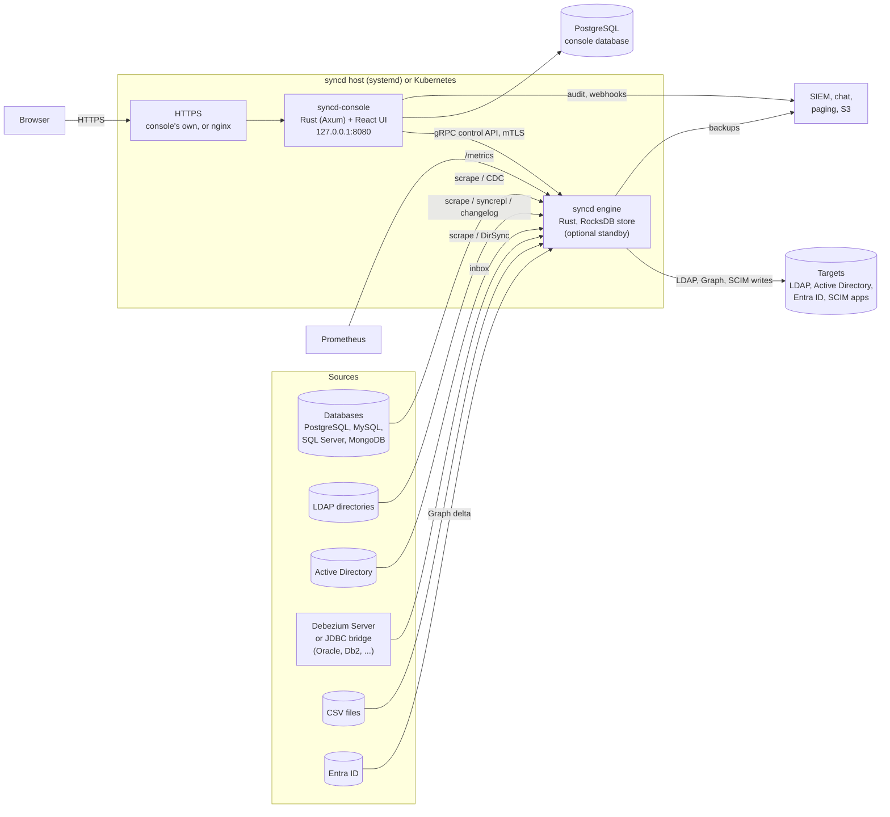

# syncd

**syncd** is an identity synchronisation engine. It reads people, accounts and groups from
databases, CSV files, Active Directory, Entra ID and other LDAP directories, merges the records
that describe the same person or object into one **view**, computes attributes from them with
rules, and publishes the result to existing LDAP directories, Active Directory, Entra ID and
SCIM applications, keeping them in step as the sources change. It is in the same category as Microsoft Identity Manager (MIM) and
RadiantLogic RadiantOne, without the virtual directory: syncd writes to directories you
already run, it does not serve LDAP itself.

It has two parts:

- **The engine** (`syncd`): a Rust daemon that ingests, stores, correlates, merges and exports.
  It runs on its own; it never needs the console to be up.
- **The web console** (`syncd-console`): the control plane and browser UI used to design
  configurations, publish them to engines, watch them run, browse what they hold and audit
  who did what.

!!! info "Source of truth"
    Everything in this section comes from the `ldap-sync-merge-view` source repository
    (version 0.5.0, as on `main` at commit `a9d17c6`; no release has been tagged yet, so nothing is
    published for download): the engine and console code, the packaging under `deploy/packaging/`, the
    container images and Helm chart under `deploy/container/` and `deploy/helm/`, and
    the repository's `docs/`. Where the code and a README disagree, these pages follow the
    code and say so.

!!! note "New in 0.5.0, and what is still unproven"
    0.5.0 adds a license check ([Licensing](licensing.md)), [SAML 2.0](single-sign-on.md#saml-20) and
    [X.509 (CAC/PIV)](single-sign-on.md#certificate-sign-in-cacpiv) sign-in, roles scoped to an
    environment or an engine, [access tiers](security.md#access-tiers) on the engine's control API
    and signed configurations, [password capture](password-sync.md#capturing-changes-in-the-directories)
    on OpenLDAP and 389 Directory Server, secrets from
    Vault, AWS or Azure, a REST/OData source with Workday, SuccessFactors and UKG Pro presets,
    custom functions in WebAssembly, reports of target entries nobody manages, and a WCAG 2.1
    self-audit with a draft VPAT. **Upgrading from 0.4.1 changes behaviour**: read the
    [upgrade notes](install.md#upgrading-from-041-to-050) first.

    Much of 0.5.0 was tested against stand-ins only: the HR services, Vault, AWS and Azure, the
    Entra ID certificate and workload-identity sign-in, and the Kubernetes Lease were run against
    fakes; SAML only against Keycloak; X.509 only with test PKIs, not a real CAC or PIV card. The
    Windows password filter is compile-checked only, the password-sync threat model is a draft,
    and no penetration test has been done. The pages below say what was tested where it matters.

## Key features

| Area | What syncd does |
|---|---|
| **Sources** | PostgreSQL, MySQL and MariaDB, Microsoft SQL Server, MongoDB, CSV and flat files, OpenLDAP and other LDAP directories, Active Directory, Entra ID, REST and OData services with presets for Workday, SAP SuccessFactors and UKG Pro, plus Oracle, Db2 and other databases through a Debezium Server sidecar or the JDBC bridge. See [Connectors](connectors.md). |
| **Targets** | OpenLDAP, 389 Directory Server / Red Hat Directory Server, Ping / UnboundID and other LDAP directories, Active Directory (with Exchange addresses, account control, home paths, UPN and `sAMAccountName` helpers), Entra ID through Microsoft Graph (users, groups, licences, app roles), and SaaS applications through SCIM 2.0. |
| **Full reads and live streams** | Each source object is read in full on a schedule (scrape), read incrementally (delta), or streamed from the source's change log: PostgreSQL logical replication, the MySQL binlog, SQL Server change data capture or change tracking, MongoDB change streams, LDAP syncrepl or a changelog, Active Directory DirSync, Entra ID delta queries. A stream resumes from its checkpoint after a restart. |
| **Correlation and merge** | Join rules link the records from each source that describe one entity. Attribute precedence decides which source wins for each attribute, and the console's correlation review shows the links and the records left unjoined. |
| **Computed attributes** | Rules written in CEL, compiled to native code, with a function library, multi-step transforms, lookup tables, cross-entity references and computed groups. Effective dates, versioned rule packages shared between configurations, custom functions in WebAssembly, and data-quality checks. Each rule carries its own test cases, golden-file tests cover whole publications, and a configuration whose tests fail cannot be published. See [Computed attributes and rules](rules.md). |
| **Publishing** | Publications write a view's entities to a target: DN templates, attribute mapping, renames and moves (including entries someone else moved or renamed in the target, found again by its own id), group membership with referential integrity, a staged leaver policy (disable, strip groups, move, delete, each after its own delay) with rehires restored, group lifecycle (manual members, owners, expiry), drift detection, reconciliation and write-back of changes made in the target. Target profiles for Active Directory, OpenLDAP, 389 Directory Server / Red Hat Directory Server and Ping / UnboundID. |
| **Passwords** | Initial passwords set as accounts are created (on Active Directory with `unicodePwd`), people changing their own password on the console's self-service page, and password changes captured on OpenLDAP and 389 Directory Server by the `syncd-capture` agent and delivered to every linked target, encrypted end to end, with the engine's keys sealed at rest and rotated on demand. See [Password synchronisation](password-sync.md). |
| **Change safety** | Per publication: change windows, deletion, modification and add thresholds, canary publishing, and a report mode that writes nothing. Changes that wait are held and re-planned, never replayed. See [Change safety and lifecycle](change-safety.md). |
| **Safe configuration changes** | Every configuration is a version: compiled by the engine as you type, compared with any other version or with what the engine runs, previewed on sample records, simulated against a copy of the engine's store to show what each target would receive, optionally approved by a second person (four eyes), then published, optionally only with a change ticket or a change-management system's approval. Configuration as code: semantic diff, environments, Git sync and promotion between environments. A configuration that does not start rolls back by itself. See [Configuration as code](config-as-code.md). |
| **Evidence** | Reconciliation reports (CSV, Excel, PDF, scheduled by e-mail or to a share), one person's lineage (JSON, PDF), [target entries no publication manages and privileged-group members syncd does not account for](reports-and-data-quality.md#unmanaged-entries-and-unaccounted-privileged-members), history retention, and the ENS audit trail with Splunk, syslog and file outputs. See [Reports, lineage and data quality](reports-and-data-quality.md) and [Audit logging](../audit-logging.md). |
| **Licensing** | Managed identities and packs, in a signed file from the ENS licensing portal, checked offline. Running sync never stops because of a license: only publishing configuration changes can be blocked, after warnings and a grace period. See [Licensing](licensing.md). |
| **Operations** | Live status of every source and publication, the engine's CPU and memory, entities held back by a failing rule (quarantine), a dead-letter queue for failed exports with retry and discard, threshold approvals, Prometheus metrics with shipped alert rules, signed webhooks (JSON, Slack, Teams, PagerDuty), scoped API tokens, off-host and scheduled backups to a directory or S3, a support bundle, and a command line (`syncd`, `syncdctl`) for everything the console does. |
| **Object explorer** | Search a view, then see an entity's source records, merged attributes and where each value came from, and what each target received. Sensitive attributes are hidden unless a permitted role reveals them, and every look is audited. |
| **Console security** | Local accounts, OpenID Connect and SAML 2.0 single sign-on and X.509 client certificates (CAC/PIV), with roles from the provider's groups; five roles, each held on everything, one environment or named engines; a notice-and-consent banner, session, lockout and password policies, break-glass local sign-in, the ENS hash-chained audit trail, classification banners, and an optional FIPS 140-3 mode. On the engine, access tiers for the control API and configurations signed by the console. |
| **Installation** | One Linux host with systemd: an offline bundle, a `.deb`, or an `.rpm` (RHEL 8 and RHEL 9+ builds), also from signed apt and dnf repositories; `syncdctl` installs, upgrades with automatic rollback, sets up an active/passive pair, installs the license, renews certificates, backs up and restores. Or Kubernetes: container images and a Helm chart with production settings (single sign-on, HTTPS, NetworkPolicies, alert rules). Either way, two engines can run as an active/passive pair. |

## Architecture at a glance

- **The engine** pulls or streams each source into a staging area, links records into entities,
  merges and computes their attributes, plans the changes each target needs and writes them.
  Its state (staged records, entities, links, what each target received, checkpoints and
  history) lives in an embedded RocksDB store under `/var/lib/syncd/engine`. There is no
  external broker or database on the engine side.
- **The console** keeps its accounts, configuration versions, settings and audit log in
  PostgreSQL, and talks to each registered engine over the engine's gRPC control API with
  mutual TLS.
- **HTTPS** for users on other machines: the console serves it itself with a certificate
  (`CONSOLE_TLS_CERT`, `CONSOLE_TLS_KEY`), or nginx goes in front (the release ships its
  configuration). On Kubernetes, an Ingress.

[Architecture](architecture.md) describes the components in detail.

## Tech stack

| Layer | Technology |
|---|---|
| Engine | Rust (2024 edition), Tokio, an embedded RocksDB store, rules in CEL syntax compiled to native closures, custom functions in WebAssembly run by the wasmi interpreter, `ldap3` with DirSync and syncrepl controls, its own `pgoutput`, DirSync and syncrepl decoders |
| Control API | gRPC (`tonic`), mutual TLS; Prometheus metrics over plain HTTP |
| Console server | Rust, Axum, PostgreSQL 13+ (`sqlx`), OpenAPI document generated from the code |
| Console UI | React 19, TypeScript, Vite, TanStack Router and Query, Tailwind CSS, Monaco editor |
| Cryptography | rustls with aws-lc-rs; the AWS-LC FIPS module in a FIPS build |
| JDBC bridge (optional) | Java 17+, run separately, with your databases' JDBC drivers |
| Delivery | Bundles for x86_64 and aarch64, each also as a FIPS bundle, `.deb` and `.rpm` packages (RHEL 8 and 9+) and signed apt and dnf repositories, the `syncd-capture` agent package for directory servers, CycloneDX SBOMs, and `SHA256SUMS` signed with GPG; systemd units `syncd` and `syncd-console`. arm64 builds need the release workflow's arm64 runners, on by default. Container images `ghcr.io/winllc/syncd` and `ghcr.io/winllc/syncd-console` (amd64 and arm64, with `-fips` variants; distroless, Trivy-scanned, cosign-signed with SPDX attestations) and the Helm chart `oci://ghcr.io/winllc/charts/syncd`, all published when a release is tagged (none is yet) |

## Roles

An account holds one or more **role assignments**, each a role on everything, on one environment
(`operator@prod`) or on named engines (`designer@engine:hr-1`). Assignments add up, and an
engine outside every assignment does not exist for that account.

| Role | Can |
|---|---|
| **admin** | Everything, including users, engine registration, sign-in policy, configuration approval, banners, API tokens, webhooks, environments and Git sync |
| **designer** | What a viewer can, plus edit, check, preview, simulate, approve and publish configurations, run connector checks, and upload and approve custom-function modules |
| **operator** | What a viewer can, plus run and control engines: full syncs, reconciliations, drift checks, approving held changes, dead-letter retry and discard, group reviews, joins, unjoins and accepted suggestions in correlation review, and scheduled reports |
| **viewer** | Read engines, status, configurations, environment names and the object explorer |
| **auditor** | What a viewer can, plus the audit log, the lists of API tokens and webhooks with their delivery logs, and environment values |

A role does not include another: a designer cannot run engines, and an operator cannot publish,
unless the account holds both roles. Accounts, settings, webhooks, Git sync, engine registration
and the audit trail as a whole stay global. The [Admin guide](admin-guide.md) gives each role's
exact permissions.

## Documentation map

| Page | Audience | Contents |
|---|---|---|
| [Install guide](install.md) | Whoever deploys it | Requirements, the bundle and packages, the Helm chart, HTTPS for the console, first sign-in, upgrade, rollback |
| [Configuration guide](configuration.md) | Designers, whoever deploys it | The engine's YAML configuration, secrets, and every console environment variable |
| [Operator guide](operator-guide.md) | Whoever keeps it running | Services, health, logs, the `syncd` and `syncdctl` commands, backups, monitoring, certificates |
| [Admin guide](admin-guide.md) | Console administrators | Users and roles, local and break-glass sign-in, configuration approval, the pre-publish hook, API tokens, webhooks, environments, Git sync, banners, engines, the audit log |
| [User guide](user-guide.md) | Designers and operators | Every console screen: engines, the configuration editor, the Computed Attribute Studio, the object explorer |
| [Connectors](connectors.md) | Designers | Each source and target type, what it needs on the other side, and its settings |
| [Computed attributes and rules](rules.md) | Designers | The rule language, the function library, transforms, lookups, references, effective dates, rule packages, test cases |
| [Password synchronisation](password-sync.md) | Designers, security reviewers | Initial passwords, self-service changes, capture on directory servers, password agents, key rotation, delivery |
| [Change safety and lifecycle](change-safety.md) | Designers, operators | Change windows, thresholds, canaries, report mode, held changes, timers, leaver stages, group lifecycle |
| [Configuration as code](config-as-code.md) | Designers, platform teams | Semantic diff, environments, Git sync, promotion, golden-file tests in CI |
| [Reports, lineage and data quality](reports-and-data-quality.md) | Operators, auditors | Reconciliation and scheduled reports, lineage export, history retention, data-quality checks, correlation suggestions |
| [Single sign-on](single-sign-on.md) | Whoever deploys it, security reviewers | OpenID Connect, SAML 2.0 and X.509 (CAC/PIV) sign-in, and role mapping |
| [Licensing](licensing.md) | Whoever deploys it, buyers | Getting and installing a license, the states, managed identities, packs |
| [API reference](api-reference.md) | Integrators | API tokens, the console's REST API, the audit pull API, the engine's gRPC control API, metrics |
| [Webhooks](webhooks.md) | Integrators | Events, formats, signatures, delivery and retries |
| [Architecture](architecture.md) | Engineers | The pipeline, the store, the console, the control API |
| [Security](security.md) | Security reviewers | Authentication, sessions, roles, secrets, mTLS, sensitive attributes, the audit log, hardening |
| [FIPS 140-3 and DISA STIG](fips-and-stig.md) | Security reviewers | The FIPS build and mode, and the settings a STIG deployment needs |
| [Accessibility](accessibility.md) | Buyers, accessibility reviewers | What the console does for accessibility, the WCAG 2.1 self-audit and draft VPAT, and what is not yet checked |
| [Sizing, availability and recovery](availability-and-sizing.md) | Whoever deploys it | Memory, disk and CPU, high availability, backups, disaster recovery, rollback |
| [Troubleshooting](troubleshooting.md) | Whoever keeps it running | Symptom → cause → fix |
