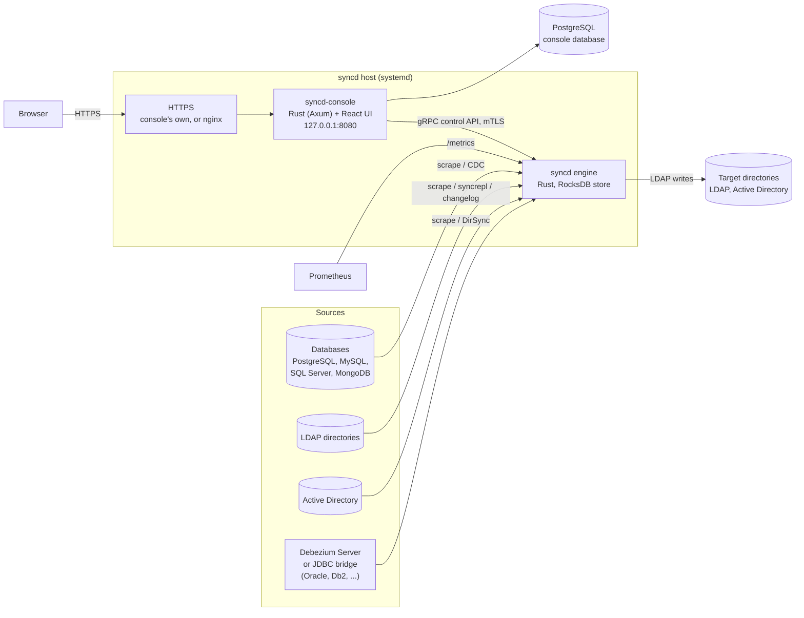

# syncd

**syncd** is an identity synchronisation engine. It reads people, accounts and groups from
databases, Active Directory and other LDAP directories, merges the records that describe the
same person or object into one **view**, computes attributes from them with rules, and
publishes the result to existing LDAP directories and Active Directory, keeping them in step
as the sources change. It is in the same category as Microsoft Identity Manager (MIM) and
RadiantLogic RadiantOne, without the virtual directory: syncd writes to directories you
already run, it does not serve LDAP itself.

It has two parts:

- **The engine** (`syncd`): a Rust daemon that ingests, stores, correlates, merges and exports.
  It runs on its own; it never needs the console to be up.
- **The web console** (`syncd-console`): the control plane and browser UI used to design
  configurations, publish them to engines, watch them run, browse what they hold and audit
  who did what.

!!! info "Source of truth"
    Everything in this section comes from the `ldap-sync-merge-view` source repository
    (version 0.3.0, as on `main` at commit `9140ec5`; no release has been tagged yet, and the
    console's own HTTPS, permanent values and the engine's CPU and memory came after the 0.3.0
    release notes were written): the engine and console code, the packaging under `deploy/packaging/`, the
    container images and Helm chart under `deploy/container/` and `deploy/helm/`, and
    the repository's `docs/`. Where the code and a README disagree, these pages follow the
    code and say so.

!!! note "What syncd does not have yet"
    syncd is newer than the other applications in the suite, and some of what they share is
    still on its roadmap: an ENS license file, SAML and X.509 sign-in, outbound webhooks, the ENS audit event format with a SIEM forwarder,
    password synchronisation, active/passive high availability, signed releases, and arm64 or
    FIPS container images. The pages below say
    what syncd offers in each of those places today.

## Key features

| Area | What syncd does |
|---|---|
| **Sources** | PostgreSQL, MySQL and MariaDB, Microsoft SQL Server, MongoDB, OpenLDAP and other LDAP directories, Active Directory, plus Oracle, Db2 and other databases through a Debezium Server sidecar or the JDBC bridge. See [Connectors](connectors.md). |
| **Full reads and live streams** | Each source object is read in full on a schedule (scrape), read incrementally (delta), or streamed from the source's change log: PostgreSQL logical replication, the MySQL binlog, SQL Server change data capture or change tracking, MongoDB change streams, LDAP syncrepl or a changelog, Active Directory DirSync. A stream resumes from its checkpoint after a restart. |
| **Correlation and merge** | Join rules link the records from each source that describe one entity. Attribute precedence decides which source wins for each attribute, and the console's correlation review shows the links and the records left unjoined. |
| **Computed attributes** | Rules written in CEL, compiled to native code, with a function library, multi-step transforms, lookup tables, cross-entity references and computed groups. Each rule carries its own test cases, and a configuration whose tests fail cannot be published. See [Computed attributes and rules](rules.md). |
| **Publishing** | Publications write a view's entities to a target directory: DN templates, attribute mapping, renames and moves (including entries someone else moved or renamed in the target, found again by its own id), group membership with referential integrity, deprovisioning by deleting or disabling, deletion thresholds that hold mass deletes for approval, drift detection, reconciliation and write-back of changes made in the target. Target profiles for Active Directory, OpenLDAP, 389 Directory Server / Red Hat Directory Server and Ping / UnboundID. |
| **Safe changes** | Every configuration is a version: compiled by the engine as you type, compared with any other version or with what the engine runs, previewed on sample records, simulated against a copy of the engine's store to show what each target would receive, optionally approved by a second person (four eyes), then published. A configuration that does not start rolls back by itself. |
| **Operations** | Live status of every source and publication, the engine's CPU and memory, entities held back by a failing rule (quarantine), a dead-letter queue for failed exports with retry and discard, threshold approvals, Prometheus metrics with shipped alert rules, and a command line (`syncd`, `syncdctl`) for everything the console does. |
| **Object explorer** | Search a view, then see an entity's source records, merged attributes and where each value came from, and what each target received. Sensitive attributes are hidden unless a permitted role reveals them, and every look is audited. |
| **Console security** | Local accounts and OpenID Connect single sign-on with roles from the provider's groups, five roles, break-glass local sign-in, sign-in throttling and lockout, a hash-chained append-only audit log, classification banners, and an optional FIPS 140-3 mode. |
| **Installation** | One Linux host with systemd: an offline bundle, a `.deb`, or an `.rpm` (RHEL 8 and RHEL 9+ builds); `syncdctl` installs, upgrades with automatic rollback, renews certificates, backs up and restores. Or Kubernetes: container images and a Helm chart, with the engine as a one-replica StatefulSet. |

## Architecture at a glance

- **The engine** pulls or streams each source into a staging area, links records into entities,
  merges and computes their attributes, plans the changes each target needs and writes them.
  Its state (staged records, entities, links, what each target received, checkpoints and
  history) lives in an embedded RocksDB store under `/var/lib/syncd/engine`. There is no
  external broker or database on the engine side.
- **The console** keeps its accounts, configuration versions, settings and audit log in
  PostgreSQL, and talks to each registered engine over the engine's gRPC control API with
  mutual TLS.
- **HTTPS** for users on other machines: the console serves it itself with a certificate
  (`CONSOLE_TLS_CERT`, `CONSOLE_TLS_KEY`), or nginx goes in front (the release ships its
  configuration). On Kubernetes, an Ingress.

[Architecture](architecture.md) describes the components in detail.

## Tech stack

| Layer | Technology |
|---|---|
| Engine | Rust (2024 edition), Tokio, an embedded RocksDB store, rules in CEL syntax compiled to native closures, `ldap3` with DirSync and syncrepl controls, its own `pgoutput`, DirSync and syncrepl decoders |
| Control API | gRPC (`tonic`), mutual TLS; Prometheus metrics over plain HTTP |
| Console server | Rust, Axum, PostgreSQL 13+ (`sqlx`), OpenAPI document generated from the code |
| Console UI | React 19, TypeScript, Vite, TanStack Router and Query, Tailwind CSS, Monaco editor |
| Cryptography | rustls with aws-lc-rs; the AWS-LC FIPS module in a FIPS build |
| JDBC bridge (optional) | Java 17+, run separately, with your databases' JDBC drivers |
| Delivery | `syncd-<version>-linux-x86_64.tar.gz`, `.deb`, `.rpm` and a RHEL 8 `.rpm`, with `SHA256SUMS` (not signed yet); systemd units `syncd` and `syncd-console`. Container images `ghcr.io/winllc/syncd` and `ghcr.io/winllc/syncd-console` (amd64, distroless, not signed yet) and the Helm chart `oci://ghcr.io/winllc/charts/syncd`, all published when a release is tagged (none is yet). aarch64 and FIPS builds are built from source |

## Roles

| Role | Can |
|---|---|
| **admin** | Everything, including users, engine registration, sign-in policy, configuration approval and banners |
| **designer** | What a viewer can, plus edit, check, preview, simulate, approve and publish configurations, and run connector checks |
| **operator** | What a viewer can, plus run and control engines: full syncs, reconciliations, drift checks, threshold approvals, dead-letter retry and discard, and manual joins and unjoins in correlation review |
| **viewer** | Read engines, status, configurations and the object explorer |
| **auditor** | What a viewer can, plus the audit log |

Roles do not stack: a designer cannot run engines, and an operator cannot publish. The
[Admin guide](admin-guide.md) gives each role's exact permissions.

## Documentation map

| Page | Audience | Contents |
|---|---|---|
| [Install guide](install.md) | Whoever deploys it | Requirements, the bundle and packages, the Helm chart, HTTPS for the console, first sign-in, upgrade, rollback |
| [Configuration guide](configuration.md) | Designers, whoever deploys it | The engine's YAML configuration, secrets, and every console environment variable |
| [Operator guide](operator-guide.md) | Whoever keeps it running | Services, health, logs, the `syncd` and `syncdctl` commands, backups, monitoring, certificates |
| [Admin guide](admin-guide.md) | Console administrators | Users and roles, local and break-glass sign-in, configuration approval, banners, engines, the audit log |
| [User guide](user-guide.md) | Designers and operators | Every console screen: engines, the configuration editor, the Computed Attribute Studio, the object explorer |
| [Connectors](connectors.md) | Designers | Each source and target type, what it needs on the other side, and its settings |
| [Computed attributes and rules](rules.md) | Designers | The rule language, the function library, transforms, lookups, references, test cases |
| [Single sign-on](single-sign-on.md) | Whoever deploys it, security reviewers | OpenID Connect setup and role mapping |
| [API reference](api-reference.md) | Integrators | The console's REST API, the engine's gRPC control API, metrics |
| [Webhooks](webhooks.md) | Integrators | What syncd offers instead of outbound webhooks |
| [Architecture](architecture.md) | Engineers | The pipeline, the store, the console, the control API |
| [Security](security.md) | Security reviewers | Authentication, sessions, roles, secrets, mTLS, sensitive attributes, the audit log, hardening |
| [FIPS 140-3 and DISA STIG](fips-and-stig.md) | Security reviewers | The FIPS build and mode, and the settings a STIG deployment needs |
| [Accessibility](accessibility.md) | Buyers, accessibility reviewers | What the console does for accessibility, and what is not yet checked |
| [Sizing, availability and recovery](availability-and-sizing.md) | Whoever deploys it | Memory, disk and CPU, high availability, backups, disaster recovery, rollback |
| [Troubleshooting](troubleshooting.md) | Whoever keeps it running | Symptom → cause → fix |
