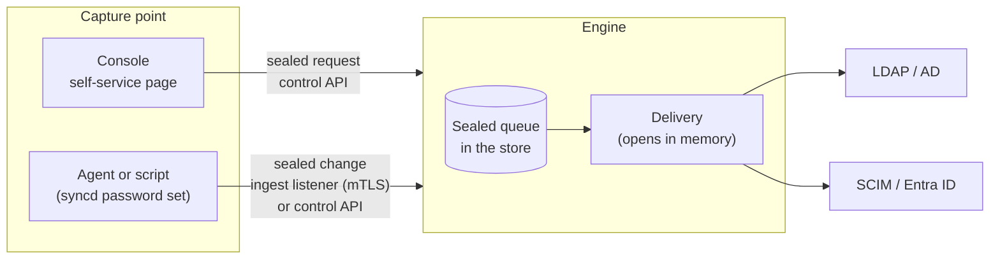

# Password synchronisation

When a person's password changes somewhere syncd can capture it, syncd delivers the new password
to that person's accounts in the target directories, usually within seconds. The password is
sealed where it is captured and opened only in the engine's memory, to be written to the target.
It is never written to disk, logs, history, the console or a support bundle in the clear.

Password synchronisation is new in syncd 0.4.0. The engine's side is built: the sealed queue,
delivery to every kind of target, initial passwords on new accounts, a self-service page on the
console, and enrolment for capture agents. syncd 0.4.1 adds sealing of the engine's password keys
at rest, password metrics and alerts, and a Helm Service for the ingest listener. The capture
plugins that sit inside a directory are not built yet (see [What is built](#what-is-built)).

## What is built

| Piece | In 0.4.1 |
|---|---|
| Delivery of captured changes to targets (the sealed queue, routing, retries, ordering, echo suppression) | Built |
| Initial passwords: a password set as the account is created, read from the entity or generated | Built |
| The console's self-service page: people change their own password | Built |
| Capture agents: enrolment, the ingest listener with per-agent certificates, revocation | Built |
| `syncd password set`: submit one change from a script, as an operator or as an enrolled agent | Built |
| The password key and the agent CA key sealed at rest with a passphrase | Built in 0.4.1 |
| Password metrics and alert rules; per-publication counts on the console's engine page | Built in 0.4.1 |
| The Windows password filter (an LSA filter DLL and a service on each writable domain controller) | **Not built** |
| The 389 Directory Server / RHDS plugin and the OpenLDAP overlay | **Not built** |
| Rotation of the password key and of the agent CA | **Not built** |
| A command to change the passphrase that seals the keys | **Not built** |
| A console page for agents, and an RBAC permission for password delivery | **Not built** |
| The threat model and the third-party penetration test that the plan sets as release gates | **Not done** |

So in 0.4.1 a password reaches syncd in one of three ways: a person changes it on the console's
self-service page, a publication creates an account with an initial password, or a script (or a
home-made agent) submits it with `syncd password set`. A password changed directly in Active
Directory, 389 DS or OpenLDAP is not captured.

Cloud identity providers (Entra ID, Okta, SaaS applications) never reveal a plaintext password, so
they can't be capture sources. Their users change their password on the self-service page instead.

### Targets that take passwords

| Target | How the password is written |
|---|---|
| LDAP (OpenLDAP, 389 DS, others) | The Password Modify extended operation (RFC 3062), so the directory hashes it under its own policy (`write: password_modify`, the default), or a replace of `userPassword` (`write: replace`) |
| Active Directory | `unicodePwd`, over LDAPS or StartTLS only. A plain `ldap://` connection without `starttls` is refused when the configuration is validated |
| SCIM 2.0 | The resource's `password` attribute. The provider must advertise `changePassword` support: the engine refuses to connect to a SCIM target that doesn't when a publication has a `passwords` block for it |
| Entra ID | The user's `passwordProfile`. Users that Entra Connect syncs from on-premises AD are refused: their password belongs to AD |

A CSV connector is a source only. See [Connectors](connectors.md) for each connector.

## How a change travels



1. **Sealed where it is captured.** The capture point builds the change: the source connector,
   the object type, the account's anchor in that source, a sequence number, the capture time and
   the password. It seals it with HPKE (RFC 9180, base mode: DHKEM(P-256, HKDF-SHA256),
   HKDF-SHA256, AES-256-GCM) to the engine's public password key, with the key's id as
   additional data. A capture point can seal; it can never open.
2. **Submitted.** The sealed change goes to the engine: over the ingest listener with an agent's
   certificate, or over the control API (`SubmitPasswords`), which needs control access like any
   command. A change sealed to another key is refused, and the capture point fetches the key
   again. A busy engine (a full sync running) does not hold submissions up.
3. **Queued.** Accepted changes are stored as they came, still sealed, in the engine's store. The
   queue survives a restart.
4. **Routed.** The delivery loop runs at once and then every 30 seconds while anything waits. It
   opens each change in memory and finds the account: the source record by its anchor, the
   record's entity, each publication whose `passwords.from` names that source, and the DN the
   entity has in that publication's target.
5. **Ordered.** Per account, only the newest change is delivered. Older ones still queued, and
   any no newer than the last one delivered, are dropped.
6. **Delivered.** The password is written to each target, and the plaintext is zeroised.
7. **Echo dropped.** A change captured in a directory just after syncd wrote the same password
   there is syncd's own write coming back, and is dropped. syncd keeps a keyed hash of each
   password it delivered for 10 minutes, with a key that is random for each run of the engine.

A change for an account that is not provisioned or exported yet, or for a target that is
unreachable or busy, waits in the queue, sealed, for up to `passwords.ttl_secs` (24 hours by
default). Then it is dropped and counted as failed. This covers a password that arrives before
the account exists. A change delivered to one target and still waiting for another remembers
where it went.

## Configuration

Password delivery is on when at least one publication has a `passwords` block.
[Configuration](configuration.md) lists every key; this section explains them.

### The engine's `passwords` block

```yaml
passwords:                              # optional; these are the defaults
  key_file: /var/lib/syncd/engine/password.key   # default: password.key in the data directory
  ttl_secs: 86400                       # how long a change may wait to be delivered
  ingest:                               # capture agents; off unless set
    listen: 0.0.0.0:7445
    names: [syncd.example.com]          # what agents reach the listener by
    agent_cert_days: 365
  self_service:                         # the console's self-service page; off unless set
    source: corp_ad
    object: user
    login: sAMAccountName
    min_length: 12
    min_classes: 3
```

| Key | Default | Meaning |
|---|---|---|
| `key_file` | `password.key` in the data directory | The engine's password key. Created on first start, mode 0600. Sealed with a passphrase when `SYNCD_PASSWORD_KEY_PASSPHRASE_FILE` is set (see [Sealing the keys](#sealing-the-keys)) |
| `ttl_secs` | `86400` | How long a change may wait, sealed, for its account or its target. At least 1 |
| `ingest.listen` | none | `host:port` of the [capture agents' listener](#capture-agents). Needs at least one publication with `passwords` |
| `ingest.names` | none | The host names and addresses agents use. The listener's certificate is issued for these. At least one |
| `ingest.agent_cert_days` | `365` | How long an agent's certificate is valid. The agent enrols again after that |
| `self_service.source` | none | The LDAP or Active Directory source people sign in to. A publication must take passwords `from` it |
| `self_service.object` | none | The source's object type whose entries are the people |
| `self_service.login` | none | The attribute people type as their user name (`uid`, `sAMAccountName`, `mail`) |
| `self_service.min_length` | `12` | The shortest new password. At least 8 |
| `self_service.min_classes` | `3` | How many of lower case, upper case, digits and other characters a new password must mix. At most 4 |

### A publication's `passwords` block

```yaml
publications:
  - name: people_to_ad
    view: people
    target: corp_ad_target
    attributes:
      userAccountControl: '"512"'       # enabled once the password is set
    passwords:
      from: [corp_ldap]                 # sources whose captured changes this target receives
      write: password_modify            # or replace; ignored by AD, SCIM and Entra ID
      initial:                          # optional: the password a new entry is created with
        generate: { length: 16, classes: 4 }   # or: from: e.initialPassword
        must_change: true               # Active Directory only: pwdLastSet 0
```

| Key | Default | Meaning |
|---|---|---|
| `from` | `[]` | Connectors of the publication's view whose captured changes are authoritative for this target. May be empty when only `initial` is wanted |
| `write` | `password_modify` | How a directory other than Active Directory takes the password: `password_modify` (RFC 3062) or `replace` (`userPassword`) |
| `initial.from` | none | CEL over `e`, the entity, giving the initial password as a string |
| `initial.generate.length` | `16` | Length of a generated password, 8 to 256 |
| `initial.generate.classes` | `4` | How many of lower case, upper case, digits and other characters it holds at least one of, 1 to 4 |
| `initial.must_change` | `false` | Active Directory only: the person must change the password at the next logon |

Validation refuses:

- a `passwords` block with neither `from` nor `initial`;
- a `from` connector that is not a source of the publication's view, or that is the publication's
  own target (the password would go back where it was captured);
- `initial` with both `from` and `generate`, or neither;
- `must_change` on a target that is not Active Directory;
- `passwords` on an Active Directory target reached over `ldap://` without `starttls`. Before
  0.4.0 this failed only when a password was written.

## Initial passwords

A publication with `passwords.initial` gives each entry it **creates** a password. The value is
either read from the entity or generated:

- **`from`** is an expression over the entity, usually an attribute that a source column flows
  into (`initialPassword: source.initial_pw`). An entity with no value, or an empty one, is
  created without a password, and that is not a rule error. The value is an attribute like any
  other and the engine keeps it in its store, so list it in `attributes.sensitive` to keep it out
  of previews, the explorer and the console.
- **`generate`** makes a different random password for each entry, from the system's random
  generator, with at least one character of each of the first `classes` of lower case, upper
  case, digits and other characters. `classes: 3` gives an alphanumeric password that is safe in
  a shell or an LDIF file. Generated passwords never contain quotes, backslashes or spaces.

The password is planned with the add, held in memory only, and set right after a **fresh** add.
An entry that was already there (adopted, converged, replayed after a crash) keeps the password
it has. On each kind of target:

- **Active Directory.** AD refuses an enabled account without a password, so the entry is added
  disabled: the exported `userAccountControl` with `ACCOUNTDISABLE` set, or 514 when none is
  exported. Then `unicodePwd` is set, then `pwdLastSet` is set to 0 when `must_change` is on,
  then `userAccountControl` is set to the exported value. An account exported as enabled becomes
  enabled only at this last step; one exported disabled stays disabled.
- **Other LDAP directories.** Password Modify, or a `userPassword` replace, right after the add.
- **SCIM.** The password goes into the `POST` that creates the user.
- **Entra ID.** The password goes into the new user's `passwordProfile`. Graph needs a password
  for every new user, so without `initial` syncd sets a random one that nobody keeps, with
  `forceChangePasswordNextSignIn`.

If a publication also sets `account_control.must_change_password` (the Active Directory
conveniences in [Connectors](connectors.md)), that rule manages `pwdLastSet` on every pass, not
only at creation.

**A refused password** (the directory's password policy, for example) does not fail the export.
The entry stays, without a password, and on Active Directory disabled. The refusal is counted as
an initial password refused, logged with the DN and the publication, and shown as the last
failure. It is not retried: the account waits for a captured change or an administrator. A lost
connection fails the export like any other operation; its retry finds the entry there and
converges it without a password, and the log says so.

**A captured change replaces it.** Captured changes need the entry's export record, which is
written after the add, so whatever a capture point sends for the account, before or after the
creation, is delivered after the initial password. A directory that is also a capture source sees
the initial password like any other change made there and delivers it onward to the publications
that take passwords from it. That is intended: the initial password reaches every account of the
person.

**With change safety:**

- An initial password rides with its add. A change window, an add threshold or a canary that
  holds the add holds the password with it. Captured changes are never held by a change window.
- A publication in report mode (`mode: report`) writes nothing: no initial password is made, and
  captured changes for it are dropped and counted (`dropped` in the status API).

See [Change safety and lifecycle](change-safety.md).

Telling the person their initial password (an e-mail, a printed letter) is out of scope. The log
and the status say that a password was set, never what it is.

## People changing their own password

The console has a public page, `/password`, where a person changes their own password without a
console account. They change it in the directory they sign in to, and syncd delivers it from
there to their other accounts like any captured change. It needs no agent.

### Turning it on

1. On the engine, add `passwords.self_service` (above) naming the LDAP or Active Directory source
   people sign in to, and give at least one publication `passwords: { from: [<that source>] }`.
2. On the console, set `CONSOLE_SELF_SERVICE_ENGINE` to the name of the registered engine (for an
   HA pair, either member: see [High availability](#high-availability)). Without it, the page says
   password changes are not available.

### What happens

1. **On the page** the person gives their user name, their current password and the new one
   twice. The console checks only the rate, per client address, with the same limiter as
   sign-in.
2. **The console seals the request** (user name, current and new password) to the engine's
   password key, with a different HPKE context from captured changes, so neither can be taken for
   the other. It hands the request to the engine over the control API and keeps nothing of it.
3. **The engine checks the policy:** the length, the character classes, not the current
   password, and not containing the user name. A refusal says what is missing.
4. **It proves the current password.** It finds the person's entry by the login attribute, with
   the source connection's own account, then binds as the person. An empty password is refused,
   never sent as an anonymous bind. No such person, several matches and a wrong password all get
   the same answer: "wrong user name or password".
5. **It changes the password there, as the person**, so the directory's own rules apply (its
   policy, history and minimum age). On OpenLDAP and 389 DS this is Password Modify with the old
   and new password. On Active Directory it is a `unicodePwd` delete of the old value and add of
   the new, over LDAPS or StartTLS only.
6. **It delivers it.** The new password is queued, sealed, for every publication that takes
   passwords from that source, and goes out at once.
7. **Repeated failures hold a user name off.** After 5 failures in 15 minutes the user name is
   refused for the rest of that time, whatever the password, on top of the console's per-address
   limit.

| Answer on the page | HTTP status (`POST /api/v1/self-service/password`) | Why |
|---|---|---|
| Your password was changed | `200` | Changed in the source and queued for the targets |
| The policy's reason, or the directory's | `400` | The new password does not meet the engine's policy, or the directory refused it |
| Wrong user name or password | `401` | No such person, several, or a wrong current password |
| Not available | `404` | `CONSOLE_SELF_SERVICE_ENGINE` is not set |
| Too many attempts | `429` | The address's rate limit, or the user name is held off |
| Try again later | `503` | The engine or the directory can't be reached |

The console's audit trail records each attempt as `password.self_service`, with the user name,
the client address and the outcome (changed, wrong credentials, refused by the policy, rate
limited). No password is ever in it.

From the command line, `syncd password change --login <name>` does the same through the control
API. It reads the current password and then the new one, one line each, from standard input.

The page's hint under **New password** gives the engine's policy, read from the engine's status
(`min_length` and `min_classes`, for example "At least 14 characters, mixing three of lower case,
upper case, digits and symbols; not your user name."). The console asks the engine at most once a
minute, and shows the defaults (12 characters, 3 classes) when it can't reach it. Before 0.4.1 the
hint always gave the defaults.

## Capture agents

A capture agent is a program on another host that submits password changes: in time, the Windows
filter's service and the directory plugins; in 0.4.0, a script using `syncd password set
--agent-dir`. Agents have identities of their own and a listener of their own, so they never need
control access to the engine.

### The agent CA

On first start with `passwords.ingest`, the engine creates its **agent CA** beside the password
key: a P-256 key (`password-agent-ca.key`, mode 0600) and a ten-year certificate
(`password-agent-ca.crt`). It issues each agent's client certificate, and at every start the
ingest listener's own server certificate for `ingest.names`. An agent needs nothing but this CA's
certificate to trust the listener, whatever PKI the rest of the deployment uses.

### Enrolling an agent

1. **An operator adds the agent** on the engine's host (control access):

    ```sh
    syncd password agent add dc01 --ca-out agent-ca.crt
    ```

    This prints a one-time enrolment token, good for an hour, and the listener's address, and
    writes the agent CA's certificate to the file. The engine keeps only the token's SHA-256.
    Adding an agent that exists gives it a new token, so that it can enrol again.

2. **The agent enrols** from its own host, with no engine configuration:

    ```sh
    syncd password agent enroll --ingest syncd.example.com:7445 --name dc01 \
      --token <token> --ca agent-ca.crt --dir /etc/syncd-agent
    ```

    The agent makes its own key, which never leaves the host (`agent.key`, mode 0600), and sends a
    signing request with the token. The token can also come from `SYNCD_AGENT_TOKEN`. The engine
    compares the token in constant time, issues a certificate for client authentication only whose
    subject is the agent's name whatever the request asked, and records its fingerprint. The token
    is spent, and any certificate from an earlier enrolment of the same agent stops working. The
    directory then holds `agent.key`, `agent.crt`, `ca.crt` and `agent.conf`.

3. **The agent submits** with its certificate: it fetches the public key, then submits changes
   sealed to it. From a script:

    ```sh
    syncd password set --agent-dir /etc/syncd-agent \
      --source corp_ldap --object person --anchor 6f1d0c2e-0001-4000-8000-000000000001 < new-password
    ```

On the ingest listener a client certificate is asked for but not required, so enrolling works
without one. Every other call needs the certificate of an enrolled agent that is not revoked. The
TLS handshake already refuses a certificate the agent CA did not issue.

### Revoking and listing agents

`syncd password agent revoke dc01` refuses the agent's certificate at once. The check is against
the fingerprint the engine recorded, not a revocation list. A revoked name can't get a new token;
a replacement agent takes another name.

`syncd password agent list` shows each agent: enrolled (and when), revoked, waiting to enrol, or
not enrolled because its token expired; when it was last seen; and how many changes it submitted.

## The `syncd password` commands

| Command | Where it runs | What it does |
|---|---|---|
| `syncd password set --source S --object O --anchor A [--sequence N]` | The engine's host (control access) | Reads one password from standard input, seals it here and submits it through the control API. `--sequence` defaults to the current time in microseconds; a later change for the same account needs a larger one |
| `syncd password set --agent-dir DIR --source S --object O --anchor A` | An enrolled agent's host | The same, as that agent, to its ingest listener |
| `syncd password change --login NAME` | The engine's host (control access) | A self-service change: the current and the new password from standard input |
| `syncd password agent add NAME [--ca-out FILE]` | The engine's host (control access) | A one-time enrolment token for a new agent, or a new one for an agent to enrol again |
| `syncd password agent enroll --ingest HOST:PORT --name NAME --token T --ca FILE --dir DIR` | The agent's host | Enrols: makes the agent's key and gets its certificate. Needs no engine configuration |
| `syncd password agent list` | The engine's host (control access) | The agents and their state |
| `syncd password agent revoke NAME` | The engine's host (control access) | Refuses the agent's certificate from now on |

Commands that use the control API take the usual `--api`, `--api-ca`, `--api-cert` and `--api-key`
options; on the engine's host the control socket needs none. See
[Operator guide](operator-guide.md).

## Delivery outcomes

| Outcome | What happens | Counted as |
|---|---|---|
| Delivered | Written to the target | `delivered` |
| Waiting | The account is not provisioned or exported yet, or the target is unreachable or busy. Tried again every 30 seconds | `queued` (waiting) |
| Refused | The target refused it (its password policy, access rights, an Entra user synced from AD, a SCIM provider without `changePassword`). Reported and **not retried** | `failed` |
| Expired | Waited longer than `ttl_secs` | `failed` |
| Unreadable | Sealed to a key the engine no longer has (a replaced key file) | `failed` |
| Superseded | A newer change for the same account came, or a newer one was delivered already | Not counted |
| Echo | syncd's own write coming back from a directory | Not counted |
| Dropped | The publication is in report mode | `dropped` |
| Initial password set or refused | See [Initial passwords](#initial-passwords) | `initial_set`, `initial_failed` |

The counters run from the engine's start. None of these places carries any password material.

| Where | What it shows |
|---|---|
| `syncd status` | `passwords: N delivered, N failed, N waiting, N dropped (report mode); initial passwords: N set, N refused; last failure: ...` (the dropped, initial and last failure parts only when there are any), then `password keys: sealed with the passphrase` or `password keys: stored in the clear (...)` |
| The console's engine page | A **Passwords** card when the engine delivers passwords: a **keys sealed** or **password keys stored in the clear** badge; delivered, failed, dropped (report mode), waiting, initial passwords set and refused; a table of delivered, failed, dropped and waiting per publication; and the last failure |
| The status API | `passwords` in the engine's status (gRPC `EngineStatus.passwords`, and the console's REST status): the counters above, the last failure, the time of the last delivery, `keys_sealed`, and `publications` with each publication's `delivered`, `failed`, `dropped` and `waiting` |
| Metrics | `syncd_password_deliveries_total{publication,outcome}` with `outcome` `delivered`, `failed` or `dropped`, and `syncd_password_waiting{publication}` (as of the last delivery pass). A failure no publication can be named for (a change that does not open) has an empty `publication`. See [Operator guide](operator-guide.md#prometheus-metrics) |
| Alerts | `SyncdPasswordDeliveryFailures` (a publication's failed count rose in 15 minutes) and `SyncdPasswordChangesDropped` (changes dropped in report mode in the last hour), in the shipped rule files and the chart's PrometheusRule. See [Operator guide](operator-guide.md#alert-rules) |
| The engine's log | Each delivery and failure, by source, object, anchor, publication and DN |
| Lineage and history | Each captured change's delivery to a publication, with its time and outcome (`delivered` or `refused`), when entity history is kept (`engine.history.keep_days` above 0). `syncd lineage` and the entity page's **Lineage JSON** and **PDF** exports include them. Initial passwords are not in the history |
| Webhooks | `password.delivery-failed` when the failed count rises, with how many and the last failure. See [Webhooks](webhooks.md) |

syncd 0.4.0 had no password metrics or alert rules; 0.4.1 adds them.

## High availability

On an active/passive pair, only the active engine delivers passwords. Every delivery checks the
lease first, like every export batch, so an engine that can't renew stops writing before the other
may take over. The passive engine doesn't run the ingest listener and doesn't answer self-service
changes or password submissions. After a failover, agents must reach the engine that is now
active: list both hosts (or a name that moves with the active one) in `ingest.names`, and enrol
agents against that name.

`CONSOLE_SELF_SERVICE_ENGINE` names one registered engine. Since 0.4.1, when that engine is one
of an HA pair, the console sends each self-service change to the member of the pair that holds
the lease, so the page keeps working after a failover. (In 0.4.0 it worked only while the named
engine was the active one.) If the console can't tell which member is active, it uses the named
engine.

The snapshots the passive engine keeps carry the password key and the agent CA as they are on
disk (sealed, when a passphrase is set), so agents' certificates and changes sealed to the key
stay good after a takeover. Both engines of a pair need the same passphrase. Password changes the
old engine queued after its last snapshot and had not delivered are not delivered again; the next
change for the account is. See [Availability and sizing](availability-and-sizing.md).

### On Kubernetes

Since chart 0.4.1, `engine.passwordIngest` exposes the ingest listener:

```yaml
engine:
  passwordIngest:
    enabled: true
    port: 7445                # the port of passwords.ingest.listen
    service:
      type: LoadBalancer      # ClusterIP by default; LoadBalancer or NodePort for agents outside the cluster
      annotations: {}
networkPolicy:
  passwordIngestFrom:         # with networkPolicy.enabled: who may reach the port; anywhere when empty
    - ipBlock: { cidr: 10.20.0.0/24 }
```

The engine's pods get an `ingest` port, and `<release>-syncd-engine-ingest` (`syncd-engine-ingest`
for a release named `syncd`) is a Service for it alone, so a load balancer for the agents exposes
neither the control API nor the metrics. The configuration the console publishes must listen on
the same port (`passwords.ingest.listen`) and name the address agents reach it by in
`ingest.names`. With `engine.ha.enabled`, the Service
routes to both pods but only the active engine listens, so an agent that reaches the passive one
must retry.

`engine.passwordKeyPassphrase.existingSecret` names a Secret holding the passphrase (under `key`,
default `passphrase`); the chart mounts it read-only and sets `SYNCD_PASSWORD_KEY_PASSPHRASE_FILE`.
Both engines of an HA pair use the same Secret.

The self-service page needs nothing more, since the console reaches the engine over the control
API.

## Security properties

- **Encryption.** HPKE (RFC 9180) with DHKEM(P-256, HKDF-SHA256), HKDF-SHA256 and AES-256-GCM,
  built on aws-lc-rs, so the FIPS build uses the validated module. See
  [FIPS and STIG](fips-and-stig.md).
- **Capture points can't decrypt.** They hold only the public key. The engine's private key is in
  `key_file`, mode 0600, readable by the engine's user only, and sealed with a passphrase when one
  is set.
- **The queue holds only sealed changes.** A change is opened in memory for delivery and the
  plaintext is zeroised afterwards. Plans holding an initial password show it as `<redacted>`.
- **No password material** in logs, the status, history, lineage, dead letters, webhooks, the
  audit trail or support bundles. A target's refusal message is logged and shown as the last
  failure; the history records only the outcome, because a policy message may echo part of the
  password. The end-to-end tests check that no password appears in the engine's log or store
  files, or the console's log and audit trail.
- **Ordering** by a sequence per account, so an older change never overwrites a newer one.
- **Echo suppression** with a keyed hash whose key is random for each run of the engine.
- **Agents** enrol with a one-time token (one hour, kept as a hash, compared in constant time),
  get a client-only certificate named by the operator, and can be revoked one by one. Their keys
  never leave their hosts.
- **Self-service** proves the current password against the directory, changes it as the person,
  holds a user name off after repeated failures, and gives the same answer for an unknown user and
  a wrong password.

Protect these files like the master key:

| File | In the data directory | Also in |
|---|---|---|
| The password key | `password.key` (or `key_file`) | Backups and HA snapshots |
| The agent CA key and certificate | `password-agent-ca.key`, `password-agent-ca.crt` | Backups and HA snapshots |

Anyone with the password key can open queued changes; anyone with the agent CA key can issue agent
certificates. Neither is protected by the console's master key.

### Sealing the keys

Since 0.4.1 the engine seals both key files with a passphrase when
`SYNCD_PASSWORD_KEY_PASSPHRASE_FILE` names a file holding one. (The 0.4.0 documentation said
these files were already encrypted; they were not.) The passphrase derives an AES-256-GCM key
with PBKDF2-HMAC-SHA256 (600,000 iterations, a random salt each time the file is written), both
FIPS-approved, through aws-lc-rs. The certificate (`password-agent-ca.crt`) is not secret and is
not sealed.

1. Write a long random passphrase to a file only the engine's user can read, kept apart from the
   backups, and keep a copy with your other recovery secrets: a restore needs it.

    ```sh
    head -c 32 /dev/urandom | base64 > /etc/syncd/engine/password-key.passphrase
    chown syncd /etc/syncd/engine/password-key.passphrase
    chmod 0600 /etc/syncd/engine/password-key.passphrase
    ```

2. Set `SYNCD_PASSWORD_KEY_PASSPHRASE_FILE=/etc/syncd/engine/password-key.passphrase` in
   `/etc/syncd/engine.env` (on Kubernetes, `engine.passwordKeyPassphrase`; see
   [On Kubernetes](#on-kubernetes)). `SYNCD_PASSWORD_KEY_PASSPHRASE`, the passphrase itself, is
   read only when the file variable is not set, for tests and containers that can't mount a file.
3. Restart the engine. It seals both files in place, keeping the same keys, so nothing queued is
   lost and agents keep their certificates. The log says `the password key was stored in the
   clear and is now sealed with the passphrase`, and `syncd status` says `password keys: sealed
   with the passphrase`.

Without a passphrase the keys stay plain files, protected by their mode only, as in 0.4.0. The
engine then warns at start (`the password keys are stored in the clear, ...`), `syncd status` says
`password keys: stored in the clear`, and the console's engine page shows **password keys stored
in the clear**.

What to know:

- **Backups and HA snapshots** carry the files as they are on disk: ciphertext when sealed, in the
  clear otherwise. Backups taken before you set the passphrase still hold the keys in the clear;
  protect or remove them.
- **A sealed file without the passphrase, or with the wrong one, stops the engine** with an error
  that names `SYNCD_PASSWORD_KEY_PASSPHRASE_FILE`. The key files are left as they are. Both
  engines of an HA pair, and an engine restored from a backup, need the passphrase the keys were
  sealed with. `syncd restore` warns when the passphrase it has does not open the restored key.
- **A lost passphrase can't be recovered.** Move both key files aside and start with new keys:
  queued changes are reported failed and agents enrol again.
- **Rolling back to 0.4.0:** 0.4.0 can't open sealed keys. Restore the plain files from the
  backup taken before the upgrade first.
- **Changing the passphrase** has no command yet.

## Known limitations

- **No capture plugins yet:** the Windows filter and service, the 389 DS and OpenLDAP plugins.
  Passwords changed directly in a directory are not captured.
- **No key rotation.** There is one password key and one agent CA. Replacing the key file makes
  queued changes unreadable; they are reported failed.
- **Sealed keys:** there is no command to change the passphrase, and backups taken before it was
  set still hold the keys in the clear.
- **Memory hygiene** stops at zeroising: there are no locked memory pages and core dumps are not
  turned off. The LDAP library's encoding buffers are not zeroised.
- **No console page for agents**, and no RBAC permission of its own: anyone who may publish a
  configuration may configure password delivery. Agents are managed with the command line only.
  The engine page shows the delivery counts and whether the keys are sealed.
- **Echo suppression** matches the password only. Tagging changes made by syncd's own account at
  capture needs the capture plugins.
- **Initial passwords:**
    - a refused initial password is not retried;
    - an entry a drift check puts back (`revert`) is re-added without one;
    - telling the person their password is out of scope;
    - the Active Directory sequence is tested against a scripted server, not a Samba domain
      controller, because the LDAP connector can't take a CA file yet.
- **Self-service:** no reset of a forgotten password (proving identity some other way), the
  directory's own policy is not shown before the person tries (the page shows the engine's), and
  the policy is the engine's, not per site.
- **High availability:**
    - changes the old engine queued after its last snapshot are not delivered again after a
      failover;
    - only the active engine listens on the ingest port, and the chart's ingest Service routes to
      both pods, so an agent that reaches the passive one must retry;
    - `syncd-console admin rename-engine` (run when the chart turns HA on) does not update
      `CONSOLE_SELF_SERVICE_ENGINE`: change it by hand.
- **Release gates:** the threat model and the third-party penetration test that the plan requires
  before password synchronisation is offered as finished have not been done.
