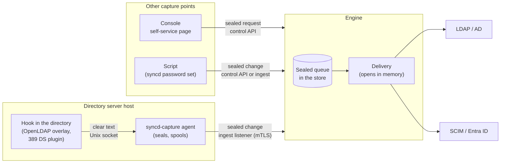

# Password synchronisation

When a person's password changes somewhere syncd can capture it, syncd delivers the new password
to that person's accounts in the target directories, usually within seconds. The password is
sealed where it is captured and opened only in the engine's memory, to be written to the target.
It is never written to disk, logs, history, the console or a support bundle in the clear.

Password synchronisation is new in syncd 0.4.0, which built the engine's side: the sealed queue,
delivery to every kind of target, initial passwords on new accounts, a self-service page on the
console, and enrolment for capture agents. 0.4.1 added sealing of the engine's keys at rest,
metrics and alerts. **syncd 0.5.0** (commit `a9d17c6`, the version this page describes) adds the
**capture points** inside the directories, with a packaged capture agent (`syncd-capture`); agents
bound to the sources they speak for; rotation of the keys and a change of passphrase; queued
changes that survive an HA failover; and a refusal to send passwords to a directory in clear text.

!!! warning "Not yet for production capture from Active Directory"
    The OpenLDAP overlay and the 389 Directory Server plugin were built and run end to end. The
    **Windows password filter is compile-checked only**: it has never been loaded by LSASS or run
    on a domain controller. The threat model is a **draft, not signed off**, and **no
    penetration test** has been done; the plan makes both release gates for password
    synchronisation. See [Known limitations](#known-limitations).

Password synchronisation is in the **Password Sync** license pack (capture agents, self-service,
delivery, initial passwords, key and CA rotation); see [Licensing](licensing.md#packs). During
the evaluation and its grace period nothing is locked, and a configuration that already runs keeps
running.

## What is built

| Piece | In 0.5.0 |
|---|---|
| Delivery of captured changes to targets (the sealed queue, routing, retries, ordering, echo suppression) | Built |
| Initial passwords: a password set as the account is created, read from the entity or generated | Built; from 0.5.0 a refused one is tried again, then held as a dead letter |
| The console's self-service page: people change their own password | Built |
| Capture agents: enrolment, the ingest listener with per-agent certificates, revocation | Built; from 0.5.0 each agent is bound to its sources, and renews its own certificate |
| `syncd password set`: submit one change from a script, as an operator or as an enrolled agent | Built |
| The `syncd-capture` agent and its package (`.deb`, `.rpm`), for the directory servers' hosts | Built in 0.5.0; never started under systemd in tests |
| The OpenLDAP overlay (`syncd_capture`) | Built in 0.5.0, shipped as source; tested end to end with slapd 2.6.10 on Ubuntu 24.04 |
| The 389 Directory Server plugin (`syncd-capture`) | Built in 0.5.0, shipped as source; tested end to end with 389-ds-base 2.4.5 on Ubuntu 24.04 |
| The Windows password filter (an LSA filter DLL), the agent as a service, and its installer | **Written and compile-checked only**: never run on a domain controller, not built with MSVC or WiX, not signed, not in the release |
| The keys sealed at rest with a passphrase | Built in 0.4.1; from 0.5.0 the passphrase can be changed (`rekey`) and wrapped by a KMS key |
| Rotation of the password key and of the agent CA | Built in 0.5.0, by command; nothing rotates on a schedule |
| Queued changes followed by the passive engine of an HA pair, and the ingest listener on both engines | Built in 0.5.0 |
| Password metrics and alert rules; per-publication counts on the console's engine page | Built in 0.4.1; key and certificate metrics and alerts added in 0.5.0 |
| A permission of its own for setting passwords through the control API | Built in 0.5.0 in the engine (`api.access.passwords`, strict mode only); the console has none |
| A console page for agents | **Not built**: agents are managed with the command line |
| The threat model sign-off and the third-party penetration test that the plan sets as release gates | **Not done**: the threat model is a draft |

So in 0.5.0 a password reaches syncd in one of four ways: a person changes it in OpenLDAP or 389
DS where a capture point is installed, a person changes it on the console's self-service page, a
publication creates an account with an initial password, or a script submits it with `syncd
password set`. A password changed directly in Active Directory is not captured in production
yet.

Cloud identity providers (Entra ID, Okta, SaaS applications) never reveal a plaintext password, so
they can't be capture sources. Their users change their password on the self-service page instead.

### Targets that take passwords

| Target | How the password is written |
|---|---|
| LDAP (OpenLDAP, 389 DS, others) | The Password Modify extended operation (RFC 3062), so the directory hashes it under its own policy (`write: password_modify`, the default), or a replace of `userPassword` (`write: replace`). From 0.5.0, over LDAPS or StartTLS unless the directory is on the engine's own host or `passwords.allow_cleartext` is set (see [Clear text is refused](#clear-text-is-refused)) |
| Active Directory | `unicodePwd`, over LDAPS or StartTLS only, whatever `allow_cleartext` says. A plain `ldap://` connection without `starttls` is refused when the configuration is validated. From 0.5.0 `connection.ca_file` names a private CA (a domain's own) |
| SCIM 2.0 | The resource's `password` attribute. The provider must advertise `changePassword` support: the engine refuses to connect to a SCIM target that doesn't when a publication has a `passwords` block for it |
| Entra ID | The user's `passwordProfile`. Users that Entra Connect syncs from on-premises AD are refused: their password belongs to AD |

A CSV connector is a source only. See [Connectors](connectors.md) for each connector.

## How a change travels



1. **Sealed where it is captured.** In a directory, the hook sees the new password in the
   directory server's own process, waits for the server to accept the change (a password its
   policy refuses never leaves it), and hands the password, the entry's DN and anchor, and the DN
   that made the change to the `syncd-capture` agent on the same host. The capture point (the
   agent, the console, or `syncd password set`) builds the change: the source connector, the
   object type, the account's anchor in that source, a sequence number, the capture time and the
   password. It seals it with HPKE (RFC 9180, base mode: DHKEM(P-256, HKDF-SHA256), HKDF-SHA256,
   AES-256-GCM) to the engine's public password key, with the key's id as additional data. A
   capture point can seal; it can never open. The agent spools the sealed change before it
   answers the hook, and keeps it until the engine has it.
2. **Submitted.** The sealed change goes to the engine: over the ingest listener with an agent's
   certificate, or over the control API (`SubmitPasswords`), which needs the `operate` tier and,
   in strict access mode from 0.5.0, a certificate listed under `api.access.passwords` (or the
   control socket). From 0.5.0 the engine opens a change an agent submits, in memory, and refuses
   one for a source the agent is not bound to. A change sealed to a key the engine no longer has
   is refused, and the capture point fetches the key again. A busy engine (a full sync running)
   does not hold submissions up.
3. **Queued.** Accepted changes are stored as they came, still sealed, in the engine's store, from
   0.5.0 with who submitted each (`syncd password queue`). The queue survives a restart and, from
   0.5.0, a failover of an HA pair.
4. **Routed.** The delivery loop runs at once and then every 30 seconds while anything waits. It
   opens each change in memory and finds the account: the source record by its anchor, the
   record's entity, each publication whose `passwords.from` names that source, and the DN the
   entity has in that publication's target.
5. **Ordered.** Per account, only the newest change is delivered. Older ones still queued, and
   any no newer than the last one delivered, are dropped.
6. **Delivered.** The password is written to each target, and the plaintext is zeroised.
7. **Echo dropped.** A change captured in a directory just after syncd wrote the same password
   there is syncd's own write coming back, and is dropped. The agent drops what syncd's own
   account in the directory set (`ignore_actor`); where the hook cannot say who made a change,
   the engine keeps a keyed hash of each password it delivered for 10 minutes, with a key that is
   random for each run of the engine, and drops a capture that matches.

A change for an account that is not provisioned or exported yet, or for a target that is
unreachable or busy, waits in the queue, sealed, for up to `passwords.ttl_secs` (24 hours by
default). Then it is dropped and counted as failed. This covers a password that arrives before
the account exists. A change delivered to one target and still waiting for another remembers
where it went.

## Configuration

Password delivery is on when at least one publication has a `passwords` block.
[Configuration](configuration.md) lists every key; this section explains them.

### The engine's `passwords` block

```yaml
passwords:                              # optional; these are the defaults
  key_file: /var/lib/syncd/engine/password.key   # default: password.key in the data directory
  ttl_secs: 86400                       # how long a change may wait to be delivered
  rotation_overlap_days: 7              # from 0.5.0: how long a rotated key or CA stays usable
  allow_cleartext: false                # from 0.5.0: see "Clear text is refused"
  ingest:                               # capture agents; off unless set
    listen: 0.0.0.0:7445
    names: [syncd.example.com]          # what agents reach the listener by
    agent_cert_days: 365
  self_service:                         # the console's self-service page; off unless set
    source: corp_ad
    object: user
    login: sAMAccountName
    min_length: 12
    min_classes: 3
```

| Key | Default | Meaning |
|---|---|---|
| `key_file` | `password.key` in the data directory | The engine's password key. Created on first start, mode 0600. Sealed with a passphrase when `SYNCD_PASSWORD_KEY_PASSPHRASE_FILE` is set (see [Sealing the keys](#sealing-the-keys)) |
| `ttl_secs` | `86400` | How long a change may wait, sealed, for its account or its target. At least 1 |
| `rotation_overlap_days` | `7` | From 0.5.0: how long a rotated password key keeps opening what was sealed to it, and a rotated agent CA stays trusted, before the engine retires it (see [Key lifecycle](#key-lifecycle)) |
| `allow_cleartext` | `false` | From 0.5.0: accept LDAP directories on other hosts reached without TLS as password targets and as the self-service source, for the whole engine, with a warning (see [Clear text is refused](#clear-text-is-refused)) |
| `ingest.listen` | none | `host:port` of the [capture agents' listener](#capture-agents). Needs at least one publication with `passwords` |
| `ingest.names` | none | The host names and addresses agents use. The listener's certificate is issued for these. At least one |
| `ingest.agent_cert_days` | `365` | How long an agent's certificate is valid. From 0.5.0 `syncd-capture` renews it in the last third of that on its own; one that expired must enrol again |
| `self_service.source` | none | The LDAP or Active Directory source people sign in to. A publication must take passwords `from` it |
| `self_service.object` | none | The source's object type whose entries are the people |
| `self_service.login` | none | The attribute people type as their user name (`uid`, `sAMAccountName`, `mail`) |
| `self_service.min_length` | `12` | The shortest new password. At least 8 |
| `self_service.min_classes` | `3` | How many of lower case, upper case, digits and other characters a new password must mix. At most 4 |

### A publication's `passwords` block

```yaml
publications:
  - name: people_to_ad
    view: people
    target: corp_ad_target
    attributes:
      userAccountControl: '"512"'       # enabled once the password is set
    passwords:
      from: [corp_ldap]                 # sources whose captured changes this target receives
      write: password_modify            # or replace; ignored by AD, SCIM and Entra ID
      initial:                          # optional: the password a new entry is created with
        generate: { length: 16, classes: 4 }   # or: from: e.initialPassword
        must_change: true               # Active Directory only: pwdLastSet 0
```

| Key | Default | Meaning |
|---|---|---|
| `from` | `[]` | Connectors of the publication's view whose captured changes are authoritative for this target. May be empty when only `initial` is wanted |
| `write` | `password_modify` | How a directory other than Active Directory takes the password: `password_modify` (RFC 3062) or `replace` (`userPassword`) |
| `initial.from` | none | CEL over `e`, the entity, giving the initial password as a string |
| `initial.generate.length` | `16` | Length of a generated password, 8 to 256 |
| `initial.generate.classes` | `4` | How many of lower case, upper case, digits and other characters it holds at least one of, 1 to 4 |
| `initial.must_change` | `false` | Active Directory only: the person must change the password at the next logon |

Validation refuses:

- a `passwords` block with neither `from` nor `initial`;
- a `from` connector that is not a source of the publication's view, or that is the publication's
  own target (the password would go back where it was captured);
- `initial` with both `from` and `generate`, or neither;
- `must_change` on a target that is not Active Directory;
- `passwords` on an Active Directory target reached over `ldap://` without `starttls`. Before
  0.4.0 this failed only when a password was written;
- from 0.5.0, `passwords` or `initial` on any LDAP target, or a self-service source, on another
  host reached over `ldap://` without `starttls`, unless `passwords.allow_cleartext` is set.

### Clear text is refused

From 0.5.0 a configuration that delivers passwords, initial passwords or self-service changes to
an LDAP directory on another host over `ldap://` without `starttls` **no longer validates**, and
the engine does not start with it. Use `ldaps://` or `starttls: true` (with `connection.ca_file`
for a private CA), or accept it for the whole engine:

```yaml
passwords:
  allow_cleartext: true
```

The engine then warns at every start, and `syncd status` says `passwords: WARNING: sent in the
CLEAR to <directories>`. A directory on the engine's own host (a loopback address, `ldapi://`) is
not considered in the clear. Active Directory never takes passwords without TLS, whatever this
says. The check is on the configured URLs: a TLS-terminating proxy in between, or a server that
accepts StartTLS but was not asked for it, is outside it. **Upgrading from 0.4.1:** check with
`syncd validate` and the new binary before the upgrade.

## Initial passwords

A publication with `passwords.initial` gives each entry it **creates** a password. The value is
either read from the entity or generated:

- **`from`** is an expression over the entity, usually an attribute that a source column flows
  into (`initialPassword: source.initial_pw`). An entity with no value, or an empty one, is
  created without a password, and that is not a rule error. The value is an attribute like any
  other and the engine keeps it in its store, so list it in `attributes.sensitive` to keep it out
  of previews, the explorer and the console.
- **`generate`** makes a different random password for each entry, from the system's random
  generator, with at least one character of each of the first `classes` of lower case, upper
  case, digits and other characters. `classes: 3` gives an alphanumeric password that is safe in
  a shell or an LDIF file. Generated passwords never contain quotes, backslashes or spaces.

The password is planned with the add, held in memory only, and set right after a **fresh** add.
An entry that was already there (adopted, converged, replayed after a crash) keeps the password
it has. On each kind of target:

- **Active Directory.** AD refuses an enabled account without a password, so the entry is added
  disabled: the exported `userAccountControl` with `ACCOUNTDISABLE` set, or 514 when none is
  exported. Then `unicodePwd` is set, then `pwdLastSet` is set to 0 when `must_change` is on,
  then `userAccountControl` is set to the exported value. An account exported as enabled becomes
  enabled only at this last step; one exported disabled stays disabled.
- **Other LDAP directories.** Password Modify, or a `userPassword` replace, right after the add.
- **SCIM.** The password goes into the `POST` that creates the user.
- **Entra ID.** The password goes into the new user's `passwordProfile`. Graph needs a password
  for every new user, so without `initial` syncd sets a random one that nobody keeps, with
  `forceChangePasswordNextSignIn`.

If a publication also sets `account_control.must_change_password` (the Active Directory
conveniences in [Connectors](connectors.md)), that rule manages `pwdLastSet` on every pass, not
only at creation.

**A refused password** (the directory's password policy, for example) does not fail the export.
The entry stays, without a password, and on Active Directory disabled. The refusal is counted as
an initial password refused, logged with the DN and the publication, and shown as the last
failure. From 0.5.0, on LDAP and Active Directory targets, it is **tried again**: the entity's
next plan carries the password again (a new one for `generate`, the entity's current value for
`from`), at its next change, the next reconciliation, or a timer the refusal arms (60 seconds
times the refusals so far). After the **third refusal** the entry is put in the **dead-letter
queue** (`the initial password was refused 3 times, ...`), where `syncd dlq`, the console, the
dead-letter metric and the `SyncdDeadLetters` alert show it; `syncd retry` (or the console's
**Retry**) makes one more attempt. In 0.4.1 a refusal was only logged. Entries refused before the
upgrade are not retried. The number of attempts and the delay are fixed. On SCIM and Entra ID the
password goes with the create, so a refused one fails the create as a dead letter, as before. A
lost connection fails the export like any other operation; its retry finds the entry there and
converges it without a password, and the log says so.

**An entry a drift check adds back** (`revert`) gets an initial password from 0.5.0, as a new
entry does; in 0.4.1 it was re-added without one. An entry found elsewhere by its id and put
back, or adopted, keeps its own.

**A captured change replaces it.** Captured changes need the entry's export record, which is
written after the add, so whatever a capture point sends for the account, before or after the
creation, is delivered after the initial password. A directory that is also a capture source sees
the initial password like any other change made there and delivers it onward to the publications
that take passwords from it. That is intended: the initial password reaches every account of the
person.

**With change safety:**

- An initial password rides with its add. A change window, an add threshold or a canary that
  holds the add holds the password with it. Captured changes are never held by a change window.
- A publication in report mode (`mode: report`) writes nothing: no initial password is made, and
  captured changes for it are dropped and counted (`dropped` in the status API).

See [Change safety and lifecycle](change-safety.md).

Telling the person their initial password (an e-mail, a printed letter) is out of scope. The log
and the status say that a password was set, never what it is.

## People changing their own password

The console has a public page, `/password`, where a person changes their own password without a
console account. They change it in the directory they sign in to, and syncd delivers it from
there to their other accounts like any captured change. It needs no agent.

### Turning it on

1. On the engine, add `passwords.self_service` (above) naming the LDAP or Active Directory source
   people sign in to, and give at least one publication `passwords: { from: [<that source>] }`.
   From 0.5.0 that source must be reached over TLS unless it is on the engine's host or
   `passwords.allow_cleartext` is set: the person's current and new passwords cross that
   connection.
2. On the console, set `CONSOLE_SELF_SERVICE_ENGINE` to the name of the registered engine (for an
   HA pair, either member: see [High availability](#high-availability)). Without it, the page says
   password changes are not available.

### What happens

1. **On the page** the person gives their user name, their current password and the new one
   twice. The console checks only the rate, per client address, with the same limiter as
   sign-in.
2. **The console seals the request** (user name, current and new password) to the engine's
   password key, with a different HPKE context from captured changes, so neither can be taken for
   the other. It hands the request to the engine over the control API and keeps nothing of it.
3. **The engine checks the policy:** the length, the character classes, not the current
   password, and not containing the user name. A refusal says what is missing.
4. **It proves the current password.** It finds the person's entry by the login attribute, with
   the source connection's own account, then binds as the person. An empty password is refused,
   never sent as an anonymous bind. No such person, several matches and a wrong password all get
   the same answer: "wrong user name or password".
5. **It changes the password there, as the person**, so the directory's own rules apply (its
   policy, history and minimum age). On OpenLDAP and 389 DS this is Password Modify with the old
   and new password. On Active Directory it is a `unicodePwd` delete of the old value and add of
   the new, over LDAPS or StartTLS only.
6. **It delivers it.** The new password is queued, sealed, for every publication that takes
   passwords from that source, and goes out at once.
7. **Repeated failures hold a user name off.** After 5 failures in 15 minutes the user name is
   refused for the rest of that time, whatever the password, on top of the console's per-address
   limit.

| Answer on the page | HTTP status (`POST /api/v1/self-service/password`) | Why |
|---|---|---|
| Your password was changed | `200` | Changed in the source and queued for the targets |
| The policy's reason, or the directory's | `400` | The new password does not meet the engine's policy, or the directory refused it |
| Wrong user name or password | `401` | No such person, several, or a wrong current password |
| Not available | `404` | `CONSOLE_SELF_SERVICE_ENGINE` is not set |
| Too many attempts | `429` | The address's rate limit, or the user name is held off |
| Try again later | `503` | The engine or the directory can't be reached |

The console's audit trail records each attempt as `password.self_service`, with the user name,
the client address and the outcome (changed, wrong credentials, refused by the policy, rate
limited). No password is ever in it.

From the command line, `syncd password change --login <name>` does the same through the control
API. It reads the current password and then the new one, one line each, from standard input.

The page's hint under **New password** gives the engine's policy, read from the engine's status
(`min_length` and `min_classes`, for example "At least 14 characters, mixing three of lower case,
upper case, digits and symbols; not your user name."). The console asks the engine at most once a
minute, and shows the defaults (12 characters, 3 classes) when it can't reach it. Before 0.4.1 the
hint always gave the defaults.

## Capturing changes in the directories

From 0.5.0 a password changed in a directory reaches syncd through a **capture point**: a hook
inside the directory server, and the `syncd-capture` agent beside it on the same host. Installing the agent's package is in the [Install guide](install.md#the-capture-agents-package).

| Directory | Hook | State in 0.5.0 |
|---|---|---|
| OpenLDAP | The `syncd_capture` overlay | Tested end to end with slapd 2.6.10 on Ubuntu 24.04 (Add, Modify and Password Modify, echo suppression both ways, refusals not captured, the agent away or required, the engine away, a revoked agent, another user refused on the socket, no password in any log or file) |
| 389 Directory Server | The `syncd-capture` plugin | The same, with 389-ds-base 2.4.5 on Ubuntu 24.04 |
| Active Directory | An LSA password filter (`syncd-pwfilter.dll`), the agent as a Windows service, and an MSI | **Compile-checked only. Do not install it in production**: never loaded by LSASS, never run on a domain controller (with or without LSA protection), never built with MSVC or WiX, no Authenticode signature. A fault in a password filter is a domain controller outage. Nothing for Windows is in the packages or the release: it is source only |

- **The hook** does nothing but hand the change over: no network, no cryptography, no files, and
  no password in any log. It waits for the agent at most its timeout (one second by default); an
  agent that is down or slow costs a line in the directory server's log and that one change is
  not synchronised, while the change itself stands. A site that would rather refuse password
  changes than miss one turns `require-agent` on: the hook then refuses the change when the agent
  does not answer, so an agent outage stops password changes in that directory.
- **The agent** checks which user's process is on its socket, seals the change to the engine's
  key, writes it to its spool, and only then tells the hook it has it. A sender takes the spool to
  the engine over mutual TLS with the agent's own certificate. The DN that made the change is used
  to drop syncd's own writes (`ignore_actor`) and stays in the agent's log; it is not sent on.
- **The hooks ship as source.** The OpenLDAP overlay must be built against the source of the very
  slapd it is loaded into, the 389 plugin against the installed server's headers, and both again
  when the directory server is upgraded: that needs a C compiler and `make` on the host, or one
  with the same packages. The OpenLDAP overlay depends on slapd's internal structure layout: its
  version check catches another version, not another build of the same version.
- **Missed captures** show only in the directory server's log: the engine never hears of them.

### Setting one up

1. **On the engine**: turn the ingest listener on (`passwords.ingest`), let a publication take
   passwords `from` the directory's connector, open the ingest port (7445) to the directory
   servers only, and add the agent, bound to that connector:

    ```sh
    sudo syncd password agent add ldap01 --source corp_ldap --ca-out agent-ca.crt
    ```

    This prints a one-time enrolment token, good for an hour.

2. **On the directory server**: install the agent's own package, `syncd-capture` (from the same
   apt and dnf repositories as `syncd`, or the release page; the bundle holds the same files),
   enrol as the agent's account, edit its settings, and start it:

    ```sh
    sudo apt install syncd-capture          # or: sudo dnf install syncd-capture
    sudo -u syncd-capture syncd-capture enroll --ingest syncd.example.com:7445 --name ldap01 \
        --token-file token --ca agent-ca.crt --dir /var/lib/syncd-capture
    sudoedit /etc/syncd-capture/capture.conf      # source, object, allow_user, ignore_actor
    sudo systemctl enable --now syncd-capture
    ```

    The package installs `/usr/bin/syncd-capture`, `/etc/syncd-capture/capture.conf` (kept across
    upgrades), a systemd unit it does not start, a `syncd-capture` account with
    `/var/lib/syncd-capture` (mode 0700: the enrolment and the spool), and the hooks' source and
    README under `/usr/share/syncd-capture`. `source` in `capture.conf` must be the connector the
    agent was added for.

3. **Build and install the hook** from `/usr/share/syncd-capture/openldap/` or `.../389ds/`, as its
   README there says.

Then change a test account's password: `syncd password agent list` on the engine shows what each
agent is bound to, what it submitted and what was refused; `syncd password queue` shows what
waits; `syncd-capture status` on the directory server shows what the agent still holds.

The packaged unit has never started the agent under systemd in the tests (the package test only
has `systemd-analyze verify` read it), and there is no SELinux or AppArmor policy for the agent's
socket.

## Capture agents

A capture agent is a program on another host that submits password changes: from 0.5.0 the
`syncd-capture` agent beside a directory, or a script using `syncd password set --agent-dir`.
Agents have identities of their own and a listener of their own, so they never need control
access to the engine.

### The agent CA

On first start with `passwords.ingest`, the engine creates its **agent CA** beside the password
key: a P-256 key (`password-agent-ca.key`, mode 0600) and a ten-year certificate
(`password-agent-ca.crt`). It issues each agent's client certificate, and at every start the
ingest listener's own server certificate for `ingest.names`. An agent needs nothing but this CA's
certificate to trust the listener, whatever PKI the rest of the deployment uses. From 0.5.0 it can
be rotated (see [Key lifecycle](#key-lifecycle)).

### Enrolling an agent

1. **An operator adds the agent** on the engine's host:

    ```sh
    syncd password agent add dc01 --source corp_ad --ca-out agent-ca.crt
    ```

    This prints a one-time enrolment token, good for an hour, and the listener's address, and
    writes the agent CA's certificate to the file. The engine keeps only the token's SHA-256.
    From 0.5.0 a new agent needs `--source <connector>` (repeat it for an agent that serves
    several): the engine takes its changes for those sources only. Adding an agent that exists
    gives it a new token, so that it can enrol again, and keeps what it is bound to unless
    `--source` is given. In strict access mode this needs `api.access.passwords`, or the control
    socket (`sudo` on the engine's host).

2. **The agent enrols** from its own host, with no engine configuration: `syncd-capture enroll`
   (above), or for a script:

    ```sh
    syncd password agent enroll --ingest syncd.example.com:7445 --name dc01 \
      --token <token> --ca agent-ca.crt --dir /etc/syncd-agent
    ```

    The agent makes its own key, which never leaves the host (`agent.key`, mode 0600), and sends a
    signing request with the token. The token can also come from `SYNCD_AGENT_TOKEN`. The engine
    compares the token in constant time, issues a certificate for client authentication only whose
    subject is the agent's name whatever the request asked, and records its fingerprint. The token
    is spent, and any certificate from an earlier enrolment of the same agent stops working. The
    directory then holds `agent.key`, `agent.crt`, `ca.crt` and `agent.conf`.

3. **The agent submits** with its certificate: it fetches the public key, then submits changes
   sealed to it. From a script:

    ```sh
    syncd password set --agent-dir /etc/syncd-agent \
      --source corp_ldap --object person --anchor 6f1d0c2e-0001-4000-8000-000000000001 < new-password
    ```

On the ingest listener a client certificate is asked for but not required, so enrolling works
without one. Every other call needs the certificate of an enrolled agent that is not revoked. The
TLS handshake already refuses a certificate the agent CA did not issue.

### Binding agents to sources

From 0.5.0 **an agent speaks for its own directory only.** The engine opens each change an agent
submits, in memory, and refuses one that names a source the agent is not bound to: it is never
queued, the agent is told and drops it, and the refusal is logged (`refused password changes for a
source the agent is not bound to`) and counted (`syncd password agent list`, `syncd status`,
`syncd_password_changes_refused_total`). So the key of an agent on one directory server cannot set
passwords in another directory's accounts.

**An agent enrolled before 0.5.0 is bound to no source** and keeps working as before: it may submit
for any source. The engine warns at every start, `syncd status` says `password agents: WARNING:
<names> bound to no source`, `syncd password agent list` marks each `NOT BOUND`, and
`syncd_password_agents_unbound` counts them. Bind each without enrolling it again:

```sh
sudo syncd password agent bind dc01 --source corp_ad
```

Such agents are also told to renew their certificate at their first exchange; `syncd-capture`
does it on its own.

What binding does not narrow: an agent, or whoever administers its directory, can still set the
password of any account of its own source that is joined to an entity. Keep privileged accounts
out of publications that take passwords from a less protected directory.

### Revoking and listing agents

`syncd password agent revoke dc01` refuses the agent's certificate at once. The check is against
the fingerprint the engine recorded, not a revocation list. A revoked name can't get a new token;
a replacement agent takes another name.

`syncd password agent list` shows each agent: what it is bound to, enrolled (and when), revoked,
waiting to enrol, or not enrolled because its token expired; when it was last seen; how many
changes it submitted and how many were refused; and its certificate (from the previous agent CA,
while it has not renewed after a rotation).

## Key lifecycle

From 0.5.0 the keys behind password synchronisation can be changed without enrolling agents again
or losing what is queued. The commands run on the engine's host with `sudo` (through the control
socket; over mTLS in strict mode they need `api.access.passwords`). `syncd status` shows `password
key: <id>, made ... ago`, `password agent CA: expires in ...` and the next agent certificate to
expire. The operator's procedure is in the [Operator guide](operator-guide.md#changing-the-passphrase-and-rotating-the-keys).

| Command | What it does |
|---|---|
| `syncd password rekey --passphrase-file FILE` | Changes the passphrase the key files are sealed with; the keys stay the same. It keeps the current passphrase as `<passphrase file>.previous`, which the engine still accepts, so an interruption leaves an engine that starts and running it again finishes. Run it with the same new passphrase on the other engine of an HA pair, right away; once every engine has started or received a snapshot since, `rekey --forget-previous` on each host removes the previous file. With the passphrase in `SYNCD_PASSWORD_KEY_PASSPHRASE` (the value), change the variable yourself and restart. On Kubernetes, `engine.passwordKeyPassphrase.previousKey` names the old passphrase in the Secret during the change |
| `syncd password rotate-key` | Makes a new password key. Capture points seal to it as they learn of it (`syncd-capture` with its next submission or within the hour; the self-service page and `syncd password set` with their next request). The old key keeps opening what was sealed to it, and is retired once `rotation_overlap_days` have passed and nothing queued needs it. `--retire` retires it now (it refuses while queued changes need it, unless `--force`, which loses them) |
| `syncd password rotate-agent-ca` | Makes a new agent CA. The previous one stays trusted, and keeps signing the listener's certificate, for the overlap; agents are told to renew with their next exchange and do so with the certificate they hold. `--retire` retires the previous CA now: an agent that did not renew must enrol again |
| `syncd password agent renew --dir DIR` | On an agent's host: a new certificate for an agent enrolled with `syncd password agent enroll`, which does not renew on its own |

- **Choose the overlap** longer than a change can wait: an agent's `spool_ttl_secs` plus
  `passwords.ttl_secs`. After a key's retirement nothing sealed to it opens any more, anywhere: an
  agent's spool still holding such changes drops them.
- **Backups and HA snapshots** carry every key that is live when they are taken. A backup from
  before a rotation restores the old key as the current one; agents fetch it again on their own.
- **Nothing rotates on a schedule**, and a renewal keeps the agent's key. `SyncdPasswordKeyOld`
  fires when the password key is a year old, and `SyncdPasswordAgentCertExpiring` 14 days before an
  agent's certificate expires (that agent is down, cannot reach the engine, or does not renew on
  its own).
- **Rolling back to 0.4.1** after a rotation loses the previous keys and the previous agent CA,
  which 0.4.1 ignores: rotate nothing before you are sure of the upgrade.

## The `syncd password` commands

| Command | Where it runs | What it does |
|---|---|---|
| `syncd password set --source S --object O --anchor A [--sequence N]` | The engine's host (control access; in strict mode `api.access.passwords` or the control socket) | Reads one password from standard input, seals it here and submits it through the control API. `--sequence` defaults to the current time in microseconds; a later change for the same account needs a larger one |
| `syncd password set --agent-dir DIR --source S --object O --anchor A` | An enrolled agent's host | The same, as that agent, to its ingest listener |
| `syncd password change --login NAME` | The engine's host (control access) | A self-service change: the current and the new password from standard input |
| `syncd password queue [--limit N]` | The engine's host (control access) | From 0.5.0: the changes waiting for delivery, oldest first: when each arrived, who submitted it, the publications it reached already. Never a password |
| `syncd password agent add NAME --source CONNECTOR [--ca-out FILE]` | The engine's host (as `set`) | A one-time enrolment token for a new agent, or a new one for an agent to enrol again |
| `syncd password agent bind NAME --source CONNECTOR` | The engine's host (as `set`) | From 0.5.0: set the sources an agent may submit for, without enrolling it again |
| `syncd password agent enroll --ingest HOST:PORT --name NAME --token T --ca FILE --dir DIR` | The agent's host | Enrols: makes the agent's key and gets its certificate. Needs no engine configuration |
| `syncd password agent renew --dir DIR` | The agent's host | From 0.5.0: a new certificate with the current one, before it expires or after a CA rotation |
| `syncd password agent list` | The engine's host (control access) | The agents and their state |
| `syncd password agent revoke NAME` | The engine's host (control access) | Refuses the agent's certificate from now on |
| `syncd password rekey`, `rotate-key`, `rotate-agent-ca` | The engine's host | From 0.5.0: see [Key lifecycle](#key-lifecycle) |
| `syncd secrets wrap --kms KEY --out FILE` | The engine's host | From 0.5.0: wrap the passphrase with a KMS key (see [Sealing the keys](#sealing-the-keys)) |

Commands that use the control API take the usual `--api`, `--api-ca`, `--api-cert` and `--api-key`
options; on the engine's host the control socket needs none. See
[Operator guide](operator-guide.md). The `syncd-capture` agent has commands of its own (`enroll`,
`status`, `ping`); see its README, installed as `/usr/share/syncd-capture/README.md`.

## Delivery outcomes

| Outcome | What happens | Counted as |
|---|---|---|
| Delivered | Written to the target | `delivered` |
| Waiting | The account is not provisioned or exported yet, or the target is unreachable or busy. Tried again every 30 seconds | `queued` (waiting) |
| Refused | The target refused it (its password policy, access rights, an Entra user synced from AD, a SCIM provider without `changePassword`). Reported and **not retried** | `failed` |
| Not bound | From 0.5.0: an agent submitted it for a source it is not bound to. Refused at the listener, never queued | `syncd_password_changes_refused_total`, and per agent in `syncd password agent list` |
| Expired | Waited longer than `ttl_secs` | `failed` |
| Unreadable | Sealed to a key the engine no longer has (a retired key, or a replaced key file) | `failed` |
| Superseded | A newer change for the same account came, or a newer one was delivered already | Not counted |
| Echo | syncd's own write coming back from a directory | Not counted |
| Dropped | The publication is in report mode | `dropped` |
| Initial password set or refused | See [Initial passwords](#initial-passwords); from 0.5.0 the third refusal is a dead letter | `initial_set`, `initial_failed` |

The counters run from the engine's start. None of these places carries any password material.

| Where | What it shows |
|---|---|
| `syncd status` | `passwords: N delivered, N failed, N waiting, N dropped (report mode); initial passwords: N set, N refused; last failure: ...` (the dropped, initial and last failure parts only when there are any), then `password keys: sealed with the passphrase` or `password keys: stored in the clear (...)`; from 0.5.0 also the current key and its age, the previous keys still opening, the agent CA's expiry, the next agent certificate to expire, agents bound to no source, and a warning when passwords go anywhere in clear text |
| The console's engine page | A **Passwords** card when the engine delivers passwords: a **keys sealed** or **password keys stored in the clear** badge; delivered, failed, dropped (report mode), waiting, initial passwords set and refused; a table of delivered, failed, dropped and waiting per publication; and the last failure |
| The status API | `passwords` in the engine's status (gRPC `EngineStatus.passwords`, and the console's REST status): the counters above, the last failure, the time of the last delivery, `keys_sealed`, and `publications` with each publication's `delivered`, `failed`, `dropped` and `waiting` |
| Metrics | `syncd_password_deliveries_total{publication,outcome}` with `outcome` `delivered`, `failed` or `dropped`, and `syncd_password_waiting{publication}` (as of the last delivery pass). A failure no publication can be named for (a change that does not open) has an empty `publication`. From 0.5.0 also `syncd_password_key_age_seconds`, `syncd_password_previous_keys`, `syncd_password_agent_ca_expiry_seconds`, `syncd_password_agent_cert_expiry_seconds`, `syncd_password_changes_refused_total` and `syncd_password_agents_unbound`. See [API reference](api-reference.md#prometheus-metrics) |
| Alerts | `SyncdPasswordDeliveryFailures` (a publication's failed count rose in 15 minutes) and `SyncdPasswordChangesDropped` (changes dropped in report mode in the last hour); from 0.5.0 `SyncdPasswordKeyOld` and `SyncdPasswordAgentCertExpiring`; in the shipped rule files and the chart's PrometheusRule. See [Operator guide](operator-guide.md#alert-rules) |
| The engine's log | Each delivery and failure, by source, object, anchor, publication and DN, and from 0.5.0 who submitted it (`submitted_by=`) |
| `syncd password queue` | From 0.5.0: what waits, when it arrived, who submitted it, and where it still has to go |
| Lineage and history | Each captured change's delivery to a publication, with its time and outcome (`delivered` or `refused`), and from 0.5.0 who submitted it, when entity history is kept (`engine.history.keep_days` above 0). `syncd lineage` and the entity page's **Lineage JSON** and **PDF** exports include them. Initial passwords are not in the history |
| Webhooks | `password.delivery-failed` when the failed count rises, with how many and the last failure. See [Webhooks](webhooks.md) |

syncd 0.4.0 had no password metrics or alert rules; 0.4.1 added them, and 0.5.0 the key and
certificate ones.

## High availability

On an active/passive pair, only the active engine delivers passwords. Every delivery checks the
lease first, like every export batch, so an engine that can't renew stops writing before the other
may take over. The passive engine doesn't answer self-service changes or password submissions
over the control API.

From 0.5.0:

- **Agents reach either engine.** With `passwords.ingest`, the passive engine listens on the ingest
  port too and hands every call (enrolment, renewal, submissions) to the active engine over the
  pair's own connection, with the fingerprint of the certificate the agent presented; the active
  engine checks the agent as its own listener would and queues. Give agents one address that
  reaches either host (a DNS name with both addresses, a load balancer, a virtual address), and
  list it in `ingest.names` on both. The passive engine's listener starts once it has received its
  first snapshot. While neither engine holds the lease, agents are answered `unavailable` and keep
  their changes in their spools.
- **In strict access mode**, the active engine takes forwarded calls only from a certificate listed
  under `api.access.passwords`: list the one the passive engine uses, on both hosts. By default that
  is `cli.crt`, which the `syncd` group can read; a certificate of the pair's own
  (`engine.ha.peer.cert_file`) keeps that power away from the group. Whoever may call
  `ForwardPasswordIngest` can act as any enrolled agent.
- **Queued changes survive a failover.** Between snapshots the passive engine follows the active
  engine's password queue write by write (`<data_dir>/ha/password-queue.replica`, sealed as the
  store keeps it). A submission is answered once the passive engine has the change, or after
  `engine.ha.password_replication_wait_ms` (2000) when it does not answer or is not there: the
  change is accepted either way, with a warning and a count in
  `syncd_ha_password_changes_unreplicated_total`. `syncd_ha_password_follower_connected` says
  whether queued changes have a second copy. The engine that takes over applies what it followed
  before it delivers anything; a change delivered just before the old engine was lost may be
  delivered once more (the same password, set twice).
- **Not covered**: an agent enrolled, or a key rotated, after the last snapshot is lost with the old
  active engine (the agent enrols again). Self-service through the followed queue, and a change of
  passphrase on a pair, were not run end to end. During an upgrade the queue is not followed until
  both engines run 0.5.0.

`CONSOLE_SELF_SERVICE_ENGINE` names one registered engine. Since 0.4.1, when that engine is one
of an HA pair, the console sends each self-service change to the member of the pair that holds
the lease, so the page keeps working after a failover. If the console can't tell which member is
active, it uses the named engine.

The snapshots the passive engine keeps carry every live password key and agent CA as they are on
disk (sealed, when a passphrase is set), so agents' certificates and changes sealed to the keys stay
good after a takeover. Both engines of a pair need the same passphrase. See
[Availability and sizing](availability-and-sizing.md).

### On Kubernetes

Since chart 0.4.1, `engine.passwordIngest` exposes the ingest listener:

```yaml
engine:
  passwordIngest:
    enabled: true
    port: 7445                # the port of passwords.ingest.listen
    service:
      type: LoadBalancer      # for agents outside the cluster (or NodePort); ClusterIP by default
      annotations: {}
networkPolicy:
  passwordIngestFrom:         # with networkPolicy.enabled: who may reach it; anywhere when empty
    - ipBlock: { cidr: 10.20.0.0/24 }
```

The engine's pods get an `ingest` port, and `<release>-syncd-engine-ingest` (`syncd-engine-ingest`
for a release named `syncd`) is a Service for it alone, so a load balancer for the agents exposes
neither the control API nor the metrics. The configuration the console publishes must listen on
the same port (`passwords.ingest.listen`) and name the address agents reach it by in
`ingest.names`. With `engine.ha.enabled`, the Service routes to both pods, and from 0.5.0 both
answer: the passive one hands each call to the active one, so agents need not know which pod
holds the lease. The image's initial configuration lists the engines' own certificate (`syncd
engine`) under `api.access.passwords` for that; a release that opted in to strict mode by hand
adds `passwords: [syncd engine]` beside `operate`. This path is tested with two engine processes
on one host, not on a cluster.

`engine.passwordKeyPassphrase.existingSecret` names a Secret holding the passphrase (under `key`,
default `passphrase`); the chart mounts it read-only and sets `SYNCD_PASSWORD_KEY_PASSPHRASE_FILE`.
Both engines of an HA pair use the same Secret. To change the passphrase, from chart 0.5.0, put
the new one in the Secret and name the old one's key in
`engine.passwordKeyPassphrase.previousKey`: the engine opens a key file the new passphrase does
not open with the old one and seals it again; remove `previousKey` once every engine pod has
started since. The chart has no values for `SYNCD_PASSWORD_KEY_PASSPHRASE_KMS`, and none of the
chart's 0.5.0 changes has been installed on a cluster yet.

The self-service page needs nothing more, since the console reaches the engine over the control
API.

## Security properties

- **Encryption.** HPKE (RFC 9180) with DHKEM(P-256, HKDF-SHA256), HKDF-SHA256 and AES-256-GCM,
  built on aws-lc-rs, so the FIPS build uses the validated module. See
  [FIPS and STIG](fips-and-stig.md).
- **Capture points can't decrypt.** They hold only the public key. The engine's private keys are
  in `key_file` (and, after a rotation, `password.key.<id>` beside it), mode 0600, readable by the
  engine's user only, and sealed with a passphrase when one is set. HPKE is used in base mode with
  a static key: there is no forward secrecy per change, so a stolen key opens every copied change
  sealed to it until it is retired.
- **The hooks hand over clear text on the host only**, over a Unix socket whose peers the agent
  checks (`allow_user`); the agent seals before it spools. The hooks do not authenticate the agent
  beyond the socket's path.
- **The queue holds only sealed changes.** A change is opened in memory for delivery and the
  plaintext is zeroised afterwards. Plans holding an initial password show it as `<redacted>`.
- **No password material** in logs, the status, history, lineage, dead letters, webhooks, the
  audit trail or support bundles. A target's refusal message is logged and shown as the last
  failure; the history records only the outcome, because a policy message may echo part of the
  password. The end-to-end tests check that no password appears in the engine's log or store
  files, or the console's log and audit trail.
- **Ordering** by a sequence per account, so an older change never overwrites a newer one.
- **Ordering depends on the capture hosts' clocks**: a change's sequence is the agent host's time
  in microseconds, so a host whose clock is ahead can make a later change from another host look
  older, and a compromised agent can block later changes for an account with a far-future
  sequence. There is no command that clears a stored sequence.
- **Echo suppression** by the account syncd writes with (`ignore_actor`), and by a keyed hash whose
  key is random for each run of the engine.
- **Agents** enrol with a one-time token (one hour, kept as a hash, compared in constant time),
  get a client-only certificate named by the operator, are bound to the sources they speak for
  (from 0.5.0), and can be revoked one by one. Their keys never leave their hosts. There is no
  per-agent rate limit.
- **Setting passwords is a permission of its own** on the control API in strict mode (from 0.5.0):
  `api.access.passwords`, or the control socket. In compatible mode any control certificate can.
- **No clear text to directories** on other hosts unless `passwords.allow_cleartext` says so (from
  0.5.0).
- **Who submitted each change** is recorded with it (from 0.5.0), not who made it in the source
  directory: that DN stays in the agent's log.
- **Self-service** proves the current password against the directory, changes it as the person,
  holds a user name off after repeated failures, and gives the same answer for an unknown user and
  a wrong password.

Protect these files like the master key:

| File | In the data directory | Also in |
|---|---|---|
| The password key | `password.key` (or `key_file`); from 0.5.0, after a rotation, the previous keys as `password.key.<id>` until they are retired | Backups and HA snapshots |
| The agent CA key and certificate | `password-agent-ca.key`, `password-agent-ca.crt`; during a rotation, the previous CA's too | Backups and HA snapshots |

Anyone with the password key can open queued changes; anyone with the agent CA key can issue agent
certificates. Neither is protected by the console's master key.

### Sealing the keys

Since 0.4.1 the engine seals both key files with a passphrase when
`SYNCD_PASSWORD_KEY_PASSPHRASE_FILE` names a file holding one. (The 0.4.0 documentation said
these files were already encrypted; they were not.) The passphrase derives an AES-256-GCM key
with PBKDF2-HMAC-SHA256 (600,000 iterations, a random salt each time the file is written), both
FIPS-approved, through aws-lc-rs. The certificate (`password-agent-ca.crt`) is not secret and is
not sealed.

1. Write a long random passphrase to a file only the engine's user can read, outside `/etc/syncd`
   and the engine's data directory, and keep a copy with your other recovery secrets: a restore
   needs it. From 0.5.0 `syncdctl backup --to` leaves a passphrase file it finds inside
   `/etc/syncd` out of the archive, with a warning (0.4.1 archived it with the sealed keys it
   opens), so a restore then needs it from where you keep it.

    ```sh
    sudo install -d -m 0750 -o root -g syncd /etc/syncd-keys
    head -c 32 /dev/urandom | base64 | sudo tee /etc/syncd-keys/password-key.passphrase >/dev/null
    sudo chown root:syncd /etc/syncd-keys/password-key.passphrase
    sudo chmod 0640 /etc/syncd-keys/password-key.passphrase
    ```

2. Set `SYNCD_PASSWORD_KEY_PASSPHRASE_FILE=/etc/syncd-keys/password-key.passphrase` in
   `/etc/syncd/engine.env` (on Kubernetes, `engine.passwordKeyPassphrase`; see
   [On Kubernetes](#on-kubernetes)). `SYNCD_PASSWORD_KEY_PASSPHRASE`, the passphrase itself, is
   read only when the file variable is not set, for tests and containers that can't mount a file.
3. Restart the engine. It seals both files in place, keeping the same keys, so nothing queued is
   lost and agents keep their certificates. The log says `the password key was stored in the
   clear and is now sealed with the passphrase`, and `syncd status` says `password keys: sealed
   with the passphrase`.

**Wrapped by a KMS key** (from 0.5.0): with `SYNCD_PASSWORD_KEY_PASSPHRASE_KMS` set, the
passphrase file holds the passphrase wrapped by an AWS KMS key (`awskms:<key>`), an Azure Key Vault
key (`azurekv:https://<vault>/keys/<name>`) or a Vault transit key (`vaulttransit:<mount>/<key>`),
and the engine asks the KMS to unwrap it at every start. Make the file with `syncd secrets wrap
--kms <key> --out <file>` (the passphrase on standard input). If the KMS cannot be asked, or does
not unwrap the file, the engine does not start: there is no fallback. Tested against doubles of
the services only.

Without a passphrase the keys stay plain files, protected by their mode only, as in 0.4.0. The
engine then warns at start (`the password keys are stored in the clear, ...`), `syncd status` says
`password keys: stored in the clear`, and the console's engine page shows **password keys stored
in the clear**.

What to know:

- **Backups and HA snapshots** carry the files as they are on disk: ciphertext when sealed, in the
  clear otherwise. Backups taken before you set the passphrase still hold the keys in the clear;
  protect or remove them.
- **A sealed file without the passphrase, or with the wrong one, stops the engine** with an error
  that names `SYNCD_PASSWORD_KEY_PASSPHRASE_FILE`. The key files are left as they are. Both
  engines of an HA pair, and an engine restored from a backup, need the passphrase the keys were
  sealed with. `syncd restore` warns when the passphrase it has does not open the restored key.
- **A lost passphrase can't be recovered.** Move both key files aside and start with new keys:
  queued changes are reported failed and agents enrol again.
- **Changing the passphrase**: from 0.5.0, `syncd password rekey` (see
  [Key lifecycle](#key-lifecycle)).
- **Rolling back:** 0.4.0 can't open sealed keys: restore the plain files from the backup taken
  before the upgrade first. **0.4.1 cannot read 0.5.0's password agent and queued password
  records**: do not roll back to 0.4.1 with agents enrolled or changes queued since the upgrade,
  and rotate nothing before you are sure of the upgrade.

## Known limitations

- **Release gates not met:** the threat model (`docs/security/password-sync-threat-model.md` in the
  source repository) is a **draft, not signed off**, and **no penetration test** of the capture
  path, the ingest listener, enrolment, the self-service page or the key handling has been
  commissioned. The plan requires both before password synchronisation is offered as finished.
- **Windows:** the password filter, the service and the installer are **compile-checked only**:
  never loaded by LSASS, never run on a domain controller, no MSVC or WiX build, no Authenticode
  signature, nothing in the release. Passwords changed directly in Active Directory are not
  captured in production.
- **OpenLDAP and 389 DS** were built and run on Ubuntu 24.04 only (slapd 2.6.10, 389-ds-base 2.4.5).
  The hooks ship as source and are not rebuilt when the directory server is upgraded. There is
  no SELinux or AppArmor policy for the agent's socket, and the packaged agent was never started
  under systemd in the tests.
- **What an agent can do:** an agent (or whoever administers its directory) can set any account of
  the sources it is bound to; the changer's DN is not carried to the engine; there is no
  per-agent rate limit; whoever may call `ForwardPasswordIngest` can act as any enrolled agent.
  Agents enrolled before 0.5.0 may submit for any source until they are bound.
- **Keys:** nothing rotates on a schedule, and a renewal keeps the agent's key. There is no
  forward secrecy per change. Backups taken before the passphrase was set still hold the keys in
  the clear.
- **Memory hygiene** stops at zeroising: the engine has no locked memory pages and does not turn
  core dumps off (the agent's sample unit sets `LimitCORE=0`). The LDAP library's encoding buffers,
  the directory server's own buffers and the kernel's socket buffers are not wiped.
- **No console page for agents**, and no permission of its own in the console: anyone who may
  publish a configuration may configure password delivery. Agents are managed with the command
  line only. The engine page shows the delivery counts and whether the keys are sealed.
- **Missed captures** (a hook that could not reach its agent) show only in the directory server's
  log; the engine has no metric for them.
- **Initial passwords:** the number of attempts (3) and the delay are fixed; a `from` value the
  policy refuses is refused three times, and a corrected value waits for `syncd retry` once the
  entry is held; telling the person their password is out of scope.
- **Self-service:** no reset of a forgotten password (proving identity some other way), the
  directory's own policy is not shown before the person tries (the page shows the engine's), and
  the policy is the engine's, not per site.
- **High availability:** an agent enrolled or a key rotated after the last snapshot is lost with the
  active engine; self-service through the followed queue and a passphrase change on a pair were
  not run end to end; a mixed-version pair does not follow the queue.
  `syncd-console admin rename-engine` (run when the chart turns HA on) does not change
  `CONSOLE_SELF_SERVICE_ENGINE`; from 0.5.0 it, the console's log and a notice on the Engines page
  say so: change it by hand.
